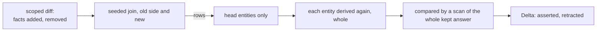

# Delta queries, and what dialog already does of them

Two readings of 2026-11-19, each by a thread of its own: the papers, fetched and quoted, and dialog's code at `144ddf8` on `wip/engine-fold`. Sources not read are listed at the end. Line numbers are of that revision; `sub.rs` is `rust/dialog-repository/src/repository/branch/subscription.rs`.

## What a delta query is

A body of n premises is kept current by n queries. Query i starts from the change of premise i and reads the others from the indexes, with no state between premises (Ammar, McSherry and others, VLDB 2018, §3.3.1; McSherry, "Delta-queries", 2016).

```
 dQ1 = ΔR1, R2,  R3          premises before the changed one are read new,
 dQ2 = R1', ΔR2, R3          premises after it old, in one fixed order (§4.3)
 dQ3 = R1', R2', ΔR3
```

| what the sources say | where | for dialog |
|---|---|---|
| no intermediate state; one index for each relation and direction, read at two versions | Ammar §3.3.1, §4.3; Materialize's `DeltaQuery` plan "maintains zero intermediate results" | the tree is that index, and any revision of it can be read |
| each query has its own order, starting from its seed | Ammar §3.3.2; McSherry 2021 | a plan for each premise a change can match |
| the rule counts derivations: weights multiply, a row with two derivations is +2 | McSherry's `half_join.rs`; `dogsdogsdogs` "Set semantics" | 🟡 dialog's rows are a set. Taking one derivation away must not retract the row |
| sets from counts need the count of every row kept | DBSP, Proposition 4.7 | state for every row of every rule that projects |
| or no counts: when a derivation goes, ask top-down whether another stands | Motik and others, AAAI 2015, the backward/forward algorithm | a query with everything bound. Stated there over a full materialization and without negation |
| `count` and `sum` take the change's weighted rows with no scan; others are folded again for the groups that changed | DBSP §7 | #837's hypothesis |
| state only for what is asked for | McSherry 2020-08-13; Noria | a state for each subscribed group |
| a delta plan is taken only when every index exists; a rule naming an attribute not there is refused | Materialize; 3DF `lib.rs` 916 | 🟡 nobody but Noria runs on partial input |
| Noria on partial state: a lookup that misses fetches; an update that meets missing state is dropped; no `min`, `max`; five kinds of race | Gjengset's thesis §3.1, §4.1, §4.5.2, §2.2.1 | dialog fetches on a miss already, and one poll reads one revision |
| negation: 3DF starts no delta from the negated side; DBSP needs `distinct` | `hector.rs`; DBSP §7.5 | not solved by any source read |
| the cost under deletions is open | Ammar, Theorem 3.2 and after | |

3DF stopped in January 2020.

## What dialog does today

| question | answer | where |
|---|---|---|
| a signed diff of facts between two revisions, costing the difference | yes: `differentiate_within` gives `Add` and `Remove` of entries, and `touched()` makes facts of them | `dialog-search-tree/src/tree.rs` 512, `differential.rs` 2203; `sub.rs` 1047-1100 |
| a value succeeded is a `Remove` | yes under every pick but `All`: the claim elected is retracted beside the new fact, its keys erased | `dialog-corpus/src/model/instruction.rs` 11-20, `tree.rs` 1829-1842 |
| a fact can stop holding with no `Remove` | 🟡 yes: under `Pick::All`, with a rule's derived candidates, and after two concurrent writes the loser stays and the election at read time demotes it. So what stopped holding needs the touched cell read | `dialog-query/src/concept/query.rs` 1375-1416; `dialog-corpus/src/model/update.rs` 82-87 |
| the diff restricted to what the query read | yes, already: each evaluation records its ranges in `Demand` and the diff is scoped to them | `sub.rs` 116-150, 1022, 1040 |
| on a partial replica | the scoped diff fetches the changed nodes inside those ranges and nothing else | `differential.rs` 113-171, 2243; `sub.rs` 977-983 |
| the old revision read | yes, whole: `Repository::snapshot`, `Branch::view`. Nothing is deleted; on a partial replica old nodes never read are fetched when read | `snapshot.rs` 224-271, 442 |
| old for some premises and new for others in one plan | 🟡 no: a plan runs against one `Scope` | `planner/conjunction.rs` 61-67 |
| the rest of a body asked with a changed fact's bindings | yes, inside: `sideways_heads` binds the fact into its premise, plans the body and evaluates it, once on the old side and once on the new. No public entry | `affected.rs` 520-672 |

So dialog already runs a delta query for a rule that joins through another entity. It keeps only the head entities of the rows found, derives each of those again whole, 16 at a time, and compares each with the kept answer by scanning all of it.



## What follows

- Dialog's shape is not the paper's rule and need not be. All premises old for what a removed fact supported, all new for what an added fact supports, gives candidates; a row is retracted if it no longer holds at the new revision and asserted if the kept answer lacks it. That is the backward/forward check and needs no counts. It is a hypothesis that this is complete, with `unless` the case to prove.
- For a join, the rows a change touches are the rows that changed, so deriving the head entities again costs a factor and not an order. What grows with the page is the scan of the kept answer for each entity, and a fold.
- The fold is where the order is lost, and what it needs is already at the subscription's edge: signed rows.
