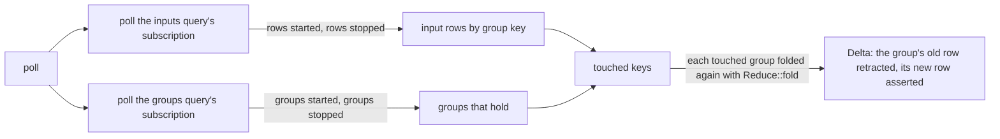

# What a subscription of a fold holds

**Decision:** what a subscription of the engine's `Fold` keeps between polls, and what one poll does.

**For:** a fold costs every group on one change: 138 ms for one tag among 1000 to-dos (`claims.md`). Direction is the maintainer's, 2026-11-19: build it, the design of views is not reopened.

| criterion \ approach | Status quo: ask the fold again | 1. The rows of each group, folded again by `Reduce::fold` | 2. A value for each group, changed by a step |
|---|---|---|---|
| one change costs | every row of every group, read again | the inner polls, and the touched group's rows folded in memory, no reads | the inner polls and a step |
| equals asking again | it is asking again | 🟢 by construction: the same `Reduce::fold` over the same rows, so a float sum is the same bits | 🟡 `count` and integer `sum` yes; a float sum no; `min` and `max` need the rows anyway |
| folds covered | all | all, one code path | `count`, integer `sum`, a set of values; the rest fall back to 1 |
| state | none | the input rows by group, a second copy of what the inner subscription keeps | a number or a count for each value |
| a group of a hundred thousand rows | the page | 🟡 the group, in memory, on each change to it | 🟢 a step |

**Decided, the agent's, to be overruled:** 1 first, with the test that it equals asking again. 2 is a later step for the folds it covers, behind the same test, when a group is large enough to measure. A view's groups are small: the tags of a to-do, the blocks of a notebook.

- The state is keyed by the group key of every input row, whether or not the group holds. A group that starts to hold finds its rows there; one with none is folded over inputs all absent, as `Fold::evaluate` does.
- Both inner subscriptions are polled at one revision, so a to-do added with its tags is one change.
- A group that stops holding is retracted and its rows stay in the state until their own retraction arrives.
- It is a subscription type of its own beside `Subscription`, with the same `poll` and `Delta`. `Branch::subscribe` of a `Fold` keeps asking again until this replaces it.

**Bars, written before it is built.** Line B8 of `examples/cost.rs`, a tag added among N to-dos, release build: confirmed if it grows less than 2 times from 100 to 10000 and is within 3 times the two inner subscriptions polled alone; refuted if it grows more than 5 times. And a property test: over random sequences of asserts and retracts, with an empty group, a group that appears after its inputs, a group that goes and comes back, and float inputs, the kept answer after each poll equals `select` of the same fold, compared exactly.
