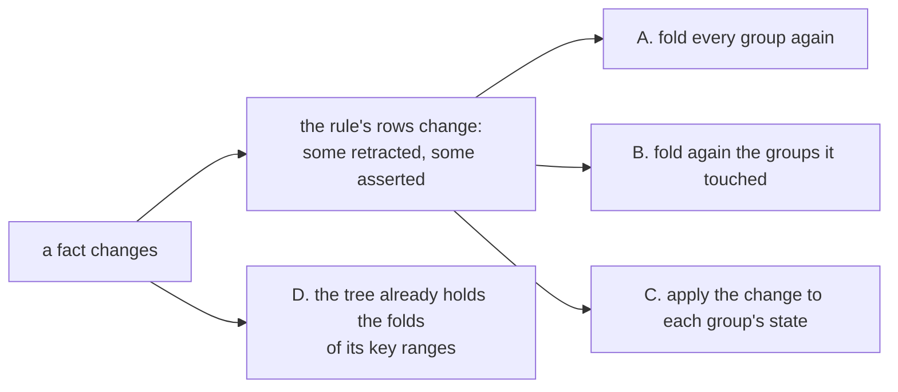

# How a folded value is kept current

**Decision:** what a subscription does when a fact changes under a rule
that folds.

**For:** the problem in [the topic](../fold-maintenance.md), once stated.
This is prior art laid out ahead of a problem statement, so the criteria
are provisional and nothing is chosen.

| criterion \ approach | A. Status quo: recompute on each poll | B. Recompute the groups a change touches | C. Fold the changes | D. Folds kept in the tree's nodes | E. Group rows after the query, outside the engine |
|---|---|---|---|---|---|
| after | the aggregation note, milestone A3 | differential dataflow's `reduce` (McSherry and others, CIDR 2013) | DBSP (Budiu and others, VLDB 2023): a change is a row with a weight, +1 or -1, and a linear fold of changes is the change of the fold. The counting algorithm (Gupta, Mumick, Subrahmanian, SIGMOD 1993) before it | CouchDB's views, which keep a reduction in each inner node of the B-tree and reduce again only along a changed path | dialog's JavaScript precursor; what `dialog-notation` did on #773 |
| one changed fact costs | ? every group, or the one it is in; not measured | the group's rows, read again | 🟢 the change: one addition for `count` and `sum` | the path written, which the write pays already | every row of the answer |
| the first read costs | the rows | the rows | the rows, once, to build the state | 🟢 a walk of the range's edge: no rows | the rows |
| state, and where | none | none | 🟡 a value for each group subscribed to, in the subscription. Noria (Gjengset and others, OSDI 2018) keeps state only for the keys someone reads | 🟡 in every node of the tree, for every reader | none |
| folds it covers | all | all | `count`, `sum`, `avg` in one step. `min`, `max` need the group's values kept in order, or one look at the index when the least is retracted. A set of values is a count for each value: it enters at 1 and leaves at 0, which is the patch a view wants | ? only a fold of a range of keys, and only an associative one | all |
| a retraction, or a value succeeded | free, it reads again | free | a row with weight -1. Needs the subscription to say what stopped holding as well as what started | the node is rewritten | free |
| rows a rule derived, not stored | as any rule | as any rule | as any rule, given their changes | 🔴 the tree holds stored facts only | as any rule |
| the stored or wire format | none | none | 🟢 none | 🔴 the node format | none |
| a fold over a fold | two strata, as now | ? | ? changes of the lower one feed the upper | no | no |

**What is known of dialog here, and what is not.** A subscription of a
concept already answers a change in time that does not grow with the page
(#773's baseline). Whether it reports what stopped holding as a row of its
own, which C needs, is not checked. Whether a group is ever a range of one
index, which D needs, is not checked.

**A hypothesis, the agent's.** C, held in the subscription: the precursor's
grouping of rows, done to the changes and not to the rows. It asks nothing
of storage, it gives a view the insert and the remove it would otherwise
have to work out, and a set of values costs no more than a count. Refuted
if dialog's subscription cannot say what stopped holding without reading
the group again, in which case B is what is left.
