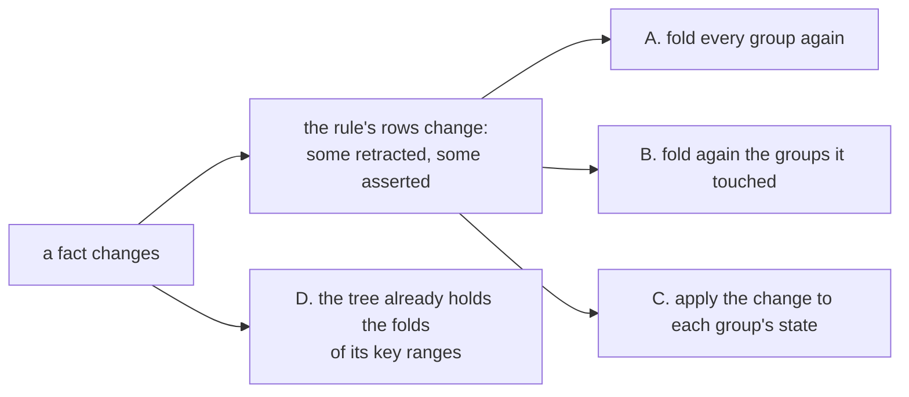
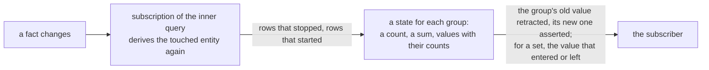

# How a folded value is kept current

**Decision:** what a subscription does when a fact changes under a rule
that folds.

**For:** the problem in [the topic](../fold-maintenance.md), once stated.
This is prior art laid out ahead of a problem statement, so the criteria
are provisional and nothing is chosen.

| criterion \ approach | A. Status quo: recompute on each poll | B. Recompute the groups a change touches | C. Fold the changes | D. Folds kept in the tree's nodes | E. Group rows after the query, outside the engine |
|---|---|---|---|---|---|
| after | the aggregation note, milestone A3 | differential dataflow's `reduce` (McSherry and others, CIDR 2013) | DBSP (Budiu and others, VLDB 2023): a change is a row with a weight, +1 or -1, and a linear fold of changes is the change of the fold. The counting algorithm (Gupta, Mumick, Subrahmanian, SIGMOD 1993) before it | CouchDB's views, which keep a reduction in each inner node of the B-tree and reduce again only along a changed path | dialog's JavaScript precursor; what `dialog-notation` did on #773 |
| one changed fact costs | ? every group, or the one it is in; not measured | the group's rows, read again | 🟢 the change: one addition for `count` and `sum` | the path written, which the write pays already | every row of the answer |
| the first read costs | the rows | the rows | the rows, once, to build the state | 🟢 a walk of the range's edge: no rows | the rows |
| state, and where | none | none | 🟡 a value for each group subscribed to, in the subscription. Noria (Gjengset and others, OSDI 2018) keeps state only for the keys someone reads | 🟡 in every node of the tree, for every reader | none |
| folds it covers | all | all | `count`, `sum`, `avg` in one step. `min`, `max` need the group's values kept in order, or one look at the index when the least is retracted. A set of values is a count for each value: it enters at 1 and leaves at 0, which is the patch a view wants | ? only a fold of a range of keys, and only an associative one | all |
| a retraction, or a value succeeded | free, it reads again | free | a row with weight -1. Needs the subscription to say what stopped holding as well as what started | the node is rewritten | free |
| rows a rule derived, not stored | as any rule | as any rule | as any rule, given their changes | 🔴 the tree holds stored facts only | as any rule |
| the stored or wire format | none | none | 🟢 none | 🔴 the node format | none |
| a fold over a fold | two strata, as now | ? | ? changes of the lower one feed the upper | no | no |

**What is known of dialog here** ([as built](subscriptions-as-built.md)).

- A poll returns a change: the rows that started holding and the rows that stopped (`Delta { asserted, retracted }`).
- A subscription keeps its whole last answer, and nothing for a rule, a premise or a group. It learns a row stopped holding by deriving the touched entity again and comparing.
- No change of a rule's rows, with a sign, exists inside the engine: what travels is the set of entities that may have gained or lost.
- A fold is evaluated over every group, at empty scope, even when one group is asked for; and a fold in reach makes a subscription ask again.
- One thing is kept across polls beside the answer today: the fixpoint of a recursive concept, held in the subscription.
- The tree holds stored facts, so D cannot fold rows a rule derived.

**A hypothesis, the agent's, refined by the reading.** C, built on what a subscription already gives. The engine has no signed rows inside it, but a subscription's poll is exactly that at its edge. So a folding query's subscription is:

1. a subscription of its inner query, kept current as any is, one touched entity at a time;
2. beside it, a state for each group, changed by what each poll of the inner one says stopped and started;
3. a poll of its own that reports the groups whose value moved.

It asks nothing new of the engine's maintenance and nothing of storage. The state is the second thing a subscription holds across polls, after the fixpoint. `min` and `max` need no ordered structure: the inner subscription already keeps the group's rows, so a retracted least is found again in memory. A set of values is a count for each value, and what it reports is the value that entered or left, which is the patch a view wants. One poll reads one revision, so several folds over one inner query move together, which is use case 5.

- **Confirmed if** one changed fact costs the inner subscription's poll and a step for each row in its change, at 10 groups' rows and at 1000: within 2 times a plain subscription of the inner query, and not growing.
- **Refuted if** the inner query's own maintenance grows with the page for the bodies views have (a join through another entity, a collection read), in which case the fold is not what costs; or if holding the inner answer for every subscriber is more memory than a page can afford.
- **What it leaves:** the first read still folds every row once; a fold of a fold feeds changes upward and is not worked out; the answer is scanned whole for each touched entity (`subscription.rs` 1312), which is nothing at a thousand rows and something at a hundred thousand.

**What the reading adds** ([literature.md](literature.md), read from the papers and docs, nothing measured here). Systems that fold changes sort a fold by what one retraction asks of it, and C is not one cost but three:

| fold | state for a group | one change costs | after |
|---|---|---|---|
| `count`, `sum` and `avg` of integers | a number or two | a step | linear in DBSP; accumulable in Materialize; Feldera's docs give space by groups and work by the change |
| a set of values, `count-distinct` | a count for each value in the group | a step; it reports only a value whose count crossed zero | DBSP's `distinct`; Feldera's docs give space by the input |
| `min`, `max` | 🟡 every value of the group, in order, or the group read again when the least is retracted | the logarithm of the group with the order kept, the group without | Gray and others, 1997: "holistic" under delete; Noria refuses them; Materialize keeps a tree of partial results |
| `sum` and `avg` of floats | 🟡 a number, but taking a value away is not the inverse of adding it | a step, with an answer that depends on the order changes arrived in | Feldera treats a float sum as not linear |
| anything else | none | the group, folded again (B) | differential dataflow's `reduce`; Skip's `remove` returning null |

Three things follow for the hypothesis above.

- It said a retracted least "is found again in memory". The answer a subscription keeps is a flat list, so finding a group's rows is a scan of the whole answer unless the state indexes rows by group. Corrected: `min` and `max` are B inside C, at the cost of the group, until someone needs better.
- 🟡 A float `sum` folded from changes can differ from one folded from the rows, and two replicas holding the same facts can then show different totals. dialog's `sum` adds floats in `f64` (`reduce.rs` 459-500). Either a float sum is folded again (B), or it is summed in a way that does not depend on order. Not decided.
- Every system that keeps a fold through recursion pays for it: delete too much and derive again (Gupta and others; Szabó and others for lattices), or state for each round (DBSP, differential dataflow). A query that no rule reads has no recursion through a fold, so none of that is needed here.

The reading found no system that keeps folds in the nodes of a content-addressed tree whose entries hold or not by cause, which is what D would be. GroveDB hashes a count into each node, over entries that are present or absent.

B is the fallback and needs less: let a fold be asked for one group when the restriction is on a field of the group's key, and derive that group again. It costs the group's rows on each change, which is what C saves.
