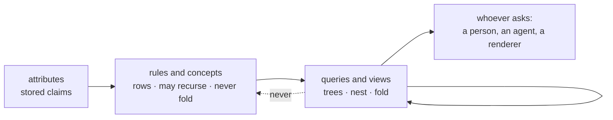

# A query nests, and a view is a query with a name

**Decision:** what reads a concept and shapes the answer: for a person asking, an agent, and a renderer. One thing, or several.

**For:** a notebook with no block is no `notebook` with a block (no entry, no row, decided 2026-11-18), and still whoever asks for a notebook expects its blocks, none included. A to-do with no tag keeps its `li`. A count of nothing is 0.

**Not decided.** A sketch to align on before anything is built. The frame is the maintainer's, by voice, 2026-11-18; the forms are the agent's proposal.

## Two layers



A rule's conclusion is read by other rules, so a fold in a head can feed itself. A query's answer is read by whoever asked and by a query above it, never by a rule, so it folds freely. That is the whole difference, and it is where the line already falls elsewhere:

| | rows | trees | folds |
|---|---|---|---|
| Datomic | `:where` clauses and rules | `pull`: attribute paths and nesting, no filter | in `:find` only, never in a clause or a rule |
| GraphQL | none; resolvers | selection sets, arguments on any field, fragments for reuse | none built in |
| EdgeQL | sets and paths | shapes, with `filter`, `order by`, `limit` at each level | `count(.link)` in a computed field |
| here | concepts and rules | a query in a query | a function of a query |

What they agree on, and what is taken:

- **The answer has the shape of the question.** So the template is the shape, and nothing about shape is inferred.
- **Nesting is written in place; a name is for reuse** (a fragment, a pull pattern held in a var). So a nested query is written where it stands, and a view is one with a name.
- **A nested part filters** in GraphQL and EdgeQL, and cannot in `pull`. So a nested query has conditions like any other.
- **Nothing for a part is not nothing for the whole.** `pull` leaves the key out and wants `:default`; GraphQL's schema says null or `[]`; EdgeQL gives the empty set. Here a nested query is its rows, and none is the empty list.

## The form

`query` and `view` are both in the design already, and the design says a view whose template is a record is a query. One step further:

```clj
(query template condition…)                ; asked in place
(view concept :name template condition…)   ; the same, named
(view concept :name of: ?e label: term…)   ; a named one, called
```

- A query's answer is its template filled once for each row of its conditions. No fold over an entity, no marker, nothing repeats but a query.
- With no template it is the design's question, and answers the bindings: `(query (todo ?t state: :open))`.
- Inside a template a query is a part of it. It sees the variables of the query round it, and stands for its rows: children in markup, a list in a record.
- Every condition of one query is required. What may be missing is a query of its own.
- A fold is a function of a query: `(count (query …))`.

## To-dos and their tags

```clj
(concept (todo ?t title: ?title)
  (xyz.todo/title of: ?t is: ?title as: :text cardinality: :one))

(concept (todo/tag ?t tag: ?g)
  (xyz.todo/tag of: ?t is: ?g as: :text cardinality: :many))
```

"Buy milk" is tagged `errand` and `home`. "Call mum" has no tag.

**One query: a to-do and a tag of it.** Both are required, so this is rows, as in Datomic.

```clj
(query {title: ?title tag: ?g}
  (todo ?t title: ?title)
  (todo/tag ?t tag: ?g))
```
```clj
[{title: "Buy milk" tag: "errand"}
 {title: "Buy milk" tag: "home"}]
```

**Nested: a to-do with its tags.**

```clj
(query {title: ?title
        tags: (query ?g (todo/tag ?t tag: ?g))}
  (todo ?t title: ?title))
```
```clj
[{title: "Buy milk" tags: ["errand" "home"]}
 {title: "Call mum" tags: []}]
```

**Folded: a to-do with how many.**

```clj
(query {title: ?title
        tags: (count (query ?g (todo/tag ?t tag: ?g)))}
  (todo ?t title: ?title))
```
```clj
[{title: "Buy milk" tags: 2}
 {title: "Call mum" tags: 0}]
```

**Rendered: the same query with markup for a template.**

```clj
(view todo :row
  [:li ?title
    (query [:span {:class "tag"} ?g]
      (todo/tag ?t tag: ?g))]
  (todo ?t title: ?title))
```
```html
<li>Buy milk<span class="tag">errand</span><span class="tag">home</span></li>
<li>Call mum</li>
```

With the tag's condition moved out beside the to-do's, "Call mum" has no `li`. The view says which it wants.

**Named, for reuse.** The nested part as a view, and the call passing the parent:

```clj
(view todo/tag :chip
  [:span {:class "tag"} ?g]
  (todo/tag ?t tag: ?g))

(view todo :row
  [:li ?title (view todo/tag :chip of: ?t)]
  (todo ?t title: ?title))
```

## A notebook and its blocks

```clj
(query {title: ?title
        blocks: (query {at: ?k source: ?s}
                  (notebook/blocks ?n at: ?k block: ?b)
                  (notebook/block ?b source: ?s))}
  (notebook/named ?n title: ?title))
```
```clj
[{title: "Field notes"
  blocks: [{at: "N1" source: "# Monday"}
           {at: "N2" source: "Rained."}]}
 {title: "Untitled" blocks: []}]
```

The blocks stand in the order of their positions, since the collection is `by: :position`. A block with no source is left out of the list, its two conditions being one query; a third level would keep it.

The design's own card, restated. `list/count-open` was a rule concluding a fold, and an empty list had no count unless a second rule wrote the zero:

```clj
(view list :card
  [:article
    [:h2 ?name]
    [:p (count (query ?t (todo ?t list: ?l state: :open))) " open"]
    [:ul (view todo :row list: ?l)]]
  (list ?l name: ?name))
```

## What it replaces

| was | becomes |
|---|---|
| the design's fold: an element repeats for each combination of the many-valued variables it holds | a query repeats, and nothing else does |
| tonk's rule, taken this morning: a marker attribute on the repeating element, a many-valued field cloned where it is shown | the same. It is the third answer to "where does it repeat" today, and the first that infers nothing |
| a fold in a rule's head, into a concept's domain (`list/count-open`), and the zero written by a second rule | `(count (query …))`, where 0 is what counting nothing gives. Nothing in the engine quarantines a fold (#830) |
| a getter | a query. Nothing a separate notion would do |
| #712: a collection that is empty | the row is rightly missing; the collection as a whole is a nested query, and empty |
| `maybe:`, which the notation has no spelling for (it occurs 25 times in tonk's library) | a nested query of none or one |

## What would refute it

- **A rule that must read a fold.** "Archive a list when nothing on it is open" reads as a count and is an `unless`. tonk's library has no fold in any rule; where it counts, an element's script does, which is a consumer. One rule that needs a number folded from rows, and the line between the layers is in the wrong place.
- **A view too broken up to read.** Every part that may be missing or many is a query of its own. `notebook :ui` restated this way has one nested query; if a real view needs four deep, the inferred rule was earning its keep.
- **Readers.** `(query template condition…)` against `(query condition…)`, and a query inside a template, have met no reader.

## Open

- **A fold with nothing to give.** `count` and `sum` of nothing are 0. `max`, or the one value of a nested query of none or one, has none. `pull` leaves the key out. Proposed: the same, the field is left out, and an optional field read as one value is `(one (query …))`.
- **Rows or distinct answers.** A template that shows less than its conditions bind is filled the same way twice. Datomic answers a set and has `:with` for when a count must not merge them.
- **A list or a map.** Proposed: always a list, in the collection's order where there is one. A map keyed by a variable would be a template of its own, `{?k ?s}`, and is not proposed.
- **Order and limit**, which `pull` (1000 by default), GraphQL and EdgeQL all had to answer. #77.
- **A view that calls itself**: a thread, an outline. `pull` allows it, with a depth, and stops at an entity it has already met.
- **What tells one row from another** when the answer is maintained. A to-do renamed is one text set, not an `li` removed and one added, so a row is known by what its conditions bind that is not a one-valued field. A hypothesis, from the prototype.
- **Whether a concept is needed at all**, the maintainer's question. A condition may be a line, so a view can read one attribute with no concept declared for it; a concept is then the short name of some lines and the unit of a write. The design's first sentence on concepts says as much.
- **What `(view concept :name …)` names.** An address a renderer looks up for an entity, not something the concept owns.
