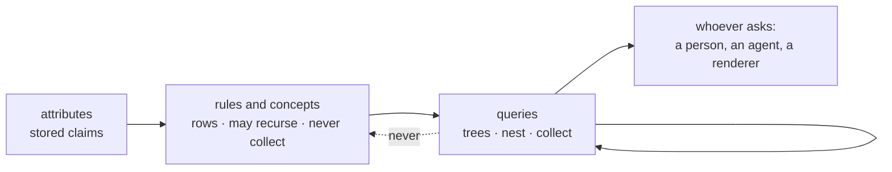

# A query: a head like a concept's, and a body that may collect

**Decision:** what reads a concept and shapes the answer: for a person asking, an agent, and a renderer. One thing, or several.

**For:** a notebook with no block is no `notebook` with a block (no entry, no row, decided 2026-11-18), and still whoever asks for a notebook expects its blocks, none included. A to-do with no tag keeps its `li`. A count of nothing is 0.

**Not decided.** A sketch to align on before anything is built. The frame and the form are the maintainer's, by voice, 2026-11-18. One thing in it does not yet do what it is for, and the fix proposed is the agent's: see "Where a collection gets its rows".

## Two layers



A rule's conclusion is read by other rules, so a fold in a head can feed itself. A query's answer is read by whoever asked and by a query above it, never by a rule, so it collects freely. Datomic draws the same line: an aggregate stands in `:find` only, never in a clause or a rule, and a tree comes from `pull`.

## The form

```clj
(query (todo/tags ?t is: ?tags)        ; the head: a name, an entity, fields, and what it answers
  (todo/tag ?t tag: ?g)                ; the body: conditions
  (is ?tags [?g]))                     ; and what the answer is
```

- **The head** is a concept's head. `is:` is the field that holds the answer. A field passed bound is a parameter, as with any relation; there is no list of them.
- **The body** is conditions, and `(is ?x shape)`, which says what a variable is. A shape is a record, a list `[…]`, a fold `(count ?g)`, or a term.
- **A call** is the head applied, a condition like any other: `(todo/tags ?t is: ?tags)`.
- **A view** is a query whose answer is markup, said by `(view ?x template)` where `is` would stand.
- `is` over rows and `view` are refused in a `rule`, and a rule cannot apply a query.

It is named under its concept, as the design's derived attributes are (`list/count-open`), and it has their shape: an entity and a value. So what was a getter is a query, and "everything derived about a list is found under `list/`" still holds.

## To-dos and their tags

```clj
(concept (todo ?t title: ?title)
  (xyz.todo/title of: ?t is: ?title as: :text cardinality: :one))

(concept (todo/tag ?t tag: ?g)
  (xyz.todo/tag of: ?t is: ?g as: :text cardinality: :many))
```

"Buy milk" is tagged `errand` and `home`. "Call mum" has no tag.

**Everything in one body is required.**

```clj
(query (todo/tagged ?t is: ?pair)
  (todo ?t title: ?title)
  (todo/tag ?t tag: ?g)
  (is ?pair {title: ?title tag: ?g}))
```

| `?t` | `?pair` |
|---|---|
| Buy milk | `{title: "Buy milk" tag: "errand"}` |
| Buy milk | `{title: "Buy milk" tag: "home"}` |

## Where a collection gets its rows

As agreed by voice, the tags of a to-do and a card that uses them:

```clj
(query (todo/tags ?t is: ?tags)
  (todo/tag ?t tag: ?g)
  (is ?tags [?g]))

(query (todo/card ?t is: ?card)
  (todo ?t title: ?title)
  (todo/tags ?t is: ?tags)
  (is ?card {title: ?title tags: ?tags}))
```

| `?t` | `?card` |
|---|---|
| Buy milk | `{title: "Buy milk" tags: ["errand" "home"]}` |

**"Call mum" has no card.** `(todo/tag ?t tag: ?g)` is a condition of `todo/tags`, it has no row for "Call mum", so there is nothing to collect from and no `?tags`; and `(todo/tags ?t is: ?tags)` is a condition of the card. This is the design's own rule for a fold ("a fold sees only the rows that exist", as in Datalog and Datomic, where a count over nothing answers nothing, not 0), and the maintainer's from today: what is written as one query needs all of it. It is also the case the whole exercise was for.

Three ways to get the empty list:

| | A. a call with its inputs bound always answers | B. the collection carries its conditions | C. conditions that only feed the collection are set apart |
|---|---|---|---|
| written | as above, nothing more | `(is ?tags [?g] (todo/tag ?t tag: ?g))` | as above, nothing more |
| the rule | a query whose answer is a collection or a fold answers once for the inputs it is given, with none an empty one, as SQL's aggregate with no `GROUP BY` | `is` with conditions of its own collects over their rows, none included. The body's other conditions are required | the engine works out which conditions the collected variables depend on |
| says what it needs in how it is written | 🟡 by where the query's boundary is: each part that may be empty is a query with a name | 🟢 in place: required conditions in the body, collected ones in the clause | 🔴 inferred, which the maintainer set aside today |
| one meaning however it is asked | 🟡 `todo/tags` holds "Call mum → []" when asked of "Call mum" and not when asked of every to-do | 🟢 the same rows either way | 🟢 |
| prior art | SQL's scalar subquery | EdgeQL's nested shape with its own `filter`; GraphQL's field with arguments | none known |

**Proposed: B.** It is the maintainer's "nested or through aggregation, and then empty is fine" with the two said in one place. A names nothing new and makes every optional part a named query, and what it answers turns on how it is called.

```clj
(query (todo/card ?t is: ?card)
  (todo ?t title: ?title)
  (is ?tags [?g] (todo/tag ?t tag: ?g))
  (is ?card {title: ?title tags: ?tags}))
```

| `?t` | `?card` |
|---|---|
| Buy milk | `{title: "Buy milk" tags: ["errand" "home"]}` |
| Call mum | `{title: "Call mum" tags: []}` |

Named, for reuse, the collection is the whole body, and nothing in it binds `?t`, so `?t` is what the caller gives:

```clj
(query (todo/tags ?t is: ?tags)
  (is ?tags [?g] (todo/tag ?t tag: ?g)))

(query (todo/card ?t is: ?card)
  (todo ?t title: ?title)
  (todo/tags ?t is: ?tags)
  (is ?card {title: ?title tags: ?tags}))
```

That answers which fields are parameters without a list of them: a head field the body does not bind is one, and asking with it open is refused.

**A fold** is the same clause: `(is ?n (count ?g) (todo/tag ?t tag: ?g))` is 2 for "Buy milk" and 0 for "Call mum".

## Rendered

```clj
(query (todo/row ?t is: ?row)
  (todo ?t title: ?title)
  (view ?chips [:span {:class "tag"} ?g] (todo/tag ?t tag: ?g))
  (view ?row [:li ?title ?chips]))
```
```html
<li>Buy milk<span class="tag">errand</span><span class="tag">home</span></li>
<li>Call mum</li>
```

`view` with conditions of its own is the template once for each of their rows, and stands as children where its variable is put. Move `(todo/tag ?t tag: ?g)` into the body and "Call mum" has no `li`.

## A notebook and its blocks

```clj
(query (notebook/outline ?n is: ?outline)
  (notebook/named ?n title: ?title)
  (is ?blocks [{at: ?k source: ?s}]
    (notebook/blocks ?n at: ?k block: ?b)
    (notebook/block ?b source: ?s))
  (is ?outline {title: ?title blocks: ?blocks}))
```

| `?n` | `?outline` |
|---|---|
| Field notes | `{title: "Field notes" blocks: [{at: "N1" source: "# Monday"} {at: "N2" source: "Rained."}]}` |
| Untitled | `{title: "Untitled" blocks: []}` |

The design's own card. `list/count-open` was a rule concluding a fold, and an empty list had no count unless a second rule wrote the zero:

```clj
(query (list/card ?l is: ?card)
  (list ?l name: ?name)
  (is ?open (count ?t) (todo ?t list: ?l state: :open))
  (is ?rows [?row] (todo ?t list: ?l) (todo/row ?t is: ?row))
  (view ?card
    [:article
      [:h2 ?name]
      [:p ?open " open"]
      [:ul ?rows]]))
```

## What it replaces

| was | becomes |
|---|---|
| `(view concept :name template condition…)` and its call | a query named under the concept, `todo/row`, whose answer is markup, and its head applied |
| the design's fold over an entity, and tonk's marker, taken this morning | `is` or `view` with conditions of its own collects, and nothing else repeats. The third answer today to "where does it repeat", and the first that infers nothing |
| a fold in a rule's head (`list/count-open`), and the zero written by a second rule | `(is ?open (count ?t) …)`, where counting nothing gives 0. Nothing in the engine quarantines a fold (#830) |
| a getter | a query of an entity and a value |
| #712: a collection that is empty | the row is rightly missing; the collection as a whole is collected, and empty |
| `maybe:`, which the notation has no spelling for (it occurs 25 times in tonk's library) | a collection of none or one |

## What would refute it

- **A rule that must read a fold.** "Archive a list when nothing on it is open" is an `unless`, not a count. tonk's library has no fold in any rule; where it counts, an element's script does. One rule that needs a number folded from rows, and the line between the layers is in the wrong place.
- **A real view that reads worse.** `notebook :ui` and the table's views restated, not done yet.
- **Readers.** None of it has met one.

## Open

- **`query` is already the design's word for asking**, `(query (todo ?t state: :open))`, the maintainer's choice after R24 and R25. With a head and a body under the same word, `(query (a ?x) (b ?x))` reads both ways. In those rounds `find`, `select` and `(? …)` read as well as `query` for asking. Proposed: `query` names what is defined, a noun beside `concept` and `rule`, and asking is `find`.
- **`is` marks many with brackets, `view` with nothing.** `(is ?x ?g conditions…)` with no brackets and no fold is one value from many rows, and is refused. A `view` with conditions is always many. Hiccup's vector is an element, so brackets cannot mean a list there.
- **A fold with nothing to give.** `count` and `sum` of nothing are 0. `max`, or the one value of a collection of none or one, has none. `pull` leaves the key out. Proposed: the same.
- **Order and limit**, which `pull` (1000 by default), GraphQL and EdgeQL all had to answer. A collection over a `by: :position` read stands in that order. #77.
- **Rows or distinct answers** in a collection. Datomic answers a set and has `:with` for when a count must not merge them.
- **A query that calls itself**: a thread, an outline. `pull` allows it, with a depth, and stops at an entity it has already met.
- **How a renderer finds the view** for an entity, now that a view is a query's name. Proposed: the name under the concept, `todo/row` for `:row` of a `todo`.
- **Whether the engine carries a list or markup as a binding** through a body. Records are values since #778; not checked for this.
- **What tells one row from another** when the answer is maintained, so a to-do renamed is one text set. A hypothesis from the prototype: what its conditions bind that is not a one-valued field.
- **Whether a concept is needed at all**, the maintainer's question. A condition may be a line, so a query can read one attribute with no concept declared for it.

## Prior art

| | rows | trees | folds |
|---|---|---|---|
| Datomic | `:where` clauses and rules | `pull`: attribute paths and nesting, no filter; a missing attribute's key is left out | in `:find` only |
| GraphQL | none; resolvers | selection sets, arguments on any field, fragments for reuse | none built in |
| EdgeQL | sets and paths | shapes, with `filter`, `order by`, `limit` at each level; nothing is the empty set | `count(.link)` in a computed field |
| here | concepts and rules | a record or markup built in a query's body | `is` over conditions |
