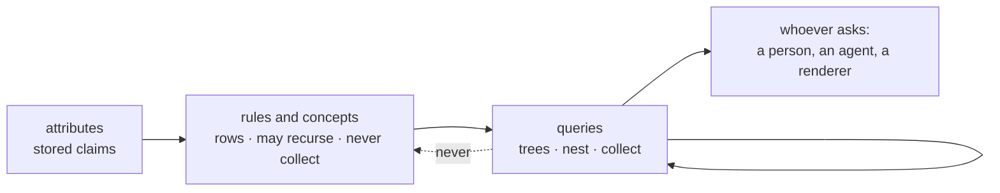

# A query: rows in, a tree out

**Decision:** what reads a concept and shapes the answer: for a person asking, an agent, and a renderer. One thing, or several.

**For:** a notebook with no block is no `notebook` with a block (no entry, no row, decided 2026-11-18), and still whoever asks for a notebook expects its blocks, none included. A to-do with no tag keeps its `li`. A count of nothing is 0.

**Not decided.** A sketch to align on before anything is built. The frame, the form, the entry as one field and the spread are the maintainer's, by voice, 2026-11-18. How each got here is in the [journal](journal.md).

## Two layers



A rule's conclusion is read by other rules, so a fold in a head can feed itself. A query's answer is read by whoever asked and by a query above it, never by a rule, so it collects freely. Datomic draws the same line: an aggregate stands in `:find` only, and a tree comes from `pull`.

Folds in rules, stratified, as Datalogs with aggregates have them, would let a rule read a count. Stratifying is a check over a whole program, and dialog has none: rules arrive from peers, and one installed later can close a cycle through a fold that was sound when it was checked. So not until a rule needs one that `unless` cannot say.

## The form

```clj
(query (todo/tagged ?t is: ?pair)       ; the head: a name, an entity, fields, and what it answers
  (todo ?t title: ?title)               ; the body: conditions
  (todo/tag ?t tag: ?g)
  (is ?pair {:title ?title :tag ?g}))   ; and what the answer is
```

- **The head** is a concept's head. `is:` is the field that holds the answer. A field passed bound is a parameter, as with any relation.
- **The body** is conditions, and `(is ?x shape)`, which says what a variable is: a record, a function of other variables, or a term. `(view ?x template)` says it is markup.
- **A call** is the head applied, a condition like any other: `(todo/tagged ?t is: ?pair)`.
- **Asking** is `select`: `(select (todo/tagged ?t is: ?pair))`, or of a concept, `(select (todo ?t title: ?title))`. `query` names what is defined, beside `concept` and `rule`.
- Every condition is required: one row for each way all of them hold.

It is named under its concept, as the design's derived attributes are (`list/count-open`), and has their shape. So what was a getter is a query.

## One at a time, or the whole

A field that holds many says so on its line. In a head it is one of them, and for a keyed collection one is an entry, a key and its value:

```clj
(concept (todo/tag ?t tag: ?g)
  (xyz.todo/tag of: ?t is: ?g as: :text cardinality: :many))

(concept (notebook/blocks ?n block: {?k ?b})
  (xyz.tonk.notebook/?k of: ?n is: ?b as: :entity cardinality: :many by: :position))
```

| | one at a time: a row for each, and no row for none | the whole: one row, and empty for none |
|---|---|---|
| many values | `(todo/tag ?t tag: ?g)` | `(todo/tag ?t tag: (collect ?tags))`, a set: a map with no names |
| a keyed collection | `(notebook/blocks ?n block: {?k ?b})` | `(notebook/blocks ?n block: (collect ?blocks))`, a map |

- `collect` stands where an elector does. `(top ?s)` chooses one of a field's claims; `(collect ?s)` takes every one.
- Key and value are paired because they were never apart: an entry is one term.
- What comes out is a map either way. A keyed collection's has its keys. Many plain values have none, and a map with no names is a set: `{: "errand" : "home"}`, stored in a record as a list. No list as such: many values have no order, and a sequence's order is in its keys.
- A pattern takes one value apart; `collect` puts many rows together. `{…}` and `[…]` in a condition are always the first.
- **A read of the whole never gates**, as `unless` never binds. So every other term in it is bound by a required condition, a constant, or blank. A query of an entity that only collects is refused: nothing would say which entities. A query of no entity that only collects answers once, and that is an index.
- It is a fold, so it is refused in a `rule`.
- A write goes through one entry: `(assert (notebook/blocks ?n block: {"N3" block:x}))`. The whole is not written.

## To-dos and their tags

"Buy milk" is tagged `errand` and `home`. "Call mum" has no tag.

**All required**, `todo/tagged` above:

| `?t` | `?pair` |
|---|---|
| Buy milk | `{:title "Buy milk" :tag "errand"}` |
| Buy milk | `{:title "Buy milk" :tag "home"}` |

**The whole:**

```clj
(query (todo/card ?t is: ?card)
  (todo ?t title: ?title)
  (todo/tag ?t tag: (collect ?tags))
  (is ?card {:title ?title :tags ?tags}))
```

| `?t` | `?card` |
|---|---|
| Buy milk | `{:title "Buy milk" :tags {: "errand" : "home"}}` |
| Call mum | `{:title "Call mum" :tags {}}` |

**Folded:** `tags: (count ?tags)` is 2 and 0. A fold is a function of what was collected.

**Rendered.** A chip is built from a tag, so it is a query of its own, passed the to-do, and the row takes all its answers:

```clj
(query (todo/chip ?t tag: ?g is: ?chip)
  (todo/tag ?t tag: ?g)
  (view ?chip [:span {:class "tag"} ?g]))

(query (todo/row ?t list: ?l is: ?row)
  (todo ?t list: ?l title: ?title)
  (todo/chip ?t is: (collect ?chips))
  (view ?row [:li ?title ?chips]))
```
```html
<li>Buy milk<span class="tag">errand</span><span class="tag">home</span></li>
<li>Call mum</li>
```

Written `(todo/chip ?t is: ?chip)`, one at a time, "Call mum" has no `li`.

## A notebook and its blocks

```clj
(query (notebook/outline ?n is: ?outline)
  (notebook/named ?n title: ?title)
  (notebook/blocks ?n block: (collect ?blocks))
  (is ?outline {:title ?title :blocks ?blocks}))
```

| `?n` | `?outline` |
|---|---|
| Field notes | `{:title "Field notes" :blocks {"N1" block:a "N2" block:b}}` |
| Untitled | `{:title "Untitled" :blocks {}}` |

With each block's source, which is a join for each entry. The item is a query whose answer is an entry, and its whole is a map again:

```clj
(query (notebook/source ?n is: {?k ?s})
  (notebook/blocks ?n block: {?k ?b})
  (notebook/block ?b source: ?s))

(query (notebook/outline ?n is: ?outline)
  (notebook/named ?n title: ?title)
  (notebook/source ?n is: (collect ?sources))
  (is ?outline {:title ?title :blocks ?sources}))
```

| `?n` | `?outline` |
|---|---|
| Field notes | `{:title "Field notes" :blocks {"N1" "# Monday" "N2" "Rained."}}` |
| Untitled | `{:title "Untitled" :blocks {}}` |

**The page.** Markup under keys stands in the order of the keys:

```clj
(query (notebook/order-item ?n is: {?k ?item})
  (notebook/blocks ?n block: {?k ?b})
  (view ?item [:span {:class "notebook-order__item" :data-block ?b :data-key ?k}]))

(query (notebook/block-row ?b notebook: ?n is: ?row)
  (notebook/block ?b notebook: ?n source: ?s)
  (view ?row [:div {:class "notebook-block-row"
                    :subject ?b :data-block ?b :data-notebook ?n :data-source ?s}]))

(query (notebook/ui ?n is: ?ui)
  (notebook/named ?n title: ?title)
  (notebook/order-item ?n is: (collect ?order))
  (notebook/block-row _ notebook: ?n is: (collect ?rows))
  (view ?ui
    [:notebook-save {:style "display: block;"}
      [:tonk-notebook {:data-subject ?n :data-notebook ?n :title ?title
                       ; the four :on/ bindings, as before
                       :style "display: block;"}
        [:div {:class "notebook-data" :hidden true}
          [:div {:class "notebook-order"} ?order]
          [:div {:class "notebook-block-rows"} ?rows]]]]))
```

Two views this morning, three queries now, and a notebook with no block shows its whole page, where the marker form showed its outer element only. The order's items stand by position; the rows are a set, which is all tonk's hidden rows need.

## The table's views, and an index

This morning's six views are six queries. Four are a row each, like this one, and the page collects them:

```clj
(query (table/sheet-row ?s is: ?row)
  (table/sheet ?s table: ?table name: ?name order: ?order)
  (view ?row [:div {:class "table-sheet-row"
                    :subject ?s :data-table ?table :data-name ?name :data-order ?order}]))

(query (table/ui ?t is: ?ui)
  (table ?t name: ?name)
  (table/sheet-row _ is: (collect ?sheets))
  (table/cell-row _ is: (collect ?cells))
  (table/column-row _ is: (collect ?columns))
  (table/rowsize-row _ is: (collect ?sizes))
  (view ?ui
    [:tonk-table {:subject ?t
                  ; the nine :on/ bindings, as before
                  }
      [:div {:hidden true}
        [:div {:class "table-sheet-rows"} ?sheets]
        [:div {:class "table-cell-rows"} ?cells]
        [:div {:class "table-column-rows"} ?columns]
        [:div {:class "table-rowsize-rows"} ?sizes]]]))
```

The directory has no entity in its head, as a command's concept has none. It answers once, and stands empty when there is no table:

```clj
(query (table/directory is: ?directory)
  (table/ui _ is: (collect ?tables))
  (view ?directory [:div {:class "table-directory"} ?tables]))
```

This was the one view of eleven that repeated the wrong element under the marker rule: tonk's YAML keeps the outer `div` and repeats the display inside it, which is what this says. It is also the morning's question of what renders when there is no notebook.

## A word, not the spread

**The maintainer's: not `{... ?x}`.** It does not say whether it takes a value apart or puts rows together, and those are different things.

| | a word: `(collect ?blocks)` | the spread: `{... ?blocks}` |
|---|---|---|
| says which it is | 🟢 only ever puts together | 🔴 a pattern's rest, which takes apart; here it would put together |
| says it does not gate | 🟢 by a word an error can name | by what a rest is |
| says what comes out | a map: with its keys or with none, by the field | a map, by the braces |
| already in the notation | no; it sits where an elector does | yes, as destructuring |

`collect` was set aside an hour before on two counts, and both are since answered. It seemed to promise a list: it makes a map, always. A dictionary had no way to say how key and value pair: an entry is one term.

**Reopened by the maintainer the same evening:** a spelling of the variable in place of the word.

| | reads today as | a neighbour one space away |
|---|---|---|
| `?x...` | a variable named `x...`, with no error | `?x ...`, the open application, three times in `todo.clj` |
| `...?x` | an error: "`...` stands apart from what follows it" | `... ?x`, the rest |
| `?..x` | a variable named `..x`, with no error | none |
| `{?..x}` | a struct that ends on a key, which gets a blank value | none; and under `{?k ?b}` it is an entry with any value |

Of the four, `?..x`. Against `(collect ?x)` it is shorter and adds no form; the word explains itself, sits with the electors, and is what an error would say anyway.

**Decided 2026-11-18, by the maintainer: `(collect ?x)`.**

## What it replaces

| was | becomes |
|---|---|
| `(view concept :name template condition…)` and its call | a query named under the concept, `todo/row`, whose answer is markup, and its head applied |
| a collection as two head fields, `at: ?k block: ?b` | one field holding an entry, `block: {?k ?b}`. The line is as it was; R46 tested the line |
| the design's fold over an entity, and tonk's marker, taken this morning | a read that collects, and nothing else repeats |
| a fold in a rule's head (`list/count-open`), and the zero written by a second rule | `(count ?open)` of a set, where counting nothing gives 0. Nothing in the engine quarantines a fold (#830) |
| a getter | a query of an entity and a value |
| #712: a collection that is empty | one at a time, the row is rightly missing; the whole is `{}`, which is what #712 expected of it |
| `maybe:`, which the notation has no spelling for (it occurs 25 times in tonk's library) | the whole of a field, none or one |

## What would refute it

- **A rule that must read a fold.** tonk's library has no fold in any rule; where it counts, an element's script does.
- **A real view that reads worse.** Every repeated part built from more than one field is a query with a name. The notebook's page is three queries for two views; the table's are six for six. Neither is run.
- **Readers.** None of it has met one: not the head with `is:`, not `{?k ?b}`, not `collect` on a field.

## Open

- **A set merges equal answers.** Two to-dos with one title are one title in a set. Count entities, not what is shown of them.
- **A fold with nothing to give.** `count` and `sum` of nothing are 0; `max` has none. `pull` leaves the key out. Proposed: the same.
- **Limit.** `pull` stops at 1000 unless told. #77.
- **A query that calls itself**: a thread, an outline. `pull` allows it, with a depth, and stops at an entity it has met.
- **How a renderer finds the view** for an entity. Proposed: the name under the concept, `todo/row` for `:row` of a `todo`.
- **Whether the engine carries a map, a set or markup as a binding** through a body. Records are values since #778; not checked for this.
- **What tells one row from another** when the answer is maintained, so a to-do renamed is one text set.
- **Whether a concept is needed at all**, the maintainer's question. A condition may be a line.

## Prior art

| | rows | trees | folds |
|---|---|---|---|
| Datomic | `:where` clauses and rules | `pull`: attribute paths and nesting, no filter; a missing attribute's key is left out | in `:find` only; over nothing, no row |
| GraphQL | none; resolvers | selection sets, arguments on any field, fragments for reuse | none built in |
| EdgeQL | sets and paths | shapes, with `filter`, `order by`, `limit` at each level; nothing is the empty set | `count(.link)` in a computed field |
| here | concepts and rules | a record or markup built in a query's body | the whole of a field, and functions of it |
