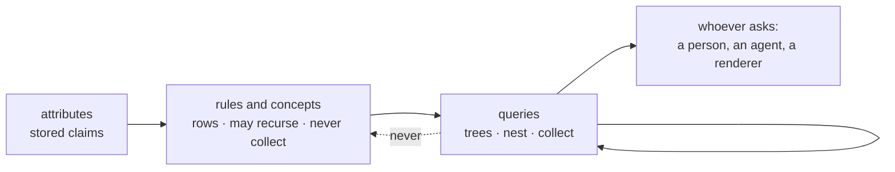

# A query: a head like a concept's, and a body that may collect

**Decision:** what reads a concept and shapes the answer: for a person asking, an agent, and a renderer. One thing, or several.

**For:** a notebook with no block is no `notebook` with a block (no entry, no row, decided 2026-11-18), and still whoever asks for a notebook expects its blocks, none included. A to-do with no tag keeps its `li`. A count of nothing is 0.

**Not decided.** A sketch to align on before anything is built. The frame and the form are the maintainer's, by voice, 2026-11-18. One thing in it does not yet do what it is for, and the fix proposed is the agent's: see "Where a collection gets its rows".

## Two layers



A rule's conclusion is read by other rules, so a fold in a head can feed itself. A query's answer is read by whoever asked and by a query above it, never by a rule, so it collects freely. Datomic draws the same line: an aggregate stands in `:find` only, never in a clause or a rule, and a tree comes from `pull`.

## The form

```clj
(query (todo/tagged ?t is: ?pair)       ; the head: a name, an entity, fields, and what it answers
  (todo ?t title: ?title)               ; the body: conditions
  (todo/tag ?t tag: ?g)
  (is ?pair {title: ?title tag: ?g}))   ; and what the answer is
```

- **The head** is a concept's head. `is:` is the field that holds the answer. A field passed bound is a parameter, as with any relation; there is no list of them.
- **The body** is conditions, and `(is ?x shape)`, which says what a variable is: a record, a list, a function of other variables, or a term.
- **A call** is the head applied, a condition like any other: `(todo/tags ?t is: ?tags)`.
- **A view** is a query whose answer is markup, said by `(view ?x template)` where `is` would stand.
- A read that collects (below) and `view` are refused in a `rule`, and a rule cannot apply a query.

It is named under its concept, as the design's derived attributes are (`list/count-open`), and it has their shape: an entity and a value. So what was a getter is a query, and "everything derived about a list is found under `list/`" still holds.

## To-dos and their tags

```clj
(concept (todo ?t title: ?title)
  (xyz.todo/title of: ?t is: ?title as: :text cardinality: :one))

(concept (todo/tag ?t tag: ?g)
  (xyz.todo/tag of: ?t is: ?g as: :text cardinality: :many))
```

"Buy milk" is tagged `errand` and `home`. "Call mum" has no tag.

**Everything in one body is required.** `todo/tagged`, above, answers:

| `?t` | `?pair` |
|---|---|
| Buy milk | `{title: "Buy milk" tag: "errand"}` |
| Buy milk | `{title: "Buy milk" tag: "home"}` |

## Where a collection gets its rows

As first agreed by voice, the tags of a to-do and a card that uses them:

```clj
(query (todo/tags ?t is: ?tags)
  (todo/tag ?t tag: ?g)
  (is ?tags [?g]))

(query (todo/card ?t is: ?card)
  (todo ?t title: ?title)
  (todo/tags ?t is: ?tags)
  (is ?card {title: ?title tags: ?tags}))
```

**"Call mum" has no card.** `(todo/tag ?t tag: ?g)` is a condition of `todo/tags` and has no row for "Call mum", so there is nothing to collect from; and the call is a condition of the card. This is the design's own rule for a fold ("a fold sees only the rows that exist", as in Datalog and Datomic, where a count over nothing answers nothing) and the maintainer's from today: what is written as one query needs all of it.

Four ways to get the empty list:

| | A. a call with its inputs bound always answers | B. the collection carries its conditions | C. the engine sets apart what only feeds the collection | D. the read says it collects |
|---|---|---|---|---|
| written | as above | `(is ?tags [?g] (todo/tag ?t tag: ?g))` | as above | `(todo/tag ?t tag: (collect ?tags))` |
| whose | the agent's | the agent's | the agent's, withdrawn | the maintainer's, as `tag: [?g]` |
| says what it needs in how it is written | 🟡 by where a query's boundary is | 🟢 in place | 🔴 inferred | 🟢 in place, on the read itself |
| one meaning however it is asked | 🟡 "Call mum → []" is there when asked of "Call mum" and not when asked of every to-do | 🟢 | 🟢 | 🟢 a query of collecting reads alone is refused, so something required always says which entities |
| forms added | none | `is` with conditions | none | a marker on a term |
| a fold | a clause | a clause | a clause | 🟢 a function of a list: `(count ?tags)` |
| a list of things built from a join | a named query | 🟢 in place | in place | 🟡 a named query for the item, and its field collected |

**Decided, the maintainer's: D, and the marker is `collect`.** A collecting read never binds what is outside it, as `unless` never does, so the same safety rule covers both: every other term in it is bound by a required condition, a constant, or blank. That is his "reject a query of collecting forms alone", one condition at a time.

The marker, and why not the others:

| | already means | so |
|---|---|---|
| `tag: [?g]` | a list pattern: `(query (xyz.note ?n tags: [?only]))` is in the notation's tests and asks for a stored list of one | taken |
| `tag: [... ?g]` | the same pattern, taking the whole stored list | taken; which it meant would turn on the field's declaration |
| `tag: ?g ...` | an open application: `(todo ?t text: ?x ...)` is "and its other fields", three times in `todo.clj` | taken |
| `tag: ... ?g` | nothing yet. A label takes one term, so the reader would change; and in a rule about syntax `...` is the template's own rest, 13 times in the prelude, so a macro could not write it | free, at a cost |
| `(all ?g)` | the design's word for the fold | says every one, not that a list is made |
| `(list ?g)` | nothing | says what is made; `list` is a concept in the examples |
| `(collect ?g)` | nothing | says the act; the word Datalogs use for it |

The spread has one thing the words lack: the rest of a pattern already matches none and already binds a list, which is this exactly. It loses on having no spelling that is free.

```clj
(query (todo/card ?t is: ?card)
  (todo ?t title: ?title)
  (todo/tag ?t tag: (collect ?tags))
  (is ?card {title: ?title tags: ?tags}))
```

| `?t` | `?card` |
|---|---|
| Buy milk | `{title: "Buy milk" tags: ["errand" "home"]}` |
| Call mum | `{title: "Call mum" tags: []}` |

**A fold** is a function of the list: `tags: (count ?tags)` is 2 for "Buy milk" and 0 for "Call mum".

## Rendered

A tag's chip is built from a tag, so it is a query of its own, passed the to-do, and the row collects its answers:

```clj
(query (todo/chip ?t tag: ?g is: ?chip)
  (todo/tag ?t tag: ?g)
  (view ?chip [:span {:class "tag"} ?g]))

(query (todo/row ?t list: ?l is: ?row)
  (todo ?t list: ?l title: ?title)
  (todo/chip ?t is: (collect ?chips))
  (view ?row [:li ?title ?chips]))
```
```html
<li>Buy milk<span class="tag">errand</span><span class="tag">home</span></li>
<li>Call mum</li>
```

The call leaves `tag:` out, so it reads every chip of `?t`, one for each row of `todo/chip`. Written `(todo/chip ?t is: ?chip)`, with no `collect`, "Call mum" has no `li`.

## A notebook and its blocks

```clj
(query (notebook/entry ?n at: ?k is: ?entry)
  (notebook/blocks ?n at: ?k block: ?b)
  (notebook/block ?b source: ?s)
  (is ?entry {at: ?k source: ?s}))

(query (notebook/outline ?n is: ?outline)
  (notebook/named ?n title: ?title)
  (notebook/entry ?n is: (collect ?entries))
  (is ?outline {title: ?title blocks: ?entries}))
```

| `?n` | `?outline` |
|---|---|
| Field notes | `{title: "Field notes" blocks: [{at: "N1" source: "# Monday"} {at: "N2" source: "Rained."}]}` |
| Untitled | `{title: "Untitled" blocks: []}` |

The design's own card. `list/count-open` was a rule concluding a fold, and an empty list had no count unless a second rule wrote the zero:

```clj
(query (list/card ?l is: ?card)
  (list ?l name: ?name)
  (todo (collect ?open) list: ?l state: :open)
  (todo/row _ list: ?l is: (collect ?rows))
  (view ?card
    [:article
      [:h2 ?name]
      [:p (count ?open) " open"]
      [:ul ?rows]]))
```

## A real view: the notebook's page

As restated this morning it was one view with a marker, and a notebook with no block showed only its outer element. Here the order's item is a query of its own, three lines, and the page stands whole for an empty notebook:

```clj
(query (notebook/order-item ?n at: ?k is: ?item)
  (notebook/blocks ?n at: ?k block: ?b)
  (view ?item [:span {:class "notebook-order__item" :data-block ?b :data-key ?k}]))

(query (notebook/block-row ?b notebook: ?n is: ?row)
  (notebook/block ?b notebook: ?n source: ?s)
  (view ?row [:div {:class "notebook-block-row"
                    :subject ?b :data-block ?b :data-notebook ?n :data-source ?s}]))

(query (notebook/ui ?n is: ?ui)
  (notebook/named ?n title: ?title)
  (notebook/order-item ?n is: (collect ?order))
  (notebook/block-row _ notebook: ?n is: (collect ?rows))
  (view ?ui
    [:notebook-save {:style "display: block;"}
      [:tonk-notebook {:data-subject ?n :data-notebook ?n :title ?title
                       ; the four :on/ bindings, as before
                       :style "display: block;"}
        [:div {:class "notebook-data" :hidden true}
          [:div {:class "notebook-order"} ?order]
          [:div {:class "notebook-block-rows"} ?rows]]]]))
```

Two views before, three queries now. What each container holds is said where the container is, and the rows' `div` moves up into the page, which is where tonk's YAML has to mark it.

## What it replaces

| was | becomes |
|---|---|
| `(view concept :name template condition…)` and its call | a query named under the concept, `todo/row`, whose answer is markup, and its head applied |
| the design's fold over an entity, and tonk's marker, taken this morning | a read marked `collect` collects, and nothing else repeats. The third answer today to "where does it repeat", and the first that infers nothing |
| a fold in a rule's head (`list/count-open`), and the zero written by a second rule | `(count ?open)` of a list collected, where counting nothing gives 0. Nothing in the engine quarantines a fold (#830) |
| a getter | a query of an entity and a value |
| #712: a collection that is empty | the row is rightly missing; the collection as a whole is collected, and empty |
| `maybe:`, which the notation has no spelling for (it occurs 25 times in tonk's library) | a collection of none or one |

## What would refute it

- **A rule that must read a fold.** "Archive a list when nothing on it is open" is an `unless`, not a count. tonk's library has no fold in any rule; where it counts, an element's script does. One rule that needs a number folded from rows, and the line between the layers is in the wrong place.
- **A real view that reads worse.** Every repeated part built from more than one field is a query with a name. `notebook :ui` holds up, above. The table's views, with rows of cells, are the harder case and are not restated yet.
- **Readers.** None of it has met one.

## Open

- **`query` is already the design's word for asking**, `(query (todo ?t state: :open))`, the maintainer's choice after R24 and R25. With a head and a body under the same word, `(query (a ?x) (b ?x))` reads both ways. In those rounds `find`, `select` and `(? …)` read as well as `query` for asking. Proposed: `query` names what is defined, a noun beside `concept` and `rule`, and asking is `find`.
- **Two terms collected in one read**, `(notebook/blocks ?n at: (collect ?ks) block: (collect ?bs))`: two lists in step, or refused. Proposed: refused until something needs it.
- **Other folds on a read**, `(todo (count ?n) list: ?l)`, beside `collect`. Not proposed: a function of the list says the same.
- **A fold with nothing to give.** `count` and `sum` of nothing are 0. `max`, or the one value of a collection of none or one, has none. `pull` leaves the key out. Proposed: the same.
- **Order and limit**, which `pull` (1000 by default), GraphQL and EdgeQL all had to answer. A collection over a `by: :position` read stands in that order. #77.
- **Rows or distinct answers.** Proposed: a collecting read gives one item for each row of the read, so two tags that make the same chip are two chips.
- **A query that calls itself**: a thread, an outline. `pull` allows it, with a depth, and stops at an entity it has already met.
- **How a renderer finds the view** for an entity, now that a view is a query's name. Proposed: the name under the concept, `todo/row` for `:row` of a `todo`.
- **Whether the engine carries a list or markup as a binding** through a body. Records are values since #778; not checked for this.
- **What tells one row from another** when the answer is maintained, so a to-do renamed is one text set. A hypothesis from the prototype: what its conditions bind that is not a one-valued field.
- **Whether a concept is needed at all**, the maintainer's question. A condition may be a line, so a query can read one attribute with no concept declared for it.

## Prior art

| | rows | trees | folds |
|---|---|---|---|
| Datomic | `:where` clauses and rules | `pull`: attribute paths and nesting, no filter; a missing attribute's key is left out | in `:find` only |
| GraphQL | none; resolvers | selection sets, arguments on any field, fragments for reuse | none built in |
| EdgeQL | sets and paths | shapes, with `filter`, `order by`, `limit` at each level; nothing is the empty set | `count(.link)` in a computed field |
| here | concepts and rules | a record or markup built in a query's body | `is` over conditions |
