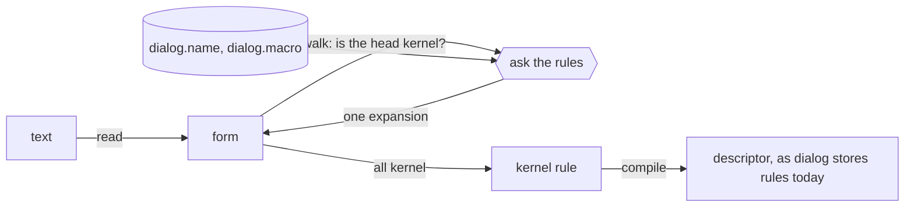

# The kernel and the core forms

The slim kernel as agreed on 2026-11-11, the core forms defined in it, and what running them through a model showed. Nothing here is implemented in dialog. Spellings are sketches until a reader round and a parser exist.



## The kernel

| | Form | In dialog today |
|---|---|---|
| Abstraction | `(rule head… (when premise…) (unless premise…))` | a rule descriptor; `when` and `unless` are its two lists |
| Read | `(xyz.todo ?t text: ?x state: ?s)`: application of a relation, one entity and the fields named | a concept query |
| Compute | `(:text ?x)`, `(:value ?a is: ?b)`, `(+ ?a : ?b is: ?c)`: application of a formula | a formula query or a constraint |
| Write | `(assert! A)`, `(retract! A)` as a rule's head: what stays | the `assert!` and `retract!` heads of an inductive rule; `Instruction::Assert(fact, pick)`, `Instruction::Retract(fact)` |
| Hold | `(assert A)` as a rule's head: holds this round and is not kept | a dispatched transient |
| Answer | `(report A)` as a rule's head | what a query returns |
| Data | constants, `?variables`, `_`, and a quoted form `'(…)` | a quoted form is new |

- `!` marks what stays. `(assert! A)` lands and is kept until retracted. `(assert A)` holds for the round, which is how a command is issued. A head with no word derives: the relation holds while the premises do.
- This departs from #728's design as of R25, where a plain `assert` head lands and `!` only re-issues a command. Irakli, 2026-11-11: without `!` the new count does not persist.
- An application has one part with no label. Every other part has its label; `:` alone is the label of a formula's second operand.
- A formula's result is `is:`. An application of a formula in a term's place stands for that value: `count: (+ ?n : 1)`.
- A type is a formula that holds for values of the type, so `(:text ?x)` can stand where `?x` would. `:value` is the type of every value, so `(:value ?a is: ?b)` is equality.
- **Proposed:** a pick wraps a term the same way, `(:last (:text ?x))`, so a read says everything about the attributes it reads. The alternative is #728's `(pick :last from: ?x)` beside the read.
- A head made only of operator characters is a formula. Names start with a letter, so it cannot be a concept or a domain.

## What the kernel supplies

- `(:match ?form : ?pattern is: ?holes)` holds when the form has the pattern's shape. `?holes` is one value holding what each hole took.
- `(:fill ?template : ?holes is: ?form)` builds a form. A hole nothing took is `_`.
- `(:get ?holes : 'name is: ?value)` and `(:bind ?holes : 'name to: ?value is: ?more)`.
- `(:id xyz.todo list: ?l text: ?x is: ?t)`: an entity from a domain and labelled values.
- A walker. It rewrites a top-level form until it is a `rule`, then every head and premise until each is a read or a formula. It asks the rules what a form expands to, in one of two positions, `:head` or `:premise`. No answer and two different answers are both errors.

A pattern is a form with holes. Bare parts match in order and in number, and `p ...` takes any number of them. A labelled part the form leaves out leaves its hole unbound. `...?rest` takes the labelled parts the pattern does not name.

## The core forms

All of [model/prelude.clj](model/prelude.clj), about 90 lines. One rule applies every macro:

```clj
(rule (dialog.syntax ?site expansion: ?out)
  (when (dialog.syntax ?site form: ?form)
        (:match ?form : '(?name _ ... ...?rest) is: ?shape)
        (:get ?shape : 'name is: ?name)
        (dialog.name ?macro is: ?name)
        (dialog.macro ?macro pattern: ?pattern template: ?template)
        (:match ?form : ?pattern is: ?holes)
        (:fill ?template : ?holes is: ?out)))
```

`macro` is stated once in the kernel, as two facts asserted with `!`. Everything after is written with it:

```clj
(macro (query ?head)
  (rule (report ?head) (when ?head)))
(macro (query ?head ... (when ?premise ...))
  (rule (report ?head) ... (when ?premise ...)))

(macro (assert! ?fact)
  (rule (assert! ?fact)))

(macro (concept (?name ?this ...?fields) ?body)
  (macro (?name ?this ...?fields) ?body))
```

A concept is a macro whose template is one read. A command needs a rule of its own, since it reads whether its head names anything and derives a domain for its rows:

```clj
(rule (dialog.syntax ?site expansion: ?out)
  (when (dialog.syntax ?site form: ?form position: :premise)
        (:match ?form : '(?command (?concept ...?fields)) is: ?holes)
        (:get ?holes : 'command is: ?name)
        (:command ?form is: ?domain)
        (:bind ?holes : 'domain to: ?domain is: ?filled)
        (:fill '(?domain _ ...?fields) : ?filled is: ?out))
  (unless (dialog.name _ is: ?name)))
```

## The to-do, expanded

[model/todo.clj](model/todo.clj) through the prelude, as the model printed it:

```clj
; (rule (assert! (todo ?t list: ?l text: ?x state: :open))
;   (when (add (todo list: ?l text: ?x))
;         (:id xyz.todo list: ?l text: ?x is: ?t)))
(rule (assert! (xyz.todo ?t list: (:last (:entity ?l)) text: (:last (:text ?x)) state: (:top :open)))
  (when (dialog.command.add.todo _ list: ?l text: ?x)
        (:id xyz.todo list: ?l text: ?x is: ?t)))

; (add (todo list: list:home text: "Buy milk"))
(rule (assert (dialog.command.add.todo (:id dialog.command.add.todo list: list:home text: "Buy milk")
                list: list:home text: "Buy milk")))

; (query (todo ?t text: ?x state: ?s))
(rule (report (xyz.todo ?t list: (:last (:entity _)) text: (:last (:text ?x)) state: (:top ?s)))
  (when (xyz.todo ?t list: (:last (:entity _)) text: (:last (:text ?x)) state: (:top ?s))))

; report
; ?s = :open ?t = id:7a6a542c ?x = "Buy milk"
; ?s = :open ?t = id:e6156d91 ?x = "Call mom"
```

## What the model is

[model/model.py](model/model.py) is a throwaway in Python: a reader, `match` and `fill`, an evaluator for kernel rules over a dictionary of facts, the walker, and rounds in which a command is seen once. It reads the prelude as text and runs it, so the definitions above are checked as written. It shares no code with dialog.

It does not model the planner, picks (the wrapper is carried and ignored, and a write to a to-do's field replaces what was there), layers, canonical identities, names at a revision, source maps, or a document whose forms are in any order: it takes them top to bottom.

```sh
cd design/macros/model
python3 -I model.py . todo.clj
python3 -I checks.py
```

## What it showed

Held, in [model/checks.py](model/checks.py):

- A later document's `(finish (todo …))` moves one to-do to `:done`.
- `(increment (xyz.counter ?c))`, declared nowhere and read by one rule, moves a counter from 0 to 1. The command is whatever that rule reads: its name, what it is around, and the fields it passes.
- `(unless (todo ?t state: :done))` excludes only the finished to-do, because the concept expands to one read.
- An unknown form is refused. Two concepts under one name are refused, and the error lists both expansions.
- A write through a concept that leaves a field out is refused, and so is one whose value is the wrong type.

Found:

1. **A read is one entity and several fields, never one attribute.** `unless` negates one proposition (`negation.rs`), so a concept that expanded to several reads could not be negated as a whole. An application that leaves a field out still requires it (`concept/query.rs`), which is why an unbound hole fills as `_`.
2. **No macro needed rows assembled into a form.** Per-field information travels inside one value, the stored pattern and template.
3. **`:id` takes whatever labels it is given.** A formula in dialog has fixed cells, so `:id` needs the per-application parameters a concept query has.
4. **A command about something another command in the same document creates is lost.** `add` and `finish` together leave the to-do open: the to-do lands after the round, and the `finish` is gone by the next. `induce.rs` describes the same rounds.
5. **A write with `_` in it has no meaning yet.** `(retract! (todo todo:1))` expands to a retract of three blanks and is refused. It has to mean "read, then retract what was read".
6. **Errors are the wrong ones.** A parameter the concept does not have is reported as an unknown form, and a missing field as `_`. The rules need a way to say why.
7. **A report's rows are named by the fields**, since the head expands too. Showing them as written needs the call site kept, as the source map would.
8. **A macro's identity is the `:id` of its pattern and template as written.** Two spellings that differ in a hole's name are two macros.
9. **A command is defined by the rules that read it, so a misspelled one is issued and nothing happens.** That is worth a warning, never a refusal (Irakli, 2026-11-11). A diagnostic is one more thing a rule derives about a form:

   ```clj
   (rule (dialog.syntax ?site warning: "no rule reads this command")
     (when (dialog.syntax ?site form: ?form position: :head)
           (:match ?form : '(?command (?concept ?subject ...?fields)) is: ?holes)
           (:get ?holes : 'command is: ?name)
           (:command ?form is: ?domain))
     (unless (dialog.name _ is: ?name)
             (dialog.rule _ on: ?domain)))
   ```

   In the model `(incremnet (xyz.counter counter:a))` is issued and comes back with that warning, and the right spelling comes back with none. Dialog keeps the index the rule reads, as `dialog.rule/on` for inductive rules and `dialog.rule/reads` for deductive ones. It already reports without refusing in two places: a rule that closes a cycle through an absence test is quarantined and listed, and a fact outside its placement is a divergence. Diagnostics would be the one relation all three are read from, and what a language server asks for.
