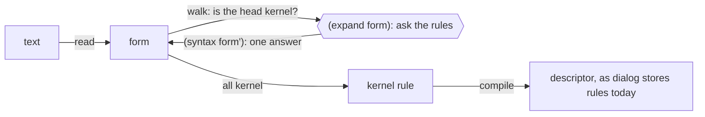

# The kernel and the core forms

The slim kernel as agreed on 2026-11-11, the core forms defined in it, and what running them through a model showed. Nothing here is implemented in dialog. Spellings are sketches until a reader round and a parser exist.



## The kernel

| | Form | In dialog today |
|---|---|---|
| Abstraction | `(rule head premise… (unless premise…))` | a rule descriptor: the first part is the head, and a rule has one; every part after it is a premise; what `(unless …)` holds must not hold |
| Read | `(xyz.todo ?t text: ?x state: ?s)`: application of a relation, one entity and the fields named | a concept query |
| Compute | `(:text ?x)`, `(:value ?a is: ?b)`, `(+ ?a : ?b is: ?c)`: application of a formula | a formula query or a constraint |
| Write | `(assert! A)`, `(retract! A)` as a rule's head: what stays | the `assert!` and `retract!` heads of an inductive rule; `Instruction::Assert(fact, pick)`, `Instruction::Retract(fact)` |
| Hold | `(assert A)` as a rule's head: holds this round and is not kept | a dispatched transient |
| Answer | `(report A)` as a rule's head | what a query returns |
| Syntax | `(expand pattern)` as a premise, `(syntax template)` as a head | new |
| Together | `(all form…)` as what a template answers: several forms standing where one was written | new; a template needs it to say more than one thing. Not written in a rule, where it is refused |

- `!` marks what stays. `(assert! A)` lands and is kept until retracted. `(assert A)` holds for the round, which is how a command is issued. A head with no word derives: the relation holds while the premises do.
- This departs from #728's design as of R25, where a plain `assert` head lands and `!` only re-issues a command. Irakli, 2026-11-11: without `!` the new count does not persist.
- An application has one part with no label. Every other part has its label; `:` alone is the label of a formula's second operand.
- A formula's result is `is:`. An application of a formula in a term's place stands for that value: `count: (+ ?n : 1)`.
- A type is a formula that holds for values of the type, so `(:text ?x)` can stand where `?x` would. `:value` is the type of every value, so `(:value ?a is: ?b)` is equality.
- **Proposed:** a pick wraps a term the same way, `(:last (:text ?x))`, so a read says everything about the attributes it reads. The alternative is #728's `(pick :last from: ?x)` beside the read.
- A head made only of operator characters is a formula. Names start with a letter, so it cannot be a concept or a domain.
- A write at the top level, `(assert! A)`, `(retract! A)` or `(assert A)` with premises after it if it has them, is a rule with that head.

## Syntax is a rule

A macro is a rule like any other (Irakli, 2026-11-11). Its premise says which form it is about, and its head says what that form becomes:

```clj
(rule (syntax (rule (report ?head) ?head))
  (expand (query ?head)))
```

- `(expand pattern)` holds for the form being expanded when it has the pattern's shape. It binds the pattern's variables to the form's parts, as rule variables. `(expand pattern in: :head)` holds in that position only; the other position is `:premise`.
- `(syntax template)` is the form it expands to. A variable the pattern bound is replaced by what it took. Any other variable in a template is the template's own: it is renamed at each expansion, so it cannot capture a variable of the form being expanded.
- Neither is walked into. What is inside them is syntax, not premises and heads. They are the quote and the quasi-quote, and a bound variable is the unquote, as in Racket's `syntax-case` and `#'`.
- The rule's other premises are ordinary: they read facts and apply formulas over the same variables.

`expand` works as a command the walker issues on each form, and `syntax` as what the rules answer. A pattern takes bare parts in order and in number, with `p ...` for any number of them. A labelled part the form leaves out leaves its variable unbound, and `...?rest` takes the labelled parts the pattern does not name.

The walker rewrites a top-level form until it is a `rule` or a write, then every head and premise until each is a read or a formula. No answer and two different answers are both refused.

## The core forms

The prelude in `rust/dialog-notation/src/prelude.clj` is rules and nothing else. There was a `syntax` of two parts as the short way to write one; it is gone (2026-11-11), since its two parts had no labels and different jobs:

```clojure
(rule (syntax (rule (report ?head) ?head))
  (expand (query ?head)))

(rule (syntax (rule ...?about
                (syntax ?body)
                (expand (?name ?this ...?fields))))
  (expand (concept (?name ?this ...?fields) ?body ...?about)))
```

A pattern is any form, not an application only. `(unless …)` may stand anywhere among the premises and more than once, each premise in it one more "and not": `A (unless B) (unless C)` is `A, not B, not C`.

A concept is syntax for what its body says. The variables tie its parameters to the body's fields, so the names need not agree. Writing

```clj
(concept (task ?t title: ?x)
  (xyz.todo ?t text: (:last (:text ?x))))
```

is writing this rule, which says that `(task …)` stands for that read of `xyz.todo`:

```clj
(rule (syntax (xyz.todo ?t text: (:last (:text ?x))))
  (expand (task ?t title: ?x)))
```

A concept maps facts to itself and back. So its body holds reads and nothing else, and every variable in it is a parameter:

- A check such as `(< ?n : 100)` has no inverse: `(assert! (cheap d:1 price: 200))` would have no answer. What it meant to say is a rule that derives a relation, which is read and never written.
- A variable that is not a parameter has no value when the concept is written.

Both are refused where the concept is defined. The reads may be of several entities, which dialog's concepts today are not, so a concept can be read from the other side:

```clj
(concept (list-item ?l todo: ?t)
  (xyz.todo ?t list: (:last (:entity ?l))))

(concept (author ?p name: ?n email: ?e)
  (io.person ?p name: (:last (:text ?n)))
  (io.contact ?p email: (:last (:text ?e))))
```

A body's reads stand together, as `(all …)`, where the concept is written:

| Where the concept is written | What its reads become |
|---|---|
| among the premises | premises, side by side |
| in a write or a report | a rule each, with the premises again |
| in an `unless` | one read when they are of one entity: `(io.person ?p name: … io.contact/email: …)` |

The last row is there because `unless` negates one proposition: two reads side by side under it would mean neither holds, not that they do not hold together. A read of one entity may span domains, as a concept query does in dialog. The absence of a concept over several entities is not one proposition, and waits on dialog negating a conjunction.

A rule has one head, as dialog's rules do (Irakli, 2026-11-13). To assert and retract on one condition, write a rule for each, or give the condition a name with a command and write a rule for each that reads it:

```clj
(rule (assert! (xyz.todo ?t list: ?to))
  (move (xyz.todo ?t list: ?to)))
(rule (retract! (xyz.todo ?t list: ?from))
  (move (xyz.todo ?t list: ?to))
  (xyz.todo ?t list: ?from))
```

`(all h1 h2)` in the head's place is refused, and so is a write after the first part; both refusals say to write a rule for each. It can be added later without changing what is written today.

A command is an application around an application whose head names nothing. In a premise it reads the command's rows:

```clj
(rule (syntax (?domain _ about: ?subject ...?fields))
  (expand (?command (?concept ?subject ...?fields)) in: :premise)
  (:command ?command : ?concept is: ?domain)
  (unless (dialog.name _ is: ?command)))
```

A rule may also say something about a form without refusing it:

```clj
(rule (warning "no rule reads this command")
  (expand (?command (?concept ?subject ...?fields)) in: :head)
  (:command ?command : ?concept is: ?domain)
  (unless (dialog.name _ is: ?command)
          (dialog.rule _ on: ?domain)))
```

## Describing things

A description is a fact about an entity, `dialog.meta/description`, never part of what the entity is. Dialog's descriptors already carry a description and leave it out of identity (`without_description`), and the stored body of a rule drops it; tonk keeps it as `dialog.meta/description` today.

Built 2026-11-13, and changed in two ways. What a form is for is said in a comment right above it, not in a `description:` part (Irakli: `description:` does not belong in a concept). And Dialog-DB refuses `dialog.meta/` from a transaction, since `dialog.` is kept for what it writes itself, so the proof of concept keeps the fact as `syntax.meta/description`. Whether dialog lets `dialog.meta/` through is open.

- A comment right above a `rule`, and one that ends its line, are the rule's description. It lands as that fact on the rule's entity. The kernel rule still carries it as `description:`, which is how it reaches the compiler.
- A concept's comment is kept with its form. It is not a fact yet: a definition has no entity until syntax is kept on a branch.

  ```clj
  ; Something to do, on a list.
  (concept (todo ?t list: ?l text: ?x state: ?s)
    (xyz.todo ?t list: (:last (:entity ?l)) text: (:last (:text ?x)) state: (:top ?s)))
  ```

- What has no form of its own, such as an attribute, is described with a plain write:

  ```clj
  (assert! (dialog.meta xyz.todo/text description: "What is to be done."))
  ```

- Finding is a query, since the descriptions are facts:

  ```clj
  (query (dialog.name ?thing is: ?name)
    (dialog.name ?thing is: ?name)
    (dialog.meta ?thing description: ?text)
    (:like ?text : "%list%"))
  ```

In the model that answers `?name = todo`. Any other labelled part of a rule is kept the same way, under `dialog.meta`.

## The to-do, expanded

[model/todo.clj](model/todo.clj) through the prelude, as the model printed it:

```clj
; (rule (assert! (todo ?t list: ?l text: ?x state: :open))
;   (add (todo list: ?l text: ?x))
;         (:id xyz.todo list: ?l text: ?x is: ?t))
(rule (assert! (xyz.todo ?t list: (:last (:entity ?l)) text: (:last (:text ?x)) state: (:top :open)))
  (dialog.command.add.todo _ list: ?l text: ?x)
  (:id xyz.todo list: ?l text: ?x is: ?t))

; (add (todo list: list:home text: "Buy milk"))
(rule (assert (dialog.command.add.todo (:id dialog.command.add.todo list: list:home text: "Buy milk")
                list: list:home text: "Buy milk")))

; (query (todo ?t text: ?x state: ?s))
(rule (report (xyz.todo ?t list: (:last (:entity ?l.2af3)) text: (:last (:text ?x)) state: (:top ?s)))
  (xyz.todo ?t list: (:last (:entity ?l.4dd8)) text: (:last (:text ?x)) state: (:top ?s)))

; report
; ?s = :open ?t = id:7a6a542c ?x = "Buy milk"
; ?s = :open ?t = id:e6156d91 ?x = "Call mom"
```

`?l.2af3` is the concept's own `?l`, which the query did not pass: renamed where it was expanded.

## What the model is

[model/model.py](model/model.py) is a throwaway in Python: a reader, pattern matching and template filling, an evaluator for kernel rules over a dictionary of facts, the walker, and rounds in which what `assert` says is seen once. It reads the prelude as text and runs it, so the definitions above are checked as written. It shares no code with dialog.

It does not model the planner, picks (the wrapper is carried and ignored, and a write to a to-do's field replaces what was there), layers, canonical identities, names at a revision, source maps, or a document whose forms are in any order: it takes them top to bottom.

```sh
cd design/macros/model
python3 -I model.py . todo.clj
python3 -I checks.py
```

## What it showed

Held, in [model/checks.py](model/checks.py):

- A later document's `(finish (todo …))` moves one to-do to `:done`.
- `(increment (xyz.counter ?c))`, declared nowhere and read by one rule, moves a counter from 0 to 1. The command is whatever that rule reads: its name, what it is around, and the fields it passes.
- `(unless (todo ?t state: :done))` excludes only the finished to-do, because the concept expands to one read.
- An unknown form is refused. Two concepts under one name are refused, and the error lists both expansions.
- A write through a concept that leaves a field out is refused, and so is one whose value is the wrong type.
- A misspelled command is issued and comes back with a warning; the right spelling comes back with none.
- A description on a concept, on a rule and on an attribute is stored as a fact, and a search for a word in them finds the concept by name.
- A concept's parameter may be named differently from the field it reads.
- A concept over two domains is read, written through, and tested for absence as a whole.
- A concept with a check in its body, or with a variable that is not a parameter, is refused where it is defined.
- A backlink reads and writes from the other side, and a concept over two entities is read and written. Its absence is refused as not one read.

Found:

1. **A read is one entity and several fields, across domains.** `unless` negates one proposition (`negation.rs`), so the reads a concept expands to are joined into one when their absence is asked for. An application that leaves a field out still requires it (`concept/query.rs`), which is why the concept's own variable stays in the read.
2. **No macro needed rows assembled into a form.** A pattern and a template carry the per-field information.
3. **`expand`, `syntax` and `:id` take whatever variables or labels they are given.** A formula in dialog has fixed cells, so these are premises of a new kind, with parameters per application as a concept query has. On dialog, `:id` did not need one: it is a chain of `entity/derive`, a link a value ([poc.md](poc.md)). Whether `expand` and `syntax` lower the same way is approach B of [design-forms.md](design-forms.md).
4. **A command about something another command in the same document creates is lost.** `add` and `finish` together leave the to-do open: the to-do lands after the round, and the `finish` is gone by the next. `induce.rs` describes the same rounds. On dialog it is not lost: both rules fire in the one round, the state holds both claims, and `last` elects one by the hash of the value ([poc.md](poc.md), finding 6).
5. **A write with a variable nothing binds has no meaning yet.** `(retract! (todo todo:1))` expands to a retract of three such variables and is refused. It has to mean "read, then retract what was read".
6. **Refusals give the wrong reason.** A parameter the concept does not have is reported as an unknown form. With diagnostics as something a rule derives, a rule that knows why can say so.
7. **A report's rows are named by the fields**, since the head expands too. Showing them as written needs the call site kept, as the source map would. Decided 2026-11-11: a query reports the relations queried.
8. **A macro is a rule, so its identity is the rule's.** Whether dialog's canonical spelling of a rule extends to the syntax inside `expand` and `syntax` is not looked at.
9. **A command is defined by the rules that read it, so a misspelled one is issued and nothing happens.** That is worth a warning, never a refusal (Irakli, 2026-11-11). Dialog keeps the index the warning rule reads, as `dialog.rule/on` for inductive rules and `dialog.rule/reads` for deductive ones. It already reports without refusing in two places: a rule that closes a cycle through an absence test is quarantined and listed, and a fact outside its placement is a divergence. Diagnostics would be the one relation all three are read from, and what a language server asks for.
10. **A template that writes syntax with a variable of its own needs an escape**, as Racket's `(... ...)` is for a literal ellipsis: an unbound variable in the outer template is renamed, so it cannot be meant for the inner one. No core form needs it.
11. **A description follows the entity, so a changed definition starts without one.** A new body is a new rule and a new entity. Whether the description is carried over, or belongs to the name, is not decided.
12. **Withdrawn.** An earlier draft let a concept's body hold a check, which filtered a read and guarded a write. A concept has to map both ways (Irakli, 2026-11-11), so a check does not belong in one. #728's design still lists comparison among the constraints a concept body may hold.
