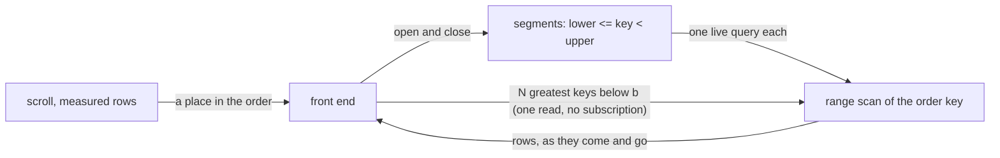

# A paginated view has to stay expressible

Asked by the maintainer, 2026-11-24, after an exchange with Chris about
virtualized lists: no hurry to port sapling's work, but views as queries
must not make sapling's paginated views impossible to say.

What sapling does is `PDD018 Ordered and Virtualized Views` in
dialog-db/sapling, with its engine support on the `sapling` branch of this
repository. This note holds only what our views must keep true for it.

## What a paginated view is there



- A page is a **segment**: a range of the order key, either bound absent.
  Never a row number: rank and offset need a count in every subtree.
- The order is the keys of a keyed collection (the entity ordering), or
  one numeric field of a model (the value ordering).
- Each segment is a live query whose bounds are constants. Moving the
  window opens and closes segments. At most 16 are open.
- Pixels, measured row sizes, spacers and the scrollbar stay in the front
  end. They change every frame and cannot wait for a round trip.
- The next bound comes from a read of the N greatest keys below a key,
  or from a guess by the density of the rows already there.

## Said in our views

A segment is a query with two parameters, and the window is the rows of
the query that collects it:

```clj
(query (message/item ?m is: ?item)
  (message ?m body: ?body author: ?who)
  (person/chip ?who is: (collect ?chip))
  (view ?item [:li ?chip ?body]))

(query (log/segment ?channel from: ?lower to: ?upper is: ?rows)
  (message ?m channel: ?channel at: ?key)
  (>= ?key ?lower)
  (< ?key ?upper)
  (message/item ?m is: (collect ?items by: ?key))
  (view ?rows [:ol ?items]))

(query (log/window ?channel is: ?list)
  (window/segment ?s of: ?channel from: ?lower to: ?upper)
  (log/segment ?channel from: ?lower to: ?upper is: (collect ?segments by: ?lower))
  (view ?list [:div ?segments]))
```

A message has a view of its own, `message/item`, which knows nothing of
channels, order or pages. The segment says which messages and in what
order. `by:` is not a form the notation has today: it stands for "these
children stand in the order of this variable of mine", which row 6 below
asks for.

`window/segment` is state of the session: the front end moves the window
with a command that asserts and retracts those facts. That is the
maintainer's model (the window is state that drives a query) and Chris's
(the front end owns layout) at once: the session holds which ranges are
wanted, the front end holds everything measured in pixels.

## What has to stay true

| # | must hold | where it stands |
|---|---|---|
| 1 | A view takes parameters, and they may come from facts. | Fact: a query's head names them (`view.rs`, `view/plan.rs`). |
| 2 | A comparison on the order key reaches the scan as a range, and the subscription's cover is that range, also when the bound is a variable another premise binds and when the premise is behind an inlined definition. | Hypothesis. Main narrows a scan by constants; `sapling` carries a comparison through a concept premise (`66b9c4e39`, `89939b4ab`, `251175439`). Bounds bound by a join are not checked. |
| 3 | A view's rows carry their order key and stand in its order, and nothing a paginated view needs goes through a fold. | Fact for standing in key order: a layer's key is the head's free variables, an entry's key first (`view/plan.rs`). A fold loses order, so a segment is rows, not a folded list. |
| 4 | There is a read that is not a subscription, with a direction and a limit: the N greatest keys below a key. | Missing on main (no reverse walk). On `sapling`: `06b8fff33`, `ae310aeaf`, `49a854327`. It is an API of the engine, not a form of the notation, and nothing in views stands in its way. |
| 5 | Many small live queries are cheap: opening one reads its range and no more, and a change outside every open range costs none of them anything. | Hypothesis. Follows from 2 and from the cover a poll scopes its diff to. To be measured when ported. |
| 6 | The query that collects children says their order and their range, by variables it binds itself. The child's view need not name the order key in its head, nor take the bounds. | Open. Today a collected query's instances stand in the order of its own head's free terms, an entry's key first (`view/plan.rs`), so a child listed by time has to carry the time in its head. Whether a collector can order and narrow by its own variables is not checked. |

Not required, and not to be promised by views: a row number, a total
count that is exact, an order by more than one field.

## What would break it

- A view compiled to one fold over the whole relation, with the range
  applied to its answer. The range must narrow the scan.
- A window said as "skip N, take M". It cannot be answered without
  counting.
- Layout state in the session. Every scroll frame would be a commit.
- A view whose children can only stand in the order of their entities.

## Left for when it is ported

- sapling assumes the whole space is local. A segment is a narrow range,
  which suits a replica that fetches what it reads, but the round trips
  of opening one were never counted.
- Ordering by a field goes through the value ordering, where a range of
  one attribute's numbers also passes every other attribute's numbers in
  the same band. That is cost, not meaning.
- Main's search tree keeps an estimate of each subtree's size, which
  sapling does not use. It may be what a scrollbar needs.
