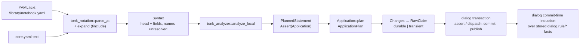

# How a document becomes running state in tonk

Read in tonk at `c006b50` (2026-11-17), `/home/claude/tonk-labs/tonk`. Every path below is under its `rust/` unless it says otherwise. Nothing was built or run: every statement is from reading, and the ones that are inferred say so.

## The pipeline

A library document reaches a space when the space is created (`core.yaml`) or when a component is installed from the palette (`library/install`, `notebook.yaml` among them). Both go through one function.

| step | where | what |
|---|---|---|
| 1. fetch | `tonk-worker/src/router/repository.rs:4783`, `:5699` | `install_component` fetches the text: from the service worker's `/library/` in a browser (`tonk-ui/assets/service_worker.js:1561`), from the copy compiled into the binary natively (`tonk-library/src/lib.rs:17`, `:20`) |
| 2. join with core | `repository.rs:7054`, `:7079` to `:7088` | a component is parsed after `core.yaml` and the two syntax trees are concatenated, so the component's names resolve against core's. `first` remembers where the component starts |
| 3. parse | `tonk-worker/src/router/library.rs:102` to `:117` | `tonk_notation::parse_at(root, text)` gives a `Syntax` and diagnostics; `tonk_notation::expand` inlines every `!include` through a loader that refuses anything outside `/library/` |
| 4. analyze | `repository.rs:7092`; `tonk-analyzer/src/analyzer.rs:147` | `analyze_local`: resolve every name against the document and the built-ins only (no branch), then expand into `tonk_schema::transact::Statement`s |
| 5. plan | `repository.rs:7105` to `:7120`; `tonk-analyzer/src/analysis.rs:160` | `statements_from(first)`: every non-rule claim in document order, then every rule. Each `Application` is planned to an `ApplicationPlan` (`tonk-schema/src/transact.rs:490`): a `ConceptPlan`, an `InductiveRule` or a `DeductiveRule` |
| 6. split | `repository.rs:7110` to `:7120`; `analysis.rs:212` | a plan whose concept is in `transient_entities()` (a `command!`) goes to `transient`, the rest to `durable` |
| 7. lower | `repository.rs:7125` to `:7146` | `Changes::into_instructions` gives `(the, of, is, policy)` rows, `RawClaim`s |
| 8. commit | `repository.rs:5029`, `:5190` to `:5201` | `stage_reinstall`: the uninstall of the previous version in one commit, the library in the next (durable claims `assert`ed, transient ones `dispatch`ed), the install record in a third, one publish |
| 9. run | `tonk-evaluator/src/lib.rs:15` to `:17`; `tonk-evaluator/src/evaluate.rs:542` to `:549` | dialog's `TransactionCommit::perform` fires the installed rules over the commit's delta. The routes core ships as `seed/route` commands are written this way, in the install commit |

A version is the text's hash, `seed:<blake3 of the text>` (`repository.rs:5604`). An upgrade happens when the shipped text hashes differently from the one recorded, and it reverts the previous install commit before installing (`repository.rs:4881` to `:4934`).

The same parse, analyze and plan run for a document posted at run time, through `SyntaxEvaluateExt::evaluate` (`tonk-evaluator/src/evaluate.rs:366`), from the worker's `/evaluate` route (`tonk-worker/src/router/evaluate.rs:140`, parse at `:736`), the CLI (`tonk-cli/src/eval.rs:175`, `:330`) and the `claim!` macro at compile time (`tonk-macros/src/lib.rs:64` to `:75`). There the analysis resolves against the branch (`analyzer::analyze`, `analyzer.rs:132`) and the plan runs once per row of the document's queries (`evaluate.rs:458`).

### What tonk-notation produces

`Syntax` (`tonk-notation/src/syntax.rs:35`) is a list of `Expression`s, each a `Query` (`head:`) or a `Claim` (`head!:`, with an optional `&anchor`) over an `Application`: a `Predicate` and a list of `Field`s (`syntax.rs:67`, `:106`). A `FieldValue` is a literal, a variable, `_`, a bare symbol, a URI, a nested map, a list of rule premises, an `!include`, or a list (`syntax.rs:248`).

It knows nothing of concepts, rules, views or events. `rule!:`, `view!:`, `event!:`, `concept!:` and `command!:` are all claims whose head is a name; the analyzer gives them their meaning by resolving the name to a built-in (`syntax.rs:59` to `:61`; `tonk-schema/src/builtin.rs:49` to `:65` lists `attribute`, `concept`, `command`, `event`, `view`, `rule`, `name` and four repository concepts). `element!:` and `route!:` are not built-ins: they are concepts `core.yaml` declares (`tonk-core/assets/library/core.yaml:1371`, `:1803`).

### What the analyzer makes of each form

| form | becomes | where |
|---|---|---|
| `concept!:`, `command!:` | an assertion of the built-in `concept` (or `command`) on the concept's content-addressed entity: `db.meta/source` (the descriptor as JSON), `db.meta/name`, `db.meta/description`, `dialog.concept/transient` for a command, `db.meta/command`. Each inline attribute is its own `attribute` assertion, emitted first | `tonk-schema/src/concept.rs:1097` to `:1146`; `tonk-analyzer/src/analyzer/declaration.rs:34` |
| `&anchor` | `db.name/referent` of `id:<anchor>`, pointing at the body-derived entity | `tonk-schema/src/transact.rs:556` to `:603` |
| a claim with no `this:` | `this` derived from the predicate and the payload, `Entity::of({assert, where})` | `transact.rs:82` |
| `rule!:` | `assert:` is a `DeductiveRule`, `assert!:` and `retract!:` an `InductiveRule` with that polarity, compiled by dialog's planner with a concept descriptor as the head | `tonk-analyzer/src/analyzer/rule.rs:358` to `:458`, `:570` |
| `view!:` | an assertion of the built-in `view` on the model concept's entity: `xyz.tonk.view/<facet>` text per entry of `show:`, `xyz.tonk.view/bindings` (a dag-cbor `Record` of the resolved events), `xyz.tonk.view/embeds`, `xyz.tonk.view.style/*`, `xyz.tonk.view.font/*` | `tonk-schema/src/builtin.rs:136`; `tonk-analyzer/src/analyzer/view.rs:223` |
| `event!:` | an assertion of the built-in `event`: `xyz.tonk.event/type`, `xyz.tonk.event.where/<field>`, `prevent-default`, `stop-propagation`. Also indexed so a view's bindings inline it | `builtin.rs:254`; `view.rs:75`, `:112` |

### What reaches dialog

Claims, through `dialog_repository::Transaction::assert` and `::dispatch` (`repository.rs:5190` to `:5201`). A rule is a claim set too: `ApplicationPlan::Rule(rule).assert(update)` writes dialog's own `dialog.rule/*` facts, the dag-cbor source and the indexes induction reads (`tonk-schema/src/rule.rs:1` to `:16`; `transact.rs:528` to `:542`). A command is a concept marked `dialog.concept/transient`, which dialog's induction reads (`dialog-repository/src/repository/branch/transaction/induce.rs:23` in dialog).

So tonk uses dialog's stored rules and dialog's induction. It evaluates no rule of its own: "Rule induction is dialog's: installed `dialog.rule/*` rules fire at commit time inside `TransactionCommit::perform`, so this crate carries no fixpoint of its own" (`tonk-evaluator/src/lib.rs:15` to `:17`). Deductive rules run when a query reads their conclusion.

## The crates that depend on tonk-notation

`grep tonk-notation rust/*/Cargo.toml` finds 13 manifests: tonk-notation itself and 12 that depend on it. `tonk-schema` declares it (`tonk-schema/Cargo.toml:48`) and uses nothing from it: no `.rs` file under `tonk-schema` names `tonk_notation`.

| crate | what it uses |
|---|---|
| tonk-analyzer | `Syntax`, `Expression`, `Application`, `Field`, `FieldValue`, `Premise`, `HeadName` as its input; `parse`/`parse_at`/`expand` in tests. The whole crate is a consumer of the syntax tree (`analyzer.rs:56`, `analyzer/rule.rs`, `analyzer/view.rs:44`) |
| tonk-evaluator | `Syntax` as the receiver of `analyze`, `compile`, `evaluate` (`evaluate.rs:221` to `:330`) |
| tonk-worker | `parse`, `parse_at`, `expand`, `Load`, `Syntax`, `Parsed` for library seeds (`router/library.rs:26`), seeds (`router/seed.rs:18`, `router/repository.rs:870`), `/evaluate` bodies (`router/evaluate.rs:33`) and agent links (`router/agent_link.rs:55`) |
| tonk-cli | `parse_at`, `expand`, `Load`, `INLINE_LOCATION` for `tonk eval` (`src/eval.rs:9`); `spell_uri` to print URIs; `ValueType` and `Pick` from wire names (`src/schema.rs:344`, `src/authoring.rs:160`) |
| tonk-macros | `parse_at` in the `claim!` proc macro, then `analyze_local` and `lower_to_claims` (`src/lib.rs:64` to `:75`) |
| tonk-library | `Load` and `Url` to serve bundled includes (`src/lib.rs:12`); `parse_at`, `Field`, `FieldValue` in `build.rs:24` to find what the library includes |
| tonk-language-server | `parse`, `document_diagnostics`, `SERVER_INFO`, `Syntax` (`src/server.rs:149`, `:413`) |
| tonk-display | `parse` to tokenize notation for highlighting (`src/notation_tokens.rs:72`); `spell_uri`, `ValueType`, `type_storage`, `Pick::from_wire`, `classify_plain_value` for introspection and event values (`src/events/extract.rs:292`, `src/introspect/slot.rs:287`) |
| tonk-template | `ValueType`, `type_storage`, `Pick::from_wire` to coerce rendered values (`src/resolve.rs:15`, `:310`, `:682`); `FieldValue`, `Scalar`, `classify_plain_value` to read an event source (`src/event.rs:44`, `:113`) |
| tonk-inspector | `parse` to tell a cell that asserts from one that queries (`src/notebook.rs:1943`, `src/element.rs:721`, `src/blocks.rs:1025`, `src/cell_output.rs:614`); `spell_uri`, `type_anchor` for output |
| tonk-intent | `ValueType::from_wire` once (`src/lib.rs:543`) |
| tonk-schema | nothing |

So six crates use the parser or the syntax tree (analyzer, evaluator, worker, cli, macros, library build), two use it for editing (language server, display's highlighter), three for the inspector's cell classification, and four only for `ValueType`, `Pick` and `spell_uri`, which are about wire names and not about the notation.

## Views

**Where the template lives.** In the branch, as text: `xyz.tonk.view/<facet>` on the model concept's entity, one fact per facet (`builtin.rs:136` to `:160`). The analyzer checks it and stores beside it what it resolved: the event bindings as `xyz.tonk.view/bindings`, a dag-cbor `Record` (`view.rs:223` to `:330`).

**What renders it.** `<tonk-display model=… entity=…>`, a custom element in `tonk-display` compiled to wasm (`tonk-display/src/lib.rs:1` to `:12`). It resolves `model` by name (`id:<name>`'s `db.name/referent`) to a concept and reads its `db.meta/source` descriptor (`tonk-display/src/element.rs:1760` to `:1767`), subscribes to the view row and reads the `show` dictionary (`element.rs:1778`), and picks the facet: `ui` with an entity, `directory` without (`element.rs:1793`; `tonk-template/src/resolve.rs:20`, `:24`). It then subscribes to the entity's rows and hands each frame to a `<tonk-view>` (`tonk-display/src/view.rs:1` to `:28`). `tonk-render` renders the same templates headless for the worker's outline and hosted views, through the same planner in `tonk-template` (`tonk-render/Cargo.toml:18`).

**Slots.** `{field}` in a text node or an attribute value is a binding addressed by its path in the fragment (`tonk-template/src/lib.rs:41` to `:60`). An attribute value may hold several, `href="/notebook/{this}"`, and is substituted as text.

**Many values.** A field that is not `cardinality: one` is an iteration axis: the lowest element holding all of its bindings is cloned once per value (`tonk-template/src/lib.rs:196` to `:215`, `:467` to `:480`). `{this}` is never an axis: the element that binds it is the per-entity repeat root, and what is outside it renders once (`lib.rs:252` to `:262`). With no entity (the `directory` facet) every instance is a row, so a directory view is chrome once and its `{this}` element once per instance.

**Nested views.** A template writes another `<tonk-display model=… [entity=…] [with="{branch}@{repo}"]>` in its HTML. The browser mounts it and it resolves on its own. Nothing in the analyzer reads it as a reference to a view.

**Events.** `on:<name>=<command>` in a template names the event declaration `on/<name>` and a command (`tonk-template/src/bindings.rs:124`, test at `:195`). The analyzer resolves both at lowering, checks every field the command needs is filled (`view.rs:262` to `:316`), and stores the declarations under `bindings`. At run time `tonk-display` reads `bindings` (`element.rs:2261`), listens at the host, reads the declaration's `where:` paths off the live event, and posts the command as a `TransactRequest` to `/transact`, not as notation (`tonk-display/src/events.rs:1` to `:23`). A declaration this document does not make, but that resolves as a name on the branch, is read at render time instead (`view.rs:285` to `:294`).

## Routes and elements at run time

**Routes.** The worker reads every `tonk:route` on the branch, `xyz.tonk.route/path` and `xyz.tonk.route/concept` (`tonk-schema/src/domain.rs:521` to `:536`, `tonk-schema/src/site.rs:195`), builds a `tonk_router::Router` per navigation, orders ties with the space's own routes first, and recognizes the remaining path (`tonk-worker/src/router/session.rs:866` to `:917`). The match writes the tab's `site` with `concept` set to the route's concept; the guest mounts `<tonk-display entity=site:… model=<that concept>>` (`core.yaml:1789` to `:1799`). `notebook.yaml` asserts its two routes directly (`route!:`, lines 390 and 437); `core.yaml` ships its own as `seed/route` commands that a rule turns into routes where no route claims the path (`core.yaml:1817`, `:2132`).

**Elements.** An element is resolved by tag name when the page announces an unregistered custom element: `id:<tag>`'s `db.name/referent`, then that entity's `xyz.tonk.element.method/*` dictionary (and the three others), both as live subscriptions (`tonk-display/src/registry.rs:17` to `:31`; `tonk-template/src/resolve.rs:48`, `:79` to `:85`). So the anchor `&notebook-save` is what makes `<notebook-save>` work: the tag is the name, not the entity.

## Rules and commands

Installed as dialog stored rules (above). A command is a transient concept: an assertion of it is dispatched rather than asserted (`evaluate.rs:470` to `:494`), lands on the session's `control:` layer for one tick, and is seen by commit-time induction. Its rules are inductive rules whose premises read it. A command's entity is derived from its content, as any claim without `this:` is (`transact.rs:82`), and a rule reads it as `this:` of the command premise (`notebook.yaml:704`, `:738`, `:835`).

## Where a second front end could hand over

Each column is a place to hand over. The notation's own compiler, `dialog-notation`, gives `Step`s: a `ConceptStatement` to assert, retract or issue, a `DeductiveRule`, an `InductiveRule`, a concept marked transient, a query (`rust/dialog-notation/src/compile.rs:44` to `:60` in this repository).

| | A. the syntax tree | B. the analyzed statements | C. the library's claims | D. the branch |
|---|---|---|---|---|
| hand-over point | `library::parse` returns a `tonk_notation::Syntax` (`router/library.rs:102`) | `analyzed.analysis.statements_from(first)` (`repository.rs:7105`) | `library_claims_after` returns `LibraryClaims { durable, transient }` (`repository.rs:7069`) | a dialog transaction on the space's branch |
| the front end must produce | the YAML forms as a tree: `concept!`, `command!`, `rule!` with `when`/`unless` premise lists, `view!` with HTML text and `on:` attributes, `event!` declarations, `&anchor`s | `Statement::Assert(Application)`s: `Application::Concept` against tonk's built-ins (`concept`, `command`, `view`, `event`, `name`), `Application::Rule` with dialog rules, the transient set, the anchor names | `RawClaim`s: tonk's meta claims (`db.meta/source` descriptors, `db.meta/name`, `db.name/referent`), the view rows with the `bindings` record, the event rows, dialog's `dialog.rule/*` facts, `dialog.concept/transient`, the data | the same claims as C, committed |
| tonk crates bypassed | tonk-notation's parser, for this document | tonk-notation and tonk-analyzer, for this document | tonk-notation, tonk-analyzer, tonk-schema's planner | every tonk crate on the write path |
| tonk crates still served | analyzer, evaluator, worker, display, template, render, router, inspector | worker (staging, upgrade, uninstall), display, template, render, router | worker (staging, upgrade, uninstall), display, template, render, router | display, template, render, router read it; nothing records it |
| what would not work | anything the YAML tree cannot hold: a Hiccup template has to be printed back to HTML text, an inline `:on/<type>` split back into an `event!` and an `on:` attribute, a command's control lines read back as a `command!`. Diagnostics point into a tree with no YAML source | the analyzer's checks of a view (every `{field}` declared, every `on:` fillable, `view.rs:223`) unless the front end does them; the compiled `bindings` record has to be built with `tonk_template::bindings::Bindings`. Names in the document still have to resolve against `core.yaml`'s | as B, and the front end must produce tonk's descriptor JSON (`db.meta/source`) byte-for-byte compatible with what `tonk-display` parses (`element.rs:1760`) | upgrades: no install record (`repository.rs:5210`), so the next upgrade cannot revert what was written; the version is no text's hash |
| what dialog-notation gives today that fits | nothing: it does not produce tonk's tree | `DeductiveRule`, `InductiveRule`, transient concepts and `ConceptStatement`s map onto `Application::Rule`, the transient set and `Application::Concept`. No concept declaration as data, no names, no views | the same, as claims: `Step::Assert` and `Step::Issue` to `RawClaim`s, rules through `.assert(update)` | the same |

Reading the runtime side: views, events and elements are read from the branch by name and by fixed attributes, so whichever column a front end hands over at, it has to write those attributes and names exactly as the YAML path does. The display never sees how a claim was written.

**Hypothesis.** Column C is the cheapest place for a proof of concept: `library_claims_after` is one function with one caller per install path, it keeps tonk's install, upgrade and uninstall as they are, and dialog-notation's `Step`s are already claims and dialog rules. The work is then a tonk-specific back end for dialog-notation that writes, beside its rules, what tonk's runtime reads: concept descriptors as `db.meta/source`, `db.name/referent` for each named concept, command, element and route concept, and view rows with a `bindings` record. What would confirm it: `notebook.clj` compiled to `LibraryClaims`, installed by `install_component` beside YAML `core.yaml`, and the notebook page rendering and taking edits. What would refute it: a runtime reader that needs something only the analyzer computes and does not store (the embeds pass, `view.rs:494`, is one to check), or rule entities differing between the two front ends so that an upgrade from the YAML install cannot revert it.

## Which dialog tonk runs, and what this branch changes under it

tonk pins dialog at `v0.5.0-rc.6` (`Cargo.toml:201` to `:226`, at the repository root). That tag is an ancestor of this branch, and 175 commits behind it. `git diff v0.5.0-rc.6 HEAD -- CHANGELOG.md` adds four entries under `## Unreleased`:

| change | what tonk's pipeline calls that it touches |
|---|---|
| a rule can name an entity it did not read: the formula `entity/derive` | dialog-notation's `id` compiles to it (`compile.rs:15`). tonk rc.6 does not have it, so any notation rule that uses `id` needs a newer dialog in tonk. The entry says it "is not to be released as it reads" |
| a stored rule holds a pattern; rule bodies are format 4 | `InductiveRule::new` and `DeductiveRule::new` (`tonk-analyzer/src/analyzer/rule.rs:433`, `:445`), `rule.assert(update)` (`tonk-schema/src/transact.rs:522` to `:528`), `InductiveRule::decode` and `DeductiveRule::decode` (`tonk-schema/src/rule.rs:73` to `:77`). Every rule tonk writes after the bump is format 4 |
| a parameter holds a pattern | `Parameters::iter`, `get` and `insert` throughout the analyzer, the planner and the evaluator (62 call sites under `tonk-analyzer/src`, `tonk-schema/src`, `tonk-evaluator/src`, `tonk-worker/src`); `Equality::new(..).schema()` (`tonk-analyzer/src/analyzer/constraint.rs:135`). `get` on a name that holds a map now gives the variable for the whole value |
| a record holds a map or a list | the `bindings` and `embeds` records of a view (`builtin.rs:160` to `:190`) are `Record`s; nothing in tonk builds a composite one |

Measured on 2026-11-18 ([tonk-dialog-move.md](tonk-dialog-move.md)): with tonk pointed at this branch every workspace crate checks with no source change. The parameter change adds to the API and removes nothing, so the 62 call sites are places that could take a pattern, not places that break. What does not go both ways is the rule format: rc.6 refuses a format 4 body.

The seed upgrade reverts the claims stored at the previous install's version (`uninstall_claims`, `repository.rs:5259`, `assertions_at_version` at `:5288`), so a format change does not stop a revert: it retracts the bytes that were written. What it does re-encode is the protection: the claims every other installed library declares are recomputed from that library's text through `install_claims_for` (`declared_by`, `repository.rs:5311`) and left alone.

**Hypothesis.** After the bump a rule declared by two installed libraries is re-encoded as format 4 while its stored claims are format 3, so it no longer matches and the upgrade of one library retracts the other's copy. What would settle it: whether any rule is declared by both `core.yaml` and a component, and whether dialog's `rule::body` keeps a decoded older body's bytes. A `rule!: this: <entity> ..: _` retract, which resolves a stored rule and re-encodes it (`tonk-schema/src/rule.rs:6` to `:8`), is the other place this could bite.

`install_claims_for` (`repository.rs:7054`) is called from three places: a fresh install (`:4996`), an upgrade (`:4897`) and the protection above (`:5322`). A second front end that hands over at column C has to be reached from there, keyed on the source, or a notation library is installed by one path and protected by another.

## What could not be determined by reading

- Whether the runtime reads anything the analyzer computes and does not store, beyond the `bindings` and `embeds` records.
- How `<tonk-notebook>`'s posts reach the worker: `tonk-inspector` builds YAML documents for creating and inserting (`tonk-inspector/src/notation.rs:13`, `tonk-inspector/src/blocks.rs:172`), which use a variable head, `this: ?b0`, bound to a derived entity and named by a later insert's `next:`. That they are posted to `/evaluate` is inferred from their being notation text; the call was not traced. If so, retiring YAML also means rewriting these two generators, and the notation has no spelling for naming the entity of one top-level assert in another.
- The notebook's live cells are `dialog-yaml` fences evaluated against the branch (`notebook.yaml:2`, `tonk-inspector/src/notebook.rs:1943`). They are a YAML surface of their own, as is the MCP `tonk_evaluate` body, and are out of what a library port retires.
