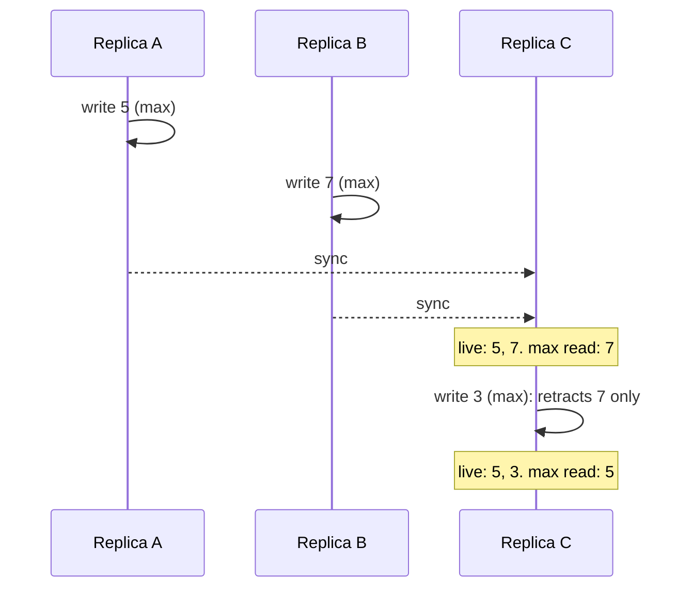

# A write under an electing pick must replace every claim it means to replace

Phase: **Directing**. Issue [#759](https://github.com/dialog-db/dialog-db/issues/759). Working material in [`pick-succession/`](pick-succession): [journal](pick-succession/journal.md), [claims](pick-succession/claims.md), [glossary](pick-succession/glossary.md), [use cases](pick-succession/use-cases.md), [direction](pick-succession/direction.md).

## Description

Two replicas write the same cell under `max`, one 5 and the other 7, without seeing each other. After they merge, a read returns 7. A replica that holds both then writes 3, meaning to replace the value. The next read returns 5.

The write retracted the claim the pick elected, 7, and left 5 live. Under `min` and `top` it goes the same way. Under `last` the read comes out right, but the losing claim stays live, and the cell never returns to one claim.

A second case came up while working through the first. Replica A writes 5, then 7 under `min`, and 7 succeeds 5. Replica B receives 7, and later receives 5 through a partial sync. On B, a `min` read returns 5, the value 7 replaced.

## Problem

A writer who writes a cell under a pick means the next read under that pick to return what was written. A writer who writes the same cell under `all` means their values to stay. Neither holds today. A write retracts only the claim its pick elects, so claims concurrent with that claim stay live and can win the next read. A read elects among live claims without checking whether one succeeded another, so a claim that partial sync brings back after its successor can win too.

## Approach

Not decided. The [direction](pick-succession/direction.md) matrix weighs six approaches. The one the maintainer has stated is column D:

- a write retires the elected claim, every live claim concurrent with it, and every live claim it succeeded;
- it keeps claims that were written before it and never succeeded;
- reads skip a claim that another present claim's cause names;
- nothing is retired on merge.

What "concurrent" is computed from, claim lineage or the revision DAG, is the first implementation decision, and the [claims](pick-succession/claims.md) show why the answer matters.
