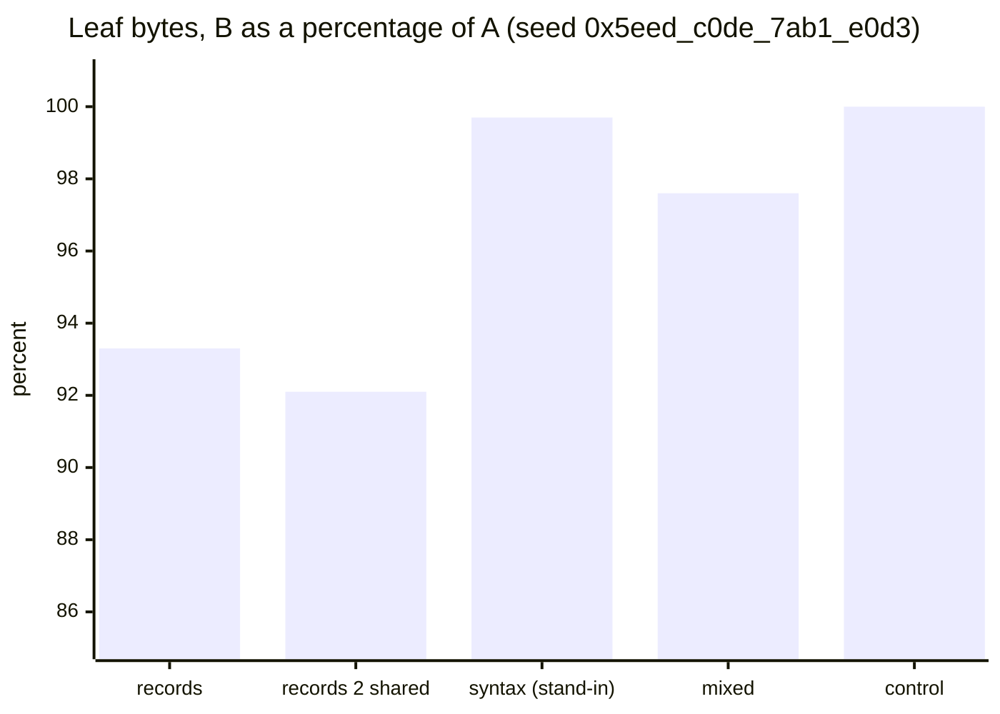

# Composite table order: keys first

**Status: Shelved.** Rejected against its bars: keys first cuts the leaves
of same-shape records by 6.7 percent (7.9 with two values shared), short of
the 10 percent bar, and makes encoding 10 to 15 percent slower, past the 5
percent bar. Asked by the maintainer: "Measure keys-first ordering
before the layout is fixed." Measured on the branch
`research/composite-table-order`, from the head of `feat/composite-value`
([#843](https://github.com/dialog-db/dialog-db/pull/843)), `aa7c98c`.

## The question

A composite's canonical bytes are `table · body`, and the table holds every
scalar atom the composite uses (map keys and scalar values alike) once,
sorted by its canonical bytes, the type byte first
(`rust/dialog-corpus/src/model/composite.rs`, `composite/encode.rs`). A
composite of up to 4,096 bytes sits inline in the value payload of its key
in the entity (EAV), attribute (AEV) and value (VAE) orderings, and that
payload is an arena column of a leaf: front-coded against the previous
entry, so a value shares exactly its leading bytes with its neighbour.

In the attribute ordering, neighbours are values of one attribute on
successive entities, so composites of one shape sit side by side. Because a
record's keys are symbols (type byte `8`) and its entity, boolean and text
values sort below them (`1`, `2`, `3`), today a record's table begins with
its values, and two records with the same fields and different values part
almost at once.

Does putting the keys first make same-shape neighbours share their key run,
so the tree's leaves get smaller?

## The two layouts

- **A (today).** The table is every distinct atom, sorted by canonical slot
  bytes (bytewise, the type byte first).
- **B (keys first).** The table is two runs, `K · V`:
  - `K` is every distinct atom that is the key of an entry of any map
    anywhere in the composite (the top level or nested), sorted by its
    canonical slot bytes, bytewise, as A sorts.
  - `V` is every other distinct atom (an atom used only as a value or a list
    item), sorted the same way.
  - An atom used both as a key and as a value is in `K` only.
  - The body is written exactly as A writes it, with each slot's index the
    atom's place in `K · V`. Map entries are sorted by key index and then by
    value: since `K` keeps the keys in the same relative order A does, the
    entries come out in the same order under both layouts, and only the
    index numbers differ.
  - For a record every key is an attribute, a symbol whose slot is `08`
    followed by its `domain/name` text, `00`-escaped and `00`-terminated.
    "Sorted" for a record's key run is therefore the bytewise order of
    `domain/name`, a name that is a prefix of another first.
  - A list of scalars has no keys: `K` is empty and B is A.

B is as canonical as A: `K` and `V` are fixed by the content (which atoms
are keys), each is sorted, and the body is fixed by the table, so a value
has one byte string. A reader that looks up a key in a map needs to search
only `K`; where the table has offsets, it binary-searches indices
`0..=k`, `k` the key index of the map's last entry (every key the map holds
sorts at or below it, and they are all in `K`). The merkle reference is
computed from the entries, not the layout, so it does not change.

## Hypothesis

**H1.** Under B, same-shape records in attribute-ordered leaves share their
key run through front coding, so the tree's leaf bytes fall.

**H0.** The difference is within noise, or it goes the other way.

## Bars (fixed before any run)

- **Adopt B** if, on the same-shape record corpus, the total bytes of the
  tree's leaf nodes fall by at least 10 percent, **and** on every other
  corpus no total rises by more than 1 percent, **and** encoding and
  field-read time are within 5 percent of A, or better.
- **Reject B** otherwise. A result between the bars is reported as "not
  worth a layout change".

## Method

One example, `dialog-baseline`'s `composite_table_order`, with B behind a
research-only feature of `dialog-corpus` (`research-table-order`, off by
default) and a runtime switch, so A and B are one build. For each corpus
and layout it commits every fact to a branch on the volatile provider in
one transaction, walks every node of the tree, and reports leaf and total
node bytes, split by the key tag of each leaf (EAV, AEV, VAE, history), the
bytes of the composites themselves, the prefix each composite payload
shares with its neighbour in the attribute ordering, and the size of the
same blocks appended to one Chronicle file. Timing (release build): encode
per composite, `get` of one field, and an item of a list, on 2, 5 and 9
field maps, A and B interleaved.

Corpora:

1. Same-shape records: one attribute, a record of 5 fields (two short
   texts, a number, a boolean, an entity reference) on 4,000 entities;
   and a variant where 2 of the 5 values are the same on most entities.
2. The notation's syntax trees, one fact per form. The notation's `.clj`
   sources that `census.py` reads are not in this repository and could not
   be reached from the session that measured this, so this corpus is a
   stand-in: 2,000 random forms built in `census.py`'s node shape (text
   keys, the kind under `type` as an entity). It is labelled so wherever it
   appears.
3. Mixed: three record shapes interleaved under one attribute, and lists of
   scalars.
4. Control: the same entities with only scalar facts, no composites.

The journal is in [composite-table-order/journal.md](composite-table-order/journal.md).

## Report

**Rejected.** B misses two of the three bars.

| corpus | leaf bytes A | leaf bytes B | B / A | node bytes B / A | chronicle A | chronicle B |
|---|--:|--:|--:|--:|--:|--:|
| records | 4,814,664 | 4,490,680 | 0.933 | 0.933 | 3,080,232 | 3,080,232 |
| records, 2 of 5 shared | 4,776,912 | 4,398,824 | 0.921 | 0.922 | 3,080,232 | 3,084,328 |
| syntax trees (stand-in) | 3,464,368 | 3,453,704 | 0.997 | 0.996 | 2,924,584 | 2,916,392 |
| mixed shapes and lists | 7,627,216 | 7,442,112 | 0.976 | 0.976 | 3,502,120 | 3,506,216 |
| control, no composites | 12,122,952 | 12,121,280 | 1.000 | 1.000 | 2,945,064 | 2,945,064 |

Medians of three runs per layout; the spread between runs of one layout is
at most 2,600 bytes (0.05 percent). No corpus's total rose. Split by
ordering, one subtotal did: the stand-in syntax trees' entity-ordered
leaves grew 1.2 percent under B (873,776 to 884,264, the same in every
run). The composites' own bytes are equal
under both layouts (566,138 for the records), and Chronicle, which interns
atoms, does not move.

| measure, ns, B / A | 2 fields | 5 fields | 9 fields |
|---|--:|--:|--:|
| encode a record | 1.11 to 1.14 | 1.12 to 1.15 | 1.10 to 1.15 |
| `get` one field | 0.98 to 0.99 | 1.12 to 1.13 | 1.07 |
| item of a list (no keys, B is A) | 0.96 to 1.00 | 0.99 to 1.12 | 1.00 to 1.01 |

Ranges are the B / A ratio of medians over three sittings.

**The mechanism did not hold.** In the attribute ordering, a record shares a
median of 2 bytes with its neighbour under both layouts (mean 2.9 under A,
6.3 under B). The table's header is `head · count · size`, and `size`, the
bytes of all its atoms, differs between neighbours whose values differ in
length: only 13 percent of neighbour pairs have the same header, and front
coding stops there before any atom is reached, whichever atom is first. The
attribute ordering's leaves fell by 0.9 percent. Almost all of the saving is
in the value ordering (about 24 percent of its leaves), where composites
are sorted by their bytes, so equal headers sit together and B's shared key
run follows them.

**What adopting B would have changed.** `encode` in
`composite/encode.rs` (the table's order, about 15 lines, and a walk for
the keys, about 12), `key_index` in `composite.rs` (a bound for the binary
search, about 4 lines), and the module and `is_record` docs. The pinned
bytes of every map whose values sort below its keys change (the record and
nested fixtures, the documentation's drawing); the merkle reference does
not, checked on every composite of every corpus.

**Left open.** The syntax-tree corpus is a stand-in. The times measure a
straightforward B; a B reader that knew where its key run ends without
reading the map's last entry would need that length written, a further
change to the layout, not measured here.
