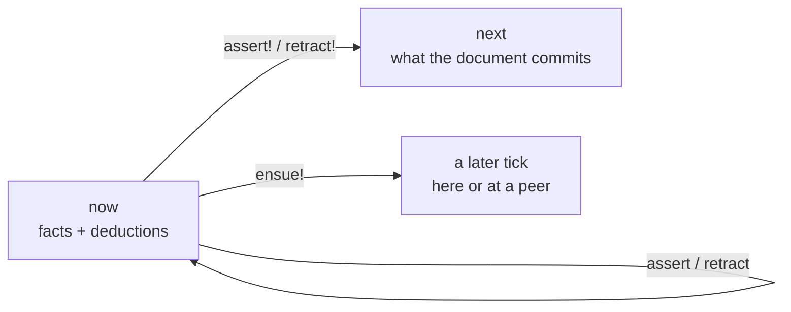

# Dialog notation

A single notation for dialog queries, rules and transactions. Nothing is implemented yet. Everything here is agreed unless it is marked **Proposed**, and the questions still open are listed at the end. The forms are spelled as Lisp while the semantics settle. The YAML spelling comes after.

This is the current decision of the [notation research](../notation.md). The [journal](journal.md) has the reader evals behind each choice, numbered R1 to R15, and the Bloom comparison that reshaped lifetimes and commands. [`sketches/`](sketches) has tonk's `core.yaml` and `notebook.yaml` redone in this notation.

## Model

A replica holds facts. Each fact is an entity, an attribute and a value, with the cause and version it was written at. A document is evaluated against three times, after [Dedalus](https://www2.eecs.berkeley.edu/Pubs/TechRpts/2009/EECS-2009-173.html):

- **`now`** holds the facts as they stand when the document starts, plus whatever the document's facts and deductive rules derive from them.
- **`next`** is the state the document commits: `now` with the document's writes applied.
- **later** is some tick after `next`, possibly at another replica. A fact sent to later arrives when it arrives, and nothing that sends it waits.

Deduction happens within `now`, induction carries `now` into `next`, and `ensue!` sends a fact to a later tick.



## Terms

| Term | Spelling |
|---|---|
| Variable | `?b`, `?status`. It belongs to the one rule or question it appears in. |
| Text | `"triage"` |
| Number | `16`, `0.5` |
| Keyword | `:done`, `:text`, `:last`. A keyword is an entity: `:done` is `done:`, with the colon in front so it is not read as a label. Keywords serve where other languages use them: types, picks, layers and the cases of a variant. |
| Entity | a URI: `id:notebook/scratch`, `did:key:z6Mk…`, `tonk:notebook/edge` |
| Record | `{xyz.bug/title "Crash" xyz.bug/author "ada"}`, `{"N1" id:notebook/scratch/1}` |
| Variant | `[:todo :done]`, a type whose value is one of these cases |
| Name | `notebook/block`, the name of a concept, view or event |

`;` starts a comment.

## Calls

A call names a concept and passes its parameters. Every definition has exactly one primary parameter, written without a label. Every other parameter has a label, and arguments are never punned. At a call the primary may be written bare or as `of:`, in any position, as in [conduct](https://github.com/Gozala/conduct).

```clj
(bug/status ?b is: :triage)
(bug/status is: :triage of: ?b)
(bug/summary ?b title: ?t assignee: ?who)
```

A call may leave out any parameter whose definition says how to derive it. Today only the primary has such a rule, under [Entities](#entities).

`is:` is a call's result. A call written in any argument's place stands for its `is:` value, through a fresh variable, when that variable would only wire the two calls together:

```clj
(bug/report (id {…}) title: "hello world")

; is short for
(id {…} is: ?bug)
(bug/report ?bug title: "hello world")
```

A `!` after the name makes the call a write: `(bug/status! bug:01 is: :done)`.

## Documents

A document is a set of top-level forms evaluated as one tick. The order of its forms does not matter.

A form without `!` belongs to `now`, for this document only: a concept or rule defined without `!`, and a ground call, which asserts its facts into `now`. A form with `!` goes to `next`: it changes the replica, and the document does not see it. Every premise and every question reads `now`, so a document sees what it asserts and derives, but never what it writes with `!`.

```clj
(concept (bug ?bug title: ?title) …)
(bug title: "Hello world")        ; asserted into now
(bug ?bug title: ?title)          ; finds the Hello world bug
```

Neither the concept nor the bug reaches `next`. Written `(bug! title: "Hello world")` instead, the bug would be in `next` and the question would not find it, and the concept still would not be in `next`. A chain, where one write depends on reading another, takes a second document.

The top-level forms are:

- **a question**, a call with a variable, such as `(bug/status ?b is: :done)`;
- **an assertion**, a ground call without `!`, which holds in `now` for this document;
- **a write**, a call with `!`;
- **a rule**, `(rule …)`;
- **a definition**: `concept`, `rule`, `view` or `event`, with `!` to install it.

## Questions

A call with a variable is a question. Its answer is the rows of variable bindings that match `now`. A parameter the question leaves out matches any value. There are no yes-or-no questions: a call with no variable is an assertion, as a ground atom is a fact in a Datalog program.

## Writes

A bare call with `!` writes into `next`. It must be ground, except for an entity it leaves out (see [Entities](#entities)).

```clj
(bug/status! bug:01 is: :done)
```

A write means the same as a rule with one `assert!` head and no `when`, so that longer form is never written.

A write through a concept passes every parameter. Leaving one out is a compile error, not "keep what is there", because it is more often a mistake than a choice. To change one attribute, write the attribute itself, `(xyz.tonk.notebook/source! id:b1 is: "x")`, or a concept over just that attribute, `(block/source! id:b1 is: "x")`. There is no marker for "keep this one". An entity is an identity over time, never partial; what can be partial is what is known about it, so that only some of a concept's facts hold. That is allowed when it is meant: it comes from writing an attribute or a smaller concept, never from forgetting a parameter.

How a retract says "every value" is open.

## Rules

A rule is one or more heads and one `when`:

```clj
(rule (assert (bug/review ?b reviewer: ?who))
  (when (bug/status ?b is: :review)
        (bug/assignee ?b is: ?who)))
```

A head is a verb around a call. The verb says when the head takes effect, and the call inside it carries no `!`:

| verb | takes effect | |
|---|---|---|
| `assert` | in `now` | a deductive rule: it derives into `now` and settles to a fixpoint |
| `retract` | in `now` | **Proposed:** stratified the way `unless` is |
| `assert!` | in `next` | an inductive rule: it reads `now` and writes `next` |
| `retract!` | in `next` | |
| `ensue!` | in a later tick | an asynchronous rule; it has no retracting form |

Several heads may share one `when`, so a body is written once:

```clj
(rule (assert! (bug/status ?b is: :done))
      (retract! (bug/assignee ?b is: ?who))
  (when (bug/status ?b is: :review)
        (bug/assignee ?b is: ?who)))
```

A premise in `when` is one of:
- a call, on a concept or on a stored attribute, such as `(xyz.todo.list/owner-peer ?l is: ?peer)`;
- `(unless call)`, which holds when the call has no match;
- a formula, such as `(== ?a ?b)`, `(!= ?old ?key)`, `(digest {…} is: ?e)` or `(dialog/position ?b after: ?lo before: ?hi is: ?at)`.

Every variable in a head must be bound by the premises.

The `!` moved from the head's call to the verb because readers could not tell when a rule spelled `(assert! (bug/status! ?b …) …)` takes effect: all nine readers in R4 said the form never says, and five of them asked for a separate part that names the trigger. In R10, `ensue!` with no definition said nothing about when it takes effect (none of three could tell), but no reader invented a retracting form for it; two of three invented `retract-later!` for `assert-later!`. So `ensue!` needs this line in the spec, and keeps it from growing an opposite.

## Installing

A `!` on a definition's keyword installs it in the replica: `concept!`, `rule!`, `view!`, `event!`. That is the same `!` a write has, since installing writes the definition into `next`. Without the `!`, the definition belongs to the document it is written in.

An installed inductive rule fires whenever its premises match, which is how a command takes effect.

**Proposed.** Installed rules induce after the document's tick, so the document's questions do not see what they induce. Their edits appear in the report and in the commit.

## Concepts

`concept!` declares a concept. Its head is a call made of variables, and its body is a conjunction. A concept can be read with a query and written with a `!` call.

### Attributes

A body line that names a stored attribute declares it: the stored name, the primary, `is:`, the value type (`as:`) and the pick.

```clj
(concept! (notebook/title ?of is: ?is)
  (xyz.tonk.notebook/title ?of is: ?is as: :text pick: :last))
```

**Proposed.** The line is a call on the stored name. It replaces the `(the xyz.tonk.notebook/title of: ?of …)` spelling, and is what every reader prompt used from R1 on. What tells such a line apart from a call on another concept is open.

The types used so far are `:text`, `:entity`, `:bytes`, `:natural`, `:float`, sized numbers such as `(:float 64)`, variants such as `[:todo :done]`, and the collections `(:sequence T)` and `(:dictionary T)`. A collection value is written as a record from key to element: `(notebook/entry! id:notebook/scratch is: {"N1" id:notebook/scratch/1})`.

The picks are `:last`, which keeps the latest claim, `:all`, which keeps every claim, and `:top`, which keeps the highest-ranked case of a variant.

An attribute line may also carry `layer:` (see [Layers](#layers)) and `role:`, the palette slot that a command's field fills.

### Composite concepts

A composite concept's body is a conjunction of attribute lines, concept calls and constants.

```clj
(concept! (notebook/block ?block notebook: ?n source: ?s)
  (block/notebook ?block is: ?n)
  (block/source ?block is: ?s))
```

Every variable in a body appears in the head. A body cannot reach through an entity it does not name, because a write through the concept could not construct that entity. A rule can reach through one.

A concept's primary need not be the entity of the attributes it reads. Read from the value's side, an attribute gives the reverse relation:

```clj
(concept! (list/todo ?list todo: ?todo)
  (xyz.todo/list ?todo is: ?list))

(list/todo list:home todo: ?t)    ; every to-do on list:home
```

A concept body holds no formulas, so every concept can be read and written. Formulas belong in rule bodies, and also at the top of a document: in a question, in an assertion, and in a write, as `(bug! (digest {…}) …)` does. A concept may not contain itself.

A concept says what facts make it up, not how its entity is made. Construction is the call's business (below) or a rule's.

### Optional parameters

A parameter marked `(option ?x)` in the head may stay unbound in a match.

```clj
(concept! (tonk/repository ?r name: ?name description: (option ?d))
  (repo/name ?r is: ?name)
  (repo/description ?r is: ?d))
```

This is open. In R2 one reader in six expected `(option ?who)` to let a bug with no assignee match.

### Identity

A concept's identity is its set of attributes. An attribute's identity is its stored name, type, pick and layer, so the same name in another layer is another attribute. A name binds a concept to a signature, meaning the head's labels. Two names over the same attributes are one concept with two signatures. Redefining a name with a different body rebinds the name. Stored facts belong to attributes, not names, so they are not touched.

**Proposed.** Views and routes refer to names, so two route models with the same fields keep separate templates.

## Entities

A write says which entity its facts land on in one of three ways:

```clj
(bug/status! bug:7f3a is: :done)                            ; 1. an entity, used as is
(bug! {xyz.bug/title "Crash on save" xyz.bug/author "ada"}   ; 2. a record: the entity
      title: "Crash on save" author: "ada" status: :todo)    ;    that record identifies
(report! title: "Crash on save" author: "ada" status: :todo) ; 3. left out: the digest
                                                             ;    of everything written
```

1. **An entity** is used as given. This is how an update names what it changes.
2. **A record** in place of an entity is a structural identifier: the entity is the one that record identifies, so equal records name the same entity on every device. Keys are resolved to stored attribute names before hashing. It is the same entity `(digest {…})` gives, without spelling the call.
3. **Left out**, the entity is the digest of every attribute and value the write states. Two writes of the same facts are one entity, and two writes that differ in any fact are two.

In R15, sixteen of sixteen readers given any wording of rule 2 used a record of title and author as the bug's identity and predicted one bug after two devices saved it. Without the rule, three readers had no shared answer: one predicted two bugs, and one made up `bug:crash-on-save-ada`.

An identity that must agree everywhere, such as "a bug is its title and author", belongs in a rule that every replica runs, not in each writer's choice of fields:

```clj
(rule! (assert! (bug ?b title: ?t author: ?a status: ?s))
  (when (report title: ?t author: ?a status: ?s)
        (digest {xyz.bug/title ?t xyz.bug/author ?a} is: ?b)))
```

`digest` is a formula. Its primary is a value, here a record, and its `is:` is the entity that value identifies: the one named by the hash of the value's canonical encoding. The same value gives the same entity on every replica. A write that leaves its entity out gets `digest` of a record of everything it writes, so all three ways above are one rule applied to different values.

Writers send a report, and the rule picks the fields. `digest` runs one way, so the planner binds its record first. The keys are stored attribute names: R15's readers spelled the same identity three ways (short names, stored names, `title:` labels), and each spelling hashes to a different entity.

Entities with the same content are the same entity. That is the point for value-like things such as routes. For things that must stay distinct even when their content is equal, a rule can lend them another entity, or the write adds a field that tells them apart, such as the event's time. In `notebook.clj`, each new block takes the entity of the insert command that made it.

There is no `default` line and no marker in the concept's head that says how a write derives the entity. Readers did not see a derivation in a `default` line (none of three in R1), and the marker that read best, `(bug {title author} ?b …)` (five of five in R14 once a rule explained it), puts construction in a definition that is otherwise only about which facts make the concept up.

## Layers

**Proposed.** The set of layers and their names beyond `:now`.

An attribute line's `layer:` says where its facts live and how long. Layers are a fixed set, named by entities, and no document declares one. An attribute with no `layer:` is stored in the replica.

| layer | holds facts | |
|---|---|---|
| (none) | until retracted | stored, and synced as the replica is |
| `:now` | for one tick | never stored; gone once the document's tick ends |

The layer is part of the attribute's identity. `xyz.tonk.site/path` stored and `xyz.tonk.site/path` in `:now` are two attributes, so a concept over one is not a concept over the other.

Facts move between layers by rules, as Bloom moves them between collections. A deductive rule reads several layers on demand; an inductive rule copies facts into another layer and keeps them there. Nothing else replicates.

## Commands

A command is a concept whose attributes are in `:now`. There is no `command` form. Writing one triggers installed rules and stores nothing.

```clj
(concept! (tonk/rename-repository ?cmd repository: ?r name: ?name)
  (xyz.tonk.rename-repository/subject ?cmd is: ?r as: :entity layer: :now)
  (xyz.tonk.rename-repository/name ?cmd is: ?name as: :text layer: :now))

(rule! (assert! (repo/name ?r is: ?name))
  (when (tonk/rename-repository ?cmd repository: ?r name: ?name)))

(tonk/rename-repository! repository: did:key:z6Mk… name: "Plans")
```

The command's write leaves its entity out, so the entity is the digest of its fields. Two commands in one tick never share an entity, so their fields never mix. A shared placeholder entity such as `:new` mixes them: in R3, three of three readers predicted that two `(bug! :new …)` writes in one document leave one entity with two titles.

Whether only rules may write a stored concept, so that its command is the only way in, is a matter of authorization, not notation: a capability that lets a writer into `:now` but not into the stored attributes.

## Sending

`ensue!` sends a fact to a later tick. Where it goes is data on the fact: the `to:` field names the peer, and the runtime routes on it, the way Bloom routes a channel row by its `@` column.

```clj
(rule! (ensue! (xyz.bug/report ?r title: ?t author: ?a status: ?s to: ?peer))
  (when (draft ?r title: ?t author: ?a status: ?s peer: ?peer)))
```

The facts the receiver needs go with the message, in the same tick: the sender says which, rather than the receiver fetching them. On arrival they are in the receiver's `:now` for one tick, where its rules join them with its own facts.

**Proposed.** A remote call, Unison's `fork` and `await`, is a layer on top: a request sent with `ensue!`, a rule at the peer that answers with `ensue!`, and a rule that matches the reply to its request by the request's entity. It needs no form of its own in the core.

## Conflicts

A conflict is never an error. It is elected, as concurrent writes are, comparing version first, then cause, then succession, and value only as the last resort.

- Conflicting writes in one document are concurrent candidates.
- A write in a later document succeeds the claim it read.
- A deductive rule's value under `:last` succeeds the claim its body read (dialog #724, fixed by #725), so `(rule (assert (bug/status ?b is: :todo)) (when (bug/status ?b is: :triage)))` rewrites the status instead of standing beside it.
- A cycle of rewrites converges, with the rewrites as concurrent candidates. A counter (`?n + 1`) does not converge.

A pick is a choice of merge, which Bloom^L would call a lattice. `:all` is a set union and needs no order. `:top` over a variant's ranked cases only moves up the ranking, so two devices that never synced agree once they do. `:last` needs an order across devices, which seventeen of nineteen readers in R15 asked about.

## Views, events and routes

**Proposed.** `view!` and `event!` name what they define by their first argument, the way `concept!` does.

A view attaches templates to a concept by facet:

```clj
(view! notebook/block
  show: {:directory "<div class='notebook-block-row' subject={this} data-source={source}></div>"})
```

An event says how a platform event fills a command. Its `where` keys name command parameters, and its values are paths into the event:

```clj
(event! on/block-remove
  type: "remove"
  where: {:block ".currentTarget.dataset.subject"})
```

A template binds an event to a command with `on:block-remove=block/remove`. A command filled from an element's event is still a command. Elements never write facts directly.

A route maps a path to a route model:

```clj
(route! path: "/notebook/{*entity}" concept: notebook/route)
```

## Preview

**Proposed.** A preview is the same document, evaluated without committing.

## From Bloom

Comparing the design with [Bloom](http://bloom-lang.net) settled three of the choices above and changed two.

| Bloom | here |
|---|---|
| A collection's kind (`table`, `scratch`, `channel`) is declared once; a rule only names collections. | Lifetime is on the attribute (`layer:`), not on the rule or the call. |
| The merge operator says when a rule takes effect: `<=` now, `<+` next, `<-` delete next, `<~` later. | The head's verb: `assert`, `assert!`, `retract!`, `ensue!`. |
| An input is a `scratch` row; `interface input` only labels who writes it. | A command is a concept in `:now`; `command` and `transient:` are gone. Who may write what is authorization. |
| A `channel` is a scratch with one column marked `@` for the destination. | `to:` is a field of the sent fact, not a parameter of `ensue!`. |
| A row's fields stay together because a row is one tuple. | A fact's fields stay together only on a shared entity, so each command needs its own: the digest of its write. |
| A key is the declared columns, and a row with other key values is another row. | A derived entity is fixed when it is made. That keeps it stable when its title changes, and is why the identity fields are open below. |
| Bloom^L lattices merge without coordination. | Picks are merges; `:last` is the one that needs a clock. |

## Open

- How text spans lines or holds `"`. The sketches still write templates as `"""…"""`, which is not part of the notation.
- What a rule head that names no entity lands on. In R16, four of five readers of this spec put a sent notice on the to-do's own entity because no example shows another way; the readers of the shorter documents left it out. The obvious answer is the one writes have: the digest of the head's facts.
- Whether a rule that creates should only create. The R16 rule that asserts `state: :open` on every add reopens a done to-do that is added again; `(unless (todo ?t))` in its `when` would stop that.
- Whether a record in place of an entity also supplies the parameters whose attributes it names. Without that, creating a bug states its title and author twice, once to identify it and once as facts, since a write must pass every parameter: `(bug! {xyz.bug/title "Crash" xyz.bug/author "ada"} title: "Crash" author: "ada" status: :todo)`. With it, `(bug! {xyz.bug/title "Crash" xyz.bug/author "ada"} status: :todo)` is complete, and a label that disagrees with the record is an error. In R15, fourteen of sixteen readers repeated the fields, so they read the record as identity only; the two who saw this form in an example wrote it. Writing `(digest {…})` explicitly has the same doubling, which is why the record rule stays.
- Record types: a formula such as `digest` takes a record, and there is no type for one yet.
- Whether a record may use short keys inside a concept call, resolved to stored names before hashing, or only stored names.
- Whether the fields an identity is derived from may change. A renamed title gives a record that no longer finds its bug, and a new write with it makes a second one.
- How `:last` orders writes from devices that had not synced.
- Optional parameters: `(option …)` read correctly once in six.
- Which layers exist beyond `:now` and stored, and their names.
- Whether commands are conduct record types, one attribute whose value is a record, rather than one attribute per field. Dialog's `Record` value is opaque to queries today ([record-value](../../notes/record-value.md)).
- How an entity is named across the rules and writes of a document, and what a bare symbol such as `scratch` or `tab-title` means.
- Whether a document's questions are answered jointly or one at a time.
- Whether a rule's head must be a declared attribute or concept.
- Whether metadata (`description:`, `action:`, `role:`) is labeled entries kept as data.
- Whether templates name models by concept name rather than by pinned URI.
- The YAML spelling.
