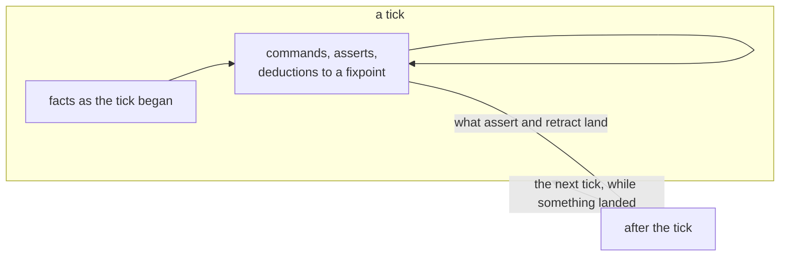

# Dialog notation

One notation for dialog's queries, rules and transactions. Nothing is implemented yet. Everything here is agreed unless it is marked **Proposed**, and what is still open is listed at the end. Forms are spelled as Lisp while the semantics settle; the YAML spelling comes after.

This is the current decision of the [notation research](../notation.md). The [journal](journal.md) has the reader rounds behind each choice, R1 to R46. The [sketches](sketches) redo tonk's `core.yaml` and `notebook.yaml` in the notation as it stood at R16, before commands, and have not been redone since.

## Model

A replica holds claims: an entity, an attribute and a value, with the cause and version it was written at. An attribute belongs to a domain: `xyz.todo/title` is the `title` attribute of the `xyz.todo` domain.

A concept is just a set of attributes: a convenient way to express derivations over those attributes more concisely. Each line of a concept is a claim, written by the attribute's full name: `(xyz.todo/title of: ?t is: ?title)` says the attribute `xyz.todo/title` of the entity `?t` is `?title`. When a concept is asked for, its lines are read. When it is concluded by a rule or asserted, its lines are what is concluded or asserted:

```clj
(concept (titled ?t title: ?title)
  (xyz.acme.task/title of: ?t is: ?title))

; this rule
(rule (titled ?t title: ?title)
  (ticket ?t title: ?title))

; is the same as
(rule (xyz.acme.task/title of: ?t is: ?title)
  (ticket ?t title: ?title))
```

There is one layer. A value of an attribute was either stored or concluded by a rule, and every read of the attribute sees both. Under `cardinality: :one` a read gives the one caused most recently, stored or concluded, and a concluded value is as recent as the newest fact it was concluded from.

These paragraphs are what a reader needs before anything else, and the spec opens with them. Readers bring Datalog's split between stored relations and derived ones:

- they take a rule's conclusion for a view that exists only at query time;
- they take a call on a domain for the stored layer;
- they take a rule as running only when its head is asked for.

From R27 to R37, no account in prose moved them: not "a domain call reads derived values", not "an open-ended concept", not "a bidirectional lens". Showing a concept rule as the attribute rule it is did, and the election sentence settled which value wins. Calling a line a claim that is read and concluded, rather than a read, kept readers from taking a concept for a view (R41 to R42).

| document | without the spec | R39 | R42 | R45, `cardinality:` |
|---|---|---|---|---|
| a rule's `memo` is found as a `note` | 0 of 10 | 20 of 20 | 19 of 20 | 20 of 20 |
| a renamed derived to-do shows the rename | 0 of 10 | 18 of 20 | 20 of 20 | 20 of 20 |

Time moves in ticks, after [Dedalus](https://www2.eecs.berkeley.edu/Pubs/TechRpts/2009/EECS-2009-173.html). A tick reads the facts as they stood when it began, plus whatever is asserted or deduced in it.

- **Deduction** happens within a tick. A rule's conclusion holds in this tick while its conditions do, and rules derive from it to a fixpoint.
- **Induction** carries one tick into the next. What `assert` and `retract` conclude lands after this tick, where rules see it.



A run goes on tick by tick while a tick lands something, up to a turn limit. No form carries `!`: it was dropped when `assert` and `retract` became the only way a conclusion outlives its tick.

## Terms

| Term | Spelling |
|---|---|
| Variable | `?t`, `?state`. It belongs to the one rule or question it appears in. `_` matches anything and binds nothing. |
| Text | `"Buy milk"` |
| Number | `16`, `0.5` |
| Keyword | `:done`, `:text`. A keyword is an entity: `:done` is `done:`, with the colon in front so it is not read as a label. Keywords serve where other languages use them: types, cardinalities and the cases of a variant. |
| Entity | a URI: `todo:9c1e`, `did:key:z6Mk…`, `tonk:notebook/edge` |
| Variant | `[:open :done]`, a type whose value is one of these cases, listed in order |
| Record | `{"N1" id:notebook/scratch/1}`, the value of a collection |
| Domain | `xyz.todo`, a namespace of attributes |
| Attribute | `xyz.todo/title`, written in full on every line that reads or writes it |
| Name | `todo`, the name of a concept |

`;` starts a comment.

## Calls

A call names a concept, a domain, a command or a formula, and passes its parameters. Every definition has exactly one primary, written without a label. Every other parameter has its label, and arguments are never punned. The primary may also be written `of:`, in any position, as in [conduct](https://github.com/Gozala/conduct).

```clj
(todo ?t list: ?l state: :open)
(todo state: :open of: ?t)
```

In a question or a premise, a parameter left out matches anything. In an `assert` through a concept, leaving one out is a compile error (see [Commands](#commands)).

## Documents

A document is a set of top-level forms evaluated as one run. The order of its forms does not matter. A top-level form is one of:

- a question, `(query …)`;
- a command, such as `(add (todo list: list:home text: "Buy milk"))` or `(assert (xyz.todo/state of: todo:9c1e is: :done))`;
- a `rule`;
- a `concept`;
- a `view`.

A command at the top level is ground, or has a `when` that binds its variables (see [Writes succeed what they read](#writes-succeed-what-they-read)). A bare call, with variables or without, is not a top-level form.

A document is submitted in one of two ways:

- As a **query**, it runs and returns what it derived and what would have landed. It changes nothing, so it needs no permission to write.
- As a **transaction**, it runs the same way, then advances the replica's revision with everything that landed.

So one document can be run as a query to see what it would do, then as a transaction. In a transaction a top-level `rule` or `concept` is installed and runs from then on; in a query it lives for that run only.

In R23, 8 of 10 readers preferred this to a `!` at the top level deciding the commit: `!` keeps one meaning, and a stray `!` cannot turn a read into a write.

## Questions

```clj
(query (todo ?t list: list:home state: :open))
```

A question's answer is the rows of variable bindings that match what holds in the tick, including what the document asserts and deduces. It changes nothing, in either kind of run.

A concept a question names must be declared, installed or in the same document, or the question is a compile error. An attribute needs no declaration: `(query (xyz.todo/text of: ?t is: ?x))` reads whatever the attribute holds. A reader's default is the other way: in R25, 16 of 20 expected an undeclared concept to answer nothing, as an unknown relation does in Datalog.

`query`, `select`, `find` and `(? …)` read alike, with documentation (R24) and without (R25), and no reader misread any of them. `query` is the maintainer's choice. A query form and a document run as a query mean the same thing: they read and change nothing.

## Concepts

```clj
(concept (todo ?i list: ?l title: ?t state: ?s)
  (xyz.todo/title of: ?i is: ?t as: :text cardinality: :one)
  (xyz.todo/state of: ?i is: ?s as: [:open :done] cardinality: :one)
  (xyz.list/task of: ?l is: ?i as: :entity cardinality: :many))
```

A concept is a set of attributes that runs both ways (see [Model](#model)). Read, its lines make the concept; asserted, each line is stored; concluded by a rule, each line is concluded. Its stored facts are carried from tick to tick until retracted.

A line is one attribute: its full name, `of:` the entity, `is:` the value, then `as:` its type, `cardinality:` and `in:` its layer. The entity may be written without `of:`, as any primary may, but concepts spell it out.

- A line names the claims it reads. In R40, a type and pick given on a line of their own, keyed by the variable, `(?l as: :entity policy: :last)`, read as the concept field's policy for 17 of 20 readers, though `?l` was the entity of `xyz.list/task` and had no claims of its own. Keyed by the attribute, 20 of 20 read it right (R41).
- Every variable in a concept's body appears in its head. That is what lets every concept be read and written, as an updatable view in SQL maps each column back to one base column. A join through a variable the head does not name belongs in a rule.
- Attributes belong to the domain, not to a concept, so concepts share them: a `note` over `xyz.todo/title` is every to-do. A concept may not contain itself.

Readers agree that a concept runs both ways: 39 of 40 in R32 said so of their own accord.

A concept's primary need not be the entity it reads. Read from the value's side, a line gives the reverse relation:

```clj
(concept (list-item ?l todo: ?t)
  (xyz.list/task of: ?l is: ?t cardinality: :many))
```

A concept says what facts make it up, not how its entity is made. Construction belongs to a command's rule (see [Creating things](#creating-things)).

### Cardinality

`cardinality:` says how many claims a line holds for one entity, and so what a write does:

- `:one`: a write replaces the claim it read, and a read gives the newest.
- `:many`: a write adds a claim, and a read gives every claim.

It replaces picks. A pick decided both how a cell was read and what a write retired, and under `:max` and `:top` updates had no good answer (#759). Cardinality says only what a write does; choosing among a cell's claims is an elector in the concept's head (below). Datomic splits it the same way.

### Electors

An elector in a concept's head chooses one of a field's claims:

```clj
(concept (account ?a status: (top ?s))
  (tonk.account/status of: ?a is: ?s as: [:suspended :active :registered] cardinality: :many))
```

The electors are `last`, `max`, `min` and `top`. Each is the greatest claim under a total order:

| elector | orders by |
|---|---|
| `(last ?s)` | cause |
| `(max ?s)`, `(min ?s)` | value, either way |
| `(top ?s)` | the listing in the line's `as:`, first listed best; a line with no ordered `as:` is an error |

Ties fall to cause, then to the value's hash, so every order is total and every replica elects alike. An elector is a lattice join, which is why it is safe inside a cycle, as `last` already is. A `:one` field with no elector reads as `(last ?s)`.

- A fold groups by every head field it does not fold, as Datomic's `:find` does. `(account ?a email: ?e status: (top ?s))` gives one status per email. A `group-by:` can come later if a concept needs it.
- An elector returns one of its claims, so a write binds it: `(assert (account acct:1 status: :active))` writes `?s = :active` through the line, which under `:many` adds a claim. The read still gives `:suspended` while `:suspended` is held. Un-suspending is retracting it.
- In R45 a ranking in a rule's conclusion, `([:suspended :active :registered] ?state)`, was invisible without a sentence: 0 of 20 readers kept `:suspended` after `:active` was asserted again, and 20 of 20 with one.

Only electors fold in a concept. A fold that computes a value, `count`, `sum`, `avg`, binds none of what it read, so nothing could be written through it, and a concept stays two-way. Those are getters.

### Getters

A getter is a rule whose conclusion wraps a concept and gives a value in `is:`:

```clj
(rule (open-count (list ?l) is: (count ?t))
  (list ?l)
  (todo ?t list: ?l state: :open))

(open-count (list list:home) is: ?n)
```

It reads like a property of the concept: the open count of this list is 2. It groups by the concept's entity. A computing fold goes only in a getter's `is:`: never in a concept's head, and never on an attribute, where it could be written and read back as stored.

### Layers

`in:` names the layer a line's claims are on, as `notes/layers.md` has it (on `claude/layers-model`). It is a constant, or a field of the concept:

```clj
(concept (todo ?i title: ?t at: ?where)
  (xyz.todo/title of: ?i is: ?t as: :text cardinality: :one in: ?where))
```

- A read with `at:` bound reads that layer. Left out, it reads every layer at once, and the elector chooses among the claims of all of them.
- A write with `at:` left out goes to the primary, an assert and a retraction alike; a command goes to the control layer. As in an image editor, erasing on one layer leaves what another shows.
- A rule's conclusion is a claim of the attribute it concludes, on that attribute's layer.

Readers read the composite with no help (20 of 20 in R43 and R44). Retracting the title they see when it sits on another layer, 2 of 20 saw that it stays; with the write sentence, 20 of 20 (R44).

### Collections

A collection's keys are its attribute names, as in dialog today: a notebook's `N5` is the attribute `xyz.tonk.notebook/N5`. A line over a collection leaves the key as a variable in the name, and `by:` says what a key is, `:name` for a dictionary or `:position` for a sequence:

```clj
(concept (element-method ?e name: ?n source: ?s)
  (xyz.tonk.element.method/?n of: ?e is: ?s as: :text cardinality: :one by: :name))

(concept (notebook-entry ?b at: ?p block: ?x)
  (xyz.tonk.notebook/?p of: ?b is: ?x as: :entity cardinality: :one by: :position))
```

- `/?n` reads one row per key. All 100 readers in R46 read it that way without being told.
- `by:` is part of the attribute's identity, as dialog's `Keyed::Dictionary` and `Keyed::Sequence` are, so it goes on the line. Without it, 18 of 20 readers took a sequence's `N1` for an opaque id (R46); with it, 20 of 20 told them apart.
- The key is a head field, and a concept holds one collection only: two would give a row for every pair of their entries.
- `cardinality:` applies to each entry.

An entry is a fact, so entries written on two devices merge key by key. A record value is one value: opaque to queries, and two concurrent writes of it elect one whole record.

### Constraints

A constraint computes nothing; it holds or it does not. It stands among a rule's conditions. On a read it filters; on an assert it refuses the write, and nothing lands.

- **type**: `(: ?x as: :text)`, a value is text, an entity, a number, a case of a variant, or a label that is a `:symbol` or a `:position`. On a concept line it is `as:`;
- **equality**: `(== ?a is: ?b)`, `(!= ?a is: ?b)`;
- **comparison**: less than, greater than, within a range.

Negation is not a constraint, since an assert could not say what it enforces, and neither is arithmetic that runs both ways, since it computes. Formulas belong in rules.

The types used so far are `:text`, `:entity`, `:bytes`, `:natural`, `:float`, sized numbers such as `(:float 64)`, variants such as `[:open :done]`, and the label types `:symbol` and `:position`. R26 tried five spellings of ascription and every reader read every one as a check that touches no stored facts.

### Identity

An attribute's identity is its domain, its name, its type and its cardinality: the same name with another type is another attribute over the same stored claims. A concept's identity is its set of attributes. A name binds a concept to a signature, meaning the head's labels. Redefining a name with a different body rebinds the name. Stored facts belong to attributes, not names, so they are not touched.

## Commands

Everything that changes anything is a command, written around a concept or a domain:

```clj
(add (todo list: list:home text: "Buy milk"))
```

- A command's facts are not the concept's facts. They are tagged with the command's name, so `(query (todo …))` never sees them, and they are never carried, stored or synced: rules see them in the tick they are issued, and then they are gone. The `add` above keeps nothing; what lands is what its rules assert. In R25 all 20 readers, shown no documentation, took `add` to write the to-do itself, so this has to be said.
- A command needs no declaration. The rules that read it decide what it takes: any of the concept's parameters, with or without its entity, as in `(remind (todo todo:9c1e))`. Issuing one with a parameter no rule reads is a compile error.
- A command wraps exactly one concept or domain, one deep: its subject. It may add labels of its own beside it, as in `(rename (todo ?t) title: ?new)`.
- A command's rows are keyed by its name and everything it passes, so identical commands in one tick are one. A command that must count twice in a tick, such as an increment, carries a field that tells them apart.

### `assert` and `retract`

The two commands that come with the language, and the only ones that change a concept:

| form | does |
|---|---|
| `(assert (todo todo:9c1e list: list:home text: "Buy milk" state: :open))` | names the entity and passes every parameter; leaving any out is a compile error |
| `(assert (xyz.todo/tag of: todo:9c1e is: "urgent"))` | one attribute; with nothing read, the value is added beside what is there |
| `(retract (todo todo:9c1e))` | retracts every field of the concept on that entity |
| `(retract (xyz.todo/text of: todo:9c1e is: "Buy milk"))` | retracts just that value |

What is asserted holds in this tick and lands after it. What is retracted stops holding now and is gone after it. Every other command changes a concept only through rules that issue `assert` or `retract`.

Leaving a parameter out of an assert through a concept is an error, not "keep what is there", because it is more often a mistake than a choice. A change to some fields goes through their attributes, with a `when` (below). An entity is an identity over time, never partial; what can be partial is what is known about it.

### Writes succeed what they read

An assert succeeds the claims its body read for the same entity and field. If it read none, it adds. This is dialog's `cause`: an assertion with one succeeds the claim it names, and one without is additive.

Any top-level command may take a `when`. It runs once, in this document, and is never installed, unlike a top-level `rule` in a transaction:

```clj
; replace: read the newest, succeed it
(assert (xyz.todo/state of: ?t is: :done)
  (when (todo ?t state: ?old)
        (== ?t is: todo:9c1e)))

; find the entity by what it says
(assert (xyz.todo/state of: ?t is: :done)
  (when (todo ?t text: "Call mom")))
```

A `:one` line replaces; a `:many` line adds; a write with no read of that field appends. An assert through a concept reads first: it reads the concept's lines on the entity, and succeeds what it read on its `:one` lines, so `(assert (todo todo:9c1e …))` replaces each `:one` field.

Every variable in a command with a `when` is bound by it; a command without one is ground.

There is no content identity: `assert` never derives an entity. In R17 and R18 an entity derived from every field made a changed state a new to-do, and readers tripped on it until it was removed (R19, 0 of 15).

## Creating things

Nothing gets an entity by itself. A new thing is made by a command whose rule computes its entity, with one of two formulas:

- `(id ?t list: ?l text: ?x)` binds `?t` to the entity those labels and values identify. The same labels and values give the same entity, on every device. It derives; it neither mints nor looks up. It runs one way, so the planner binds its fields first.
- `(fresh ?n)` binds `?n` to a new entity, never equal to any other.

```clj
(rule (assert (todo ?t list: ?l text: ?x state: :open))
  (add (todo list: ?l text: ?x))
  (id ?t list: ?l text: ?x))

(rule (assert (note ?n text: ?x))
  (jot (note text: ?x))
  (fresh ?n))
```

Two devices that `add` the same list and text make one to-do; every `jot` makes a new note. The schema's author owns how things are created, so every agent that creates through `add` agrees on identity. In R25, 19 of 20 readers could not tell from the code alone whether `id` mints, derives or looks up, so the spec says it.

## Rules

`(rule conclusion condition…)`. The first form is what the rule concludes; the rest are its conditions. There is no `when`: in R27 all 20 readers read the bare form exactly as well as the form with `when`.

A conclusion is one of:

- a concept or an attribute, a deduction: it holds in this tick while the conditions do, and is never stored;
- a getter, `(name (concept ?x) is: …)`, a deduction whose `is:` may fold;
- a command, which holds in this tick for other rules to read;
- `(assert …)` or `(retract …)`, which lands after the tick.

A rule has one conclusion. Where one event should do several things, a rule concludes a command of its own, and a rule per effect reads it:

```clj
(rule (update-title (todo ?t) old: ?old new: ?new)
  (rename (todo ?t) title: ?new)
  (xyz.todo/title of: ?t is: ?old))

(rule (retract (xyz.todo/title of: ?t is: ?old))
  (update-title (todo ?t) old: ?old))

(rule (assert (xyz.todo/title of: ?t is: ?new))
  (update-title (todo ?t) new: ?new))
```

In R27, readers asked to write such a pair wrote two rules, each with one conclusion, and none put two conclusions in one.

A condition is one of:

- a call on a concept, an attribute, a getter or a command;
- `(unless call)`, which holds when the call has no match;
- a constraint: a type, an equality or a comparison;
- a formula: `id`, `fresh`, `(dialog/position ?b after: ?lo before: ?hi is: ?at)`.

Every variable in a conclusion is bound by a condition. A condition matches what holds now: stored values and concluded ones alike.

Rules derive to a fixpoint, recursion included, and a rule's conclusion holds whether or not anything asks for it. Asked yes or no, readers commit to the opposite. In R37, 16 of 20 readers without the spec said a `note` would not see a rule's `memo`, for two reasons:

- 12 said the rule makes a `memo`, not a `note`;
- 7 said the rule never runs, since nothing asks for `memo`.

```clj
(rule (xyz.app.open/text of: ?t is: ?x)
  (todo ?t text: ?x state: :open))

(query (xyz.app.open/text of: ?t is: ?x))
```

Re-issuing a command in a later tick, which `!` did, is open (below).

The cost R23's readers named: a conclusion's `assert` lands only when the run is a transaction, and the rule's text does not say which it will be.

## The prelude

**Proposed.** A concept is carried from tick to tick by a rule the language supplies, as persistence is in Dedalus; a command is not carried, because nothing carries it. `?concept` stands for any concept and `… ?params` for its parameters but the primary.

```clj
(rule (?concept ?e … ?params)             ; what is asserted holds now
  (assert (?concept ?e … ?params)))
```

The rule that carried what holds into the next tick, unless retracted, was written with a `!` head, which is gone; how the prelude spells persistence is open. These rules act on each field a concept reads, so an assert or retract through a domain is the same rules over one field. They do not yet say that a retract also stops a fact holding in its own tick; that, and an assert and a retract of one fact in one tick, are open. In R17 the prelude did not help readers; it is the definition, not the teaching.

## Conflicts

A conflict is never an error. It is elected, as concurrent writes are, comparing version first, then cause, then succession, and value only as the last resort.

- Conflicting asserts in one tick are concurrent candidates.
- An assert in a later transaction succeeds the claim it read.
- A value a rule derives on a `:one` line succeeds the claim its body read (dialog #724, fixed by #725), so a rule that moves a status rewrites it instead of standing beside it.
- A cycle of rewrites converges, with the rewrites as concurrent candidates. A counter (`?n + 1`) does not converge.

An elector is a choice of merge, which Bloom^L would call a lattice. A `:many` read is a set union and needs no order. `top` over a variant's ranked cases only moves up the ranking, so two devices that never synced agree once they do. `last` needs an order across devices, which seventeen of nineteen readers in R15 asked about. A computing fold is not a lattice: the same 5 counted twice is 10, which is why it stays out of concepts.

## Sending

**Proposed.** Dialog exposes no network: a peer can only write where others read. So a message to another peer is a retained fact, asserted where the receiver reads, and delivered by sync or gossip. It is cleared by a receipt, as delay-tolerant networks hand off custody. One replica cannot make another retain a message for one tick only, so a message is not a command at the receiver; its rules read it as they read any fact. Where a fact goes is data on it, as Bloom routes a channel row by its `@` column. The facts the receiver needs go with the message: the sender says which, rather than the receiver fetching them, as Unison sends code by hash. Where to write is an entity the embedder binds, such as `:session`. The spelling is open.

A remote call, Unison's `fork` and `await`, is a layer on top: a request sent, a rule at the peer that answers, and a rule that matches the reply to its request by the request's entity.

## Views

**Proposed.** A view is a named template over one concept:

```clj
(view (card (list ?l name: ?name))
  [:article
    [:h2 ?name]
    [:p (open-count (list ?l)) " open"]
    [:ul (row (todo ?t list: ?l))]])

(view (row (todo ?t title: ?title))
  [:li ?title])
```

- The head wraps one concept application and binds its fields. It reads as a sentence: the card of a list is this.
- The body is the template. A vector is markup, as in Hiccup; a variable fills a slot; a call in parentheses is a join, as a rule's condition is, and its inputs are bound by the head.
- A call to a getter fills the slot with its `is:`. A call to a view renders that view for each match: `(row (todo ?t list: ?l))` renders one `[:li]` per to-do on the list. There is no `for`: anything can be many, and many repeats, as tonk's templates do today.
- Order comes from positional dictionaries, which sort by position, or from CSS `order`. Unordered matches keep a stable order between renders, so nothing reshuffles when nothing changed.
- A concept has as many views as names. `(card (list list:home))` renders one; `(detail (list list:home))` another.

A view is data, not a rule. It expands to today's entry in the concept's views dictionary, the head kept beside the template, so a concept has one `card`, and editing the template is a rewrite:

```clj
(assert (tonk.concept/view of: concept:list
          card: {of: (list ?l name: ?name)
                 is: [:article …]}))
```

The renderer binds the head for an entity, and each call in the template becomes a query against that binding.

A view whose body is a record instead of markup is a query, called by name for data:

```clj
(view (summary (list ?l name: ?name))
  {name: ?name  open: (open-count (list ?l))})
```

One form returns markup or data, called by name on a concept, with joins written as calls in its result. A join in front of the head would give one card per row, so joins go in the body, where many means a list on screen.

Events and routes are as [macros](macros.md) left them, and are not redone here.

## Prior art

Comparing the design with [Bloom](http://bloom-lang.net), Dedalus and LogiQL settled most of the choices above.

| there | here |
|---|---|
| Bloom: a `table` persists; a `scratch` or `channel` lasts one tick. | A concept is carried until retracted; a command lasts one tick. Lifetime belongs to what is called, not to the call. |
| Bloom: tables change only through `<+` and `<-`. | Concepts change only through `assert` and `retract`, which land after the tick. |
| Bloom: `<=` holds now, `<~` arrives later. | A rule's conclusion holds now; sending is open. |
| Dedalus: persistence is a rule, and induction is the successor tick. | The [prelude](#the-prelude) carries concepts; `assert` and `retract` are induction. |
| Datalog: derived relations are views apart from stored ones; Prolog and top-down Datalog reach a rule through its head's name. | One layer: a rule's conclusion is values of attributes, seen by every read of them, whether or not its head is asked for. Readers bring the Datalog model, so the spec opens with this (see [Model](#model)). |
| LogiQL: pulse predicates hold for one transaction. | Commands. |
| LogiQL: delta predicates `+R`, `-R`, `^R`. | `assert` and `retract`. |
| LogiQL: constructor predicates make entities from a key. | `id` and `fresh` in a command's rule. |
| LogiQL: `exec` runs a block once, `addblock` installs it. | A query runs a document's rules once; a transaction installs them. |
| Bloom: a row's fields stay together because a row is one tuple. | A command's rows are keyed by its name and content. |
| Bloom^L: lattices merge without coordination. | Electors are merges; `last` is the one that needs a clock. Computing folds are not, and live in getters. |
| Datomic: cardinality one replaces, many adds; aggregates live in `:find` and group by what is not aggregated. | `cardinality:` does the same for writes; electors and getters group the same way. |
| Hiccup: markup as vectors. | A view's template, with calls for joins. |

## Open

- Under whose authority an installed rule writes: the transaction that installed it, or the one that set it off. Dialog's induction today runs as the operator committing.
- What a retract hides in its own tick when a rule also derives the fact, and what an assert and a retract of one fact in one tick do.
- A command in a premise and an issued command look alike: `(add (todo list: ?l text: ?x))` matches as a rule's condition and issues at the top. Readers proposed `(do add …)`.
- What drives a tick. Dialog runs induction inside one commit and fails it after 16 rounds. With `!` gone, how a command is re-issued in a later tick or carried to a later transaction or a clock, and how the prelude spells persistence.
- Whether a top-level command keeps `when`, now that rules have none.
- A stored value on a derived concept outlives its derivation. Renaming a to-do that a rule derives from an issue stores a title; once the issue closes and the to-do is no longer derived, the stored title is still read through the attribute. Whether a rename of a derived concept should write somewhere else, or only hold while the derivation does.
- Every reader round so far used `haiku`. Whether larger models read attribute lines and rules differently is untested.
- How commands are defined for discovery: derived from the rules that read them, with metadata as facts ([implementation](implementation.md#commands)).
- Whether `id` names a domain or a concept, so two concepts with the same labels and values do not share an entity.
- Whether a rule that creates should only create. The `add` rule asserts `state: :open`, so adding a done to-do's list and text again reopens it; `(unless (todo ?t))` among its conditions would stop that.
- Whether a type filters before an elector chooses or after. With two text claims, `"Buy milk"` and a newer `42`, under `as: :text`, typing first gives `"Buy milk"` and electing first gives nothing.
- What retract takes for a collection concept: `(retract (notebook-entry notebook:scratch))` names every entry; it likely needs the entity and the key.
- What two concurrent blind writes on a `:one` line leave: each succeeds what was live where it landed, so both stay live for the next read to elect.
- Optional fields and defaults. `(option ?x)` in a head read correctly once in six (R2). Proposed on the line: `optional: true`, and `default: :open`, which is `optional` with `Coalesce` on read. A default cannot be a rule on its own attribute: that is a cycle through negation.
- Whether a query holds several calls answered jointly, and whether questions stay calls or become rules into a relation head.
- How text spans lines or holds `"`. The sketches write templates as `"""…"""`, which is not part of the notation.
- Rows without an entity, such as a set of pairs, and relations without a value, such as a set of entities: every fact needs an entity and a field.
- Record types: there is no type for a record yet.
- Concurrent claims on a `:one` line are ordered by standing and last by the value's hash, so every replica elects alike (#752). A write after them settles them only once [#759](https://github.com/dialog-db/dialog-db/issues/759) lands.
- Whether a command's parameters are a conduct record type, one field whose value is a record. Dialog's `Record` value is opaque to queries today ([record-value](../../notes/record-value.md)).
- How an entity is named across the rules and commands of a document, and what a bare symbol such as `scratch` means.
- Whether metadata (`description:`, `action:`, `role:`) is labeled entries kept as data.
- Whether templates name models by concept name rather than by pinned URI.
- The sketches, which predate commands.
- The YAML spelling.
- A getter's conclusion, `(open-count (list ?l) is: …)`, has the shape of a command, `(rename (todo ?t) title: …)`. Only `is:` tells a reader it is computed, not issued.
- The cardinality work (`claude/pick-strategy-rules-crdt-tvdpm7`, #793) lets any deductive rule fold and ranks a fold's value against stored claims. The notation puts electors only in concept heads and computing folds only in getters, so a folded value never competes with a stored claim. The engine and the notation have to agree on this.
- A rename under `:many` when the old value is on another layer leaves the old value beside the new one.
- Whether the form for views and queries is called `view` or `query`.
- How a view's template binds events and names commands, now that it is Hiccup.
