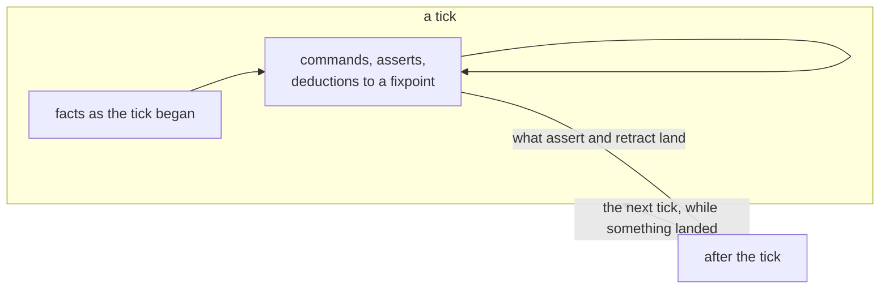

# Dialog notation

One notation for dialog's queries, rules and transactions. Nothing is implemented yet. Everything here is agreed unless it is marked **Proposed**, and what is still open is listed at the end. Forms are spelled as Lisp while the semantics settle; the YAML spelling comes after.

This is the current decision of the [notation research](../notation.md). The [journal](journal.md) has the reader rounds behind each choice, R1 to R39. The [sketches](sketches) redo tonk's `core.yaml` and `notebook.yaml` in the notation as it stood at R16, before commands, and have not been redone since.

## Model

A replica holds claims: an entity, an attribute and a value, with the cause and version it was written at. An attribute belongs to a domain: `xyz.todo/title` is the `title` attribute of the `xyz.todo` domain.

A concept is just a set of attributes that share an entity: a convenient way to express derivations over those attributes more concisely. Asserting a concept stores one claim per attribute, reading it reads them, and a rule that concludes a concept concludes each of them:

```clj
(concept (titled ?t title: ?title)
  (xyz.acme.task ?t title: ?title))

; this rule
(rule (titled ?t title: ?title)
  (ticket ?t title: ?title))

; is the same as
(rule (xyz.acme.task ?t title: ?title)
  (ticket ?t title: ?title))
```

There is one layer. A value of an attribute was either stored or concluded by a rule, and every read of the attribute sees both, through any concept or a domain call. A pick elects among them: `last` picks the value caused most recently, stored or concluded, and a concluded value is as recent as the newest fact it was concluded from.

These three paragraphs are what a reader needs before anything else, and the spec opens with them. Readers bring Datalog's split between stored relations and derived ones:

- they take a rule's conclusion for a view that exists only at query time;
- they take a domain call such as `(xyz.todo ?t title: ?x)` for the stored layer;
- they take a rule as running only when its head is asked for.

From R27 to R37, no account in prose moved them: not "a domain call reads derived values", not "an open-ended concept", not "a bidirectional lens". Showing a concept rule as the domain rule it is did, and the election sentence settled which value wins. In R39, with the framing, the one-field example and the election sentence:

| document | without the spec | with it |
|---|---|---|
| a rule's `memo` is found as a `note` | 0 of 10 | 20 of 20 |
| a renamed derived to-do's rename lands | 0 of 10 | 18 of 20 |

Time moves in ticks, after [Dedalus](https://www2.eecs.berkeley.edu/Pubs/TechRpts/2009/EECS-2009-173.html). A tick reads the facts as they stood when it began, plus whatever is asserted or deduced in it.

- **Deduction** happens within a tick. A rule's conclusion holds in this tick while its conditions do, and rules derive from it to a fixpoint.
- **Induction** carries one tick into the next. What `assert` and `retract` conclude lands after this tick, where rules see it.



A run goes on tick by tick while a tick lands something, up to a turn limit. No form carries `!`: it was dropped when `assert` and `retract` became the only way a conclusion outlives its tick.

## Terms

| Term | Spelling |
|---|---|
| Variable | `?t`, `?state`. It belongs to the one rule or question it appears in. `_` matches anything and binds nothing. |
| Text | `"Buy milk"` |
| Number | `16`, `0.5` |
| Keyword | `:done`, `:text`. A keyword is an entity: `:done` is `done:`, with the colon in front so it is not read as a label. Keywords serve where other languages use them: types, picks and the cases of a variant. |
| Entity | a URI: `todo:9c1e`, `did:key:z6Mk…`, `tonk:notebook/edge` |
| Variant | `[:open :done]`, a type whose value is one of these cases |
| Record | `{"N1" id:notebook/scratch/1}`, the value of a collection |
| Domain | `xyz.todo`, a namespace of attributes such as `xyz.todo/title` |
| Name | `todo`, the name of a concept |

`;` starts a comment.

## Calls

A call names a concept, a domain, a command or a formula, and passes its parameters. Every definition has exactly one primary, written without a label. Every other parameter has its label, and arguments are never punned. The primary may also be written `of:`, in any position, as in [conduct](https://github.com/Gozala/conduct).

```clj
(todo ?t list: ?l state: :open)
(todo state: :open of: ?t)
```

In a question or a premise, a parameter left out matches anything. In an `assert` through a concept, leaving one out is a compile error (see [Commands](#commands)).

## Documents

A document is a set of top-level forms evaluated as one run. The order of its forms does not matter. A top-level form is one of:

- a question, `(query …)`;
- a command, such as `(add (todo list: list:home text: "Buy milk"))` or `(assert (xyz.todo todo:9c1e state: :done))`;
- a `rule`;
- a `concept`.

A command at the top level is ground, or has a `when` that binds its variables (see [Writes succeed what they read](#writes-succeed-what-they-read)). A bare call, with variables or without, is not a top-level form.

A document is submitted in one of two ways:

- As a **query**, it runs and returns what it derived and what would have landed. It changes nothing, so it needs no permission to write.
- As a **transaction**, it runs the same way, then advances the replica's revision with everything that landed.

So one document can be run as a query to see what it would do, then as a transaction. In a transaction a top-level `rule` or `concept` is installed and runs from then on; in a query it lives for that run only.

In R23, 8 of 10 readers preferred this to a `!` at the top level deciding the commit: `!` keeps one meaning, and a stray `!` cannot turn a read into a write.

## Questions

```clj
(query (todo ?t list: list:home state: :open))
```

A question's answer is the rows of variable bindings that match what holds in the tick, including what the document asserts and deduces. It changes nothing, in either kind of run.

A concept a question names must be declared, installed or in the same document, or the question is a compile error. A domain call needs no declaration: `(query (xyz.todo ?t text: ?x))` reads whatever the domain holds. A reader's default is the other way: in R25, 16 of 20 expected an undeclared concept to answer nothing, as an unknown relation does in Datalog.

`query`, `select`, `find` and `(? …)` read alike, with documentation (R24) and without (R25), and no reader misread any of them. `query` is the maintainer's choice. A query form and a document run as a query mean the same thing: they read and change nothing.

## Concepts

```clj
(concept (todo ?t list: ?l text: ?x state: ?s)
  (xyz.todo ?t list: ?l text: ?x state: ?s)
  (: ?l as: :entity)
  (: ?x as: :text)
  (: ?s as: [:open :done])
  (pick :last from: ?l)
  (pick :last from: ?x)
  (pick :top from: ?s))
```

A concept is a set of attributes that runs both ways (see [Model](#model)). Read, its body makes the concept; asserted, each of its fields goes into its domain; concluded by a rule, each of its fields is concluded. Its stored facts are carried from tick to tick until retracted.

Readers agree that a concept runs both ways: 39 of 40 in R32 said so of their own accord. What they do not see without the spec is that a rule's conclusion goes through it.

A body holds domain calls, concept calls and constraints, and every variable in it appears in the head. That is what lets every concept be read and written, as an updatable view in SQL maps each column back to one base column; anything else is a rule. A concept may not contain itself.

A concept's primary need not be the entity it reads. Read from the value's side, a field gives the reverse relation:

```clj
(concept (list-item ?l todo: ?t)
  (xyz.todo ?t list: ?l))

(query (list-item list:home todo: ?t))    ; every to-do on list:home
```

A concept says what facts make it up, not how its entity is made. Construction belongs to a command's rule (see [Creating things](#creating-things)).

### Domain calls

`(xyz.todo ?t text: ?x)` reads the `text` field of `?t` in the `xyz.todo` domain. A domain is never declared; each label names a field. Fields belong to the domain, not to a concept, so concepts can share them:

```clj
(concept (note ?n text: ?x)
  (xyz.todo ?n text: ?x)
  (: ?x as: :text)
  (pick :last from: ?x))
```

Every to-do is also a note, and `(retract (todo todo:9c1e))` takes the `text` a note reads, so it stops being a note.

A domain call names no type and no pick. It reads every live claim of its fields, whatever their values, and types and picks are constraints on the variables it binds (below). A bare domain call and a concept that read one field with different types or picks are two attributes over the same stored claims.

A domain call reads concluded values as well as stored ones. It has to: a concept over some of another concept's fields must see what a rule concludes for the larger one, and when it did not, everyone was surprised. It is also what readers least expect:

- **Storage.** The `xyz.` form reads as the stored layer. From R27 to R31, every reader without the spec said rule B's `(xyz.todo ?t title: ?old)` cannot see a title rule A concluded.
- **Record.** `(xyz.tonk.post ?m content: ...)` reads as a record of type `xyz.tonk.post` with a field of its own. In R32, 9 of 10 readers never named the attribute `xyz.tonk.post/content`, and 31 of 40 asked for attributes written in full.

The spec's example in [Model](#model) is what answers both.

### Collections

A domain's fields whose names start lowercase are its dictionary; those whose names start uppercase are positions, its sequence, as in dialog today. A label written as a variable reads every entry, one row per entry, with the label bound to the variable:

```clj
(xyz.tonk.element.method ?e run: ?source)     ; one key
(xyz.tonk.element.method ?e ?name: ?source)   ; every key
(xyz.tonk.notebook ?n ?at: ?block)            ; every position
```

A concept over a collection gives the key a parameter of its own, and holds one collection only. Two collections in one concept would give a row for every pair of their entries.

```clj
(concept (element-method ?e name: ?n source: ?s)
  (xyz.tonk.element.method ?e ?n: ?s)
  (: ?n as: :symbol)
  (: ?s as: :text))

(concept (notebook-entry ?n at: ?p block: ?b)
  (xyz.tonk.notebook ?n ?p: ?b)
  (: ?p as: :position)
  (: ?b as: :entity))
```

An entry is a fact, `(assert (xyz.tonk.notebook notebook:scratch N5: block:2))`, so entries written on two devices merge key by key. A record value, `{"N5" block:2}`, is one value: it is opaque to queries, and two concurrent writes of it elect one whole record. Records are for data that is one value.

In R26, 22 of 25 readers named the variable label as the hardest thing to guess, though all 25 read it correctly.

### Constraints

A constraint computes nothing; it holds or it does not. It may stand in a concept's body or among a rule's conditions. On a read it filters; on an assert through a concept it refuses the write, and nothing lands. About half of R26's readers could not guess which, so this has to be said. The constraints are:

- **type**: `(: ?x as: :text)`, a value is text, an entity, a number, a case of a variant, or a label that is a `:symbol` or a `:position`;
- **equality**: `(== ?a is: ?b)`, `(!= ?a is: ?b)`, with a variable or a constant;
- **comparison**: less than, greater than, within a range;
- **pick**: `(pick :last from: ?x)`, below.

Negation is not a constraint, since an assert could not say what it enforces, and neither is arithmetic that runs both ways, since it computes. Formulas belong in rules.

The types used so far are `:text`, `:entity`, `:bytes`, `:natural`, `:float`, sized numbers such as `(:float 64)`, variants such as `[:open :done]`, and the label types `:symbol` and `:position`.

`(: ?x as: …)` is ascription, `x : T`. R26 tried five spellings, `(dialog/type ?x is: :text)`, `(: ?x as: :text)`, `(?x as: :text)`, `(:text ?x)` and `(text ?x)`, and every reader read every one as a check that touches no stored facts. `:` is the one taken: it takes no word, where `claim`, `where` and `the` already mean something in dialog.

### Picks

A pick elects among the live claims of one entity and field. `(pick :last from: ?x)` applies to every field whose value position holds `?x`. Without one, a read returns every live claim, `:all`. The picks are `:all`, `:last`, `:max`, `:min`, and `:top`, which ranks a variant's cases with the first listed best, as dialog's `as:` list does today. A pick is named by an entity (`last:`, `top:` …).

- A variable has one pick. To read one field two ways, use two variables.
- A pick on a variable that only appears as an entity is an error: an entity has no claims to elect.
- A pick is per cell, not per row: whether a claim survives depends on the others in its cell, so adding a claim can take away a row. A rule that picks from a field it also writes recurses through an election, and is checked as `unless` is.

A pick elects over every candidate for a cell, whether stored or derived by a rule. A derived row counts as the newest fact it consumed, so `:last` over a derived relation works as it does over stored claims.

Writes normally leave one live claim in a cell, so `:all` usually returns one row, and several only after replicas that wrote concurrently merge. Leaving the pick out shows those conflicts; a concept's picks say how they are elected.

In dialog today a pick is one ordering over a cell's claims, used both ways:

- **On read**, the claims of one entity and field are elected by the ordering, and the winner is returned. `:all` returns every claim.
- **On write**, the claim the ordering elects, the one a read would return, leaves the operational index beside the new value; history keeps every value. Under `:all` a write appends and retracts nothing. Under `:max`, writing 3 over a 5 replaces the 5: the pick decides which claim concurrent writes resolve to, not that values only grow.

The write is the read's shortcut, so a read normally finds one live claim, and elects among several only after replicas that wrote concurrently merge. A write today succeeds only the elected claim and leaves the other concurrent ones live, so under `:max`, `:min` and `:top` a value the write meant to replace can win the next read ([#759](https://github.com/dialog-db/dialog-db/issues/759)). In the notation a write succeeds the claims it read (see [Commands](#writes-succeed-what-they-read)), so a write after a read under `:all` settles every live claim.

**Proposed.** User-defined picks are user-defined orderings: how two values compare, with the shared fallback to standing (version, cause, succession) and then the value's hash, so every ordering is total and every replica elects alike. An ordering runs at read. A write succeeds what its read elected, so it needs no ordering of its own. A pick elects one claim; a sum or a count is a rule over an `:all` field.

### Identity

An attribute's identity is its domain, its name, its type and its pick: the same name with another type or pick is another attribute. Attributes over one name read the same stored claims, `xyz.todo/state`, each through its own type and pick. A concept's identity is its set of attributes. A name binds a concept to a signature, meaning the head's labels; two names over the same fields are one concept with two signatures. Redefining a name with a different body rebinds the name. Stored facts belong to fields, not names, so they are not touched.

## Commands

Everything that changes anything is a command, written around a concept or a domain:

```clj
(add (todo list: list:home text: "Buy milk"))
```

- A command's facts are not the concept's facts. They are tagged with the command's name, so `(query (todo …))` never sees them, and they are never carried, stored or synced: rules see them in the tick they are issued, and then they are gone. The `add` above keeps nothing; what lands is what its rules assert. In R25 all 20 readers, shown no documentation, took `add` to write the to-do itself, so this has to be said.
- A command needs no declaration. The rules that read it decide what it takes: any of the concept's parameters, with or without its entity, as in `(remind (todo todo:9c1e))`. Issuing one with a parameter no rule reads is a compile error.
- A command wraps exactly one concept or domain, one deep: its subject. It may add labels of its own beside it, as in `(rename (todo ?t) title: ?new)`.
- A command's rows are keyed by its name and everything it passes, so identical commands in one tick are one. A command that must count twice in a tick, such as an increment, carries a field that tells them apart.

### `assert` and `retract`

The two commands that come with the language, and the only ones that change a concept:

| form | does |
|---|---|
| `(assert (todo todo:9c1e list: list:home text: "Buy milk" state: :open))` | names the entity and passes every parameter; leaving any out is a compile error |
| `(assert (xyz.todo todo:9c1e tag: "urgent"))` | a domain takes any of its fields; with nothing read, the value is added beside what is there |
| `(retract (todo todo:9c1e))` | retracts every field of the concept on that entity |
| `(retract (xyz.todo todo:9c1e text: "Buy milk"))` | retracts just that value |

What is asserted holds in this tick and lands after it. What is retracted stops holding now and is gone after it. Every other command changes a concept only through rules that issue `assert` or `retract`.

Leaving a parameter out of an assert through a concept is an error, not "keep what is there", because it is more often a mistake than a choice. A change to some fields goes through the domain, with a `when` (below). An entity is an identity over time, never partial; what can be partial is what is known about it.

### Writes succeed what they read

An assert succeeds the claims its body read for the same entity and field. If it read none, it adds. This is dialog's `cause`: an assertion with one succeeds the claim it names, and one without is additive.

Any top-level command may take a `when`. It runs once, in this document, and is never installed, unlike a top-level `rule` in a transaction:

```clj
; replace: read the winner, succeed it
(assert (xyz.todo ?t state: :done)
  (when (xyz.todo ?t state: ?old)
        (pick :last from: ?old)
        (== ?t is: todo:9c1e)))

; find the entity by what it says
(assert (xyz.todo ?t state: :done)
  (when (todo ?t text: "Call mom")))
```

So writes need no pick of their own. A read under `:last` and a write replace; a read under `:all` and a write settle a conflict; a write with no read of that field appends. An assert through a concept reads first: it reads the concept's fields on the entity under the concept's picks, and succeeds what it read, so `(assert (todo todo:9c1e …))` replaces each field.

Every variable in a command with a `when` is bound by it; a command without one is ground.

There is no content identity: `assert` never derives an entity. In R17 and R18 an entity derived from every field made a changed state a new to-do, and readers tripped on it until it was removed (R19, 0 of 15).

## Creating things

Nothing gets an entity by itself. A new thing is made by a command whose rule computes its entity, with one of two formulas:

- `(id ?t list: ?l text: ?x)` binds `?t` to the entity those labels and values identify. The same labels and values give the same entity, on every device. It derives; it neither mints nor looks up. It runs one way, so the planner binds its fields first.
- `(fresh ?n)` binds `?n` to a new entity, never equal to any other.

```clj
(rule (assert (todo ?t list: ?l text: ?x state: :open))
  (add (todo list: ?l text: ?x))
  (id ?t list: ?l text: ?x))

(rule (assert (note ?n text: ?x))
  (jot (note text: ?x))
  (fresh ?n))
```

Two devices that `add` the same list and text make one to-do; every `jot` makes a new note. The schema's author owns how things are created, so every agent that creates through `add` agrees on identity. In R25, 19 of 20 readers could not tell from the code alone whether `id` mints, derives or looks up, so the spec says it.

## Rules

`(rule conclusion condition…)`. The first form is what the rule concludes; the rest are its conditions. There is no `when`: in R27 all 20 readers read the bare form exactly as well as the form with `when`.

A conclusion is one of:

- a concept or a domain call, a deduction: it holds in this tick while the conditions do, and is never stored;
- a command, which holds in this tick for other rules to read;
- `(assert …)` or `(retract …)`, which lands after the tick.

A rule has one conclusion. Where one event should do several things, a rule concludes a command of its own, and a rule per effect reads it:

```clj
(rule (update-title (todo ?t) old: ?old new: ?new)
  (rename (todo ?t) title: ?new)
  (xyz.todo ?t title: ?old))

(rule (retract (xyz.todo ?t title: ?old))
  (update-title (todo ?t) old: ?old))

(rule (assert (xyz.todo ?t title: ?new))
  (update-title (todo ?t) new: ?new))
```

In R27, readers asked to write such a pair wrote two rules, each with one conclusion, and none put two conclusions in one.

A condition is one of:

- a call on a concept, a domain or a command;
- `(unless call)`, which holds when the call has no match;
- a constraint: a type, an equality, a comparison or a pick;
- a formula: `id`, `fresh`, `(dialog/position ?b after: ?lo before: ?hi is: ?at)`.

Every variable in a conclusion is bound by a condition. A condition matches what holds now: stored values and concluded ones alike.

Rules derive to a fixpoint, recursion included, and a rule's conclusion holds whether or not anything asks for it. Asked yes or no, readers commit to the opposite. In R37, 16 of 20 readers without the spec said a `note` would not see a rule's `memo`, for two reasons:

- 12 said the rule makes a `memo`, not a `note`;
- 7 said the rule never runs, since nothing asks for `memo`.

```clj
(rule (xyz.app.open ?t text: ?x)
  (todo ?t text: ?x state: :open))

(query (xyz.app.open ?t text: ?x))
```

Re-issuing a command in a later tick, which `!` did, is open (below).

The cost R23's readers named: a conclusion's `assert` lands only when the run is a transaction, and the rule's text does not say which it will be.

## The prelude

**Proposed.** A concept is carried from tick to tick by a rule the language supplies, as persistence is in Dedalus; a command is not carried, because nothing carries it. `?concept` stands for any concept and `… ?params` for its parameters but the primary.

```clj
(rule (?concept ?e … ?params)             ; what is asserted holds now
  (assert (?concept ?e … ?params)))
```

The rule that carried what holds into the next tick, unless retracted, was written with a `!` head, which is gone; how the prelude spells persistence is open. These rules act on each field a concept reads, so an assert or retract through a domain is the same rules over one field. They do not yet say that a retract also stops a fact holding in its own tick; that, and an assert and a retract of one fact in one tick, are open. In R17 the prelude did not help readers; it is the definition, not the teaching.

## Conflicts

A conflict is never an error. It is elected, as concurrent writes are, comparing version first, then cause, then succession, and value only as the last resort.

- Conflicting asserts in one tick are concurrent candidates.
- An assert in a later transaction succeeds the claim it read.
- A value a rule derives under `:last` succeeds the claim its body read (dialog #724, fixed by #725), so a rule that moves a status rewrites it instead of standing beside it.
- A cycle of rewrites converges, with the rewrites as concurrent candidates. A counter (`?n + 1`) does not converge.

A pick is a choice of merge, which Bloom^L would call a lattice. `:all` is a set union and needs no order. `:top` over a variant's ranked cases only moves up the ranking, so two devices that never synced agree once they do. `:last` needs an order across devices, which seventeen of nineteen readers in R15 asked about.

## Sending

**Proposed.** Dialog exposes no network: a peer can only write where others read. So a message to another peer is a retained fact, asserted where the receiver reads, and delivered by sync or gossip. It is cleared by a receipt, as delay-tolerant networks hand off custody. One replica cannot make another retain a message for one tick only, so a message is not a command at the receiver; its rules read it as they read any fact. Where a fact goes is data on it, as Bloom routes a channel row by its `@` column. The facts the receiver needs go with the message: the sender says which, rather than the receiver fetching them, as Unison sends code by hash. Where to write is an entity the embedder binds, such as `:session`. The spelling is open.

A remote call, Unison's `fork` and `await`, is a layer on top: a request sent, a rule at the peer that answers, and a rule that matches the reply to its request by the request's entity.

## Views, events and routes

**Proposed.** [macros](macros.md) has a different proposal: a view is a key on its concept's entity, installed by a `view` macro, and displaying is a command the view handles. What follows is the earlier sketch.

**Proposed.** `view`, `event` and `route` are top-level forms like `rule` and `concept`: installed by a transaction, and named by their first argument.

A view attaches templates to a concept by facet:

```clj
(view block
  show: {:directory "<div class='notebook-block-row' subject={this} data-source={source}></div>"})
```

An event says how a platform event fills a command. Its `where` keys name command parameters, and its values are paths into the event:

```clj
(event block-remove
  type: "remove"
  where: {:block ".currentTarget.dataset.subject"})
```

A template binds an event to a command, and a command filled from an element's event is still a command. Elements never write facts directly. How a template names a command that wraps a concept, `(remove (block …))`, is open.

A route maps a path to a route model:

```clj
(route path: "/notebook/{*entity}" concept: notebook-route)
```

## Prior art

Comparing the design with [Bloom](http://bloom-lang.net), Dedalus and LogiQL settled most of the choices above.

| there | here |
|---|---|
| Bloom: a `table` persists; a `scratch` or `channel` lasts one tick. | A concept is carried until retracted; a command lasts one tick. Lifetime belongs to what is called, not to the call. |
| Bloom: tables change only through `<+` and `<-`. | Concepts change only through `assert` and `retract`, which land after the tick. |
| Bloom: `<=` holds now, `<~` arrives later. | A rule's conclusion holds now; sending is open. |
| Dedalus: persistence is a rule, and induction is the successor tick. | The [prelude](#the-prelude) carries concepts; `assert` and `retract` are induction. |
| Datalog: derived relations are views apart from stored ones; Prolog and top-down Datalog reach a rule through its head's name. | One layer: a rule's conclusion is values of attributes, seen by every read of them, whether or not its head is asked for. Readers bring the Datalog model, so the spec opens with this (see [Model](#model)). |
| LogiQL: pulse predicates hold for one transaction. | Commands. |
| LogiQL: delta predicates `+R`, `-R`, `^R`. | `assert` and `retract`. |
| LogiQL: constructor predicates make entities from a key. | `id` and `fresh` in a command's rule. |
| LogiQL: `exec` runs a block once, `addblock` installs it. | A query runs a document's rules once; a transaction installs them. |
| Bloom: a row's fields stay together because a row is one tuple. | A command's rows are keyed by its name and content. |
| Bloom^L: lattices merge without coordination. | Picks are merges; `:last` is the one that needs a clock. |

## Open

- Under whose authority an installed rule writes: the transaction that installed it, or the one that set it off. Dialog's induction today runs as the operator committing.
- What a retract hides in its own tick when a rule also derives the fact, and what an assert and a retract of one fact in one tick do.
- A command in a premise and an issued command look alike: `(add (todo list: ?l text: ?x))` matches as a rule's condition and issues at the top. Readers proposed `(do add …)`.
- What drives a tick. Dialog runs induction inside one commit and fails it after 16 rounds. With `!` gone, how a command is re-issued in a later tick or carried to a later transaction or a clock, and how the prelude spells persistence.
- Whether a top-level command keeps `when`, now that rules have none.
- A stored value on a derived concept outlives its derivation. Renaming a to-do that a rule derives from an issue stores a title; once the issue closes and the to-do is no longer derived, the stored title is still read by a domain call. Whether a rename of a derived concept should write somewhere else, or only hold while the derivation does.
- If the spec's opening is not enough on its own: concepts that name attributes in full (`(?note xyz.tonk.post/content ...)`, asked for by 31 of 40 readers in R32), or concepts built from one-attribute building blocks, which carried a rule's conclusion for about half of readers (R33 to R35) without any spec.
- Every reader round so far used `haiku`. Whether larger models read domain calls and rules differently is untested.
- Which case of a variant ranks best. With `[:open :done]` and the first case best, a to-do done on one device and reopened on another resolves to open.
- How commands are defined for discovery: derived from the rules that read them, with metadata as facts ([implementation](implementation.md#commands)).
- What a view is: data on a concept, a relation head with a template, or a concept that can be written through ([implementation](implementation.md#views)).
- Whether `id` names a domain or a concept, so two concepts with the same labels and values do not share an entity.
- Whether a rule that creates should only create. The `add` rule asserts `state: :open`, so adding a done to-do's list and text again reopens it; `(unless (todo ?t))` among its conditions would stop that.
- Whether a type filters before a pick elects or after. With two text claims, `"Buy milk"` and a newer `42`, under `(: ?x as: :text)` and `:last`, typing first gives `"Buy milk"` and electing first gives nothing.
- What retract takes for a keyed concept: `(retract (notebook-entry notebook:scratch))` names every entry; it likely needs the entity and the key.
- What two concurrent blind `:last` writes leave: each succeeds what was live where it landed, so both stay live for the next read to elect.
- Optional parameters. `(option ?x)` in a head read correctly once in six (R2).
- Whether a query holds several calls answered jointly, and whether questions stay calls or become rules into a relation head.
- How text spans lines or holds `"`. The sketches write templates as `"""…"""`, which is not part of the notation.
- Where aggregation goes and how it is spelled. A deductive rule refuses `reduce` (#580): a fold withdraws its result when a fact arrives and has no reading inside a cycle. It belongs to a query, a subscription or an inductive rule, and none of them takes one yet ([aggregation](../../notes/aggregation.md)). Within a tick, a `pick` elects among candidates instead. A rule closing a cycle through `unless` is not refused: it is quarantined, the one of the cycle installed last.
- Rows without an entity, such as a set of pairs, and relations without a value, such as a set of entities: every fact needs an entity and a field.
- Record types: there is no type for a record yet.
- Concurrent claims under `:last` are ordered by standing and last by the value's hash, so every replica elects alike (#752). A write after them settles them only once [#759](https://github.com/dialog-db/dialog-db/issues/759) lands.
- Whether a command's parameters are a conduct record type, one field whose value is a record. Dialog's `Record` value is opaque to queries today ([record-value](../../notes/record-value.md)).
- How an entity is named across the rules and commands of a document, and what a bare symbol such as `scratch` means.
- Whether metadata (`description:`, `action:`, `role:`) is labeled entries kept as data.
- Whether templates name models by concept name rather than by pinned URI.
- The sketches, which predate commands.
- The YAML spelling.
