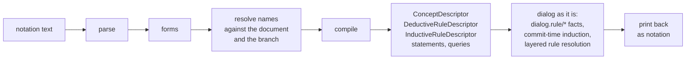

# Implementing the notation

How the [design](design.md) becomes dialog. The aim is a front end: the notation compiles to what dialog already stores and runs, and new storage comes only where nothing fits. Read against the code as of 2026-11-10.



## What dialog has

- **Concepts** are `ConceptDescriptor`s: named fields over attributes that share one entity, each with `the`, `as` and a pick. A concept's identity is the hash of its attribute set; its name is not part of it. Concepts are not stored; a query carries its descriptors inline.
- **Deductive rules** are stored as `dialog.rule/*` facts (`derives`, `reads`, `conclusion`, `source`), with the body as a canonical dag-cbor `DeductiveRuleDescriptor`. They are found by attribute, not concept (`rust/dialog-repository/src/rules.rs`).
- **Inductive rules** run at commit, dispatched by the attributes a commit touched. Each has exactly one head, `assert!` or `retract!` (`InductiveRuleDescriptor`).
- **Commands** are concepts marked `dialog.concept/transient`. Their facts are dispatched, live one induction round and are never committed. A head concluding one routes to the next round.
- **Rounds.** A commit runs rounds until one produces no novelty and no transients. Sibling rules in a round read the same frozen view. A cascade still producing after 16 rounds fails the commit (`MAX_ROUNDS`, `transaction/induce.rs`).

## The mapping

| notation | dialog today | change |
|---|---|---|
| `(concept (todo ?t …) (xyz.todo ?t …) (dialog.type …))` | `ConceptDescriptor`, a field per label, `the: xyz.todo/<label>`, `as` from the type | none |
| `(dialog.type ?s is: [:open :done])` | `as: [open:, done:]`, which implies the `top` pick | none; see the ranking note below |
| `(xyz.todo ?t text: ?x)` in a premise | an attribute query per label | type inferred; untyped when nothing narrows it |
| `(query …)` | a query over concept and attribute premises | none |
| relation head `(rule (xyz.app.open ?t text: ?x) …)` | `DeductiveRuleDescriptor`, `deduce` over `xyz.app.open/*` | none |
| `(rule (assert (todo …)) …)` | `InductiveRuleDescriptor`, `assert!` | none; the notation's plain head is today's `assert!` |
| `(rule (retract (xyz.todo ?t text: ?x)) …)` | `retract!`, which drops the exact triple | none |
| `(retract (todo ?t))`, every field | `retract!` needs the values | the compiler binds each field in the body first |
| several heads on one `when` | one head per inductive rule | split into one rule per head: siblings read the same round view, so the meaning is the same |
| `(add (todo list: … text: …))` | a transient concept with its own attributes | a command concept the compiler derives (below) |
| `(rule (remind! (todo ?t)) …)` | a head concluding a transient, routed to the next round | none, but see rounds below |
| `(id ?t list: ?l text: ?x)` | nothing | a `dialog/id` formula |
| `(fresh ?n)` | nothing | bound by the induction engine, not a formula (below) |
| a document submitted as a transaction | a transaction with its asserts, dispatches and rules, committed | none |
| a document submitted as a query | nothing that runs induction without committing | a preview: induction over the transaction, returned, never published |
| a top-level `rule` in a transaction | `tx.assert(rule)` | none |
| a top-level `concept` in a transaction | nothing; concepts are not stored | a name binding (below) |

Nothing already stored changes. Existing rules keep their encodings and content addresses, tonk's transient concepts keep working, and every stored rule and concept can be printed in the notation.

## What is new

### Concept names

"An undeclared concept is a compile error" needs somewhere a name is declared. A name binds to a descriptor, as the design says; it is not part of the descriptor's identity. Store it like a rule:

- `dialog.concept/name` `of` the concept entity `is` the name, pick `last`, so redefining a name rebinds it;
- `dialog.concept/source` `of` the concept entity `is` the canonical descriptor bytes.

The compiler resolves a name against the document first, then the branch. The wire keeps inline descriptors, so the engine never sees a name.

### Commands

A command needs no declaration in the notation, but it does need a stored definition. Tools and agents have to discover which commands a schema offers, and the compiler has to check "a parameter no rule reads".

- **Its facts.** `(add (todo list: … text: …))` compiles to a transient concept whose attributes live in a domain derived from the command's name and the wrapped concept's identity, with one field per parameter plus one for the wrapped entity when given. Its entity is the `id` of the command's name and everything it passes, which gives "identical commands in one tick are one". The domain is the transient marker: any attribute in a command domain is transient, so no marker fact is needed, and `dialog.concept/transient` stays for tonk's existing commands.
- **Its definition.** The definition is derived from what is already stored: the installed rules that read the command's attributes (`dialog.rule/reads`). The parameters a command takes are the union of what those rules read, and "a parameter no rule reads" is a lookup in that index. Metadata (a description, the words that say it, a palette role) goes on the command concept entity as ordinary facts, as `dialog.concept/name` does for concepts.
- **Open: the domain spelling.** A readable domain (`add.todo`) can collide with a real one and does not tell two `todo` concepts apart. A hashed one (`dialog.command.add.<hash>`) is safe but must fit the 64-byte selector budget with its field name. I lean hashed, with the name kept as metadata.

"Persisting" a command means persisting its definition, never its facts: an issued command is still gone after its tick. If you also mean keeping a log of issued commands for audit or replay, that is a separate choice, since today the commit records only what landed.

### `id` and `fresh`

- `dialog/id` hashes the canonical encoding of its labels and values to an entity, the same on every replica, the way a concept's identity is hashed. Whether it also takes the concept or domain, so two concepts with the same fields do not share an entity, is in the design's Open list; settle it before anything stores one.
- `fresh` cannot be a pure formula. A document run as a query and then as a transaction should mint the same entities, and so should the watermark catch-up when it re-fires a rule. Bind it in the induction engine, from the rule's entity, the firing's trigger row and the revision it fires at. It is then deterministic for a given firing and never equal across firings.

### Query mode

A preview of `TransactionCommit`: run the same induction rounds over the staged transaction, return the answers and the changes that would land, and publish nothing. Its environment does not require `Put`, `Publish` or `Attest`, so "needs no permission to write" holds by construction. Pin it with a test that previews as a session with no write grant and gets the same changes the commit would land.

### Retract by entity

`(retract (todo ?t))` with the values unbound needs either the compiler's read-then-retract (above), or an instruction that drops every live claim of an entity and attribute. The read is enough to start; the instruction is cheaper, and the same thing #759 needs to succeed every live claim.

## What the design has to settle first

Implementing these as the design reads now would bake in something unintended.

1. **Rounds.** Induction runs inside one commit and fails at 16 rounds. The design's `(rule (remind! (todo ?t)) …)`, which re-issues itself while a to-do is open, would fail the transaction that issues it. Either `!` heads re-issue only within a commit and must quiesce, or a command can be carried to a later commit, which today has no place to live.
2. **`:top` ranking.** dialog ranks the first case of `as` best. With `[:open :done]`, a to-do done on one device and reopened on another resolves to open. Either list the winning case first or define the order the other way round; the design's examples list `:open` first.
3. **Authority.** Induction today runs as the committing operator (`Identify` in `induce.rs`). That answers "under whose authority an installed rule writes" by default: whoever's transaction set it off. Say so in the design, or change it.
4. **`fresh` determinism**, as above.

## Views

In this model a view is a rule. A deductive rule whose head is a presentation domain derives what a screen shows from concepts, the way `xyz.app.open` derives open to-dos:

```clj
(rule (ui.todo-row ?t text: ?x state: ?s)
  (when (todo ?t text: ?x state: ?s)))
```

That leaves a template and its events. Three ways to hold them:

- **A view is data on a concept**, as the design's `(view block show: {…})` has it, with the template a value. This is closest to tonk today, and a template is opaque to queries.
- **A view is a relation head plus a template keyed by that domain.** The rule says what is shown, the template only how. Views become queryable and composable like any rule, and a route is a query into one.
- **A view is a concept over the presentation domain**, so its fields can be written. An edit in a view is then a command around the view's concept, `(rename (ui.todo-row todo:9c1e text: "Buy oat milk"))`, and a rule maps it back to the stored concept. This is the relational-lens question, and it is where the model gets interesting.

The second is the smallest step that keeps views inside the model. The third is the one worth a design topic of its own.

## Order of work

1. **Parser, forms and printer**, in a new `dialog-notation` crate. Round-trip every example in the design and every reader sample from R17 to R25. No engine change.
2. **Compiler to today's descriptors**: single-domain concepts, domain calls, `query`, relation heads, `assert` and `retract` heads, multi-head splitting, top-level ground commands to `assert` and `dispatch`, and name resolution within a document. Its errors: undeclared concept, ungrounded top-level command, a concept assert missing a parameter.
3. **Engine additions**: `dialog/id`, command domains as transient, concept names, the command definition lookup, query mode.
4. **The four settlements above**, then `fresh`.
5. **Printing what is stored**: tonk's `core.yaml` and `notebook.yaml`, loaded and printed back, which redoes the sketches against the real thing.
6. **Later**: concepts that call concepts or read from the value's side (read-only rules until writing through them is designed), sending, views.

Every step is additive to the stored format. The first one that is not is the command domain convention, and it touches only facts that are never committed.
