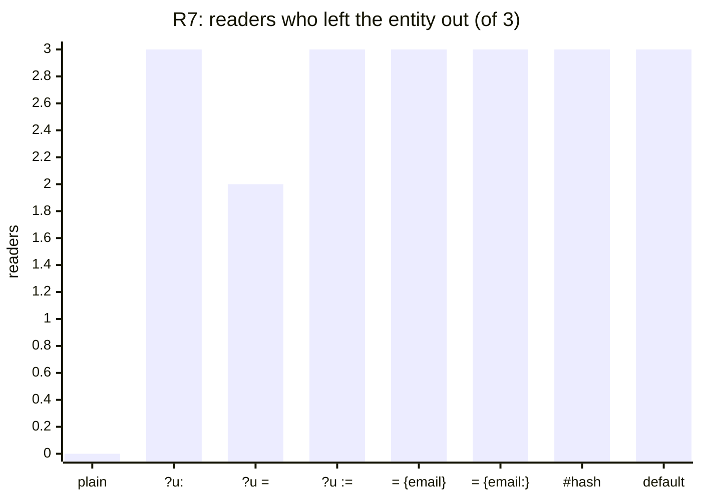
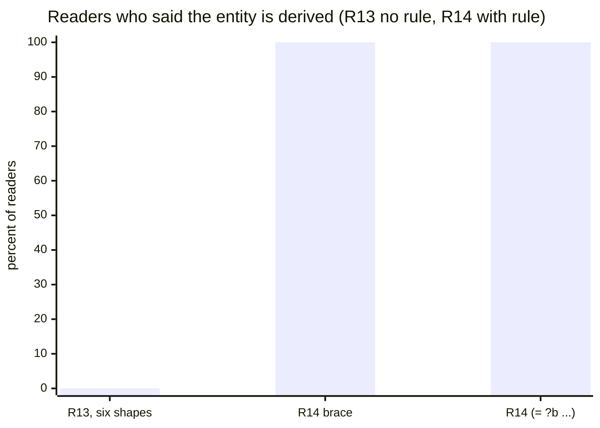
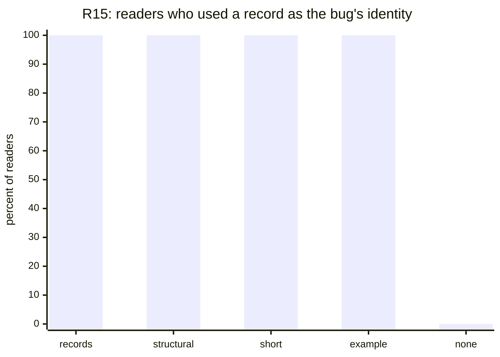
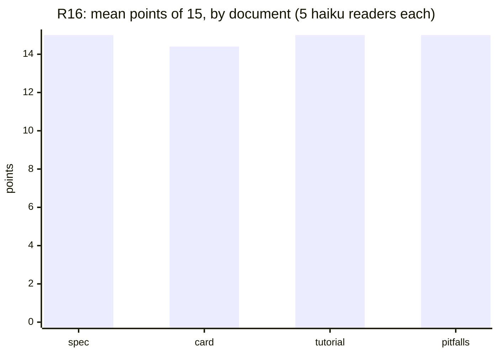
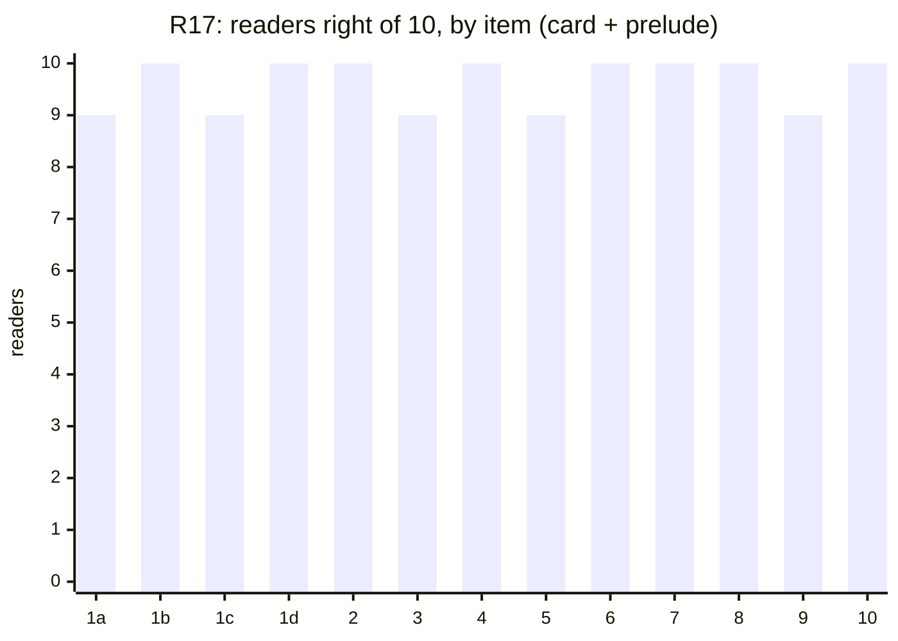

# Notation: journal

What we tried, what it measured, and what we decided, newest last. The [idea](../notation.md) says why; the [evaluation](evaluation.md) says how a reader is scored; the [design](design.md) is the current decision. Work happens on the `docs/notation` branch, PR [#728](https://github.com/dialog-db/dialog-db/pull/728).

## Where things stand

**Status: Exploring.** See the [research index](../README.md) for what the statuses mean.

- **Decided:** rules are heads and a `when`, with timing on the verb (`assert`, `assert!`, `retract!`, `ensue!`); lifetimes are layers on attributes, and a command is a concept in `:now`; a write names its entity (directly or as `(id {…})`) or leaves the primary out and creates, getting the `id` of what it writes; a derivation that must agree everywhere is a rule with `id`.
- **Measured:** 249 readers over 15 rounds. Without a visible word, readers do not see a derivation (R1 `default` line 0/3, R13's six brace shapes 0/18). With one paragraph of spec, they do (R14 5/5, R15 16/16).
- **Rejected on design grounds, though readers got them:** `=` in a head (constraint elsewhere), the `{title author} ?b` head (construction does not belong in a concept).
- **R16:** the revised design, read from four ways of writing its spec, scored 297 of 300 points; every document's median was 15 of 15. The style of the spec did not matter at this difficulty; the examples did.
- **Settled after R16:** a write through a concept passes every parameter, and leaving one out is a compile error; a top-level call is `assert`, `assert!` or `query` by whether it has variables and a `!`; the `!` means retained; records in the entity's place are dropped for `(id {…})`; picks stay part of the attribute; a concept body holds only attribute lines and constraints.
- **R17:** the modifier design (commands as modifiers, `!` as mutation, `assert` and `retract` as modifiers) read right from a card: 125 of 130 points, every item passing. Every reader rated it 3 of 5, and 9 of 10 named `!` as the most confusing thing.
- **Next:** decide whether a premise names the stored read; then take the design into `design.md`.
- **Open:** whether commands are asserted or written; what a rule head that names no entity lands on; whether questions stay calls with variables or become rules into a domain-call head; text literals; optional parameters. The design's Open list has the rest.

## Datasets

There is no dataset in the usual sense. The workload is the reader prompts: a sketch of the notation, a task (save a table, update a row, find one, predict what exists after two devices sync) and numbered questions. Each round's prompts are in its results file, each with its sha256, and every reader's answer is in the round's `.jsonl` beside it. The prompts are synthetic and hold nothing private.

The topic file, this journal and the tallies were written on 2026-11-06, after the rounds had run in conversation. Every tally was recounted from the stored answers where the results file says so; where it says "as scored at the time", it is the tally the round reported then, checked against the answers but not rescored.

## 2026-11-04 — R1: does a `default` line say the entity is derived?

**Question.** The spec gave a write that leaves the entity out the hash of a record, with `(default ?bug is: {…})`. Does a reader see that?

**Method.** Five spellings of the same derivation, three readers each: the `default` line, `(identity ?bug from: {…})`, a second concept passing a record in the entity slot, `(?bug or: {…})` and `(option ?bug from: {…})` in the head. Each reader saw one, then a write without an entity, its rerun, and a status change.

**Results.** [r01](results/r01.md).

| spelling | derived, one bug after a rerun |
|---|---|
| `(default ?bug is: {…})`, the spec | 0/3 |
| `(identity ?bug from: {…})` | 3/3 |
| a record in the entity slot | 0/3 |
| `(?bug or: {…})` | 1/3 |
| `(option ?bug from: {…})` | 0/3 |

Readers who saw a derivation also saw its cost: status is in the hash, so a status change makes a second bug.

**Decision.** The `default` line goes. A derivation needs a word that says it, and only the identifying fields belong in it.

## 2026-11-04 — R2: a whole sketch

**Question.** Read cold, which parts of the sketch hold up: attribute concepts, picks, `(option …)`, `assert` against `assert!`, `let:new`?

**Method.** One sketch of attributes, a concept and four rules; longhand attribute concepts against a shorthand `{attr :type}`; three readers each.

**Results.** [r02](results/r02.md). Picks were read (6/6 for `:all`), and so was computed against stored (6/6). `(option ?who)` was not: one reader in six let a bug with no assignee match. Four in six said nothing says when `assert!` fires.

**Decision.** Keep the longhand attribute line; the shorthand saved nothing readers needed. Optionals stay open.

## 2026-11-04 — R3: an overloaded constructor, and a command's placeholder entity

**Question.** Does an overloaded `bug` whose second definition hashes its fields read as a constructor? And does a command written on a placeholder (`let:new`, `:new`, `?`) read as lasting one tick?

**Method.** Four variants, three readers each.

**Results.** [r03](results/r03.md). The overload read as derived 3/3, every reader inferring a dispatch rule the text never states. No reader of any placeholder read its facts as short-lived (0/9). Asked about two commands in one document, all three `:new` readers predicted one entity holding both titles.

**Decision.** A placeholder entity shared by every command mixes their fields. Lifetime has to be written somewhere a reader sees.

## 2026-11-04 — R4: when does a rule take effect?

**Question.** `(assert head …)` with `!` on the head's call, `rule` for every form, or `rule` with `assert!`: which says when a rule fires?

**Method.** Three variants of the same three rules, three readers each.

**Results.** [r04](results/r04.md). All nine told computed from stored. All nine said no form says when a `!` rule fires, and five asked for a separate part that names the trigger, most spelling it `when`.

**Decision.** `(rule head… (when premise…))`, with the timing on the head's verb and no `!` on the call inside.

## 2026-11-04 — R5: where to say a user is identified by email and name

**Question.** Head marker, bare `?`, a rule, a `define`, or an overload: which says it?

**Method.** Five variants, three readers each.

**Results.** [r05](results/r05.md). Every spelling with `hash` in it was read, 3/3 each. The bare `(? :email :name)` was read once in three.

**Decision.** A ceiling: this task cannot tell the `hash` spellings apart. The next rounds make readers write, not just read.

## 2026-11-05 — R6: the derivation at the call site

**Question.** If the writer names the fields at the call, `(user! (hash email: name:) …)`, which word reads best, and can "every field" be spelled short?

**Method.** `hash`, `derive`, `id`, `by` with field lists; `(hash)`, `(hash *)`, `(hash ...)` for every field; a `:new` write turned into a user by a rule. Three readers each.

**Results.** [r06](results/r06.md). The four words all read (2/3 to 3/3). `(hash)` and `(hash *)` read as every field 2/3; `(hash ...)` 0/3, read as the email alone. With `:new`, no reader could say how to make one email land on one user whatever the name.

**Decision.** Writers should not choose the fields: two writers who choose differently make two entities. The concept, or a rule, should own the derivation.

## 2026-11-05 — R7: save a table, with no hint

**Question.** Given only a definition and rows to save, does a reader leave the entity out?

**Method.** A plain head against seven heads that mark the identity fields; three readers each.

**Results.** [r07](results/r07.md).

| head | left the entity out |
|---|---|
| plain `(user ?u …)` | 0/3 |
| any of the seven markers | 20/21 |

The plain-head readers invented `user:01`, `user:02`, and reused `user:01` for the second device's row by hand.

**Decision.** Without a mark, nobody omits the entity. Something at the definition has to say it may be left out.

## 2026-11-05 — R8: "derive me if left out", on the primary and on a labeled parameter

**Question.** Which marker says a parameter may be left out and derived, and is the primary harder than a labeled one?

**Method.** Six markers, each on `user`'s primary and on `member`'s `person:`; three readers each.

**Results.** [r08](results/r08.md). `(?u = {email:})`, `(= ?u {email:})` and `(?u ?? {email:})` were left out 6/6. `(or ?u {email:})` 0/6: readers passed a record or `person:`. `(?? ?u …)` and `from:` were left out on the labeled parameter 3/3 and on the primary 1/3.

**Decision.** `=` and `??` read best; `or` reads as a choice between two things to pass. A labeled parameter is easier to omit than the primary.

## 2026-11-05 — R9: a constructor concept

**Question.** Does `(concept (bug/new title: ?t status: ?s) (bug {…} …))`, with a bare record in the entity slot, read as derived?

**Method.** A bare record, `(id {…})`, `(hash {…})`; five readers each.

**Results.** [r09](results/r09.md). The bare record 0/5: read as an anonymous record and minted. `id` and `hash` 5/5.

**Decision.** A record in an entity slot needs a rule that says what it means; without one it is a value. Two readers here followed a Tonk guide that reached them from the session's tool instructions, which is when the reader [hygiene](evaluation.md#hygiene) problem was noticed.

## 2026-11-05 — Bloom: collections, operators, channels

**Question.** Bloom has tables, scratches, interfaces and channels, and an operator per timing. What does that say about lifetimes, commands and sending?

**Method.** A reading of Bloom and Bud against the design, not a measurement.

**Results.** Bloom declares a collection's kind once and lets rules only name collections; the operator says when (`<=` now, `<+` next, `<-` delete next, `<~` async). A channel is a scratch with one column marked `@` for where a row goes. Replication is a rule like any other.

**Decision.** Timing goes on the rule's verb, and `ensue!` is the asynchronous one, chosen over `propose!` and `issue!` because it has no natural opposite. Lifetimes go on attributes as layers, named by entities from a fixed set like Bloom's, with no layer declarations and no `syncs`. Replication between layers is rules. A remote write is an outbox, not a transaction across connections.

## 2026-11-05 — R10: where the identity fields go, and `ensue!`

**Question.** Which head placement of the identity fields reads; does `ensue!` read without a definition?

**Method.** Six head placements, and `ensue!` against `assert-later!`; three readers each.

**Results.** [r10](results/r10.md). `[title: author:] ?b` 3/3, `(= ?b {…})` 3/3 (two by passing the record), `[:title :author]` and `#{…}` 2/3; `{title: author:} ?b` and `(title: author:) ?b` 0/3. Undefined, `ensue!` said nothing about when (0/3), but no reader invented an opposite; `assert-later!` was read (3/3) and two of three invented `retract-later!`.

**Decision.** `ensue!` stays, and the spec defines it in a line. `{title: author:} ?b` and `(title: author:) ?b` are out.

## 2026-11-05 — R11: a record of field names before the primary

**Question.** `{title author} ?b` and `{title: _ author: _} ?b`: does a record shape say "these fields, derived"?

**Method.** Three variants, four readers each.

**Results.** [r11](results/r11.md). `{title author}` 2/4. `{title: _ author: _}` 0/4: every reader passed a record as the primary, the opposite of leaving it out.

**Decision.** A shape that looks like a value invites a value.

## 2026-11-05 — R12: do readers know why?

**Question.** Readers construct, update and query right; do they know the entity is derived?

**Method.** Three variants, four readers each, asked what the part before `?b` means.

**Results.** [r12](results/r12.md). Behavior 12/12. Understanding: `(= ?b [title: author:])` 4/4, `?b = […]` 1/4, `[…] ?b` 0/4.

**Decision.** Right behavior is not understanding: a reader omits the entity because no entity was given, not because it reads a derivation. Score both from here on. `=` is out although it read best: it is a constraint everywhere else in the notation. So are vectors of fields: a vector is an enumeration (`as: [:todo :done]`). Forms that look like a call passing nothing, such as `(or ?b title: author:)`, are out too.

## 2026-11-06 — R13: six brace shapes, no rule

**Question.** The maintainer's six shapes around `{title author}` and `?b`: does any of them say "derived" on its own?

**Method.** Six variants, three readers each, no rule text.

**Results.** [r13](results/r13.md). Left the entity out 18/18. Said it is derived 0/18; `?b{title author}` was read as a key 3/3.

**Decision.** No spelling carries the meaning alone. The spec needs a rule.

## 2026-11-06 — R14: the brace head and one paragraph of spec

**Question.** With the rule "writing a concept without its primary creates the entity; if the definition names what it is derived from, the same values give the same entity on every device", does `{title author} ?b` read?

**Method.** Five readers for the brace head, three for `(= ?b [title: author:])`, from here on as read-only readers.

**Results.** [r14](results/r14.md).

| round | readers | said the entity is derived |
|---|---|---|
| R13, no rule | 18 | 0 |
| R14 `{title author} ?b`, with the rule | 5 | 5 |
| R14 `(= ?b [title: author:])`, with the rule | 3 | 3 |

**Decision.** One paragraph of spec does what no spelling did. `{title author} ?b` was the recommended head until the next round.

## 2026-11-06 — R15: a record in the entity's place is its identifier

**Question.** If the spec says a record given where an entity is expected identifies that entity, do readers use a record of the identity fields, and which wording works?

**Method.** Four wordings of the rule (records, structural identifiers, one short sentence, a worked example) and a control with none; four readers each, three for the control.

**Results.** [r15](results/r15.md).

| wording | readers | record of title and author | one bug after sync | also wrote `title:` `author:` |
|---|---|---|---|---|
| any of the four | 16 | 16 | 16 | 14 |
| none | 3 | 0 | 1 at low confidence | |

The control had no shared answer: one predicted two bugs, one made up `bug:crash-on-save-ada`. Readers spelled the record's keys three ways (short names 11, stored names 4, `title:` 1), which would hash to three entities.

**Decision.** The rule works, in any wording, and a short sentence is enough. Two problems belong to the idea, not the wording: the writer picks the identity fields again, and key spelling decides the hash. Whether a record in the entity's place also writes its fields is open.

## 2026-11-06 — Bloom again: keys, updates, interfaces and lattices

**Question.** How does Bloom say what identifies a row, how does it update one, and what is an `interface`?

**Method.** A reading of Bloom and Bloom^L against R15's problems.

**Results.** A Bloom key is the declared columns: the row has no identity apart from them, an update replaces by key (`<+-`), and a new title is a new row. An `interface input` is a scratch with a label saying who writes it. A row keeps its fields together because it is one tuple. Bloom^L's lattices merge without coordination, and a set is one.

**Decision.** Commands are rows, not a kind: a concept whose attributes are in `:now`, with no `command` form. A command's entity must be its own, the digest of its write, or its fields mix as R3's `:new` did. Who may write a stored concept directly is authorization, not notation. Picks are merges: `:all` and `:top` need no clock, `:last` does.

## 2026-11-06 — Derivation leaves the concept

**Question.** Where does a derivation live, if not in a head marker or a `default` line?

**Method.** Design discussion over R14, R15 and the Bloom readings.

**Results.** The head marker read well (R14), but it puts construction in a definition that is otherwise only about which facts make up a concept, and the writer still chooses the fields when it passes a record (R15).

**Decision.** A write names its entity, passes a record that identifies it, or leaves it out and gets the digest of everything it writes. A derivation that must agree on every device is a rule with `digest`, keyed by stored attribute names, so writers send commands and the rule picks the fields. The layer is `layer: :now`, part of the attribute's identity. Sending puts the destination in the data (`to:`); a remote call is request and reply rules on top of `ensue!`. Not yet measured: the next round reads the design as a whole.

## 2026-11-06 — The record, recounted

**Question.** Do the tallies reported during the rounds hold against the stored answers?

**Method.** Every reader's first answer, read from its transcript; the tallies in the results files are recounted where they say so.

**Results.** R7 was reported as 22/24 for any marker; it is 20/21 with a marker and 0/3 without. R10's `[:title :author] ?b` was reported 3/3; it is 2/3 (one reader made up ids). R15's worked-example readers rated clarity 4, 4, 4, 4, not 4, 3, ?, 4. R1 to R4 had no tally before. Ten of 249 readers called a tool they were told not to (listed under [hygiene](evaluation.md#hygiene)).

**Decision.** Use the recounts. None changes a decision above.

## 2026-11-07 — R16 planned: how should the spec be written?

**Question.** With the notation fixed, does the way the spec is written change whether a cheap reader can write in it? This turns the topic from how the notation looks to how it is taught.

**Method.** Four documents stating the same facts: `design.md` as it is (the baseline), a reference card, a walkthrough, and the card with a table of earlier readers' mistakes. Each is followed by the same tasks in a domain none of them uses: define a stored concept and a command, write the rule that derives a to-do's identity, write, update, query, send to a peer, and predict four outcomes. Five readers per document. The rubric (15 points) and the bars were committed before any reader ran: [r16-plan](results/r16-plan.md).

**Results.** Not run yet.

**Decision.** Not decided. A median of at least 13 of 15, 2 above the spec's, picks the style; a gain of 1 or less says the style is not the lever.

## 2026-11-07 — R16: the way the spec is written makes no difference at this difficulty

**Question.** The one planned above: does the way the spec is written change whether a cheap reader can write in it?

**Method.** As planned in [r16-plan](results/r16-plan.md): four documents, five readers each, all started at once, scored by the committed rubric.

**Results.** [r16](results/r16.md).

| document | lines | scores | median |
|---|---|---|---|
| `spec`, `design.md` as it is | 366 | 15, 15, 15, 15, 15 | 15 |
| `card` | 104 | 13, 15, 15, 14, 15 | 15 |
| `tutorial` | 146 | 15, 15, 15, 15, 15 | 15 |
| `pitfalls` | 118 | 15, 15, 15, 15, 15 | 15 |

The failure bar holds: no document beat the spec's median. But that is a ceiling, not a tie between equals: the tasks follow the documents' examples closely (a command, a rule that digests it, a send), so the round says the revised design reads (297 of 300 points), not that the way it is written can never matter. Where a task had no example, readers copied the nearest one. For task 7 the premises give the notice no entity: all 15 readers of the three short documents left it out, as their `ensue!` example does, and four of five `spec` readers put the notice on the to-do's own entity, as the spec's example binds one. Readers also named gaps more than style: the type of an entity-valued attribute (every `tutorial` reader, whose document left the type list out), a premise on a stored attribute (shown in no document), a partial write marked Proposed, and what a rule head that names no entity lands on. One reader found a real problem: a rule that asserts `state: :open` on every add reopens a done to-do when it is added again.

The `tutorial` broke the plan's promise that every document states the same facts: it had no list of types. Its readers guessed `:entity` right.

**Decision.** Keep one document: the spec, which did as well as anything shorter. Write its examples as the forms readers should copy, because they do, and show every form a reader will need, including a premise on a stored attribute. Two questions go to the maintainer: what a rule head that names no entity lands on, and whether a partial write through a concept is agreed. Telling documents apart takes harder tasks, with no worked example to copy.

## 2026-11-07 — The maintainer's corrections to the design

**Question.** Reading the revised design, what did the maintainer correct?

**Method.** Review of `design.md`, not a measurement.

**Results.**
- `"""…"""` is not part of the notation. How text spans lines or holds `"` is open; the sketches still use it for templates.
- A keyword is an entity, spelled with the colon in front (`:done` is `done:`) so it is not read as a label.
- `[:todo :done]` is a variant type, not a vector.
- `is:` is a call's result: `(bug/report (id {…}) title: "hello world")` is short for `(id {…} is: ?bug)` and `(bug/report ?bug title: "hello world")`.
- A document sees what it asserts in `now`. A document-local concept and a ground call without `!` are facts of `now`, which the document's questions find; neither reaches `next`. A call with `!` reaches `next`, and the document's questions do not see it. The design had said a document never sees its own writes, which read as if it saw nothing it states.
- A write through a concept that leaves out a parameter is a compile error, not "keep what is there". On an entity that does not exist yet it would make a partial one. A one-attribute change goes through a concept over that attribute; an explicit "keep" marker such as `notebook: .` is open.
- Every variable in a concept's body appears in its head, and the design shows a reverse relation.

**Decision.** All taken into the design. R16's item 5 expected the partial write `(todo! todo:9c1e state: :done)`, which is now a compile error; all 20 readers wrote it, so it is the spelling readers reach for, and the error is what will catch it. R16's scores stand as scored under its plan.

## 2026-11-08 — No "keep" marker

**Question.** Should a write through a concept have a marker for "leave this parameter as it is", such as `notebook: .`?

**Method.** Maintainer's decision.

**Results.** No. A one-attribute change writes the attribute itself or a concept over just that attribute.

**Decision.** Dropped from the design's open questions.

## 2026-11-08 — Assertions, partial entities, intermediates

**Question.** Follow-ups to the corrections: is a ground call that asserts a trap, are partial entities allowed, why can a concept not reach through an intermediate?

**Method.** Maintainer's decisions.

**Results.** A ground call is an assertion, as a ground atom is a fact in a Datalog program; there are no yes-or-no questions. Partial entities are allowed when meant, through an attribute or a smaller concept; the compile error is only for a forgotten parameter. A concept cannot reach through an intermediate because a write through it could not construct one; rules can. The `is:` shortcut applies to any parameter, when the variable would only wire two calls.

**Decision.** All in the design.

## 2026-11-08 — Entities are never partial

**Question.** Is "partial entity" the right term?

**Method.** Maintainer's correction.

**Results.** No. An entity is an identity over time, never partial. What can be partial is what is known about it: only some of a concept's facts hold. The entry above titled "partial entities" means that. The design also used `digest` without defining it.

**Decision.** The design says "partial information about a concept", and defines `digest`: a formula from a value to the entity that value identifies, by the hash of its canonical encoding.

## 2026-11-08 — The record rule stays

**Question.** Should "a record in place of an entity" be dropped for an explicit `(digest {…})` in that place?

**Method.** Maintainer's review of the proposal.

**Results.** Three things stand against dropping it. An explicit call needs formulas outside rules, which the notation should support anyway and now says so. A formula that takes a record needs a record type, which does not exist yet. And creating a concept would state the identifying fields twice. The third weighs most, but the record form doubles them too unless a record also supplies the parameters it names.

**Decision.** The record rule stays. Formulas are allowed in questions, assertions and writes. Record types and whether a record supplies its parameters are open; the second is what ends the doubling.

## 2026-11-08 — Records are not entities; a ground call is a rule

**Question.** Does the notation need "a record in place of an entity", and is a ground call without `!` consistent with deductive rules?

**Method.** Maintainer's review, in conversation.

**Results.** Leaving the primary out already creates: given every other parameter, the write makes a new instance and its entity. Naming a particular identity takes the `id` formula in the primary's place, `(bug! (id {…}) …)`, so the record form adds nothing. The identifying record and the facts written need not correspond: an identity is fixed when it is made, and the facts can change after. A ground call looked inconsistent with deductive rules, one lasting a tick and the other forever; it is a rule with no premises, and in both the `!` says where the form lives. A written fact stays until retracted; an installed deductive rule's conclusion holds while its premises do.

**Decision.** Records in the entity's place are dropped, and with them the question of whether a record supplies its parameters and how its keys are spelled in a call. The formula is named `id`, not `digest`. The design says a ground call is a rule with no premises. Record types for formulas stay open.

## 2026-11-08 — `!` means into next

**Question.** How should the `!` be framed?

**Method.** Maintainer's review.

**Results.** Without `!` a form deduces into `now`; with `!` it derives into `next`. An installed deductive rule keeps deducing into each tick's `now`, which is why its deductions appear in every question. An assertion without `!` that matches an installed inductive rule gets that rule's write stored; deductions from it last only the tick.

**Decision.** The design says so. It leaves a question: commands are written with `!` in every example, which under this framing puts them a tick late.

## 2026-11-08 — `!` means retained

**Question.** Is "into `now`" against "into `next`" the right way to say what `!` does?

**Method.** Maintainer's correction of the previous entry.

**Results.** No. The `!` says whether something is retained. Without it, an assertion, a concept or a rule holds for the tick and is not retained; with it, it is retained until retracted. A deductive rule does not retain its conclusions but keeps deducing them; an inductive rule retains them.

**Decision.** The design says so, replacing the framing of the previous entry. The question about commands stands, and reads more plainly: a command is something not retained, so it is asserted without `!`.

## 2026-11-08 — Top-level calls are sugar

**Question.** What does a call at the top of a document stand for?

**Method.** Maintainer's decision.

**Results.** A call with no variables is `(assert form)`, or `(assert! form)` with `!`. A call with variables is `(query form)`. There is no inductive query, so a call with variables and `!` is an error.

**Decision.** In the design. One case is marked Proposed: a variable bound by a nested call, as in `(bug! (id {…}) title: "x")`, should not turn a write into a forbidden inductive query.

## 2026-11-08 — Formulas may feed an assertion, queries may not

**Question.** Does nesting `(id {…})` in a write break "no variables means assertion"?

**Method.** Maintainer's review of the previous entry's Proposed case.

**Results.** Variables flowing from a query into an assertion were refused earlier because evaluation order became unclear and assertions and queries stopped being distinguishable, not on principle; a rule says the same thing. A formula over ground arguments keeps both clear: it has one result and reads no facts. A concept call does neither.

**Decision.** Proposed in the design: a top-level call may nest formulas over ground arguments; anything that reads facts takes a rule.

## 2026-11-08 — Domain calls, and pick is part of the attribute

**Question.** Can a domain be queried as a concept nobody declared, and where do type and pick go?

**Method.** Maintainer's proposal, discussed in conversation.

**Results.** `(xyz.tonk ?bug title: ?t assignee: ?a)` reads `xyz.tonk/title` and `xyz.tonk/assignee`, defaulting to any type and `pick: :last`. Type and pick constraints on variables, `(.type ?t is: :text)` or `(?t as: :text pick: :last)`, attach to a value, which can come from two attributes; they belong on the attribute. Pick is part of an attribute's identity, so choosing another pick reads another attribute, not a narrower view. A type check runs both ways (it filters on read and validates on write), so it does not break the rule against one-way formulas in concepts.

**Decision.** Domain calls are Proposed in the design, with defaults, and attribute lines name a specific type and pick. A concept may hold checks and formulas that run both ways; one-way formulas such as `id` belong in rules.

## 2026-11-08 — What a pick is in dialog today, and constraints

**Question.** Can picks be user-defined? And what may a concept body hold besides attribute lines?

**Method.** Read `dialog-artifacts` (`Pick`, `prefers`, `elect`, the tree's write) and `dialog-query` (`Cardinality`, the one-valued attribute query, the concept election) on main at `3b5835ad`. Prior art: Kleppmann's CRDTs as Datalog queries over a set of operations; Bloom^L's monotone lattices; Automerge's predecessors on each operation.

**Results.** A pick is one ordering (`Pick::prefers`) over a cell's claims, by value and standing. A read elects the winner; a query over a one-valued attribute scans, then checks each candidate against the rest of its cell. A write retracts the claim the pick elects and adds the new one; only `:all` appends. So `:max` is not a grow-only maximum: writing 3 over a 5 replaces it. An earlier suggestion in conversation, that picks other than `:last` accumulate and differ only in how they are read, was wrong against the source. The pick tells the store what a write succeeds, which is why it is part of the attribute.

**Decision.** Proposed: user-defined picks are user-defined orderings over claims, hashed into the attribute's identity as `:top`'s cases already are; aggregates that compute (sum, count) are rules over `:all`. Constraints, named apart from formulas, are what a concept body may hold: type, equality, comparison; no negation, no arithmetic. Domain calls infer each attribute's type from what narrows it or from the value written.

## 2026-11-08 — The write is the index, and a bug in it

**Question.** Do picks use an index shortcut, and what happens to concurrent claims?

**Method.** Maintainer's correction, checked against `tree.rs`, `instruction.rs` and `it_succeeds_the_claim_the_succession_elects` on main at `3b5835ad`.

**Results.** The write is the shortcut: it keeps the operational index at the claim a read would return, so a read elects among several claims only after concurrent writes merge. Ties fall back to standing and then the value's hash, so every election is deterministic. But a write succeeds only the elected claim: after concurrent writes of 5 and 7 under `max`, a write of 3 leaves 5 live, and the next read returns 5. Filed as [#759](https://github.com/dialog-db/dialog-db/issues/759), with the fix: succeed every live claim the writer holds.

**Decision.** User-defined picks stay orderings, which run at write and so keep the shortcut; the design says so and links #759.

## 2026-11-09 — Commands are modifiers, and `!` is mutation

**Question.** How does a command carry a concept's shape without declaring its fields again, and where does an entity come from when a write names none?

**Method.** Design session with the maintainer, not a measurement. Prior art checked: Dedalus (persistence rules), LogiQL (delta predicates `+R` `-R` `^R`, pulse predicates, constructor predicates, `exec` vs `addblock`), relational lenses for writing through a view, and the EDB/IDB split of classic Datalog.

**Results.**
- `!` means mutation: `(x! …)` is short for `(! (x …))`, and the fact goes into the next tick. Without `!` a fact holds this tick only. A document with no `!` changes nothing, needs no permission to write, and its result lists what its rules would have done; the cascade runs to the turn limit, uncommitted.
- Persistence belongs to the predicate, as in Dedalus: a concept is carried until retracted, a modifier is not. `layer: :now` on attributes is no longer needed for commands.
- A concept is a rule that runs both ways. `concept!` is a rule the checker holds to the writable subset: attribute or domain calls, constraints, every body variable in the head.
- A modifier is applied to a concept's shape: `(open (bug title: … author: …))`. Its facts are tagged with its name, so they never leak into a `bug` query, and are never carried, stored or synced. It needs no declaration: the rules that read it decide what it takes, by subset, and a parameter no rule reads is a compile error. Modifiers nest one deep; `!` is an operator, not a modifier.
- `assert` and `retract` are modifiers that come with the language. `assert` takes every parameter and no entity, which is the `id` of the content. `retract` names only the entity and retracts every attribute of the concept on it. A rule that wants another identity writes `(bug! ?b …)` with `?b` from its own `(id …)`.
- Every top-level form starts with its verb: `query`, `rule`, `rule!`, `concept!`, or a modifier. A bare concept call at the top level is an error. In a head, a bare call defines a relation; in a premise it matches what holds now, and `(x! …)` what is stored.
- The prelude is four rules: stored stays stored unless retracted with `!`; what holds now is what is stored minus what is retracted, plus what is asserted now; `assert!` stores by content. A modifier on a concept applies to each of its attribute lines, and picks act on attributes.
- A command's own rows land on an entity derived from the modifier's name and everything it passes. Identical applications in one tick are one fact; a command that must count twice in a tick, such as an increment, carries a field that tells them apart. The id is the same in a dry run and a real one.

**Decision.** All taken as the design to measure in R17, [planned](results/r17-plan.md) before any reader ran. Open: assert and retract of one fact in one tick; what retract hides when a rule also derives the fact; a spelling for rules on change rather than state; under whose authority an installed rule writes; whether layers beyond carried and not-carried are needed, and whether they are Bloom's channels.

## 2026-11-10 — R17: the modifier design reads, and `!` carries too much

**Question.** The one [planned](results/r17-plan.md): is the design of 2026-11-09 read right from a short card, with tasks that no example shows, and does writing out the rules that define `assert` and `retract` help?

**Method.** As planned: two documents, `card` and `card` with the four prelude rules, five readers each, all started at once, scored by the committed rubric.

**Results.** [r17](results/r17.md).

125 of 130 points; both medians 13 of 13. Every item and every hypothesis passes. Lifetime, which R3 scored 0 of 9 with `transient: true`, is 10 of 10 and 9 of 10. The prelude made no difference, and the one reader below 12 had it: it read `add!` as a stored fact, which the prelude's `(?concept! …)` rules may have suggested.

Outside the rubric, every reader rated the notation 3 of 5, and 9 of 10 named `!` as the most confusing thing: a write into next, a stored read in a premise, and a commit that depends on the trigger. Five proposed naming the stored read, `(stored (bug …))`, and six naming the next tick, `(next (add …))`. Three readers found a gap: the card does not say whether an uncommitted `!` head is visible to a same-tick query.

**Decision.** The design reads; take it into `design.md`. Keep the prelude as the definition, not as teaching. Two questions go to the maintainer: whether `!` keeps its three readings or a premise names the stored read, and what a same-tick query sees of a `!` head that does not commit.

## 2026-11-10 — What `!` means, case by case

**Question.** R17 readers named `!` as most confusing. Which of its readings stay?

**Method.** Maintainer's decisions on the cases R17 readers raised.

**Results.**
- `!` never appears in a premise. A premise matches what holds now; the prelude reads the stored part under its own name.
- A head with `!` always derives into the next tick. What is committed is decided by the top-level form that set it off: a form with `!` is committed with everything its rules derive, a form without `!` lists what was derived in its result.
- A query sees what is derived into this tick, not what is derived into the next.
- A concept's `!` lasting until retracted and a modifier's lasting one tick is tested in R18: writing every concept through `(assert! (todo todo:9c1e …))`, with `assert`'s entity optional and the content's `id` when left out.

**Decision.** Taken; R18 [planned](results/r18-plan.md) before any reader ran.

## How to reproduce

1. Take a variant's prompt from its round's results file and save it as `<variant>.txt`.
2. Start a reader with model `haiku` as a read-only agent (no shell, no tools that reach the user's apps or devices), and tell it: "This is a reading-comprehension exercise. Use the Read tool once to read `<variant>.txt`, then do exactly what that file asks. Use no other tools, do not search the web, and read no other files. Your final reply is just the numbered answers."
3. Start every reader of a round at once, three or more per variant, interleaving variants.
4. Score the first answer only, by the round's criteria in its results file; keep every answer.
