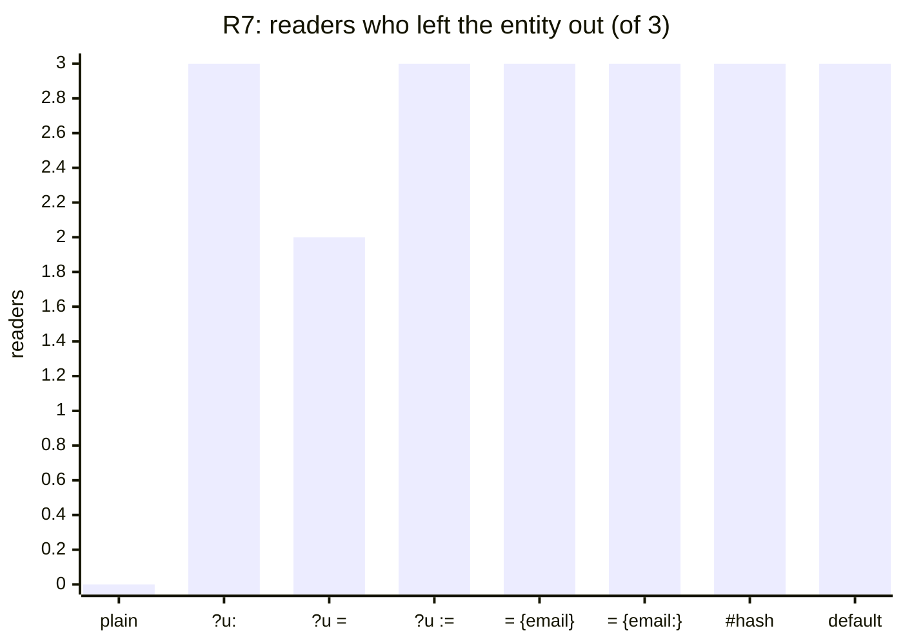
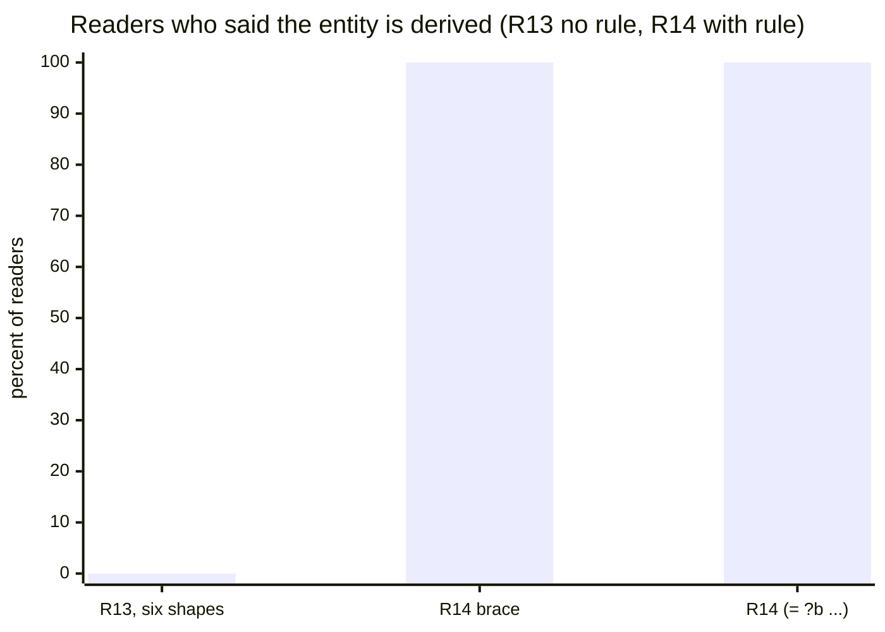
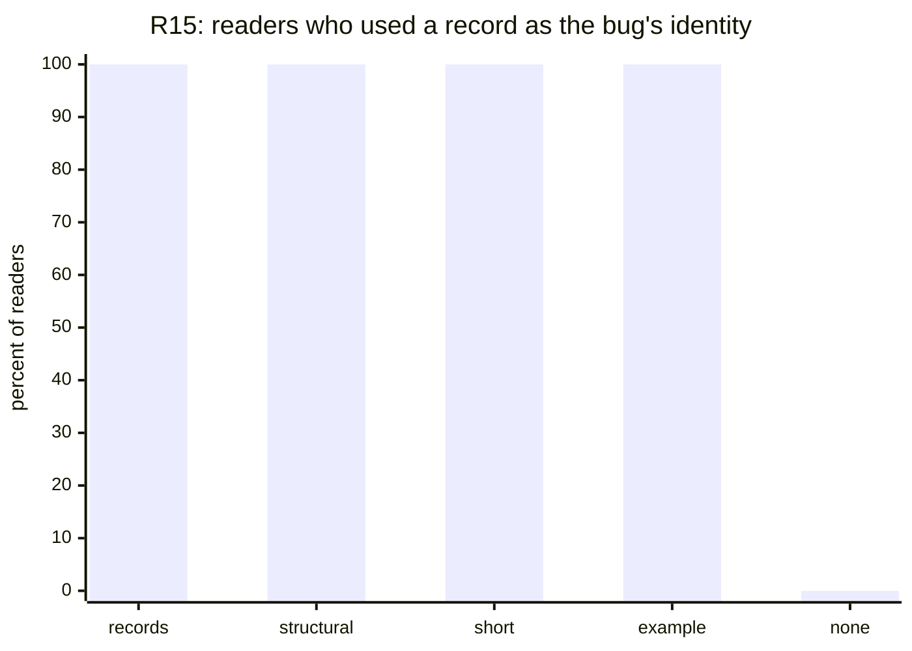

# Notation: journal

What we tried, what it measured, and what we decided, newest last. The [idea](../notation.md) says why; the [evaluation](evaluation.md) says how a reader is scored; the [design](design.md) is the current decision. Work happens on the `docs/notation` branch, PR [#728](https://github.com/dialog-db/dialog-db/pull/728).

## Where things stand

**Status: Exploring.** See the [research index](../README.md) for what the statuses mean.

- **Decided:** rules are heads and a `when`, with timing on the verb (`assert`, `assert!`, `retract!`, `ensue!`); lifetimes are layers on attributes, and a command is a concept in `:now`; a write names its entity, gives a record that identifies it, or leaves it out and gets the digest of what it writes; a derivation that must agree everywhere is a rule with `digest`.
- **Measured:** 249 readers over 15 rounds. Without a visible word, readers do not see a derivation (R1 `default` line 0/3, R13's six brace shapes 0/18). With one paragraph of spec, they do (R14 5/5, R15 16/16).
- **Rejected on design grounds, though readers got them:** `=` in a head (constraint elsewhere), the `{title author} ?b` head (construction does not belong in a concept).
- **Next:** R16, planned and not yet run: the revised design as a whole, read from four ways of writing its spec.
- **Open:** whether a record in the entity's place writes its fields; key spelling inside records; `:last` across devices; optional parameters.

## Datasets

There is no dataset in the usual sense. The workload is the reader prompts: a sketch of the notation, a task (save a table, update a row, find one, predict what exists after two devices sync) and numbered questions. Each round's prompts are in its results file, each with its sha256, and every reader's answer is in the round's `.jsonl` beside it. The prompts are synthetic and hold nothing private.

The topic file, this journal and the tallies were written on 2026-11-06, after the rounds had run in conversation. Every tally was recounted from the stored answers where the results file says so; where it says "as scored at the time", it is the tally the round reported then, checked against the answers but not rescored.

## 2026-11-04 — R1: does a `default` line say the entity is derived?

**Question.** The spec gave a write that leaves the entity out the hash of a record, with `(default ?bug is: {…})`. Does a reader see that?

**Method.** Five spellings of the same derivation, three readers each: the `default` line, `(identity ?bug from: {…})`, a second concept passing a record in the entity slot, `(?bug or: {…})` and `(option ?bug from: {…})` in the head. Each reader saw one, then a write without an entity, its rerun, and a status change.

**Results.** [r01](results/r01.md).

| spelling | derived, one bug after a rerun |
|---|---|
| `(default ?bug is: {…})`, the spec | 0/3 |
| `(identity ?bug from: {…})` | 3/3 |
| a record in the entity slot | 0/3 |
| `(?bug or: {…})` | 1/3 |
| `(option ?bug from: {…})` | 0/3 |

Readers who saw a derivation also saw its cost: status is in the hash, so a status change makes a second bug.

**Decision.** The `default` line goes. A derivation needs a word that says it, and only the identifying fields belong in it.

## 2026-11-04 — R2: a whole sketch

**Question.** Read cold, which parts of the sketch hold up: attribute concepts, picks, `(option …)`, `assert` against `assert!`, `let:new`?

**Method.** One sketch of attributes, a concept and four rules; longhand attribute concepts against a shorthand `{attr :type}`; three readers each.

**Results.** [r02](results/r02.md). Picks were read (6/6 for `:all`), and so was computed against stored (6/6). `(option ?who)` was not: one reader in six let a bug with no assignee match. Four in six said nothing says when `assert!` fires.

**Decision.** Keep the longhand attribute line; the shorthand saved nothing readers needed. Optionals stay open.

## 2026-11-04 — R3: an overloaded constructor, and a command's placeholder entity

**Question.** Does an overloaded `bug` whose second definition hashes its fields read as a constructor? And does a command written on a placeholder (`let:new`, `:new`, `?`) read as lasting one tick?

**Method.** Four variants, three readers each.

**Results.** [r03](results/r03.md). The overload read as derived 3/3, every reader inferring a dispatch rule the text never states. No reader of any placeholder read its facts as short-lived (0/9). Asked about two commands in one document, all three `:new` readers predicted one entity holding both titles.

**Decision.** A placeholder entity shared by every command mixes their fields. Lifetime has to be written somewhere a reader sees.

## 2026-11-04 — R4: when does a rule take effect?

**Question.** `(assert head …)` with `!` on the head's call, `rule` for every form, or `rule` with `assert!`: which says when a rule fires?

**Method.** Three variants of the same three rules, three readers each.

**Results.** [r04](results/r04.md). All nine told computed from stored. All nine said no form says when a `!` rule fires, and five asked for a separate part that names the trigger, most spelling it `when`.

**Decision.** `(rule head… (when premise…))`, with the timing on the head's verb and no `!` on the call inside.

## 2026-11-04 — R5: where to say a user is identified by email and name

**Question.** Head marker, bare `?`, a rule, a `define`, or an overload: which says it?

**Method.** Five variants, three readers each.

**Results.** [r05](results/r05.md). Every spelling with `hash` in it was read, 3/3 each. The bare `(? :email :name)` was read once in three.

**Decision.** A ceiling: this task cannot tell the `hash` spellings apart. The next rounds make readers write, not just read.

## 2026-11-05 — R6: the derivation at the call site

**Question.** If the writer names the fields at the call, `(user! (hash email: name:) …)`, which word reads best, and can "every field" be spelled short?

**Method.** `hash`, `derive`, `id`, `by` with field lists; `(hash)`, `(hash *)`, `(hash ...)` for every field; a `:new` write turned into a user by a rule. Three readers each.

**Results.** [r06](results/r06.md). The four words all read (2/3 to 3/3). `(hash)` and `(hash *)` read as every field 2/3; `(hash ...)` 0/3, read as the email alone. With `:new`, no reader could say how to make one email land on one user whatever the name.

**Decision.** Writers should not choose the fields: two writers who choose differently make two entities. The concept, or a rule, should own the derivation.

## 2026-11-05 — R7: save a table, with no hint

**Question.** Given only a definition and rows to save, does a reader leave the entity out?

**Method.** A plain head against seven heads that mark the identity fields; three readers each.

**Results.** [r07](results/r07.md).

| head | left the entity out |
|---|---|
| plain `(user ?u …)` | 0/3 |
| any of the seven markers | 20/21 |

The plain-head readers invented `user:01`, `user:02`, and reused `user:01` for the second device's row by hand.

**Decision.** Without a mark, nobody omits the entity. Something at the definition has to say it may be left out.

## 2026-11-05 — R8: "derive me if left out", on the primary and on a labeled parameter

**Question.** Which marker says a parameter may be left out and derived, and is the primary harder than a labeled one?

**Method.** Six markers, each on `user`'s primary and on `member`'s `person:`; three readers each.

**Results.** [r08](results/r08.md). `(?u = {email:})`, `(= ?u {email:})` and `(?u ?? {email:})` were left out 6/6. `(or ?u {email:})` 0/6: readers passed a record or `person:`. `(?? ?u …)` and `from:` were left out on the labeled parameter 3/3 and on the primary 1/3.

**Decision.** `=` and `??` read best; `or` reads as a choice between two things to pass. A labeled parameter is easier to omit than the primary.

## 2026-11-05 — R9: a constructor concept

**Question.** Does `(concept (bug/new title: ?t status: ?s) (bug {…} …))`, with a bare record in the entity slot, read as derived?

**Method.** A bare record, `(id {…})`, `(hash {…})`; five readers each.

**Results.** [r09](results/r09.md). The bare record 0/5: read as an anonymous record and minted. `id` and `hash` 5/5.

**Decision.** A record in an entity slot needs a rule that says what it means; without one it is a value. Two readers here followed a Tonk guide that reached them from the session's tool instructions, which is when the reader [hygiene](evaluation.md#hygiene) problem was noticed.

## 2026-11-05 — Bloom: collections, operators, channels

**Question.** Bloom has tables, scratches, interfaces and channels, and an operator per timing. What does that say about lifetimes, commands and sending?

**Method.** A reading of Bloom and Bud against the design, not a measurement.

**Results.** Bloom declares a collection's kind once and lets rules only name collections; the operator says when (`<=` now, `<+` next, `<-` delete next, `<~` async). A channel is a scratch with one column marked `@` for where a row goes. Replication is a rule like any other.

**Decision.** Timing goes on the rule's verb, and `ensue!` is the asynchronous one, chosen over `propose!` and `issue!` because it has no natural opposite. Lifetimes go on attributes as layers, named by entities from a fixed set like Bloom's, with no layer declarations and no `syncs`. Replication between layers is rules. A remote write is an outbox, not a transaction across connections.

## 2026-11-05 — R10: where the identity fields go, and `ensue!`

**Question.** Which head placement of the identity fields reads; does `ensue!` read without a definition?

**Method.** Six head placements, and `ensue!` against `assert-later!`; three readers each.

**Results.** [r10](results/r10.md). `[title: author:] ?b` 3/3, `(= ?b {…})` 3/3 (two by passing the record), `[:title :author]` and `#{…}` 2/3; `{title: author:} ?b` and `(title: author:) ?b` 0/3. Undefined, `ensue!` said nothing about when (0/3), but no reader invented an opposite; `assert-later!` was read (3/3) and two of three invented `retract-later!`.

**Decision.** `ensue!` stays, and the spec defines it in a line. `{title: author:} ?b` and `(title: author:) ?b` are out.

## 2026-11-05 — R11: a record of field names before the primary

**Question.** `{title author} ?b` and `{title: _ author: _} ?b`: does a record shape say "these fields, derived"?

**Method.** Three variants, four readers each.

**Results.** [r11](results/r11.md). `{title author}` 2/4. `{title: _ author: _}` 0/4: every reader passed a record as the primary, the opposite of leaving it out.

**Decision.** A shape that looks like a value invites a value.

## 2026-11-05 — R12: do readers know why?

**Question.** Readers construct, update and query right; do they know the entity is derived?

**Method.** Three variants, four readers each, asked what the part before `?b` means.

**Results.** [r12](results/r12.md). Behavior 12/12. Understanding: `(= ?b [title: author:])` 4/4, `?b = […]` 1/4, `[…] ?b` 0/4.

**Decision.** Right behavior is not understanding: a reader omits the entity because no entity was given, not because it reads a derivation. Score both from here on. `=` is out although it read best: it is a constraint everywhere else in the notation. So are vectors of fields: a vector is an enumeration (`as: [:todo :done]`). Forms that look like a call passing nothing, such as `(or ?b title: author:)`, are out too.

## 2026-11-06 — R13: six brace shapes, no rule

**Question.** The maintainer's six shapes around `{title author}` and `?b`: does any of them say "derived" on its own?

**Method.** Six variants, three readers each, no rule text.

**Results.** [r13](results/r13.md). Left the entity out 18/18. Said it is derived 0/18; `?b{title author}` was read as a key 3/3.

**Decision.** No spelling carries the meaning alone. The spec needs a rule.

## 2026-11-06 — R14: the brace head and one paragraph of spec

**Question.** With the rule "writing a concept without its primary creates the entity; if the definition names what it is derived from, the same values give the same entity on every device", does `{title author} ?b` read?

**Method.** Five readers for the brace head, three for `(= ?b [title: author:])`, from here on as read-only readers.

**Results.** [r14](results/r14.md).

| round | readers | said the entity is derived |
|---|---|---|
| R13, no rule | 18 | 0 |
| R14 `{title author} ?b`, with the rule | 5 | 5 |
| R14 `(= ?b [title: author:])`, with the rule | 3 | 3 |

**Decision.** One paragraph of spec does what no spelling did. `{title author} ?b` was the recommended head until the next round.

## 2026-11-06 — R15: a record in the entity's place is its identifier

**Question.** If the spec says a record given where an entity is expected identifies that entity, do readers use a record of the identity fields, and which wording works?

**Method.** Four wordings of the rule (records, structural identifiers, one short sentence, a worked example) and a control with none; four readers each, three for the control.

**Results.** [r15](results/r15.md).

| wording | readers | record of title and author | one bug after sync | also wrote `title:` `author:` |
|---|---|---|---|---|
| any of the four | 16 | 16 | 16 | 14 |
| none | 3 | 0 | 1 at low confidence | |

The control had no shared answer: one predicted two bugs, one made up `bug:crash-on-save-ada`. Readers spelled the record's keys three ways (short names 11, stored names 4, `title:` 1), which would hash to three entities.

**Decision.** The rule works, in any wording, and a short sentence is enough. Two problems belong to the idea, not the wording: the writer picks the identity fields again, and key spelling decides the hash. Whether a record in the entity's place also writes its fields is open.

## 2026-11-06 — Bloom again: keys, updates, interfaces and lattices

**Question.** How does Bloom say what identifies a row, how does it update one, and what is an `interface`?

**Method.** A reading of Bloom and Bloom^L against R15's problems.

**Results.** A Bloom key is the declared columns: the row has no identity apart from them, an update replaces by key (`<+-`), and a new title is a new row. An `interface input` is a scratch with a label saying who writes it. A row keeps its fields together because it is one tuple. Bloom^L's lattices merge without coordination, and a set is one.

**Decision.** Commands are rows, not a kind: a concept whose attributes are in `:now`, with no `command` form. A command's entity must be its own, the digest of its write, or its fields mix as R3's `:new` did. Who may write a stored concept directly is authorization, not notation. Picks are merges: `:all` and `:top` need no clock, `:last` does.

## 2026-11-06 — Derivation leaves the concept

**Question.** Where does a derivation live, if not in a head marker or a `default` line?

**Method.** Design discussion over R14, R15 and the Bloom readings.

**Results.** The head marker read well (R14), but it puts construction in a definition that is otherwise only about which facts make up a concept, and the writer still chooses the fields when it passes a record (R15).

**Decision.** A write names its entity, passes a record that identifies it, or leaves it out and gets the digest of everything it writes. A derivation that must agree on every device is a rule with `digest`, keyed by stored attribute names, so writers send commands and the rule picks the fields. The layer is `layer: :now`, part of the attribute's identity. Sending puts the destination in the data (`to:`); a remote call is request and reply rules on top of `ensue!`. Not yet measured: the next round reads the design as a whole.

## 2026-11-06 — The record, recounted

**Question.** Do the tallies reported during the rounds hold against the stored answers?

**Method.** Every reader's first answer, read from its transcript; the tallies in the results files are recounted where they say so.

**Results.** R7 was reported as 22/24 for any marker; it is 20/21 with a marker and 0/3 without. R10's `[:title :author] ?b` was reported 3/3; it is 2/3 (one reader made up ids). R15's worked-example readers rated clarity 4, 4, 4, 4, not 4, 3, ?, 4. R1 to R4 had no tally before. Ten of 249 readers called a tool they were told not to (listed under [hygiene](evaluation.md#hygiene)).

**Decision.** Use the recounts. None changes a decision above.

## 2026-11-07 — R16 planned: how should the spec be written?

**Question.** With the notation fixed, does the way the spec is written change whether a cheap reader can write in it? This turns the topic from how the notation looks to how it is taught.

**Method.** Four documents stating the same facts: `design.md` as it is (the baseline), a reference card, a walkthrough, and the card with a table of earlier readers' mistakes. Each is followed by the same tasks in a domain none of them uses: define a stored concept and a command, write the rule that derives a to-do's identity, write, update, query, send to a peer, and predict four outcomes. Five readers per document. The rubric (15 points) and the bars were committed before any reader ran: [r16-plan](results/r16-plan.md).

**Results.** Not run yet.

**Decision.** Not decided. A median of at least 13 of 15, 2 above the spec's, picks the style; a gain of 1 or less says the style is not the lever.

## How to reproduce

1. Take a variant's prompt from its round's results file and save it as `<variant>.txt`.
2. Start a reader with model `haiku` as a read-only agent (no shell, no tools that reach the user's apps or devices), and tell it: "This is a reading-comprehension exercise. Use the Read tool once to read `<variant>.txt`, then do exactly what that file asks. Use no other tools, do not search the web, and read no other files. Your final reply is just the numbered answers."
3. Start every reader of a round at once, three or more per variant, interleaving variants.
4. Score the first answer only, by the round's criteria in its results file; keep every answer.
