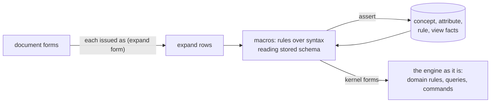

# Forms as commands, macros as rules

**Proposed.** Written before rules dropped `when` and `!` (R27, see [design](design.md#rules)); its rules still use that spelling. A way to have one kind of top-level form and a small kernel, with `concept`, `view`, `query` and the rest written in the notation as a prelude. It picks up the macro system in Gozala's tonk journal ([2026-05-16](https://github.com/tonk-labs/tonk/blob/journal/%40gozala/2026-05-16.md), [2026-05-21](https://github.com/tonk-labs/tonk/blob/journal/%40gozala/2026-05-21.md)) and moves it from the YAML notation to this one. Conduct's choice of Lux-style macros that read declarations is the same idea seen from the language side: here a macro reads declarations because it is a rule, and declarations are facts.

## The idea

- A top-level form is a command, `(expand <form>)`. The form is syntax, a value, never evaluated.
- A macro is a rule. Its `when` matches the shape of the syntax, and its heads assert the facts that describe it, or issue further forms.
- `concept`, `view`, `query` are macros in the prelude. The kernel knows none of them.
- Installing is those asserts landing: in a query run they are in the report, in a transaction they are stored.

A definition is never spread over facts on its entity. If a concept were its attributes asserted on the concept's entity, anyone could change the concept by asserting one more. So a definition (a concept, a rule, a view) is one value, its canonical form, stored under an entity that is the hash of that form. A claim of another source on that entity is not the definition, since its hash does not match: the entity certifies itself. What is said about a definition (its names, the views of a concept, indexes such as which attributes a rule reads) is ordinary facts on its entity, additive and from any writer, and never changes what the definition is.



## The kernel

| piece | what it is |
|---|---|
| syntax | a form is a value: atoms (symbol, keyword, text, number, entity, variable) and calls (a head, a primary, labelled arguments) |
| `(match ?form '(…))` | holds when `?form` has the quoted shape, binding its pattern variables; one row per way it matches |
| `id` | an entity from content: `(id ?x the: … as: …)`, or `(id ?x of: ?form)` for a canonical form |
| facts and commands | `assert`, `retract`, command rows that last one tick |
| `rule` | rules over a tick, `when`, `unless`, `!` heads; built in, so it can install the first macro |

In a quoted pattern, a `?name` matches any atom, the source's own variables included, and `_` matches anything. `…` after a part matches it any number of times, one row per match. A label written as a variable iterates over the entries, as the journal's `with: { ?k: ?attr }` did. A pattern variable matches only an atom, so a call needs a call pattern, which keeps the variants of a macro disjoint.

`rule` is the one built-in form. Something has to install the first macro, and the rule that installs rules cannot be installed by itself. Lisps keep a handful of special forms for the same reason; this keeps one.

## The prelude

### `concept`

```clj
(rule (assert (dialog.concept ?concept source: ?definition))
      (assert (dialog.name ?concept is: ?name))
  (when (expand ?form)
        (match ?form '(concept (?name ?this ?label: ?var …) _ …))
        (dialog/canonical ?form without: ?name is: ?definition)
        (id ?concept of: ?definition)))
```

The concept is stored whole, as its canonical form without its name, under the hash of that form, as a rule's body is stored under `dialog.rule/source` today. The name is a fact beside it, so one name may point at several concepts, and two documents that write the same concept derive the same entity: capture becomes merge, as the journal puts it.

The rest of the macro checks the form rather than taking it apart. A rule per shape a body may hold, disjoint by its pattern, says what is well formed: a field joined to a head parameter, `(?domain ?this ?field: (?pick ?var as: ?type) …)` with `?var` among the head's variables; a constraint, `(: ?var as: ?type)`; a collection field, `?key: (?pick ?var …)`. A form with a part no rule accepts is an error, and nothing is stored.

### `query`

```clj
(rule (query-of ?form
        (?domain ?this ?field: ?value …))
  (when (expand ?form)
        (match ?form '(query (?name ?this ?label: ?value …)))
        (dialog.name ?concept is: ?name)
        (dialog.concept ?concept source: ?definition)
        (match ?definition '(concept (_ _ ?label: ?var …) (?domain _ ?field: (_ ?var _ …) …) _ …))))
```

The journal's first open item was that a query cannot be a macro, because the form a user writes does not know the schema. A macro that is a rule reads the schema the `concept` macro stored. Here a concept call becomes a domain call with the concept's attributes, which is what dialog's wire carries today. The head spelling, a call built from rows, is the hardest part to write and is open below.

### `view`

```clj
(rule (assert (dialog.view ?concept ?mode: ?view))
      (assert (dialog.view ?view template: ?template model: ?model))
      (assert (rule (ui.display ?e mode: ?mode view: ?view)
                (when (?mode (?name ?e)))))
  (when (expand ?form)
        (match ?form '(view ?template model: ?model))
        (match ?model '(?mode (?name _ …) _ …))
        (dialog.name ?concept is: ?name)
        (id ?view of: ?form)))
```

A view is a definition of its own, its form under its hash. What ties it to a concept is a fact on the concept's entity, a key per mode as tonk stores it: `row`, `detail`, `edit`. That fact says something about the concept without changing it, so anyone may add a view to anyone's concept. The model is syntax, so the pattern in it is a value and is never checked as a ground command.

The macro also installs a rule, and that rule is what makes displaying a command. `(row (todo todo:9c1e))` is the command `row` around a to-do, and the view is what handles it: it derives `ui.display`, which the runtime renders by running the stored model with `?todo` bound and filling the template. A view is a command handler that renders. Its events are commands too, `issue='toggle'` issuing `(toggle (todo ?todo))`, so a view both answers commands and issues them.

## The to-do, expanded

```clj
(concept (todo ?todo title: ?title status: ?status)
  (xyz.tonk.todo ?todo
    title:  (last ?title as: :text)
    status: (last ?status as: [:done :todo])))

(rule (assert (todo ?t title: ?x status: :todo))
  (when (add (todo title: ?x))
        (id ?t title: ?x)))

(view #html "<li data-subject={?todo}>
               <span>{?t}</span>
               <input type='checkbox' issue='toggle' checked={?done}>
             </li>"
  model: (row (todo ?todo title: ?t status: ?s)))

(add (todo title: "Buy milk"))
(row (todo todo:9c1e))
```

| form | what expands | what lands |
|---|---|---|
| `concept` | the `concept` macro | the concept's form under its hash, and `dialog.name` `todo` on it |
| `rule` | built in | `dialog.rule/*`, as dialog stores rules today |
| `view` | the `view` macro | `row:` on `todo`'s concept entity, the view's template and model, the rule for `row` |
| `(add …)` | no macro: a command | a row of `add`, which the rule reads |
| `(row …)` | no macro: a command | a row of `row`, which the view's rule reads; `ui.display` for `todo:9c1e` |

A form whose head names a macro expands; a form whose head is anything else is issued as a command, and is an error if no rule reads it.

## What H1 found

H1 asked whether the prelude needs no kernel special cases. Writing it out:

- **One special case.** `rule` is built in, because it installs the first macro. Everything else is prelude.
- **Syntax needs a kernel.** `match` and quoted patterns are kernel pieces, and `…` iteration is what lets a macro handle a body of any length without recursion.
- **Definitions are values, not facts.** Storing a concept as attributes on its entity would let anyone change it. A definition is its canonical form under its own hash, and macros check forms rather than take them apart. That also removes most of the assembly problem: a definition is stored as written, so nothing has to be put back together from rows. A query compiled to a descriptor still has to be assembled once, from the rows its macro matched; that is the one aggregate a macro needs, and it runs at expansion, not in a rule over data.
- **Two identities.** The hash of the form names a definition. Dialog's concept identity is the hash of its attribute set, a structure. Both are useful: two definitions with the same attributes are the same structure. The kernel computes the structural one when it builds a descriptor.
- **Phases.** A macro installed by a transaction applies from the next document, as Racket separates phases, so every expansion can be reproduced from the hashes a document pinned.

So H1 holds with one exception, `rule`, and with a kernel step that assembles forms from rows.

## Open

- The spelling of a head built from rows, `(?domain ?this ?field: ?value …)`, and whether it is the same `…` as in patterns.
- What `(expand ?form)` holds for a form inside a form: whether a macro issues nested forms for other macros, and how far expansion runs in a tick.
- Errors. A form that matches no variant of its macro has to list the variants, as an ambiguous name lists its candidates.
- H2: whether an agent given only a space's macro facts writes valid forms as often as one given the spec.
