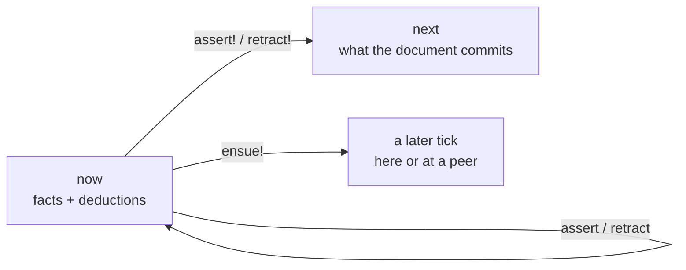

# R16 plan: how to write the spec

Written and committed before any reader ran. The tally will be in `r16.md` beside it.

## Variants

The notation is held fixed at [`design.md`](../design.md) as of this commit. Only the documentation differs; every variant states the same facts. The tasks follow the documentation in every file and use a domain (to-dos) none of the documents uses.

| variant | what the reader gets | lines |
|---|---|---|
| `spec` | `design.md` as it is: the baseline | 366 |
| `card` | a one-page reference card: the same rules as short bullets, one example each, no rationale or evidence | 104 |
| `tutorial` | a walkthrough that builds a bug tracker step by step, introducing each rule where it is needed | 146 |
| `pitfalls` | the reference card plus a table of mistakes earlier readers made, wrong beside right | 118 |

The pitfalls are drawn from the errors of R3, R4, R7, R10 and R15, so they overlap the tasks by design: the variant tests whether naming a mistake prevents it.

## Scoring

Fifteen points per reader, from its first answer only:

| item | point when |
|---|---|
| 1 | `todo` declares the three stored attributes on its primary, with `is:`, their types, and `pick: :last` on state; no `layer:` |
| 2 | every attribute line of `add` has `layer: :now` |
| 3a | the head is `assert!` around a `todo` call with no `!` inside, and state `:open` |
| 3b | `digest` hashes exactly the list and the text |
| 3c | the digest's keys are the stored names `xyz.todo/list` and `xyz.todo/text` |
| 3d | the rule is installed (`rule!`) |
| 4 | `(add! list: list:home text: "Buy milk")`: `!`, no entity |
| 5 | `(todo! todo:9c1e state: :done)` |
| 6 | a `todo` question with list and text given and the state a variable |
| 7a | the head is `ensue!` around `notice`, with `to:` inside the call |
| 7b | the premises join a done `todo` to its list's `xyz.todo.list/owner-peer` |
| 8 | one to-do |
| 9 | nothing is left: the facts lasted one tick |
| 10 | no: each add's entity is the digest of its own fields |
| 11 | the to-do would hold only while the add does, that tick, and never be stored |

A rename that keeps the meaning (`of:` for the primary, `concept` for `concept!` in task 1 or 2) still scores. Item 12, the rating, is reported, not scored.

## Bars

Five readers per variant, `haiku`, read-only, all started at once and interleaved.

- **Success:** a variant whose median is at least 13 of 15 and at least 2 above `spec`'s median, with no reader of it below 11. That variant becomes how the spec is written.
- **Failure:** no variant's median beats `spec`'s by more than 1. The way the spec is written is not the lever for this reader; fix the specific items readers miss instead.
- **The middle:** a gain of 1 to 2, or a winner that costs a second document to keep in step. The maintainer weighs it.

Per item, the tally also reports how many readers of each variant got it, so a style that teaches one rule and loses another shows.

## What the readers read

<details><summary><code>spec</code> (sha256 <code>741171201360b0a4</code>)</summary>

````text
You are going to write in Dialog notation. Its documentation comes first, then your tasks.

# Dialog notation

A single notation for dialog queries, rules and transactions. Nothing is implemented yet. Everything here is agreed unless it is marked **Proposed**, and the questions still open are listed at the end. The forms are spelled as Lisp while the semantics settle. The YAML spelling comes after.

This is the current decision of the [notation research](../notation.md). The [journal](journal.md) has the reader evals behind each choice, numbered R1 to R15, and the Bloom comparison that reshaped lifetimes and commands. [`sketches/`](sketches) has tonk's `core.yaml` and `notebook.yaml` redone in this notation.

## Model

A replica holds facts. Each fact is an entity, an attribute and a value, with the cause and version it was written at. A document is evaluated against three times, after [Dedalus](https://www2.eecs.berkeley.edu/Pubs/TechRpts/2009/EECS-2009-173.html):

- **`now`** holds the facts as they stand when the document starts, plus whatever the document's facts and deductive rules derive from them.
- **`next`** is the state the document commits: `now` with the document's writes applied.
- **later** is some tick after `next`, possibly at another replica. A fact sent to later arrives when it arrives, and nothing that sends it waits.

Deduction happens within `now`, induction carries `now` into `next`, and `ensue!` sends a fact to a later tick.



## Terms

| Term | Spelling |
|---|---|
| Variable | `?b`, `?status`. It belongs to the one rule or question it appears in. |
| Text | `"triage"`, or `"""…"""` for text that holds `"` or spans lines |
| Number | `16`, `0.5` |
| Keyword | `:done`, `:text`, `:last`. Types, picks, layers and enumerated values are keywords. A keyword names the entity it spells with the colon moved: `:now` is `now:`. |
| Entity | a URI: `id:notebook/scratch`, `did:key:z6Mk…`, `tonk:notebook/edge` |
| Record | `{xyz.bug/title "Crash" xyz.bug/author "ada"}`, `{"N1" id:notebook/scratch/1}` |
| Vector | `[:todo :done]`, which as a type is an enumeration: one of these values |
| Name | `notebook/block`, the name of a concept, view or event |

`;` starts a comment.

## Calls

A call names a concept and passes its parameters. Every definition has exactly one primary parameter, written without a label. Every other parameter has a label, and arguments are never punned. At a call the primary may be written bare or as `of:`, in any position, as in [conduct](https://github.com/Gozala/conduct).

```clj
(bug/status ?b is: :triage)
(bug/status is: :triage of: ?b)
(bug/summary ?b title: ?t assignee: ?who)
```

A call may leave out any parameter whose definition says how to derive it. Today only the primary has such a rule, under [Entities](#entities).

A `!` after the name makes the call a write: `(bug/status! bug:01 is: :done)`.

## Documents

A document is a set of top-level forms evaluated as one tick. The order of its forms does not matter. Every premise and every question reads `now`, so nothing in a document sees that document's own writes. A chain, where one write depends on reading another, takes a second document.

The top-level forms are:

- **a question**, a bare call such as `(bug/status ?b is: :done)`;
- **a write**, a bare call with `!`;
- **a rule**, `(rule …)`;
- **a definition**: `concept!`, `rule!`, `view!` or `event!`.

## Questions

A bare call at the top of a document is a question. Its answer is the rows of variable bindings that match `now`. A parameter the question leaves out matches any value.

## Writes

A bare call with `!` writes into `next`. It must be ground, except for an entity it leaves out (see [Entities](#entities)).

```clj
(bug/status! bug:01 is: :done)
```

A write means the same as a rule with one `assert!` head and no `when`, so that longer form is never written.

**Proposed.** A write through a concept that leaves out a value parameter leaves that attribute as it is. `(notebook/block! id:b1 source: "x")` changes the block's source and keeps its notebook.

**Proposed.** A retract through a concept that leaves out a parameter retracts every value of it.

## Rules

A rule is one or more heads and one `when`:

```clj
(rule (assert (bug/review ?b reviewer: ?who))
  (when (bug/status ?b is: :review)
        (bug/assignee ?b is: ?who)))
```

A head is a verb around a call. The verb says when the head takes effect, and the call inside it carries no `!`:

| verb | takes effect | |
|---|---|---|
| `assert` | in `now` | a deductive rule: it derives into `now` and settles to a fixpoint |
| `retract` | in `now` | **Proposed:** stratified the way `unless` is |
| `assert!` | in `next` | an inductive rule: it reads `now` and writes `next` |
| `retract!` | in `next` | |
| `ensue!` | in a later tick | an asynchronous rule; it has no retracting form |

Several heads may share one `when`, so a body is written once:

```clj
(rule (assert! (bug/status ?b is: :done))
      (retract! (bug/assignee ?b is: ?who))
  (when (bug/status ?b is: :review)
        (bug/assignee ?b is: ?who)))
```

A premise in `when` is one of:
- a call;
- `(unless call)`, which holds when the call has no match;
- a formula, such as `(== ?a ?b)`, `(!= ?old ?key)`, `(digest {…} is: ?e)` or `(dialog/position ?b after: ?lo before: ?hi is: ?at)`.

Every variable in a head must be bound by the premises.

The `!` moved from the head's call to the verb because readers could not tell when a rule spelled `(assert! (bug/status! ?b …) …)` takes effect: all nine readers in R4 said the form never says, and five of them asked for a separate part that names the trigger. In R10, `ensue!` with no definition said nothing about when it takes effect (none of three could tell), but no reader invented a retracting form for it; two of three invented `retract-later!` for `assert-later!`. So `ensue!` needs this line in the spec, and keeps it from growing an opposite.

## Installing

A `!` on a definition's keyword installs it in the replica: `concept!`, `rule!`, `view!`, `event!`. That is the same `!` a write has, since installing writes the definition into `next`. Without the `!`, the definition belongs to the document it is written in.

An installed inductive rule fires whenever its premises match, which is how a command takes effect.

**Proposed.** Installed rules induce after the document's tick, so the document's questions do not see what they induce. Their edits appear in the report and in the commit.

## Concepts

`concept!` declares a concept. Its head is a call made of variables, and its body is a conjunction. A concept can be read with a query and written with a `!` call.

### Attributes

A body line that names a stored attribute declares it: the stored name, the primary, `is:`, the value type (`as:`) and the pick.

```clj
(concept! (notebook/title ?of is: ?is)
  (xyz.tonk.notebook/title ?of is: ?is as: :text pick: :last))
```

**Proposed.** The line is a call on the stored name. It replaces the `(the xyz.tonk.notebook/title of: ?of …)` spelling, and is what every reader prompt used from R1 on. What tells such a line apart from a call on another concept is open.

The types used so far are `:text`, `:entity`, `:bytes`, `:natural`, `:float`, sized numbers such as `(:float 64)`, enumerations such as `[:todo :done]`, and the collections `(:sequence T)` and `(:dictionary T)`. A collection value is written as a record from key to element: `(notebook/entry! id:notebook/scratch is: {"N1" id:notebook/scratch/1})`.

The picks are `:last`, which keeps the latest claim, `:all`, which keeps every claim, and `:top`, which keeps the highest-ranked value of an enumeration.

An attribute line may also carry `layer:` (see [Layers](#layers)) and `role:`, the palette slot that a command's field fills.

### Composite concepts

A composite concept's body is a conjunction of attribute lines, concept calls and constants.

```clj
(concept! (notebook/block ?block notebook: ?n source: ?s)
  (block/notebook ?block is: ?n)
  (block/source ?block is: ?s))
```

A concept body holds no formulas, so every concept can be read and written. Formulas belong in rule bodies. A concept may not contain itself.

A concept says what facts make it up, not how its entity is made. Construction is the call's business (below) or a rule's.

### Optional parameters

A parameter marked `(option ?x)` in the head may stay unbound in a match.

```clj
(concept! (tonk/repository ?r name: ?name description: (option ?d))
  (repo/name ?r is: ?name)
  (repo/description ?r is: ?d))
```

This is open. In R2 one reader in six expected `(option ?who)` to let a bug with no assignee match.

### Identity

A concept's identity is its set of attributes. An attribute's identity is its stored name, type, pick and layer, so the same name in another layer is another attribute. A name binds a concept to a signature, meaning the head's labels. Two names over the same attributes are one concept with two signatures. Redefining a name with a different body rebinds the name. Stored facts belong to attributes, not names, so they are not touched.

**Proposed.** Views and routes refer to names, so two route models with the same fields keep separate templates.

## Entities

A write says which entity its facts land on in one of three ways:

```clj
(bug! bug:7f3a status: :done)                                        ; 1. an entity, used as is
(bug! {xyz.bug/title "Crash on save" xyz.bug/author "ada"}            ; 2. a record: the entity
      status: :todo)                                                  ;    that record identifies
(report! title: "Crash on save" author: "ada" status: :todo)          ; 3. left out: the digest
                                                                      ;    of everything written
```

1. **An entity** is used as given. This is how an update names what it changes.
2. **A record** in place of an entity is a structural identifier: the entity is the one that record identifies, so equal records name the same entity on every device. Keys are resolved to stored attribute names before hashing.
3. **Left out**, the entity is the digest of every attribute and value the write states. Two writes of the same facts are one entity, and two writes that differ in any fact are two.

In R15, sixteen of sixteen readers given any wording of rule 2 used a record of title and author as the bug's identity and predicted one bug after two devices saved it. Without the rule, three readers had no shared answer: one predicted two bugs, and one made up `bug:crash-on-save-ada`.

An identity that must agree everywhere, such as "a bug is its title and author", belongs in a rule that every replica runs, not in each writer's choice of fields:

```clj
(rule! (assert! (bug ?b title: ?t author: ?a status: ?s))
  (when (report title: ?t author: ?a status: ?s)
        (digest {xyz.bug/title ?t xyz.bug/author ?a} is: ?b)))
```

Writers send a report, and the rule picks the fields. `digest` runs one way, so the planner binds its record first. The keys are stored attribute names: R15's readers spelled the same identity three ways (short names, stored names, `title:` labels), and each spelling hashes to a different entity.

Entities with the same content are the same entity. That is the point for value-like things such as routes. For things that must stay distinct even when their content is equal, a rule can lend them another entity, or the write adds a field that tells them apart, such as the event's time. In `notebook.clj`, each new block takes the entity of the insert command that made it.

There is no `default` line and no marker in the concept's head that says how a write derives the entity. Readers did not see a derivation in a `default` line (none of three in R1), and the marker that read best, `(bug {title author} ?b …)` (five of five in R14 once a rule explained it), puts construction in a definition that is otherwise only about which facts make the concept up.

## Layers

**Proposed.** The set of layers and their names beyond `:now`.

An attribute line's `layer:` says where its facts live and how long. Layers are a fixed set, named by entities, and no document declares one. An attribute with no `layer:` is stored in the replica.

| layer | holds facts | |
|---|---|---|
| (none) | until retracted | stored, and synced as the replica is |
| `:now` | for one tick | never stored; gone once the document's tick ends |

The layer is part of the attribute's identity. `xyz.tonk.site/path` stored and `xyz.tonk.site/path` in `:now` are two attributes, so a concept over one is not a concept over the other.

Facts move between layers by rules, as Bloom moves them between collections. A deductive rule reads several layers on demand; an inductive rule copies facts into another layer and keeps them there. Nothing else replicates.

## Commands

A command is a concept whose attributes are in `:now`. There is no `command` form. Writing one triggers installed rules and stores nothing.

```clj
(concept! (tonk/rename-repository ?cmd repository: ?r name: ?name)
  (xyz.tonk.rename-repository/subject ?cmd is: ?r as: :entity layer: :now)
  (xyz.tonk.rename-repository/name ?cmd is: ?name as: :text layer: :now))

(rule! (assert! (repo/name ?r is: ?name))
  (when (tonk/rename-repository ?cmd repository: ?r name: ?name)))

(tonk/rename-repository! repository: did:key:z6Mk… name: "Plans")
```

The command's write leaves its entity out, so the entity is the digest of its fields. Two commands in one tick never share an entity, so their fields never mix. A shared placeholder entity such as `:new` mixes them: in R3, three of three readers predicted that two `(bug! :new …)` writes in one document leave one entity with two titles.

Whether only rules may write a stored concept, so that its command is the only way in, is a matter of authorization, not notation: a capability that lets a writer into `:now` but not into the stored attributes.

## Sending

`ensue!` sends a fact to a later tick. Where it goes is data on the fact: the `to:` field names the peer, and the runtime routes on it, the way Bloom routes a channel row by its `@` column.

```clj
(rule! (ensue! (xyz.bug/report ?r title: ?t author: ?a status: ?s to: ?peer))
  (when (draft ?r title: ?t author: ?a status: ?s peer: ?peer)))
```

The facts the receiver needs go with the message, in the same tick: the sender says which, rather than the receiver fetching them. On arrival they are in the receiver's `:now` for one tick, where its rules join them with its own facts.

**Proposed.** A remote call, Unison's `fork` and `await`, is a layer on top: a request sent with `ensue!`, a rule at the peer that answers with `ensue!`, and a rule that matches the reply to its request by the request's entity. It needs no form of its own in the core.

## Conflicts

A conflict is never an error. It is elected, as concurrent writes are, comparing version first, then cause, then succession, and value only as the last resort.

- Conflicting writes in one document are concurrent candidates.
- A write in a later document succeeds the claim it read.
- A deductive rule's value under `:last` succeeds the claim its body read (dialog #724, fixed by #725), so `(rule (assert (bug/status ?b is: :todo)) (when (bug/status ?b is: :triage)))` rewrites the status instead of standing beside it.
- A cycle of rewrites converges, with the rewrites as concurrent candidates. A counter (`?n + 1`) does not converge.

A pick is a choice of merge, which Bloom^L would call a lattice. `:all` is a set union and needs no order. `:top` over a ranked enumeration only moves up the ranking, so two devices that never synced agree once they do. `:last` needs an order across devices, which seventeen of nineteen readers in R15 asked about.

## Views, events and routes

**Proposed.** `view!` and `event!` name what they define by their first argument, the way `concept!` does.

A view attaches templates to a concept by facet:

```clj
(view! notebook/block
  show: {:directory """
    <div class="notebook-block-row" subject={this} data-source={source}></div>
    """})
```

An event says how a platform event fills a command. Its `where` keys name command parameters, and its values are paths into the event:

```clj
(event! on/block-remove
  type: "remove"
  where: {:block ".currentTarget.dataset.subject"})
```

A template binds an event to a command with `on:block-remove=block/remove`. A command filled from an element's event is still a command. Elements never write facts directly.

A route maps a path to a route model:

```clj
(route! path: "/notebook/{*entity}" concept: notebook/route)
```

## Preview

**Proposed.** A preview is the same document, evaluated without committing.

## From Bloom

Comparing the design with [Bloom](http://bloom-lang.net) settled three of the choices above and changed two.

| Bloom | here |
|---|---|
| A collection's kind (`table`, `scratch`, `channel`) is declared once; a rule only names collections. | Lifetime is on the attribute (`layer:`), not on the rule or the call. |
| The merge operator says when a rule takes effect: `<=` now, `<+` next, `<-` delete next, `<~` later. | The head's verb: `assert`, `assert!`, `retract!`, `ensue!`. |
| An input is a `scratch` row; `interface input` only labels who writes it. | A command is a concept in `:now`; `command` and `transient:` are gone. Who may write what is authorization. |
| A `channel` is a scratch with one column marked `@` for the destination. | `to:` is a field of the sent fact, not a parameter of `ensue!`. |
| A row's fields stay together because a row is one tuple. | A fact's fields stay together only on a shared entity, so each command needs its own: the digest of its write. |
| A key is the declared columns, and a row with other key values is another row. | A derived entity is fixed when it is made. That keeps it stable when its title changes, and is why the identity fields are open below. |
| Bloom^L lattices merge without coordination. | Picks are merges; `:last` is the one that needs a clock. |

## Open

- Whether writing a record in place of an entity also writes the record's fields. In R15, fourteen of sixteen readers repeated `title:` and `author:` beside the record, so they read it as identity only.
- Whether a record may use short keys inside a concept call, resolved to stored names before hashing, or only stored names.
- Whether the fields an identity is derived from may change. A renamed title gives a record that no longer finds its bug, and a new write with it makes a second one.
- How `:last` orders writes from devices that had not synced.
- Optional parameters: `(option …)` read correctly once in six.
- Which layers exist beyond `:now` and stored, and their names.
- Whether commands are conduct record types, one attribute whose value is a record, rather than one attribute per field. Dialog's `Record` value is opaque to queries today ([record-value](../../notes/record-value.md)).
- How an entity is named across the rules and writes of a document, and what a bare symbol such as `scratch` or `tab-title` means.
- Whether a document's questions are answered jointly or one at a time.
- Whether a rule's head must be a declared attribute or concept.
- Whether metadata (`description:`, `action:`, `role:`) is labeled entries kept as data.
- Whether templates name models by concept name rather than by pinned URI.
- The YAML spelling.

---

# Tasks

Your app keeps to-dos. These stored attributes already exist; use these names:

- `xyz.todo/list`: the list a to-do is on, an entity
- `xyz.todo/text`: the to-do's text
- `xyz.todo/state`: `:open` or `:done`, the latest write wins

The UI adds a to-do by sending an add command with a list and a text. The command's attributes are `xyz.todo.add/list` and `xyz.todo.add/text`. A to-do is identified by its list and its text: the same text added to the same list from two devices must end up as one to-do.

A concept `(notice ?n todo: ?t text: ?x to: ?peer)` is already defined. The peer that owns a list is stored in `xyz.todo.list/owner-peer`.

1. Define the stored concept `todo`, with parameters `list:`, `text:` and `state:`.
2. Define the command concept `add`, with parameters `list:` and `text:`.
3. Write the rule that turns an add into a stored to-do, open, identified by its list and its text.
4. Write what the UI writes to add "Buy milk" to `list:home`.
5. Write what marks the to-do `todo:9c1e` done.
6. Write a question that finds the state of "Buy milk" on `list:home` without knowing its entity.
7. Write a rule: whenever a to-do is done, send a `notice` about it, with its text, to the peer that owns its list.

Answer in a sentence or two:

8. Two devices that have not synced each run task 4. After they sync, how many "Buy milk" to-dos are on `list:home`?
9. One tick after task 4 runs, what is left of the add command's facts?
10. One document writes two adds, "Buy milk" and "Buy eggs", to different lists. Can their lists and texts get mixed up? Why or why not?
11. If task 3's rule used `assert` instead of `assert!`, what would change?
12. Rate the documentation from 1 to 5 for how easy it made these tasks, name the one thing that confused you most, and say what change to the documentation would have fixed it.

Answer as a numbered list, 1 to 12. Write only notation for tasks 1 to 7.
````

</details>

<details><summary><code>card</code> (sha256 <code>9881c406d9fbb4f0</code>)</summary>

````text
You are going to write in Dialog notation. Its documentation comes first, then your tasks.

# Dialog notation: reference card

A replica holds facts: an entity, an attribute, a value. A document is a set of top-level forms, evaluated as one tick. Order does not matter. Everything a document reads, it reads from the facts as they stood when it started.

**Values.** Variable `?b` (local to one rule or question). Text `"triage"`. Keyword `:done`; types, picks, layers and enumerated values are keywords. Entity: a URI such as `bug:7f3a`. Record `{xyz.bug/title "Crash" xyz.bug/author "ada"}`. Vector `[:todo :done]`, as a type an enumeration. `;` starts a comment.

**Calls.** `(name primary label: value …)`. One primary per definition, written bare (or as `of:`), in any position. Every other argument has its label; nothing is punned.
- `(bug/status ?b is: :triage)` is a question: it returns the rows of bindings that match.
- `(bug/status! bug:01 is: :done)` is a write: the `!` writes. A write is ground, except for an entity it leaves out.
- A parameter a question leaves out matches anything.
- A write that leaves out a value parameter leaves that attribute as it is.

**Concepts.** `concept!` defines one, `rule!` installs a rule, `view!` and `event!` the same. The `!` installs it in the replica; without it, it belongs to the document.
- A body line naming a stored attribute declares it: `(xyz.bug/title ?b is: ?t as: :text pick: :last)`.
- Types: `:text`, `:entity`, `:natural`, `:float`, `:bytes`, enumerations `[:todo :done]`. Picks: `:last` keeps the latest claim, `:all` keeps every claim, `:top` the highest-ranked value.
- A composite concept's body is attribute lines and concept calls, no formulas.
- A concept says which facts make it up, not how its entity is made.

```clj
(concept! (bug ?b title: ?t author: ?a status: ?s)
  (xyz.bug/title  ?b is: ?t as: :text)
  (xyz.bug/author ?b is: ?a as: :text)
  (xyz.bug/status ?b is: ?s as: [:todo :done] pick: :last))
```

**Entities.** A write names its entity one of three ways:
1. an entity, used as given: `(bug! bug:7f3a status: :done)`;
2. a record, identifying the entity: equal records name the same entity on every device;
3. left out: the entity is the digest of every attribute and value the write states. Same facts, same entity; any fact different, different entity.

An identity that must agree on every device goes in a rule, with `digest` over the identifying fields, keyed by stored attribute names:
`(digest {xyz.bug/title ?t xyz.bug/author ?a} is: ?b)`.

**Rules.** `(rule head… (when premise…))`. A head is a verb around a call; the call inside has no `!`.

| verb | effect |
|---|---|
| `assert` / `retract` | derived in this tick only: holds while its premises hold, never stored |
| `assert!` / `retract!` | written to the next state: stored |
| `ensue!` | sent to a later tick, here or at a peer; there is no retracting form |

Several heads may share one `when`. Premises: calls, `(unless call)`, formulas such as `(== ?a ?b)` or `(digest {…} is: ?e)`. Every head variable must be bound by a premise. An installed rule (`rule!`) fires whenever its premises match.

```clj
(rule! (assert! (bug ?b title: ?t author: ?a status: ?s))
  (when (report title: ?t author: ?a status: ?s)
        (digest {xyz.bug/title ?t xyz.bug/author ?a} is: ?b)))
```

**Layers.** `layer:` on an attribute line says where its facts live. No `layer:` means stored in the replica until retracted. `layer: :now` means the facts last one tick and are never stored. The layer is part of the attribute's identity.

**Commands.** A command is a concept whose attributes are all `layer: :now`. Writing one triggers installed rules and stores nothing. Its write leaves the entity out, so each command's entity is the digest of its own fields, and two commands never share one.

```clj
(concept! (report ?r title: ?t author: ?a status: ?s)
  (xyz.bug.report/title  ?r is: ?t as: :text layer: :now)
  (xyz.bug.report/author ?r is: ?a as: :text layer: :now)
  (xyz.bug.report/status ?r is: ?s as: [:todo :done] layer: :now))

(report! title: "Crash on save" author: "ada" status: :todo)
```

**Sending.** `ensue!` sends a fact to a later tick. Where it goes is data: a `to:` field on the sent fact names the peer, and the runtime routes on it.

```clj
(rule! (ensue! (report title: ?t author: ?a status: ?s to: ?peer))
  (when (draft ?d title: ?t author: ?a status: ?s peer: ?peer)))
```

**Conflicts** are never errors. Concurrent writes are elected by version, then cause, then value. Under `pick: :last` the later write wins.

---

# Tasks

Your app keeps to-dos. These stored attributes already exist; use these names:

- `xyz.todo/list`: the list a to-do is on, an entity
- `xyz.todo/text`: the to-do's text
- `xyz.todo/state`: `:open` or `:done`, the latest write wins

The UI adds a to-do by sending an add command with a list and a text. The command's attributes are `xyz.todo.add/list` and `xyz.todo.add/text`. A to-do is identified by its list and its text: the same text added to the same list from two devices must end up as one to-do.

A concept `(notice ?n todo: ?t text: ?x to: ?peer)` is already defined. The peer that owns a list is stored in `xyz.todo.list/owner-peer`.

1. Define the stored concept `todo`, with parameters `list:`, `text:` and `state:`.
2. Define the command concept `add`, with parameters `list:` and `text:`.
3. Write the rule that turns an add into a stored to-do, open, identified by its list and its text.
4. Write what the UI writes to add "Buy milk" to `list:home`.
5. Write what marks the to-do `todo:9c1e` done.
6. Write a question that finds the state of "Buy milk" on `list:home` without knowing its entity.
7. Write a rule: whenever a to-do is done, send a `notice` about it, with its text, to the peer that owns its list.

Answer in a sentence or two:

8. Two devices that have not synced each run task 4. After they sync, how many "Buy milk" to-dos are on `list:home`?
9. One tick after task 4 runs, what is left of the add command's facts?
10. One document writes two adds, "Buy milk" and "Buy eggs", to different lists. Can their lists and texts get mixed up? Why or why not?
11. If task 3's rule used `assert` instead of `assert!`, what would change?
12. Rate the documentation from 1 to 5 for how easy it made these tasks, name the one thing that confused you most, and say what change to the documentation would have fixed it.

Answer as a numbered list, 1 to 12. Write only notation for tasks 1 to 7.
````

</details>

<details><summary><code>tutorial</code> (sha256 <code>9670401a9b99d0a9</code>)</summary>

````text
You are going to write in Dialog notation. Its documentation comes first, then your tasks.

# Dialog notation: a walkthrough

This builds a small bug tracker, one step at a time. Each step introduces the part of the notation it needs.

## 1. Facts and documents

A replica holds facts. A fact is an entity, an attribute and a value: bug `bug:7f3a` has `xyz.bug/status` `:todo`. Entities are URIs (`bug:7f3a`), text is quoted (`"Crash"`), keywords start with a colon (`:todo`), variables with a question mark (`?b`), and `;` starts a comment.

You send the replica a document: a set of forms, evaluated together as one tick. Their order does not matter, and everything in the document reads the facts as they stood when it started.

## 2. Define a concept

A concept names a group of facts about one entity. Here, a bug has a title, an author and a status:

```clj
(concept! (bug ?b title: ?t author: ?a status: ?s)
  (xyz.bug/title  ?b is: ?t as: :text)
  (xyz.bug/author ?b is: ?a as: :text)
  (xyz.bug/status ?b is: ?s as: [:todo :done] pick: :last))
```

The head, `(bug ?b title: ?t …)`, is how you will call it. `?b` is the concept's primary parameter: there is exactly one, written without a label. Every other parameter has a label, and you always write it.

Each body line declares a stored attribute: its full name, the entity (`?b`), its value (`is:`), its type (`as:`) and its pick. `[:todo :done]` as a type means one of those values. `pick: :last` keeps the latest write; `:all` would keep every one, `:top` the highest-ranked. `concept!` installs the definition in the replica; without the `!` it would belong only to this document.

A concept says which facts make it up. It does not say how a bug's entity is made; that comes in step 5.

## 3. Ask a question

A call without `!` is a question. It returns every set of bindings that matches:

```clj
(bug ?b author: "ada" status: ?s)
```

This finds ada's bugs and their status. A parameter you leave out matches anything. The primary can also be written `of: ?b`, anywhere in the call.

## 4. Write

The same call with `!` after the name writes. A write is ground: every value given.

```clj
(bug! bug:7f3a status: :done)
```

This names the entity, so it changes that bug. Parameters it leaves out keep their values.

## 5. Make a new bug, the same one on every device

To create a bug, you don't make up an entity. A write names its entity in one of three ways:

1. an entity, used as given, as in step 4;
2. a record, such as `{xyz.bug/title "Crash" xyz.bug/author "ada"}`: equal records name the same entity on every device;
3. nothing: the entity is the digest of every attribute and value the write states. Same facts, same entity; any fact different, a different entity.

We want a bug to be identified by its title and author, whatever its status, and the same on every device. So the identity goes in a rule (step 7) that every replica runs, and it hashes exactly those fields, spelled with their stored names:

```clj
(digest {xyz.bug/title ?t xyz.bug/author ?a} is: ?b)
```

## 6. A command

The UI should not write bugs directly. It sends a command, `report`, and a rule turns it into a bug. A command is a concept whose attributes are all `layer: :now`:

```clj
(concept! (report ?r title: ?t author: ?a status: ?s)
  (xyz.bug.report/title  ?r is: ?t as: :text layer: :now)
  (xyz.bug.report/author ?r is: ?a as: :text layer: :now)
  (xyz.bug.report/status ?r is: ?s as: [:todo :done] layer: :now))
```

`layer:` says where an attribute's facts live. With no `layer:` they are stored until retracted. With `layer: :now` they last one tick and are never stored. The layer is part of the attribute: `xyz.bug.report/title` in `:now` is not the same attribute as a stored one.

The UI writes a report and leaves the entity out:

```clj
(report! title: "Crash on save" author: "ada" status: :todo)
```

The report's entity is the digest of its own fields, so two reports in one document never share an entity, and their fields never mix.

## 7. A rule

```clj
(rule! (assert! (bug ?b title: ?t author: ?a status: ?s))
  (when (report title: ?t author: ?a status: ?s)
        (digest {xyz.bug/title ?t xyz.bug/author ?a} is: ?b)))
```

A rule is heads and one `when`. Each head is a verb around a call, and the call inside has no `!`; the verb says when the head takes effect:

| verb | effect |
|---|---|
| `assert` / `retract` | derived in this tick only: holds while its premises hold, never stored |
| `assert!` / `retract!` | written to the next state: stored |
| `ensue!` | sent to a later tick, here or at a peer; there is no retracting form |

Here `assert!` stores the bug, so it stays after the report is gone. `rule!` installs the rule, and an installed rule fires whenever its premises match. Several heads may share one `when`. Premises are calls, `(unless call)`, and formulas such as `(== ?a ?b)` or `digest`. Every variable in a head must be bound by a premise.

## 8. Send to a peer

`ensue!` sends a fact to a later tick, possibly at another replica. Where it goes is data on the fact: a `to:` field names the peer, and the runtime routes on it.

```clj
(rule! (ensue! (report title: ?t author: ?a status: ?s to: ?peer))
  (when (draft ?d title: ?t author: ?a status: ?s peer: ?peer)))
```

## 9. Conflicts

Two devices that wrote the same attribute without syncing never get an error. Concurrent writes are elected by version, then cause, then value; under `pick: :last` the later write wins.

---

# Tasks

Your app keeps to-dos. These stored attributes already exist; use these names:

- `xyz.todo/list`: the list a to-do is on, an entity
- `xyz.todo/text`: the to-do's text
- `xyz.todo/state`: `:open` or `:done`, the latest write wins

The UI adds a to-do by sending an add command with a list and a text. The command's attributes are `xyz.todo.add/list` and `xyz.todo.add/text`. A to-do is identified by its list and its text: the same text added to the same list from two devices must end up as one to-do.

A concept `(notice ?n todo: ?t text: ?x to: ?peer)` is already defined. The peer that owns a list is stored in `xyz.todo.list/owner-peer`.

1. Define the stored concept `todo`, with parameters `list:`, `text:` and `state:`.
2. Define the command concept `add`, with parameters `list:` and `text:`.
3. Write the rule that turns an add into a stored to-do, open, identified by its list and its text.
4. Write what the UI writes to add "Buy milk" to `list:home`.
5. Write what marks the to-do `todo:9c1e` done.
6. Write a question that finds the state of "Buy milk" on `list:home` without knowing its entity.
7. Write a rule: whenever a to-do is done, send a `notice` about it, with its text, to the peer that owns its list.

Answer in a sentence or two:

8. Two devices that have not synced each run task 4. After they sync, how many "Buy milk" to-dos are on `list:home`?
9. One tick after task 4 runs, what is left of the add command's facts?
10. One document writes two adds, "Buy milk" and "Buy eggs", to different lists. Can their lists and texts get mixed up? Why or why not?
11. If task 3's rule used `assert` instead of `assert!`, what would change?
12. Rate the documentation from 1 to 5 for how easy it made these tasks, name the one thing that confused you most, and say what change to the documentation would have fixed it.

Answer as a numbered list, 1 to 12. Write only notation for tasks 1 to 7.
````

</details>

<details><summary><code>pitfalls</code> (sha256 <code>389a00c0fcdd1138</code>)</summary>

````text
You are going to write in Dialog notation. Its documentation comes first, then your tasks.

# Dialog notation: reference card

A replica holds facts: an entity, an attribute, a value. A document is a set of top-level forms, evaluated as one tick. Order does not matter. Everything a document reads, it reads from the facts as they stood when it started.

**Values.** Variable `?b` (local to one rule or question). Text `"triage"`. Keyword `:done`; types, picks, layers and enumerated values are keywords. Entity: a URI such as `bug:7f3a`. Record `{xyz.bug/title "Crash" xyz.bug/author "ada"}`. Vector `[:todo :done]`, as a type an enumeration. `;` starts a comment.

**Calls.** `(name primary label: value …)`. One primary per definition, written bare (or as `of:`), in any position. Every other argument has its label; nothing is punned.
- `(bug/status ?b is: :triage)` is a question: it returns the rows of bindings that match.
- `(bug/status! bug:01 is: :done)` is a write: the `!` writes. A write is ground, except for an entity it leaves out.
- A parameter a question leaves out matches anything.
- A write that leaves out a value parameter leaves that attribute as it is.

**Concepts.** `concept!` defines one, `rule!` installs a rule, `view!` and `event!` the same. The `!` installs it in the replica; without it, it belongs to the document.
- A body line naming a stored attribute declares it: `(xyz.bug/title ?b is: ?t as: :text pick: :last)`.
- Types: `:text`, `:entity`, `:natural`, `:float`, `:bytes`, enumerations `[:todo :done]`. Picks: `:last` keeps the latest claim, `:all` keeps every claim, `:top` the highest-ranked value.
- A composite concept's body is attribute lines and concept calls, no formulas.
- A concept says which facts make it up, not how its entity is made.

```clj
(concept! (bug ?b title: ?t author: ?a status: ?s)
  (xyz.bug/title  ?b is: ?t as: :text)
  (xyz.bug/author ?b is: ?a as: :text)
  (xyz.bug/status ?b is: ?s as: [:todo :done] pick: :last))
```

**Entities.** A write names its entity one of three ways:
1. an entity, used as given: `(bug! bug:7f3a status: :done)`;
2. a record, identifying the entity: equal records name the same entity on every device;
3. left out: the entity is the digest of every attribute and value the write states. Same facts, same entity; any fact different, different entity.

An identity that must agree on every device goes in a rule, with `digest` over the identifying fields, keyed by stored attribute names:
`(digest {xyz.bug/title ?t xyz.bug/author ?a} is: ?b)`.

**Rules.** `(rule head… (when premise…))`. A head is a verb around a call; the call inside has no `!`.

| verb | effect |
|---|---|
| `assert` / `retract` | derived in this tick only: holds while its premises hold, never stored |
| `assert!` / `retract!` | written to the next state: stored |
| `ensue!` | sent to a later tick, here or at a peer; there is no retracting form |

Several heads may share one `when`. Premises: calls, `(unless call)`, formulas such as `(== ?a ?b)` or `(digest {…} is: ?e)`. Every head variable must be bound by a premise. An installed rule (`rule!`) fires whenever its premises match.

```clj
(rule! (assert! (bug ?b title: ?t author: ?a status: ?s))
  (when (report title: ?t author: ?a status: ?s)
        (digest {xyz.bug/title ?t xyz.bug/author ?a} is: ?b)))
```

**Layers.** `layer:` on an attribute line says where its facts live. No `layer:` means stored in the replica until retracted. `layer: :now` means the facts last one tick and are never stored. The layer is part of the attribute's identity.

**Commands.** A command is a concept whose attributes are all `layer: :now`. Writing one triggers installed rules and stores nothing. Its write leaves the entity out, so each command's entity is the digest of its own fields, and two commands never share one.

```clj
(concept! (report ?r title: ?t author: ?a status: ?s)
  (xyz.bug.report/title  ?r is: ?t as: :text layer: :now)
  (xyz.bug.report/author ?r is: ?a as: :text layer: :now)
  (xyz.bug.report/status ?r is: ?s as: [:todo :done] layer: :now))

(report! title: "Crash on save" author: "ada" status: :todo)
```

**Sending.** `ensue!` sends a fact to a later tick. Where it goes is data: a `to:` field on the sent fact names the peer, and the runtime routes on it.

```clj
(rule! (ensue! (report title: ?t author: ?a status: ?s to: ?peer))
  (when (draft ?d title: ?t author: ?a status: ?s peer: ?peer)))
```

**Conflicts** are never errors. Concurrent writes are elected by version, then cause, then value. Under `pick: :last` the later write wins.

## Common mistakes

Each is a mistake earlier readers made.

| wrong | right | why |
|---|---|---|
| `(report! report:01 title: "Crash" …)` | `(report! title: "Crash" …)` | Don't make up an entity for something new. Leave it out; the write's digest is its entity. |
| `(rule! (assert! (bug! ?b …)) …)` | `(rule! (assert! (bug ?b …)) …)` | The verb says when; the call inside a head never has `!`. |
| `(rule! (assert (bug ?b …)) (when (report …)))` to create bugs | `(rule! (assert! (bug ?b …)) (when (report …)))` | `assert` derives only while its premises hold. A report lasts one tick, so the bug would vanish with it. `assert!` stores it. |
| a command whose attribute lines have no `layer:` | `layer: :now` on every attribute line | Without it the command's facts are stored forever. |
| `(digest {title ?t author ?a status ?s} is: ?b)` | `(digest {xyz.bug/title ?t xyz.bug/author ?a} is: ?b)` | Hash only the identifying fields, or a status change makes a new bug; spell keys as stored attribute names, or two spellings make two entities. |
| `(ensue! (report …) to: ?peer)` | `(ensue! (report … to: ?peer))` | The destination is a field of the sent fact, not an argument of `ensue!`. |
| `(rule (assert! …) (when …))` meant to fire on every future command | `(rule! (assert! …) (when …))` | Without `!` the rule belongs to the one document it is written in. |

---

# Tasks

Your app keeps to-dos. These stored attributes already exist; use these names:

- `xyz.todo/list`: the list a to-do is on, an entity
- `xyz.todo/text`: the to-do's text
- `xyz.todo/state`: `:open` or `:done`, the latest write wins

The UI adds a to-do by sending an add command with a list and a text. The command's attributes are `xyz.todo.add/list` and `xyz.todo.add/text`. A to-do is identified by its list and its text: the same text added to the same list from two devices must end up as one to-do.

A concept `(notice ?n todo: ?t text: ?x to: ?peer)` is already defined. The peer that owns a list is stored in `xyz.todo.list/owner-peer`.

1. Define the stored concept `todo`, with parameters `list:`, `text:` and `state:`.
2. Define the command concept `add`, with parameters `list:` and `text:`.
3. Write the rule that turns an add into a stored to-do, open, identified by its list and its text.
4. Write what the UI writes to add "Buy milk" to `list:home`.
5. Write what marks the to-do `todo:9c1e` done.
6. Write a question that finds the state of "Buy milk" on `list:home` without knowing its entity.
7. Write a rule: whenever a to-do is done, send a `notice` about it, with its text, to the peer that owns its list.

Answer in a sentence or two:

8. Two devices that have not synced each run task 4. After they sync, how many "Buy milk" to-dos are on `list:home`?
9. One tick after task 4 runs, what is left of the add command's facts?
10. One document writes two adds, "Buy milk" and "Buy eggs", to different lists. Can their lists and texts get mixed up? Why or why not?
11. If task 3's rule used `assert` instead of `assert!`, what would change?
12. Rate the documentation from 1 to 5 for how easy it made these tasks, name the one thing that confused you most, and say what change to the documentation would have fixed it.

Answer as a numbered list, 1 to 12. Write only notation for tasks 1 to 7.
````

</details>

