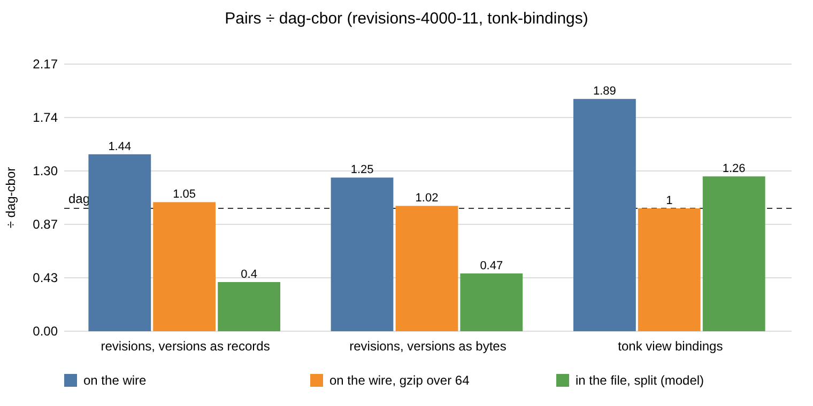
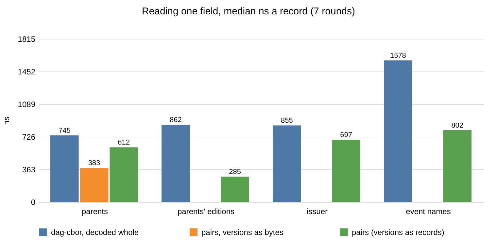

# 2026-11-11: records as key-tail pairs, against dag-cbor

The first sitting of measurements for [record values](../../record-values.md),
from the spike `rust/dialog-repository/examples/record_spike.rs`
(branch `worker/laughing-maxwell-lzfhyy`). Release build, rustc 1.99.1, a
shared 4-core container.

## Datasets

None is committed; each is named by its file's hash.

| dataset | what | records | file | sha256 |
|---|---|--:|---|---|
| revisions, shallow | `record_spike revisions 600 7`: 600 steps on three branches (seven in ten a commit of one to three writes, the rest a pull), pulled until they agree; every revision record branch `a` holds, as stored | 552 | `revisions-600-7.bin` | `0f22104a…31a7e63` |
| revisions, deep | `record_spike revisions 4000 11`, the same at 4000 steps | 3,628 | `revisions-4000-11.bin` | `0fada0fe…3e02f85` |
| tonk view bindings | tonk's library (`tonk-core/assets/library`, `bfb2d72`) by `tonk_bindings.py`: each view's `on:` bindings and the `event!:` declarations they name, built into tonk's `Bindings` with its serde shapes | 13 | `tonk-bindings.json` | `a06cf2ca…970ed8d16` |

Limits of the datasets:

- **One issuer.** One session wrote every revision, so issuer and authority
  are one token each; a team's replica has one per member. It flatters the
  split layouts below for those two fields only.
- **Identities are not seeded.** The session's keys are random per run, so a
  replay gives records of the same shape and other bytes; the hash names the
  file measured.
- **The bindings are rebuilt, not lowered.** The script reads sources by their
  spelling (`.a.b` a property, `{f}` a field, quoted a literal, else a
  reference); tonk's analyzer would also rewrite symbols to entities. Thirteen
  records is small: it says what the shape costs, not what a space holds.

## How each record is written as pairs

- **A revision record:** `dialog.revision/format`, `/branch`, `/issuer`,
  `/authority` (entities), `/signature` (bytes), and a `/parent` and a `/skip`
  per version. A version is written two ways, each kept apart:
  - **as records:** `{dialog.version/origin <32 bytes>, dialog.version/edition
    <number>}`, which destructures to the edition;
  - **as bytes:** its 40 key bytes (edition, then origin), as history keys
    hold it.

  A version's entity (`Version::entity`) is a hash, from which the edition
  does not come back, and the ancestry walk needs editions: written that way
  the record loses what it holds. The first run did that; it is not reported.
- **A view's bindings:** a table keyed by names known only at run time cannot
  be fields named by attributes, so each event is a nested record under the
  many-valued `tonk.view/event`, its name a field (`tonk.event/name`), with
  `/type`, `/prevent-default`, `/stop-propagation` and a nested `/source`
  record per command field. The `kind` tag is not written: the attributes'
  namespace says what this is.

## The canonical form holds

`record_spike check 200000`: 200,000 generated records (up to six pairs,
nested to depth two, sets, strings holding zero bytes, numbers of every type)
and 199,999 neighbouring pairs of them. Each property holds:

- decodes, and re-encodes to the same bytes; delimits itself;
- pair order and repeats do not change the bytes;
- a natural and the float of it encode alike;
- a spilled prefix (the leading whole pairs) is a record and sorts before the
  whole;
- finding a field agrees with decoding the whole;
- byte order equals the order of the pairs by meaning.

Each check was seen to fail with its property broken: pairs unsorted (repeats
and order), numbers keyed out of the band (decode), the end byte made `0xFF`
(decode), numbers given their own type byte (re-encode), pairs sorted in
reverse (lookup), and the check's own number order reversed (order).

## Bytes per record, on the wire



The chart's numbers are in the tables below and in the file section.

Deep revisions and the bindings; the shallow revisions give the same ratios
to two places.

| dataset | dag-cbor | pairs | ÷ | pairs, each attribute once | ÷ |
|---|--:|--:|--:|--:|--:|
| revisions, versions as records | 1,498,817 | 2,161,716 | 1.44 | 1,952,432 | 1.30 |
| revisions, versions as bytes | 1,498,817 | 1,872,686 | 1.25 | 1,836,873 | 1.23 |
| tonk view bindings | 5,674 | 10,720 | 1.89 | 5,950 | 1.05 |

"Each attribute once" models a repeat of an attribute anywhere in a record
as a two-byte reference to its first use. Medians: a revision record is 405
bytes as dag-cbor, 505 with versions as bytes and 579 as records; a view's
bindings 260 and 464.

Where the pairs' bytes go:

| dataset | attribute names | values | record ends | repeated attribute names |
|---|--:|--:|--:|--:|
| revisions, versions as records | 966,472 (45%) | 1,183,759 | 11,485 | 229,802 |
| revisions, versions as bytes | 612,907 (33%) | 1,256,151 | 3,628 | 39,407 |
| tonk view bindings | 7,457 (70%) | 3,145 | 118 | 5,314 |

Compressed, in groups of 64 records as a node's block would carry them
(`compress.py`, gzip -6), the difference is gone:

| dataset | dag-cbor, gzip | pairs, gzip | ÷ |
|---|--:|--:|--:|
| revisions, versions as records | 314,031 | 328,255 | 1.05 |
| revisions, versions as bytes | 314,031 | 320,931 | 1.02 |
| tonk view bindings (all 13) | 954 | 951 | 1.00 |

Blocks are not compressed today, on the wire or at rest (only UCAN
containers are, in `dialog-remote-ucan`).

## In the single-file archive, modelled

A model, not the file: each distinct token stored once; a record a row of
4-byte names of its parts (the file's rows are delta-varint columns, so names
are smaller there); "aligned" stores a token as the file does (16-aligned, its
length in the four bytes before), "packed" with a varint length and no
padding. Split: each attribute and each value slot a token, a nested record
its parts.

| dataset | layout | tokens | token bytes | names | aligned | ÷ dag-cbor whole | packed |
|---|---|--:|--:|--:|--:|--:|--:|
| revisions | dag-cbor, one token each | 3,628 | 1,498,817 | 14,512 | 1,554,064 | 1.00 | 1,520,585 |
| revisions, versions as records | pairs, one token each | 3,628 | 2,161,716 | 14,512 | 2,218,096 | 1.43 | 2,183,484 |
| revisions, versions as records | pairs, split | 5,471 | 248,382 | 302,260 | 622,468 | **0.40** | 556,113 |
| revisions, versions as bytes | pairs, split | 7,268 | 415,655 | 207,976 | 730,904 | 0.47 | 630,899 |
| bindings | dag-cbor, one token each | 11 | 4,775 | 52 | 4,948 | 1.00 | 4,849 |
| bindings | pairs, one token each | 11 | 9,002 | 52 | 9,172 | 1.85 | 9,076 |
| bindings | pairs, split | 131 | 2,090 | 2,612 | 6,228 | 1.26 | 4,833 |

Split, a revision record costs mostly names: of the 622 KB, 302 KB are names
and 248 KB the tokens they name. Whole, pairs cost more than dag-cbor; split,
they cost less than half of it for revisions, and the same for the bindings,
whose thirteen views share little but attribute names.

A record's versions, written as bytes, against the versions the history keys
hold as tokens (`split_record_components`):

| versions in records | the same token | the same bytes once unescaped, without the type byte |
|--:|--:|--:|
| 7,857 | 0 | 7,857 |

Every version a record names is already a token in the file, and none is
shared: a value slot carries its type byte and escapes the edition's zero
bytes, and a history key carries the 40 bytes raw.

## Reading one field



Each read over every record of its dataset, seven rounds, every variant once
a round in turn; ns a record. The dag-cbor reads decode the whole record, as
every reader does today.

| read | form | min | median | max | median ÷ dag-cbor |
|---|---|--:|--:|--:|--:|
| a revision's parents | dag-cbor | 618 | 745 | 980 | 1.00 |
| | pairs, versions as bytes | 322 | 383 | 416 | 0.51 |
| | pairs, versions as records | 508 | 612 | 644 | 0.82 |
| its parents' editions | dag-cbor | 697 | 862 | 935 | 1.00 |
| | pairs, versions as records | 242 | 285 | 310 | 0.33 |
| a revision's issuer | dag-cbor | 642 | 855 | 882 | 1.00 |
| | pairs | 566 | 697 | 751 | 0.82 |
| a view's event names | dag-cbor | 1,261 | 1,578 | 1,809 | 1.00 |
| | pairs | 709 | 802 | 866 | 0.51 |

Every pairs read is faster at the median, and its slowest run beats
dag-cbor's median, except the issuer, whose ranges overlap (566–751 against
642–882): parsing the issuer as an entity costs most of the read either way.
These read canonical bytes in memory; a record read from its parts in the file
touches its tokens' pages, which is not measured here.

## Against the bars (proposed, not yet set)

| bar | revisions | bindings |
|---|---|---|
| canonical | holds | holds |
| on the wire, at most 25% over dag-cbor | 1.25 (bytes) and 1.44 (records): at and over; 1.02 and 1.05 compressed | 1.89: fails; 1.00 compressed |
| in the file, split under half of one token each | 0.28 and 0.38: holds | 0.68: fails |
| one field cheaper than decoding dag-cbor | holds, the issuer within the spread | holds |
| commits within the perf gate | not measured | not measured |

The failure bars: bindings are more than 50% larger than dag-cbor on the wire
uncompressed, and save under 2× split; revisions pass both. The result is in
the middle the topic leaves to the maintainer.

## Reproduce

```sh
cargo build --release -p dialog-repository --features helpers --example record_spike
target/release/examples/record_spike check 200000
target/release/examples/record_spike revisions 4000 11 revisions-4000-11.bin
python3 -I tonk_bindings.py path/to/tonk/rust/tonk-core/assets/library > tonk-bindings.json
RECORD_SPIKE_DUMP=dump target/release/examples/record_spike measure revisions-4000-11.bin tonk-bindings.json 7
python3 -I compress.py dump
```

The scripts are in [`bench/`](../bench/): `tonk_bindings.py`, `compress.py`, `charts.py` (the SVGs) and `render.js` (PNGs, through Playwright).
