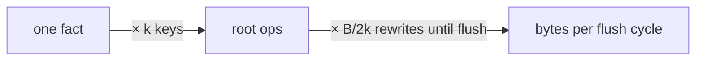

# Root novelty

Status: Proposed. See the [research index](README.md) for what the statuses mean.

## Idea

Novelty lands in the root as every index permutation of every fact: the
three orderings (EAV, AEV, VAE), the folded history entries and the
revision-record pair, each routed to the link whose range covers it. A
fact pays for itself several times over before it is ever flushed.
Datomic looks cheaper: novelty is just facts, flushed later. The hope is
a hybrid, a root that collects facts and flushes them hitchhiker style,
without teaching the tree about facts and without reworking sync.

Two things in that framing do not hold up, and they move the question.

**Datomic does not trade space for scans.** Its memory index holds novelty
in every ordering (EAVT, AEVT, AVET, VAET), sorted, and queries merge it
with the durable segments; nothing is scanned. What makes it cheap is that
the memory index is never persisted. Durability is the log, written once
per transaction, and the indexing job folds the memory index into new
durable segments when it outgrows `memory-index-threshold` (a size, not a
frequency). So Datomic stores novelty once, in one shape, and keeps the
permutations ephemeral. We persist the permutations and rewrite them.

**The permutations are probably not the big factor.** The root is rewritten
on every commit with its whole buffer. The single-file topic measured
~120 to 160 KB written per commit of a couple of facts, which is the
root re-encode. With `k` keys per fact and a buffer of `B` ops, a root
fills over roughly `B / k` commits and each one rewrites a growing
buffer, so the bytes written per flush cycle are about `B / 2k` times
the ops it holds. Fan-out multiplies by `k`; refill multiplies by
`B / 2k`. For `k` around 6 and `B` in the hundreds to a thousand, refill
dominates by an order of magnitude. That is a hypothesis to check, not a
result.

So the better question is not "facts or permutations at the root" but
"why does a commit rewrite every op it has not flushed yet".

## Candidates

Each is judged on the three constraints from the original question: the
tree stays agnostic of facts, sync does not get a new engine, and space
goes down.

- **A. Shared component dictionaries.** A node's novelty shares one
  dictionary per component class across schemas, so an entity is stored
  once whether it sits in an EAV, AEV or VAE key. The tree already takes
  a schema per tag from the consumer; this adds a class to each
  component. Codec only, sync untouched. Attacks fan-out, not refill.
- **B. Messages with an expander.** Root novelty holds opaque messages; the
  consumer supplies a deterministic `expand(message) -> [(key, op)]`,
  named in the manifest as a must-understand field. Reads and the
  differential expand the root on the fly; a root flush expands into
  per-link novelty and nothing below the root changes. Agnostic in the
  same sense the schema is. Attacks fan-out at the root only, and the
  expander is versioned forever.
- **C. Root novelty as a frame chain.** A commit writes its ops as one
  small immutable frame; the root keeps its links and the hash of the
  newest frame, which links to the previous one. Nothing is rewritten
  until the chain reaches the buffer budget, then the chain flushes into
  per-link novelty as today. Push ships the small root and one frame.
  Two roots with the same links share a chain prefix by hash, so their
  difference is the tail frames: the root-buffered fast path, with the
  chain doing the work `settle_buffered` does now. The tree sees ops of
  `(key, value)`, nothing about facts. Attacks refill, keeps fan-out.
  Reads pay a merge across frames, and a cold open loads up to `B / k`
  small blocks unless frames are squashed in tiers.
- **D. Log outside the tree.** The head names a tree root plus a log
  chain; commits append to the log and the tree is touched only at the
  threshold. This is Datomic's shape, and the head change the port note
  priced at ~100× commit latency. Attacks both factors, but sync now
  exchanges logs as well as trees and every reader rebuilds a memory
  index from the log. This is the "new system" the question wants to
  avoid.

| | agnostic | sync change | fan-out | refill |
|---|---|---|---|---|
| A. shared dictionaries | yes | none | partly | no |
| B. expander | parameterized | root only | at root | no |
| C. frame chain | yes | root only | no | yes |
| D. external log | yes | head and sync | yes | yes |

A and C compose: C removes the rewrite, A shrinks what is written.
[Single-file format](single-file-format.md) attacks refill on disk (a
rewritten root becomes a frame of offsets into tokens stored once) but
not on the wire, where a push still ships the whole root. C is the wire
side of the same idea, and both have to be measured together.

## Question

What share of the bytes a commit writes and pushes comes from fan-out,
and what share from rewriting unflushed novelty? Given the answer, does
a frame chain at the root (C, alone or with A) cut those bytes without
costing reads or sync?

## Hypothesis

Refill dominates fan-out by at least 5× on the Stack Exchange replay,
so B buys little on its own and C is the hybrid worth building.

## Measured against

`main` as it is, and the single-file branch
([#733](https://github.com/dialog-db/dialog-db/pull/733)), so the wire
and disk effects show apart: main, main with C, #733, #733 with C.

## Success

- Bytes pushed per commit of a couple of facts at most 10% of main's.
- Bytes written to the store per commit at most 25% of main's.
- Commit latency inside the `commit-*` perf gates.
- Sync reads on `sync_flush_regimes` and the `read_amplification`
  scenarios within the spread of main's runs.
- First query on a cold replica within 10% of main.

## Failure

- Refill is not the larger factor (the hypothesis is wrong, and A or B
  is the question instead).
- Or C leaves pushed bytes above 50% of main's.
- Or any read path regresses by more than 25%.

## The middle

Between the two, the cost of a slower cold open against smaller commits
is a maintainer call on the numbers.

## First spike

Before building anything, decompose main's root on the replay: per
commit, the root's novelty bytes split by tag (EAV, AEV, VAE, history,
revision records), the bytes written, and the bytes pushed. That one
table says whether this topic is about fan-out or refill.
