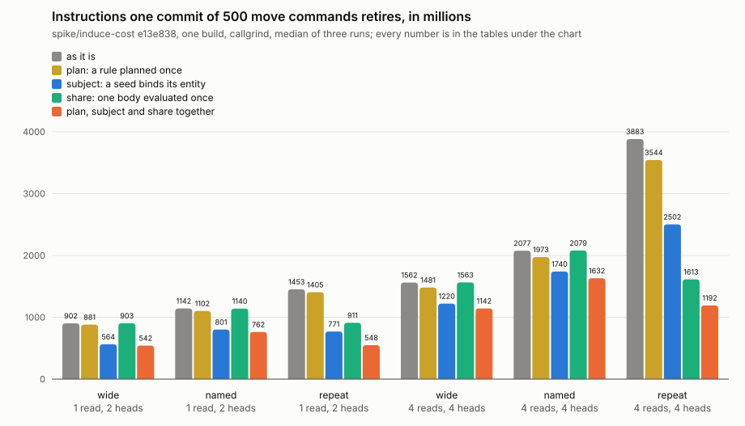
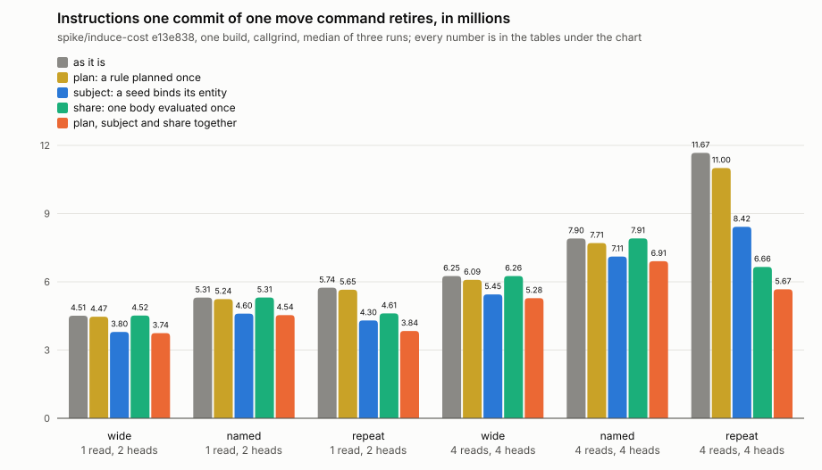

# 2026-11-12: what the engine could recover

Build: `spike/induce-cost` at e13e838 (main dd19d6c, the harness and four prototype changes to `rust/dialog-repository/src/repository/branch/transaction/induce.rs`), release. One binary; each prototype is off unless `DIALOG_SPIKE` names it. Runner: Intel Xeon @ 2.10GHz (flags `c1e7468c17a39377`), callgrind. Three sweeps of every variant, interleaved in two streams (as it is, `subject`, all three; and `plan`, `share`, `entity`). The corner cells only: one read and two heads, four reads and four heads. Every number, each run and every counter are in [`2026-11-12-induce-cost.json`](2026-11-12-induce-cost.json).

```
 plan      a rule is planned once for each set of names a seed binds, and the plan kept for the thread
 share     the seeded rules of a round that state one body, under a renaming of variables, have it evaluated once
 subject   a seed binds the entity its rows are about, where the premise leaves `this` unnamed
 entity    a committed rule is found by the entity it is stored under, with no read of its source
```

None of them is meant to land as it is. What each leaves out is at the end.

## One commit of 500 commands



Millions of instructions, the median of three. The widest spread between three runs of one scenario in this sitting is 0.35%.

| | body, heads | `wide` | `named` | `repeat` | `named` over `wide` | `repeat` over `wide` |
|---|---|---|---|---|---|---|
| as it is | 1 read, 2 heads | 901.7 | 1142.2 | 1452.8 | +26.7% | +61.1% |
| `plan` | 1 read, 2 heads | 881.4 | 1102.5 | 1405.2 | +25.1% | +59.4% |
| `subject` | 1 read, 2 heads | 563.7 | 801.2 | 770.6 | +42.1% | +36.7% |
| `share` | 1 read, 2 heads | 902.9 | 1140.1 | 911.2 | +26.3% | +0.9% |
| all three | 1 read, 2 heads | 541.9 | 762.3 | 548.5 | +40.7% | +1.2% |
| as it is | 4 reads, 4 heads | 1562.5 | 2077.3 | 3882.8 | +33.0% | +148.5% |
| `plan` | 4 reads, 4 heads | 1481.0 | 1973.3 | 3544.1 | +33.2% | +139.3% |
| `subject` | 4 reads, 4 heads | 1220.4 | 1740.5 | 2502.1 | +42.6% | +105.0% |
| `share` | 4 reads, 4 heads | 1562.8 | 2079.2 | 1612.7 | +33.0% | +3.2% |
| all three | 4 reads, 4 heads | 1142.3 | 1631.6 | 1191.7 | +42.8% | +4.3% |

Each against the build as it is:

| | body, heads | `wide` | `named` | `repeat` |
|---|---|---|---|---|
| `plan` | 1 read, 2 heads | -2.2% | -3.5% | -3.3% |
| `subject` | 1 read, 2 heads | -37.5% | -29.9% | -47.0% |
| `share` | 1 read, 2 heads | +0.1% | -0.2% | -37.3% |
| all three | 1 read, 2 heads | -39.9% | -33.3% | -62.2% |
| `plan` | 4 reads, 4 heads | -5.2% | -5.0% | -8.7% |
| `subject` | 4 reads, 4 heads | -21.9% | -16.2% | -35.6% |
| `share` | 4 reads, 4 heads | +0.0% | +0.1% | -58.5% |
| all three | 4 reads, 4 heads | -26.9% | -21.5% | -69.3% |

## One command a commit



Millions of instructions a commit, 100 commits, the median of three.

| | body, heads | `wide` | `named` | `repeat` | `named` over `wide` | `repeat` over `wide` |
|---|---|---|---|---|---|---|
| as it is | 1 read, 2 heads | 4.51 | 5.31 | 5.74 | +17.6% | +27.3% |
| `plan` | 1 read, 2 heads | 4.47 | 5.24 | 5.65 | +17.3% | +26.5% |
| `subject` | 1 read, 2 heads | 3.80 | 4.60 | 4.30 | +21.2% | +13.3% |
| `share` | 1 read, 2 heads | 4.52 | 5.31 | 4.61 | +17.5% | +2.1% |
| all three | 1 read, 2 heads | 3.74 | 4.54 | 3.84 | +21.2% | +2.6% |
| as it is | 4 reads, 4 heads | 6.25 | 7.90 | 11.67 | +26.4% | +86.6% |
| `plan` | 4 reads, 4 heads | 6.09 | 7.71 | 11.00 | +26.6% | +80.8% |
| `subject` | 4 reads, 4 heads | 5.45 | 7.11 | 8.42 | +30.5% | +54.5% |
| `share` | 4 reads, 4 heads | 6.26 | 7.91 | 6.66 | +26.5% | +6.4% |
| all three | 4 reads, 4 heads | 5.28 | 6.91 | 5.67 | +30.7% | +7.4% |

Each against the build as it is:

| | body, heads | `wide` | `named` | `repeat` |
|---|---|---|---|---|
| `plan` | 1 read, 2 heads | -1.0% | -1.2% | -1.6% |
| `subject` | 1 read, 2 heads | -15.8% | -13.3% | -25.1% |
| `share` | 1 read, 2 heads | +0.1% | +0.1% | -19.7% |
| all three | 1 read, 2 heads | -17.0% | -14.5% | -33.1% |
| `plan` | 4 reads, 4 heads | -2.7% | -2.5% | -5.7% |
| `subject` | 4 reads, 4 heads | -12.9% | -10.1% | -27.9% |
| `share` | 4 reads, 4 heads | +0.0% | +0.1% | -43.0% |
| all three | 4 reads, 4 heads | -15.6% | -12.6% | -51.4% |

Net of `plain`, a transaction that asserts the same facts with no rule:

| | body, heads | `plain` | `wide` | `named` | `repeat` | `named` over `wide` | `repeat` over `wide` |
|---|---|---|---|---|---|---|---|
| as it is | 1 read, 2 heads | 2.91 | 1.60 | 2.40 | 2.83 | +49.5% | +76.8% |
| all three | 1 read, 2 heads | 2.91 | 0.84 | 1.63 | 0.93 | +95.0% | +11.5% |
| as it is | 4 reads, 4 heads | 4.02 | 2.24 | 3.89 | 7.65 | +73.7% | +242.1% |
| all three | 4 reads, 4 heads | 4.02 | 1.26 | 2.88 | 1.65 | +128.9% | +30.9% |

## Against the bars

Set in the journal before the prototypes were measured.

- **With every prototype on, `repeat` is within 10% of `wide` in every cell measured**: +1.2% and +4.3% at 500 commands a commit, +2.6% and +7.4% at one. So `repeat` needs no rule of several heads for its cost, in the corner cells. The cells between them were not run.
- `named` has no bar. It ends 41% and 43% over `wide` at 500 and 21% and 31% at one: further than it was, as guessed, because the prototypes take the same amount off both and nothing off its second round.
- **No gated scenario grows past the allowance**, measured the only way this machine can: see below.

So the order turns over. As the engine is, `named` is the cheaper way to write on one condition without a rule of several heads. With a body evaluated once for the rules that share it, `repeat` is, and it costs what `wide` does and a head's writing.

## Where a seed's instructions go

By callgrind's inclusive cost, with every prototype off unless said.

**The command premise, read by value.** The seed binds the command's four fields and leaves its entity free. The four fields are then four reads by value over every entity, and their conjunction estimates each read's range before choosing a merge or a fold (`Conjunction::scans_balanced_for`): 2012 estimates in the commit of 500 for one rule, 153 thousand instructions each, 309 of 901 million. With the entity bound the conjunction folds and estimates nothing (0 calls with `subject`). This is its own topic: `design/seed-subject.md` on dialog-db/dialog-db#789. It is also not only a cost: a rule that leaves a subject unnamed fires for entities the commit did not touch.

**Planning.** `InductiveRule::plan` runs once a seed: 500 times for a rule in the commit of 500, 52 thousand instructions each for the body of one read and 176 thousand for the body of four. In `repeat` with four reads and four heads that is 352 of 3877 million. With `plan` a seed takes a copy of a kept plan, 5 thousand instructions: in the commit of `named` with one read and two heads the planner runs 42 times, where the rules alone were planned 1500 times.

**The second round of `named`.** With every prototype on, `named` with one read and two heads is 220 million over `wide`, where it was 240. Of it 178 is the two rules that read the command the first rule issued, 1000 evaluations of 178 thousand instructions, 112 of that reading one cell of the round's overlay and 52 of that settling it (`ReadSettlement::advance`). Keeping the transient facts is 18 more and writing the heads 14. The fact a reading rule is seeded with is the fact its one premise reads, and it is read back through the general path.

**Probing for triggers, a commit.** At one command a commit `induce::committed`, the reads of the committed tree that find which rules a write triggers and whether a head is transient, is 184 thousand instructions a commit for one rule and 543 for five, beside the reads of the rules' sources counted below. The answers are kept by the head they were read at, and every commit moves the head. Not prototyped.

## How often a rule is decoded, analyzed and planned

Counted from callgrind's call counts, with every prototype off.

| | a commit of 500, `wide`, 1 rule | a commit of 500, `repeat`, 4 reads, 4 rules | a commit of one, `wide`, 1 rule | a commit of one, `named`, 4 reads, 5 rules | a commit of one, `repeat`, 4 reads, 4 rules |
|---|---|---|---|---|---|
| inductive rules decoded | 0 | 0 | 0 | 0 | 0 |
| inductive rules analyzed | 0 | 0 | 0 | 0 | 0 |
| concepts' own rules analyzed (`analyze_with`) | 27 | 32 | 0 | 0 | 0 |
| a rule's source read from the tree (`Dispatch::source_bytes`) | 1 | 4 | 1 | 5 | 4 |
| a rule found in the cache by its source's hash (`RuleCache::inductive`) | 2 | 8 | 1 | 5 | 4 |
| a rule planned (`InductiveRule::plan`) | 500 | 2000 | 1 | 5 | 4 |
| thousands of instructions: source read and cache | 48 | 5171 | 55 | 270 | 293 |
| thousands of instructions: planning | 25823 | 351584 | 48 | 214 | 661 |
| planning, of the commit | 2.9% | 9.1% | 1.1% | 2.7% | 5.7% |

- **A rule is decoded and analyzed once a process, not once a commit, a round or a seed.** `RuleCache` keeps the analyzed rule by its entity and the hash of its source, and the measured commits find every rule there: the process had installed the rules and decoded them then. The analyses counted in a first commit are of concepts' own rules, 6 to 9 thousand instructions each, and a later commit runs none.
- **What a commit pays to find a rule it has** is a read of the rule's source from the tree and a hash of it, to key the cache, and a copy of the rule: 55 thousand instructions a rule a round. `entity` skips the read and the hash and shares the rule instead of copying it:

| body, heads | shape | as it is | `entity` | |
|---|---|---|---|---|
| 1 read, 2 heads | `wide` | 4.512 | 4.454 | -1.3% |
| 1 read, 2 heads | `named` | 5.305 | 5.158 | -2.8% |
| 1 read, 2 heads | `repeat` | 5.743 | 5.625 | -2.1% |
| 4 reads, 4 heads | `wide` | 6.255 | 6.166 | -1.4% |
| 4 reads, 4 heads | `named` | 7.904 | 7.614 | -3.7% |
| 4 reads, 4 heads | `repeat` | 11.672 | 11.337 | -2.9% |

- **A rule is planned once a seed.** That is the one thing compiled again and again, and `plan` is the prototype for it. A plan depends on which variables the seed binds, and a rule has one such set for each way its premises can be seeded, so the plans could be part of what is kept for a rule.
- **Not measured: a process that starts with its rules stored.** It decodes and analyzes each rule once. The nearest number here is the gated `rule-install`, whose 100 deductive rules cost 288 thousand instructions each to decode and analyze. Keeping the analysis by the rule's entity, in the store, would save that once a rule a process, and nothing a commit.

## The gated scenarios

`perf sweep` of the 30 gated scenarios with every prototype on and with none, from the one binary, then `perf compare`.

- **Against the same binary with the prototypes off** (`perf compare --base`): no regressions. Every counter of all 30 scenarios is unchanged. Instructions move between -3.4% (`rule-dispatch`, the one gated scenario that fires inductive rules, 645.0 to 622.9 million) and +1.2% (`number-point`, which runs no rule; it is under a tenth of a second of work and moves that much between sweeps). `commit-succeed`, which the gate does not hold to its instructions, moved -11.6%.
- **Against `perf/baseline/`**: it fails, and says nothing about the prototypes: 26 of the 30 scenarios are 3.6% to 14.9% over their files with the prototypes on, and the same 26 are 3.7% to 15.7% over with them off, scenarios that run no rule among them. The files are recorded by the nix toolchain on CI's CPUs, and this container's compiler and CPU retire more instructions for the same code. No counter differs from the files beyond the gate's allowance in either sweep.

## What each prototype leaves out

- `plan` keeps plans in a thread-local map that is never emptied, by the rule's entity. Sound as far as a plan depends only on the rule and the names bound; that was read from `Planner::plan`, not proved.
- `share` groups only when every seeded candidate of a round states one body; a round with two bodies is left as it is. A head that writes a collection is left out. Bodies are compared as the rules encode, so two spellings the encoding tells apart are not shared. The rule the body is evaluated under carries every member's head, so a type a head gives a variable narrows the body for every member; where two heads type one variable differently the members would lose matches. Matches come in the order of that rule's premises, which may not be each member's own.
- `subject` changes what a rule fires for, on purpose: see the design topic. It names subjects in positive concept premises only.
- `entity` is unsound as it stands. It no longer checks that the rule's source is stored on the line being committed to, so a trigger row with no rule behind it there would fire a rule this thread loaded elsewhere. The check it skips is what makes forged `dialog.rule/*` facts inert.
- Tested: `dialog-perf`'s own tests, which check that the three shapes write the same facts as a transaction that asserts them by hand, at 500 a commit and at one, pass under every switch. `dialog-repository`'s 706 library tests, the 38 of induction among them with their check that seeding rows together writes what seeding them one by one writes, pass with `plan`, `share`, `subject` and `entity` on together as they do with none, on the branch's head (8f84ff7). That is as far as those tests reach: none was written for a shared body, a kept plan or a rule found by its entity.

## What this does not say

- The corner cells only, and `wide` is still a floor for a rule of several heads.
- Instructions, not time; the store is in memory.
- The measured build is e13e838. The branch's head differs from it by `Arc` where it had `Rc`, so that a commit's future stays `Send`, and was not measured again.
