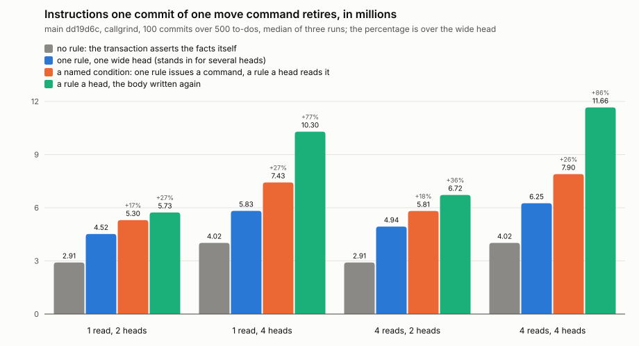

# 2026-11-12: a commit a command, three ways

Build: main dd19d6c with the harness at d311797 (`rust/dialog-perf/src/scenario/heads.rs`, scenarios `heads-each-…`), release. Runner: Intel Xeon @ 2.10GHz (flags `c1e7468c17a39377`), callgrind; the first sitting ran on another CPU, so its numbers compare with these only roughly. 500 to-dos seeded, the rules installed, one commit of one command off the record, then 100 commits of one command each. Three sweeps, one after another, so every scenario ran once a sweep. Every number, each run and every counter are in [`2026-11-12-one-command.json`](2026-11-12-one-command.json).

Instructions one commit retires, millions: the phase over its 100 commits, the median of three. The widest spread between three runs of one scenario is 0.32%. `plain` is a transaction that asserts the same facts itself, with no rule installed.

| body | heads | `plain` | `wide` | `named` | `repeat` | `named` over `wide` | `repeat` over `wide` |
|---|---|---|---|---|---|---|---|
| one read | 2 | 2.91 | 4.52 | 5.30 | 5.73 | +17.4% | +26.9% |
| one read | 4 | 4.02 | 5.83 | 7.43 | 10.30 | +27.5% | +76.7% |
| four reads | 2 | 2.91 | 4.94 | 5.81 | 6.72 | +17.8% | +36.1% |
| four reads | 4 | 4.02 | 6.25 | 7.90 | 11.66 | +26.3% | +86.5% |

A command dispatched with no rule to read it (`none`) costs 0.56 million and writes nothing.

## Net of the commit

What the rules add to a commit of the same facts: each shape less `plain`.

| body | heads | `wide` | `named` | `repeat` | `named` over `wide` | `repeat` over `wide` |
|---|---|---|---|---|---|---|
| one read | 2 | 1.61 | 2.39 | 2.82 | +48.9% | +75.7% |
| one read | 4 | 1.81 | 3.41 | 6.28 | +88.6% | +247.2% |
| four reads | 2 | 2.03 | 2.91 | 3.81 | +43.3% | +88.0% |
| four reads | 4 | 2.24 | 3.88 | 7.65 | +73.4% | +241.7% |

At 500 commands a commit the same cells, net of the 94 million a commit of 500 commands costs with no rule, were +24% to +42% for `named` and +68% to +158% for `repeat` ([the first sitting](2026-11-12.md)). That floor writes nothing, so the two are not the same subtraction; the comparison is rough.

## Against the bars

Set in the journal before the run, on the gross number.

- **The difference holds**: `named` is 10% or more over `wide` in every cell. Met: +17.4% to +27.5%.
- The order holds in every cell: `wide`, `named`, `repeat`.
- Gross, the three are closer than at 500, as guessed: `named` was +21.5% to +38.7% there and `repeat` +61% to +148%.
- Net, they are further apart than at 500, as guessed.

## Where one commit's instructions go

By callgrind's inclusive cost, thousands of instructions a commit.

| | `plain`, 2 facts | `wide`, 1 read, 2 heads | `named` | `repeat` | `repeat`, 4 reads, 4 heads |
|---|---|---|---|---|---|
| the commit | 2909 | 4512 | 5302 | 5738 | 11664 |
| records, the tree, signing (`Mint`) | 2226 | 2151 | 2124 | 2100 | 2919 |
| induction | 77 | 1837 | 2650 | 3116 | 8221 |
| of it, evaluating bodies | | 1030 | 1339 | 2024 | 5042 |
| of that, range estimates | | 665 | 643 | 1329 | 3054 |
| of it, probing for triggers | | 226 | 473 | 320 | 623 |
| of it, writing heads | | 203 | 221 | 213 | 502 |
| of it, planning | | 48 | 72 | 96 | 661 |

Signing is 495 thousand of every commit. The estimates are the largest single thing a rule adds: 665 thousand for a rule, a little over four a commit at 160 thousand each. They come of the command premise leaving its subject unnamed (see [the next sitting](2026-11-12-induce-cost.md)).

## Does the input decide it

One run each, so a difference under about 0.5% says nothing. Millions a commit.

| what changed | cell | `plain` | `wide` | `named` | `repeat` | `named` over `wide` | `repeat` over `wide` | net `wide` | net `named` | net `repeat` |
|---|---|---|---|---|---|---|---|---|---|---|
| 10 commits | one read, 2 | 1.97 | 3.56 | 4.38 | 4.90 | +23.1% | +37.5% | 1.59 | 2.41 | 2.92 |
| 10 commits | four reads, 4 | 2.54 | 4.63 | 6.79 | 10.32 | +46.6% | +122.7% | 2.09 | 4.25 | 7.77 |
| 300 commits | one read, 2 | 3.18 | 4.93 | 5.80 | 6.26 | +17.7% | +27.0% | 1.75 | 2.62 | 3.08 |
| 300 commits | four reads, 4 | 4.93 | 7.02 | 8.66 | 12.19 | +23.3% | +73.5% | 2.09 | 3.73 | 7.26 |
| 5000 to-dos | one read, 2 | 4.48 | 5.98 | 7.11 | 7.75 | +18.9% | +29.5% | 1.50 | 2.63 | 3.26 |
| 5000 to-dos | four reads, 4 | 7.88 | 10.48 | 12.32 | 17.17 | +17.6% | +63.9% | 2.60 | 4.44 | 9.29 |
| the first commit after the rules are installed | one read, 2 | 2.53 | 5.04 | 5.70 | 5.96 | +13.2% | +18.3% | 2.51 | 3.17 | 3.43 |
| the first commit after the rules are installed | four reads, 4 | 2.97 | 6.39 | 8.57 | 11.88 | +34.1% | +85.9% | 3.42 | 5.60 | 8.91 |
| the commit after that one | one read, 2 | 2.25 | 3.35 | 4.13 | 4.59 | +23.1% | +36.8% | 1.10 | 1.88 | 2.33 |
| the commit after that one | four reads, 4 | 2.72 | 4.28 | 5.93 | 9.44 | +38.5% | +120.7% | 1.56 | 3.21 | 6.72 |

- The order holds in every row, and `named` is 13% or more over `wide` in every row.
- What a commit costs with no rule is not fixed: 1.97 million averaged over the first 10 commits, 3.18 over 300, 4.48 over a store of 5000 to-dos. So the gross percentages move with how much has been committed. What the rules add moves much less: with one read and two heads `wide` adds 1.5 to 1.75 million averaged over 10, 100 and 300 commits and over 5000 to-dos, 1.1 in the second commit after the rules are installed and 2.5 in the first.
- The first commit after the rules are installed pays about 1.4 million more for a rule than the one after it: 36 concepts' own rules are analyzed, and the rules' triggers found (`resolve_bundle`, `resolve_rules`). The process had installed the rules itself, so it had already decoded them. A process that starts with the rules stored decodes each once more; that was not run.

## What this does not say

- `wide` is a floor, as before.
- Instructions, not time. The store is in memory: what signing costs is here, what a disk costs is not, and it is the same for the three.
- The command premise leaves its subject unnamed in every shape. A rule that named it would pay no estimates, and every number here would be lower by them: [the next sitting](2026-11-12-induce-cost.md) measures that.
