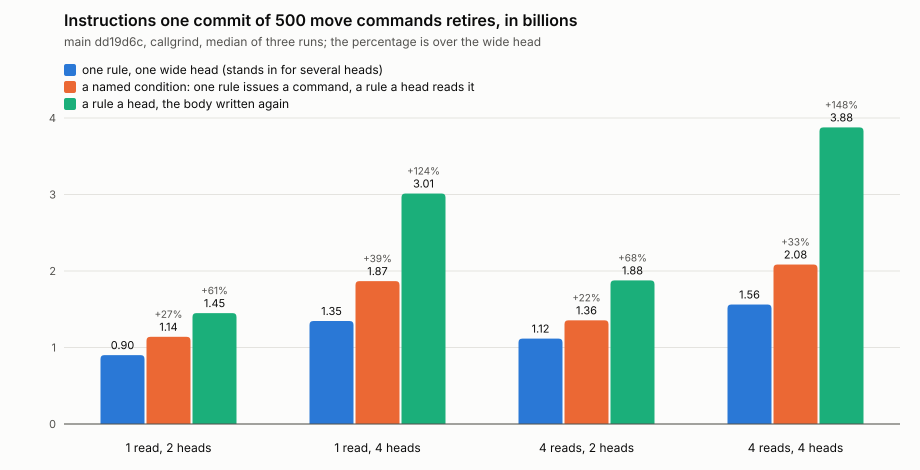

# 2026-11-12: one commit of 500 move commands, three ways

Build: main dd19d6c with the harness (`rust/dialog-perf/src/scenario/heads.rs`), release. Runner: Intel Xeon @ 2.30GHz, callgrind. Three sweeps, one after another, so every scenario ran once a sweep. Every number, each run and every counter are in [`2026-11-12.json`](2026-11-12.json).

Instructions, millions, the median of three. The widest spread between three runs of one scenario is 0.43%.

| body | heads | no rule | `wide` | `named` | `repeat` | `named` over `wide` | `repeat` over `wide` |
|---|---|---|---|---|---|---|---|
| one read | 2 | 94.3 | 900.8 | 1139.6 | 1450.3 | +26.5% | +61.0% |
| one read | 4 | 94.3 | 1346.4 | 1867.9 | 3013.4 | +38.7% | +123.8% |
| four reads | 2 | 94.3 | 1116.0 | 1356.0 | 1877.7 | +21.5% | +68.3% |
| four reads | 4 | 94.3 | 1562.1 | 2084.4 | 3876.8 | +33.4% | +148.2% |
| one read, a command of two fields | 2 | 48.8 | 959.5 | 1212.3 | 1603.8 | +26.3% | +67.1% |

A to-do moved for real, the list it goes to asserted and the one it was on retracted, which `wide` cannot do:

| | `named` | `repeat` | `named` under `repeat` |
|---|---|---|---|
| assert and retract, a body of one read | 1632.8 | 2329.7 | 29.9% |

## What the counters say

| | `wide` | `named` | `repeat` |
|---|---|---|---|
| archive blocks written, two heads | 16 | 16 | 16 |
| archive bytes written, one read and two heads | 889,356 | 895,948 | 895,468 |
| `span.resolve_rules`, one read and two heads | 7 | 9 | 7 |
| `span.settle_cell`, two heads and four | 0 | 1000, 2000 | 0 |

The three write the same facts, checked by `it_writes_the_same_facts_in_every_shape`, and within 1% of the same bytes. `named` settles a cell for each transient fact its first rule writes.

## Where `named` spends more than `wide`

Four reads, two heads: 240 million more, by callgrind's inclusive cost.

| | millions |
|---|---|
| evaluating the two rules that read the command, 1000 times in all | 128 |
| applying the transient facts | 33 |
| planning | 27 |
| emitting matches | 16 |
| the rest | 36 |

That is about 128 thousand instructions to evaluate a rule of one read that a fact has already bound. `named` costs about 120 million a head over `wide` whether the body is one read or four, and `repeat` costs the whole body again a head.

## Against the bars

- Within 10% of `wide` in every cell: not met. The best without a rule of several heads is `named`, 21.5% to 38.7% over.
- `wide` 30% or more under the best without, where the body is four reads: not met. It is 17.7% under with two heads and 25.1% under with four.
- So it is between, and the maintainer's to weigh.

## What this does not say

- `wide` is a floor. A rule of several heads has to write to more than one entity and retract as well as assert, and may cost more than a wide head does.
- Instructions, not time, and one commit of 500 commands. A commit of one command was not run, so whether the difference holds a command at a time is not known.
- The store is in memory. What a commit costs beyond the engine, signing and the archive on disk, is not in these numbers and is the same for the three.
