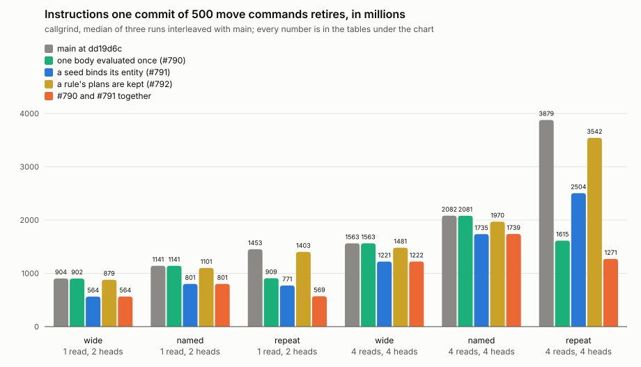
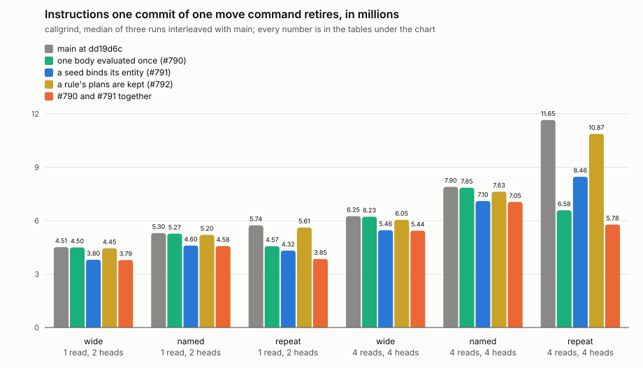

# 2026-11-13: the prototypes built to land

Builds: main at dd19d6c, and three branches off it, each with the harness of this topic added for measuring only: `perf/share-body` at fe75f1c (dialog-db/dialog-db#790), `fix/seed-subject` at 7be4c57 (#791), `perf/keep-plans` at 804d200 (#792), and #790 with #791 merged, which is on no branch. Release. Runner: the container of the 2026-11-12 sittings, callgrind. Three sweeps of every variant, each sitting interleaved with main: main and #790; main, #791 and #792; main and the two together. The corner cells only: one read and two heads, four reads and four heads. Every number, each run and every counter are in [`2026-11-13-sound.json`](2026-11-13-sound.json).

```
 #790   the seeded rules of a round that state one body have it evaluated once        `share`
 #791   a seed binds the entity its rows are about, where a premise leaves it unnamed  `subject`
 #792   a rule's plans are kept, one for each set of names a seed binds                `plan`
```

The widest spread between three runs of one scenario is 0.42%. Main in its three sittings, `repeat` with four reads and four heads at 500 a commit: 3879.0, 3878.9 and 3879.6 million.

## One commit of 500 commands



Millions of instructions, the median of three.

| | body, heads | `wide` | `named` | `repeat` | `named` over `wide` | `repeat` over `wide` |
|---|---|---|---|---|---|---|
| main | 1 read, 2 heads | 903.6 | 1141.4 | 1452.9 | +26.3% | +60.8% |
| one body evaluated once (#790) | 1 read, 2 heads | 901.7 | 1140.7 | 909.0 | +26.5% | +0.8% |
| a seed binds its entity (#791) | 1 read, 2 heads | 563.9 | 800.9 | 771.0 | +42.0% | +36.7% |
| a rule's plans are kept (#792) | 1 read, 2 heads | 879.2 | 1101.1 | 1402.9 | +25.2% | +59.6% |
| #790 and #791 together | 1 read, 2 heads | 564.4 | 800.7 | 569.4 | +41.9% | +0.9% |
| main | 4 reads, 4 heads | 1563.3 | 2081.8 | 3879.0 | +33.2% | +148.1% |
| one body evaluated once (#790) | 4 reads, 4 heads | 1562.9 | 2080.9 | 1614.6 | +33.1% | +3.3% |
| a seed binds its entity (#791) | 4 reads, 4 heads | 1221.2 | 1735.4 | 2504.5 | +42.1% | +105.1% |
| a rule's plans are kept (#792) | 4 reads, 4 heads | 1480.7 | 1970.0 | 3542.2 | +33.0% | +139.2% |
| #790 and #791 together | 4 reads, 4 heads | 1222.0 | 1738.9 | 1271.1 | +42.3% | +4.0% |

Each against the main of its sitting:

| | body, heads | `wide` | `named` | `repeat` |
|---|---|---|---|---|
| one body evaluated once (#790) | 1 read, 2 heads | -0.2% | -0.1% | -37.4% |
| a seed binds its entity (#791) | 1 read, 2 heads | -37.5% | -29.8% | -46.9% |
| a rule's plans are kept (#792) | 1 read, 2 heads | -2.6% | -3.5% | -3.4% |
| #790 and #791 together | 1 read, 2 heads | -37.5% | -29.7% | -60.8% |
| one body evaluated once (#790) | 4 reads, 4 heads | -0.0% | -0.0% | -58.4% |
| a seed binds its entity (#791) | 4 reads, 4 heads | -21.9% | -16.5% | -35.4% |
| a rule's plans are kept (#792) | 4 reads, 4 heads | -5.3% | -5.2% | -8.7% |
| #790 and #791 together | 4 reads, 4 heads | -21.8% | -16.3% | -67.2% |

## One command a commit



Millions of instructions a commit, 100 commits, the median of three.

| | body, heads | `wide` | `named` | `repeat` | `named` over `wide` | `repeat` over `wide` |
|---|---|---|---|---|---|---|
| main | 1 read, 2 heads | 4.51 | 5.30 | 5.74 | +17.5% | +27.1% |
| one body evaluated once (#790) | 1 read, 2 heads | 4.50 | 5.27 | 4.57 | +17.3% | +1.6% |
| a seed binds its entity (#791) | 1 read, 2 heads | 3.80 | 4.60 | 4.32 | +20.9% | +13.6% |
| a rule's plans are kept (#792) | 1 read, 2 heads | 4.45 | 5.20 | 5.61 | +17.0% | +26.3% |
| #790 and #791 together | 1 read, 2 heads | 3.79 | 4.58 | 3.85 | +20.9% | +1.7% |
| main | 4 reads, 4 heads | 6.25 | 7.90 | 11.65 | +26.3% | +86.3% |
| one body evaluated once (#790) | 4 reads, 4 heads | 6.23 | 7.85 | 6.58 | +26.1% | +5.7% |
| a seed binds its entity (#791) | 4 reads, 4 heads | 5.46 | 7.10 | 8.46 | +30.0% | +54.9% |
| a rule's plans are kept (#792) | 4 reads, 4 heads | 6.05 | 7.63 | 10.87 | +26.1% | +79.7% |
| #790 and #791 together | 4 reads, 4 heads | 5.44 | 7.05 | 5.78 | +29.7% | +6.3% |

Each against the main of its sitting:

| | body, heads | `wide` | `named` | `repeat` |
|---|---|---|---|---|
| one body evaluated once (#790) | 1 read, 2 heads | -0.4% | -0.6% | -20.3% |
| a seed binds its entity (#791) | 1 read, 2 heads | -15.7% | -13.3% | -24.7% |
| a rule's plans are kept (#792) | 1 read, 2 heads | -1.5% | -1.9% | -2.1% |
| #790 and #791 together | 1 read, 2 heads | -16.1% | -13.7% | -32.9% |
| one body evaluated once (#790) | 4 reads, 4 heads | -0.4% | -0.6% | -43.5% |
| a seed binds its entity (#791) | 4 reads, 4 heads | -12.7% | -10.1% | -27.4% |
| a rule's plans are kept (#792) | 4 reads, 4 heads | -3.3% | -3.4% | -6.7% |
| #790 and #791 together | 4 reads, 4 heads | -13.0% | -10.7% | -50.4% |

Net of `plain`, a transaction that asserts the same facts with no rule:

| | body, heads | `plain` | `wide` | `named` | `repeat` | `repeat` over `wide` |
|---|---|---|---|---|---|---|
| main | 1 read, 2 heads | 2.91 | 1.60 | 2.39 | 2.83 | +76.4% |
| one body evaluated once (#790) | 1 read, 2 heads | 2.91 | 1.58 | 2.36 | 1.66 | +4.6% |
| a seed binds its entity (#791) | 1 read, 2 heads | 2.91 | 0.90 | 1.69 | 1.41 | +57.5% |
| a rule's plans are kept (#792) | 1 read, 2 heads | 2.91 | 1.54 | 2.30 | 2.71 | +75.9% |
| #790 and #791 together | 1 read, 2 heads | 2.91 | 0.88 | 1.67 | 0.95 | +7.4% |
| main | 4 reads, 4 heads | 4.02 | 2.23 | 3.88 | 7.63 | +241.6% |
| one body evaluated once (#790) | 4 reads, 4 heads | 4.01 | 2.21 | 3.83 | 2.57 | +16.1% |
| a seed binds its entity (#791) | 4 reads, 4 heads | 4.01 | 1.45 | 3.09 | 4.45 | +207.0% |
| a rule's plans are kept (#792) | 4 reads, 4 heads | 4.01 | 2.03 | 3.61 | 6.86 | +237.1% |
| #790 and #791 together | 4 reads, 4 heads | 4.01 | 1.42 | 3.04 | 1.77 | +24.1% |

## Against the prototypes

The prototypes of 2026-11-12 (`spike/induce-cost`), each against the build as it was, beside what was built to land:

| | at 500, prototype | at 500, built | at one, prototype | at one, built |
|---|---|---|---|---|
| `share`, off `repeat` | 37% to 59% | 37.4% and 58.4% | 20% to 43% | 20.3% and 43.5% |
| `subject`, off `wide` | 22% to 38% | 37.5% and 21.9% | 13% to 16% | 15.7% and 12.7% |
| `plan`, off the three shapes | 2% to 9% | 2.6% to 8.7% | 1% to 6% | 1.5% to 6.7% |

Nothing was given back by making them sound. What the sound `share` adds to a round, the partition and the pass over a rule's heads for the order of writing, does not show: `wide` and `named`, which share nothing, moved by -0.6% to 0.0%.

## Against the bar

Set in the journal on 2026-11-12: with every prototype on, `repeat` needs no rule of several heads for its cost if it is within 10% of `wide` in every cell.

- **#790 alone meets it**: `repeat` is 0.8% and 3.3% over `wide` at 500 commands a commit, 1.6% and 5.7% over at one.
- With #791 as well: 0.9% and 4.0% at 500, 1.7% and 6.3% at one, and every shape is 11% to 67% cheaper than on main.
- `named` has no bar. It ends 26% to 33% over `wide` with #790, and 42% with #791, whose saving is the same amount off both.

## What each is held to

- #790: every rule fired from another rule's matches is also evaluated alone in `dialog-repository`'s tests and must write the same; 24 generated rule sets run with sharing on and off; with sharing off 8 of its 9 tests fail; with the guard on the order of matches off, the differential check fails where two rules list one body in two orders.
- #791: changes what a commit writes, on purpose. Six tests assert main's outcome and the new one side by side; main's were recorded on main at dd19d6c. The cases are on #789.
- #792: every kept plan handed out is compared with a plan made afresh in every test of the crate that fires a rule; with keeping off its 3 tests fail.

## What was not built

`entity`, a committed rule found by the entity it is stored under, is not built. As prototyped it skipped the read that proves the rule's source is stored on the line being committed to. A form that keeps that proof: remember what was read, by the line's rules root in place of its head. `RuleCache::rules_root` already carries one root across every commit that changes no rule fact (`dialog.rule/*` and `dialog.concept/transient`), and the facts read here, a rule's source, its triggers and a concept's transient marker, are all rule facts. An answer read at one root holds at every head that carries it, and a forged trigger row is itself a rule fact, so committing it moves the root and the source is read again and found missing. That would save the read of each rule's source (55 thousand instructions a rule a round) and the probes for triggers (184 to 543 thousand a commit), both measured on 2026-11-12. Not built, not measured.

## What this does not say

- The corner cells only, and `wide` is still a floor for a rule of several heads.
- Instructions, not time; the store is in memory.
- #792 was not measured together with the others: it and #790 change the same lines and were not merged. With #791, a kept plan's key would also have to say which premise's subject was named.
- The gated scenarios were not swept here. CI's Perf gate ran them on each pull request.
