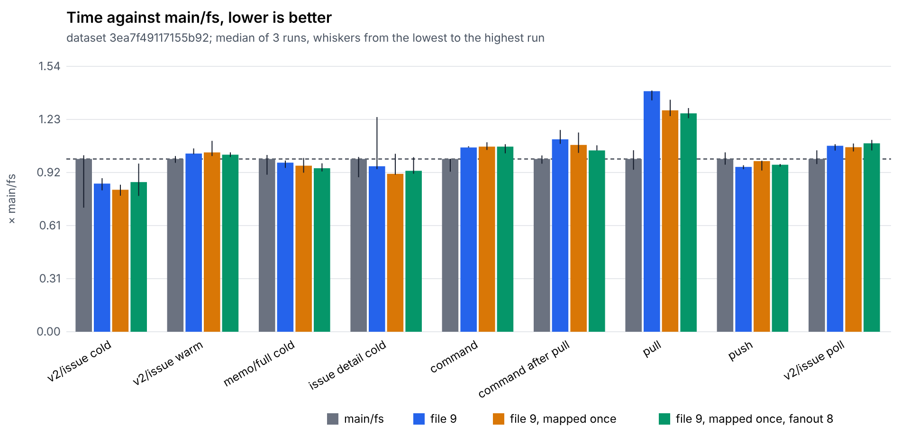
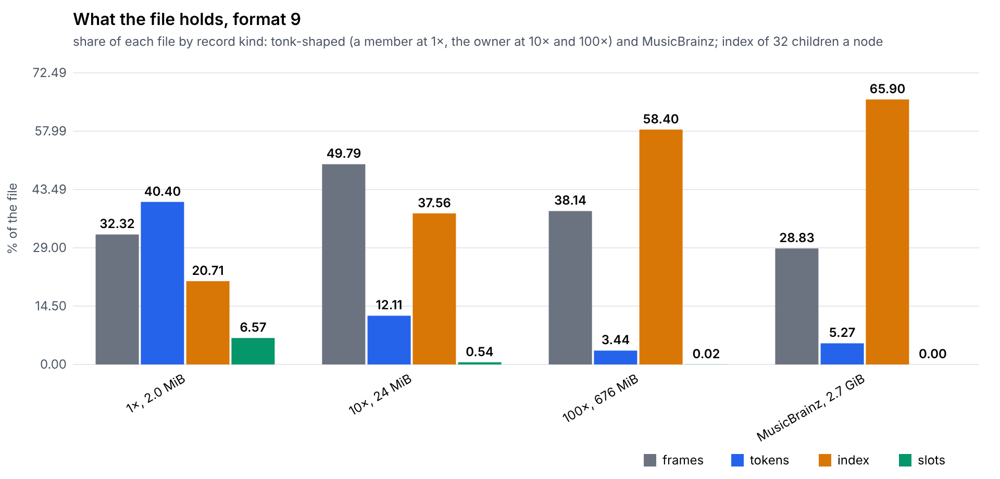
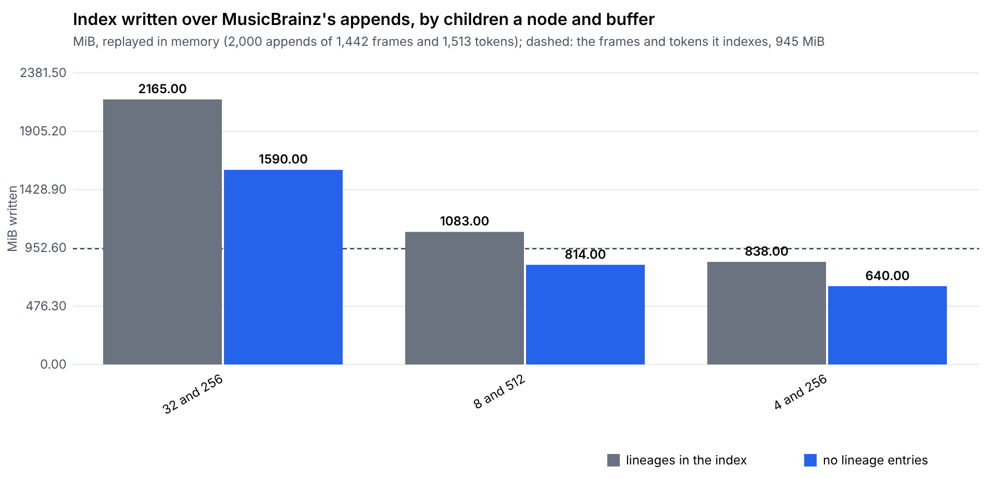
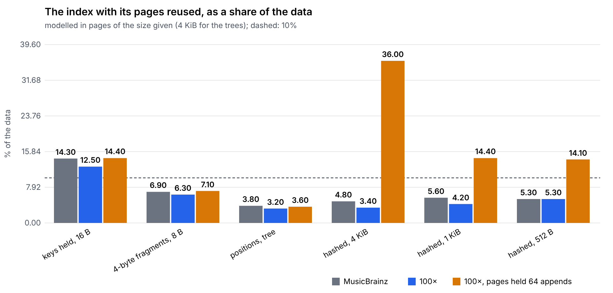
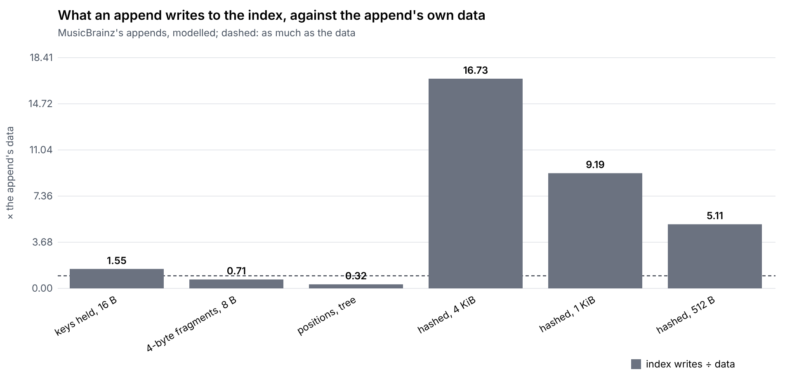
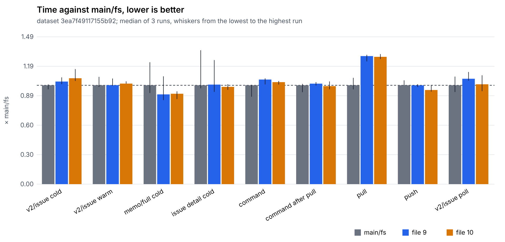

# Single-file format: journal

What we tried, what it measured, and what we decided, newest last. The
[idea](../single-file-format.md) says why; the [spike](spike.md) holds the first round of
measurements in full; the [design](design.md) is the current decision.
Work happens on the `worker/pensive-edison-fu3bx5` branch, PR
[#733](https://github.com/dialog-db/dialog-db/pull/733).

## Where things stand

**Status: Building.** See the [research index](../README.md) for what the
statuses mean.

- **Built:** `dialog-archive-file`, a space's blocks in one append-only
  file, tree nodes as frames over shared tokens, read by the tree in place
  through a mapping of the file; writers take turns across processes.
  `dialog-migration` moves a replica the `fs` provider wrote into it.
- **Size:** tonk-team's 5,623 modern tree nodes take 5.7 MiB, against
  379.4 MiB as a file per block (66×). Stack Exchange at 4096 commits takes
  13.2 MiB against 1147 MiB (the history-key split below has not been
  re-measured there yet).
- **Speed, against main's `fs` archive:** cold reads level, warm reads the
  same, cached nodes a third of the memory; commits about 2.3 ms slower.
- **Next:** the [evaluation](evaluation.md) that decides the block index's
  layout on queries, writes, sync, memory and storage; a hitchhiker tree
  leads on size.
- **Open:** the writer's token dictionary (in memory today, as a cache);
  skipping unchanged entries on write; values yielded in place by the
  tree's scans; Windows; the web (OPFS); verified range reads.

## Datasets

- **Stack Exchange:** the `retrocomputing` dump transformed into facts,
  replayed one branch commit per transaction (`DIALOG_SE_CSV`). Up to 4096
  commits, 9,915 facts, about 14,900 blocks.
- **tonk-team:** the team space's pushed history, all 9,070 blocks fetched
  from R2 (568.5 MiB; R2's own listing matches the fetched blocks block for
  block). 770 roots, ordered by the history records they hold. 3,145 nodes
  are in the old layout and do not rebuild with today's encoder: they are
  kept whole, and left out of "modern" figures.

## 2026-11-04 — The spike: is one file of tokens and frames worth it?

**Question.** Would one append-only file, each distinct token once and
each node a frame of references, beat a file per block on size, without
losing reads?

**Method.** `single_file_census` replays Stack Exchange and models stores
over the blocks a repository writes: the file per block, an append log,
zstd, zstd against the previous version, and frames of token offsets.

**Results.** Frames of 4-byte token offsets: 20× smaller than a file per
block on Stack Exchange, 9.9× on tonk-team, but every rewritten node is
copied forward, so the file grows with commits. zstd against the previous
version reached 13.9 MiB on Stack Exchange.

**Decision.** Worth pursuing, with an encoding of our own: zstd says how
much redundancy there is, not how to read it.

Commits: `d792cc7`, `b2eccd9`, `bd26f78`.

## 2026-11-05 — Columnar frames written against their predecessor

**Question.** Can our own encoding match zstd and still read fast?

**Method.** A frame is rows of dense token ids, each column zigzag-delta
varints; each section is written against the node it supersedes, as runs
copied from its rows around the rows that are new, and whole every K
versions. The predecessor is the latest node of the same kind starting at
the same first key, which a store can find without the tree's help (it
agrees with the tree's own lineage 96–99% of the time).

**Results.**

| | Stack Exchange, 4096 commits | tonk-team, 770 roots |
|---|---|---|
| file per block | 1160.7 MiB | 568.5 MiB |
| offsets (the idea as written) | 59.1 | 57.3 |
| zstd against the previous version | 13.9 | 25.2 |
| columnar, whole every 32 | **13.4 (87×)** | **25.4 (22×)** |

Decoding a node's rows: 5–27 µs, about a file read. Rebuilding its block
from rows: 150–225 µs, which is the tree's encoder, not the format.

**Decision.** Columnar frames, whole every 32. The 3,145 tonk-team nodes
that do not rebuild are the old layout and out of scope.

Commits: `37508df`, `eed8061`, `6d159cf`, `b7011ac`, `27a6220`.

## 2026-11-05 — Memory while querying

**Question.** Facts repeat entities and values everywhere; what does that
cost in memory at query time?

**Method.** `memory_census`, with a counting allocator: the node cache
after a scan, the rows a scan returns, and the same data as a token model.

**Results.** A warm node holds about twice its block (its decoded keys are
kept beside it). Result rows cost about 130 bytes per attribute and per
entity, from a fresh `Arc` per decode. A token model is 2.4–3.6× smaller.

**Decision.** The file should serve nodes, not blocks, to local reads:
the wire form exists to be hashed and sent.

Commits: `674e2f7`, `03aed53`.

## 2026-11-05 — The archive, whole blocks first

**Built.** `dialog-archive-file`: records (`kind | length | crc32 | body`),
a footer ending every append, checkpoints, recovery of a torn tail, the
archive effects (`Get`, `Put`, `Import`), opened from a space's `Location`.
A repository commits, reopens and selects through it.

Commit: `ccee000`.

## 2026-11-05 — Design: nodes to local reads, blocks to sync; writers take turns

**Question.** How does a single file serve both, and how do several
processes share it?

**Decision.** Local reads get nodes read from rows; sync gets blocks
realized on asking. Concurrency is SQLite's write-ahead log without the
checkpoint copy: writers take turns on an exclusive file lock and first
read what others appended; readers take no lock, since everything up to a
footer never changes.

Commit: `ad60ac1`.

## 2026-11-05 — Frames in the archive, and a bench against main

**Built.** Tree nodes kept as frames, written only once they read back and
rebuild their exact block; tokens through a mapping of the file; writers
across processes (a test runs two processes appending at once, and fails
with the catch-up turned off).

**Method.** `file_archive_bench` replays Stack Exchange through a
repository into spaces that differ only in their archive, reopens each and
reads cold, then warm.

**Results (4096 commits).** 13.2 MiB against 1147 MiB. Rebuilding a block
on every cold read made cold point reads about 2× slower than main. A
frame costs about 600 µs to write, about 2.3 ms a commit. Holding token
bytes in memory made the index 23.4 MiB; mapped, 4.0 MiB.

**Found along the way.** The same replay wrote 11,780 to 14,916 blocks from
run to run: a replica's keys reach its tree. Seeding every identity made
every store write the same 14,900 blocks and end on the same root.

Commits: `cfef28c`, `3077330`, `f6f344a`, `c1ae556`.

## 2026-11-05 — Reading nodes in place

**Question.** Can the tree read a node from the file without its block?

**Built.** The tree reads a node through `IndexView` and `SegmentView`,
backed by a block or by a store's rows (`NodeRows`); an environment that
holds a `NodeSource` is asked before any block is loaded. The archive
serves nodes whose keys compare part by part and whose values are read as
archives where they sit (tokens are aligned to 16).

**Results, against main.** Cold reads level (scan 29–37 ms against
32–37, points 9–12 ms against 11–12); a cached node 18 KB against 53 KB.
All 14,900 Stack Exchange nodes read the same both ways, accessor by
accessor.

**Not removed.** The tree's scans yield owned values, so a value read in
place is deserialized when a query takes it, as on main.

Commits: `b76b351`, `6af4544`, `2db465b`.

## 2026-11-05 — What the in-memory index holds

**Results (Stack Exchange, 4096 commits).** About 4.8 MiB, 35% of the
file: every block by catalog and hash (1.6 MiB), the node table (1.2 MiB),
node ids by hash (1.0 MiB), the token table (1.1 MiB). About 250 bytes a
node, while a node's frame averages 190.

Naming tokens and children by file position instead of id would drop the
node table and the token table, for frames about 26% larger.

Commit: `9e90672`.

## 2026-11-05 — tonk-team in the file, and an index estimate

**Results.** The modern blocks: 24.2 MiB in the file (of which 8.9 MiB are
blocks that are not tree nodes, kept whole) against 388.3 MiB as files.
The 5,623 modern nodes alone: 15.3 MiB, of which 12.3 MiB were tokens.

Commit: `32ffd4d`.

## 2026-11-05 — Migrations

**Built.** `dialog-migration`, a crate of migrations, each behind a
feature, run by an application before it opens a replica (`Migrations`,
`Step`) or by `dialog-migrate`. Its `archive-file` step moves every space
of a replica into the file, writing it under another name and renaming it
once complete, so an interrupted run resumes. tonk-team moves in 5.4 s.

Commits: `4333312`, `93d6a2c`, `9d508f8`.

## 2026-11-06 — Splitting history keys

**Question.** Tokens were 80% of tonk-team's nodes. Why?

**Finding.** History and coverage keys have no column schema in the tree
(`Schema::opaque`), so the archive kept each whole, as one token of its
own: none was ever shared.

**Built.** The archive splits them into version, entity, attribute and
value tokens (`split_record_components`), so a record shares its fact's
tokens and a revision's records share one version. The tree's own leaf
encoding is untouched.

**Results (tonk-team, modern nodes).**

| | before | split |
|---|---|---|
| tokens | 80,014, 12.29 MiB | 29,322, 3.48 MiB |
| frames | 1.66 MiB | 1.94 MiB |
| total | 15.3 MiB | **5.7 MiB (66×)** |
| index loaded at open | 3.4 MiB | 1.8 MiB |

All 5,623 nodes still read the same both ways and rebuild their blocks.

Commit: `3ceb925`.

## 2026-11-06 — What a writer that just opened the file pays

**Question.** If the token dictionary stays in memory, how different is a
cold writer from a hot one?

**Results (tonk-team).** Opening: 8.9 ms (it scans every record, since no
checkpoint was written yet). Building the dictionary from the mapped
tokens: 1.4 ms for 29,322 tokens. An append: 5.7 ms. So a cold writer pays
less than a quarter of an append, once; about 48 ns a token, so tens of
milliseconds at ten times this data, and about half a second at a gigabyte
of tokens.

**Decision.** Keep the dictionary as a writer-side cache for now; revisit
when replicas grow large enough for it to matter.

Commit: `c69e733`.

## 2026-11-06 — Where the block index lives

**Question.** The index has to find any block by hash, including blocks no
tree reaches any more, without being loaded into memory. What layout?

**Prior art.** Hyperbee keeps a B-tree in its log: each block carries the
nodes its put changed, keys are pointers to the blocks holding them, and
the root is in the last block. Hypercore's merkle tree is positional
(flat in-order, no pointers, roots merging like binary carries), so it
cannot find a block by hash, but its carries are a schedule for merging
sorted runs. Our own tree's hitchhiker buffers turn many small writes
into few large ones.

**Method.** `single_file_census` with `DIALOG_CENSUS_INDEX` replays each
history one append at a time into each layout, then at sixteen points of
the history looks up every 7th block written by then, counting the 4 KiB
pages the index reads: cold, and warm (the top cached).

**Results.**

| layout | tonk MiB | tonk warm pages | SE MiB | SE warm pages | largest append |
|---|---|---|---|---|---|
| B-tree, keys as pointers, paths copied | 0.58 | 13.3 | 2.13 | 13.2 | 5 KB |
| B-tree, hash prefixes, paths copied (8 a node) | 1.20 | 1.8 | 4.33 | 1.6 | 10 KB |
| B-tree against last version, whole every 8 | 0.50 | 2.6 | 1.80 | 1.7 | 5 KB |
| sorted runs, merged 4 at a time | 0.40 | 1.0 | 1.51 | 1.0 | 288 KB |
| **hitchhiker, 32 a node, buffers of 256, root against its last version, whole every 32** | **0.32** | **1.2** | **1.46** | **1.1** | **8 KB** |

The full table is in the [design](design.md#where-the-block-index-lives-layouts-replayed).

**Leading, not decided.** A hitchhiker tree in the file, children named by
position: the smallest layout without a merge spike, 6–11% of the data,
about a page a lookup once its root is cached. The first lookup after
opening reads the root's chain of versions (7–17 pages), once. Sorted runs
merged 4 at a time are the other finalist. Size and pages are one axis;
the evaluation decides on the rest.

Commits: `e368291`, `66eb85d`.

## 2026-11-06 — How we decide: five axes

**Question.** The index layouts were compared on size and pages a lookup
reads. What else must a decision weigh?

**Plan.** The [evaluation](evaluation.md): queries (real ones, including
tonk's), writes (tonk's commands creating issues and memos, inductive
rules and all), sync (pulling another replica's changes), memory (readers
and writers apart) and storage growth, for `fs`, the file as built today,
and the two index finalists built for real. It needs the index behind one
interface, and a store per run in `dialog-perf` and `dialog-soak`.

**Tonk without tonk.** The first plan patched tonk to build against this
branch. It need not: tonk-team carries its schema as facts. Its commands
are inductive rules the space stores: `v2/issue-create` derives a
`squash.bug` from `dom.event.detail/create-issue-*` event facts, and
`memo/post` derives an `xyz.tonk.memo` and its author from
`dom.event.detail/memo-*` and `dialog.session/profile`. The event is a
transient concept, and the rules run at commit. A harness in dialog
asserts the event and commits, and the space's own rules do the rest; its
views' queries are concept queries over the descriptors it stores (294
issues, 9 memos, about 300 concepts, 116 rules). What this leaves out is
tonk's own cost, rendering and the worker's handlers, which no archive
changes.

**Charts.** The report draws each measure as a Mermaid bar chart, stores
along the axis (GitHub draws them; Mermaid has no legend, so one series a
chart), and the growth curves as SVG it writes itself, every store on one
chart with a legend. Each chart has its numbers in a table under it.

**Every permutation, against main.** Every layout the replay looked at
is built, not only its two finalists: four tree layouts (path-copied, per-
node delta, hitchhiker, hitchhiker with every node a delta), which are one
tree with two settings, and the sorted runs. The baseline is main itself,
built from a worktree of `origin/main`, and `branch/fs` sits between them,
so the branch's changes outside the archive show apart from the archive's.

**A sixth axis, subscriptions.** A standing query (`Branch::subscribe`,
on main) re-evaluates only where the tree's diff since its last poll
meets the ranges it read, so a poll is tree nodes read: the archive's
cost. Measured for a write the query does not read, one it does, and a
rule change, and once after a pull.

**One dataset, generated once.** tonk-team links its records: 294 issues
with 173 label links (11 labels), 119 project links (22 projects),
assignees and creators among 6 people, 168 activity entries, 9 memos with
8 mentions. A generator reproduces that shape at 1×, 10× and 100× through
the space's own commands, from a seed, into a file; every store and both
builds replay that file, and the report names it by hash. Neither the
datasets nor the space's schema they are made with are committed.

**Status.** Planned, not run.

## 2026-11-06 — tonk-team's commands, run from dialog alone

**Question.** Can dialog, with no tonk code, replay tonk-team and run
its commands the way tonk does?

**Method.** `tonk_dataset export` reads the replica copy: its history
region as 1457 commits (43,280 claims), and, split off, the rules and
command markers live at the head (115 inductive rules, 20 deductive, 89
command concepts, all readable by this build) and 284 concepts rebuilt
from tonk's concept records (`db.concept.with/*`, `db.attribute/*`,
`db.name/referent`). `tonk_bench` replays it into a store, installs the
rules, and dispatches one `v2/issue-create`.

**Results.**

- The replay takes 11.8–14.7 s into `fs`, which then takes 567 MiB.
- A command must be *dispatched* (`Transaction::dispatch`), not
  asserted: asserted, its rule still fires, but the event facts are
  committed with it. Dispatched, the issue appears and the event does
  not. One `v2/issue-create` commits in 30–35 ms on `fs`, its rules
  included.
- The issues page reads `v2/issue` (title, ident and status required,
  the rest optional), not `bug`, whose fields are all required and which
  misses an issue created without an assignee: 282 rows against
  `v2/issue`'s 301. A query taken from a view's model, not from a concept
  of the same data, is the one to time.
- The replica holds 301 issues where the live space answered 294 through
  tonk's `bug:` query: the shape the generator follows is read from the
  export, not from the live space.

**Decision.** The harness needs no tonk build. Next: the queries of the
issues, memos and agents pages, a run of commands, subscriptions and
pulls, then the `file/*` stores and main.

Commits: `516bb7f`, and the bench below.

## 2026-11-06 — A team of six on tonk-shaped data: fs against the file

**Question.** With a team writing as tonk's members do, what does the
single file (as built, its index in memory) cost and save against main's
archive, on this branch?

**Method.** `tonk_dataset generate` makes a space shaped like tonk-team
(301 issues, 0.55 labels an issue, 39% in a project, 96% assigned, 0.33
comments an issue, 9 memos), through the space's commands, then a week:
25 rounds in which each of six members sends one to three commands on
their own replica, then everyone pulls and pushes in turn. `tonk_bench`
runs it with every member on the store under test, sharing a filesystem
remote. Three runs of each store, interleaved. Full tables in
[results/2026-11-06-tonk-1x.md](results/2026-11-06-tonk-1x.md).

**Results** (median of three runs; a difference inside the spread between
runs is not counted):

| | fs | file | file ÷ fs |
|---|---|---|---|
| a member's replica after the week | 169.8 MiB | 1.53 MiB | 1/111 |
| a command, rules included | 15.7 ms | 20.7 ms | 1.32 |
| first command after a pull | 27.4 ms | 33.6 ms | 1.23 |
| pull, in a round | 42.9 ms | 71.1 ms | 1.66 |
| push, in a round | 20.3 ms | 29.6 ms | 1.46 |
| `v2/issue` poll after a pull | 23.2 ms | 25.5 ms | 1.10 |
| `v2/issue`, warm | 52.2 ms | 51.7 ms | level |
| `v2/issue`, cold (just joined) | 82.1 ms | 97.0 ms | 1.18, spreads overlap |

- One run said cold queries were 18% *faster* on the file; three runs say
  slower, within the noise. A single run decides nothing.
- Every replica converges on the same 337 issues, on both stores.
- The cost is on the write side: every block a commit or a pull brings in
  is split into rows, encoded against its predecessor and verified before
  it is appended. A pull pays it for every block of everyone else's
  commits, which is why pulls cost the most.

**Decision.** Not decided: this is the file as built, against `fs` on
the branch. The pull and commit costs are what the index layouts and the
write path have to answer. Next: main as the baseline, tonk-team's own
history with the week, 10×, then the index layouts.

Commits: `6701aba`.

## 2026-11-06 — The same team against main

**Question.** Against main itself, not this branch with main's archive,
what does the file cost and save, and what do the branch's other changes
cost?

**Method.** The run above, with `main/fs` added: the same `tonk_bench`
built from origin/main (`5dbde9f`) by `bench/main-baseline.sh`, on the
same dataset file (`d02fd406dacb607d`). Three runs of each of the three,
interleaved, in one sitting:
[results/2026-11-06-tonk-1x-main.md](results/2026-11-06-tonk-1x-main.md).

**Results** (median of three; ratios against main):

| | main/fs | fs | file | file ÷ main |
|---|---|---|---|---|
| a member's replica after the week | 169.8 MiB | 169.8 MiB | 1.53 MiB | 1/111 |
| a command, rules included | 17.6 ms | 18.6 ms | 21.5 ms | 1.22 |
| first command after a pull | 28.9 ms | 31.7 ms | 35.2 ms | 1.22 |
| pull, in a round | 48.4 ms | 53.1 ms | 74.9 ms | 1.55 |
| push, in a round | 22.6 ms | 26.6 ms | 41.0 ms | 1.81 |
| `v2/issue` poll after a pull | 23.8 ms | 24.6 ms | 28.0 ms | 1.18 |
| `v2/issue`, warm | 45.3 ms | 50.7 ms | 50.7 ms | 1.12 |
| `v2/issue`, cold (just joined) | 93.4 ms | 110.8 ms | 90.4 ms | 0.97 |
| `memo/full`, cold | 5.0 ms | 6.3 ms | 3.8 ms | 0.76 |

- Main and `branch/fs` write the same bytes: the archive is all that
  differs between `fs` and `file`, and nothing the branch changed moves
  what a replica stores.
- The branch's other changes (the tree's row read path among them) cost
  about 5–12% on warm reads and commands against main, before the file
  is involved: `v2/issue` warm is 45.3 ms on main and 50.7 ms on either
  branch store. That cost is the branch's, not the file's, and it is not
  yet explained.
- The file's own cost is on the write side again: pulls 1.4× and pushes
  1.5× `branch/fs`. Cold reads of a replica that just joined are level
  with main or better.
- The `fs` numbers moved by up to 15% between this sitting and the last
  (a command: 15.7 ms then, 18.6 ms now): only numbers from one sitting
  compare.

**Decision.** The index layout is not where the file loses: reads are
level, and what it costs is in writing what a commit or a pull brings in
(splitting, encoding against predecessors, verifying). The layouts still
get measured, but the write path is the larger question, and the branch's
5–12% on warm reads needs explaining before the branch can land.

## 2026-11-06 — The branch's own cost, found and mostly fixed

**Question.** Warm reads and commands were 5–12% slower on this branch
than on main with the same archive. Main had gained six commits since
the branch last merged it, none on a read or commit path. Where does the
branch spend it?

**Method.** `dialog-perf` counts the instructions each scenario retires
under callgrind, which a timing's noise does not touch. Every scenario,
on main (`5dbde9f`, in a worktree) and on the branch, built with the
same toolchain; then each regression's profiles compared function by
function.

**Results.**

- Before: 21 of 29 scenarios over the gate's 3%, every counter (blocks,
  engine steps) unchanged: `rule-point` +16.0%, `read-point` +12.9%,
  `commit-batch` +9.0% against main on one toolchain.
- The cause: every tree read made an accessor, and every accessor looked
  up the environment's node source, building its key with `format!` (a
  type id written out in hex) and a held-value lookup. In `read-point`
  that is 2.4M of the 2.9M extra instructions; the row views themselves
  cost 0.12M. The lookup now runs on the first node the cache does not
  hold, at most once an accessor, and not at all for a read the cache
  answers.
- The tree diff behind subscriptions built its index links through the
  view one link at a time; it now hands the archived node's own `links`
  and `link_at` the work, as main did.
- After: every scenario within 3% of main, most within 0–2%;
  `first-query` 10% cheaper. `subscribe-fanout` is at +3.0%, on the
  line: a node read from its block carries one more pointer (the rows
  it may have come from), and the diff moves nodes about.

**Decision.** Fixed in the read path; `subscribe-fanout` stays open, to
be brought under the line by folding the rows pointer into the node's
existing fields. The six-member run should be repeated with this fix
before its `fs` and `main/fs` numbers are compared again.

## 2026-11-07 — The node is its block or its rows

**Question.** After the per-read lookup was fixed, `subscribe-fanout` sat at
+3.0% against main, attributed to the pointer every node carried for the
rows it might have come from. Does a node that is either its block or its
rows clear it?

**Method.** `PersistentNode` holds an enum: a block (its bytes and where
its body sits, exactly main's two fields) or rows. A compile-time assertion
keeps a block node at main's size. Every `dialog-perf` scenario on main
(`9b98395`) and on the branch, one toolchain, callgrind instructions.

**Results.** No regressions: every scenario within 0.1-2.8% of main, every
counter unchanged. `subscribe-fanout` +1.6% (from +3.0%),
`subscribe-pulled` +1.5%, `read-point` +2.5%, `first-query` +2.8%,
`commit-batch` +1.6%; `commit-succeed` (volatile, not gated) -13%.

**Decision.** Kept. The node-source lookup itself stays, on a cache miss
only, until the tree reads nodes through capabilities
([dialog-db/dialog-db#753](https://github.com/dialog-db/dialog-db/pull/753)
plans it). A first try at carrying rows on `Load`'s answer instead was
set aside: `Load` never reaches a store (the peer answers it with `Get`,
which is routed to the space's archive and returns bytes that also cross
the wire), so it is the routing question #753 leaves open, not a small
step.

Commits: `a17589b`.

## 2026-11-07 — The team of six again, after the read-path fix

**Question.** With the per-read lookup gone and the node back to main's
size, where does the file stand against main on the six-member bench?

**Method.** As on 2026-11-06, against origin/main `9b98395`; three runs
of each of `main/fs`, `fs` and `file`, interleaved, one sitting; dataset
`3ea7f49117155b92` (tonk-shaped 1×, generated from the schema fixture).
[results/2026-11-07-tonk-1x-main.md](results/2026-11-07-tonk-1x-main.md).

**Results** (median of three; ratios against main):

| | main/fs | fs | file | file ÷ main |
|---|---|---|---|---|
| a member's replica after the week | 169.8 MiB | 169.8 MiB | 1.53 MiB | 1/111 |
| `v2/issue`, warm | 36.3 ms | 38.3 ms | 37.4 ms | 1.03 |
| `v2/issue`, cold (just joined) | 69.7 ms | 71.0 ms | 66.7 ms | 0.96 |
| an issue's detail, cold | 2.69 ms | 2.55 ms | 2.04 ms | 0.76 |
| a command, rules included | 13.5 ms | 14.3 ms | 16.4 ms | 1.22 |
| pull, in a round | 40.2 ms | 44.0 ms | 56.9 ms | 1.41 |
| push, in a round | 19.8 ms | 22.7 ms | 30.3 ms | 1.53 |
| `v2/issue` poll after a pull | 19.0 ms | 19.6 ms | 20.8 ms | 1.10 |

- `fs` on the branch is now within the run-to-run spread of main on reads
  (it was 5-12% behind before the fix).
- The file reads level with main or faster, cold reads of a replica that
  just joined most of all.
- What the file costs is all on the write side: a commit 1.22×, a pull
  1.41×, a push 1.53×.

**Decision.** Reads are done for now. The next work is the write path:
what a commit, a pull and a push spend in the archive (splitting blocks
into rows, encoding frames against predecessors, verifying them, and
building blocks back for a push).

## 2026-11-07 — Where the write side goes

**Question.** Commands, pulls and pushes cost more on the file than on
main. Where does the time go?

**Method.** The archive times its phases and reports them when it closes
(`DIALOG_ARCHIVE_TIMINGS`); one six-member run on the file, then call
stacks of a sample of blocks built for `Get`, then the archive's
`split_costs` profile over a member's file, then callgrind over it.

**Results.**

- Nodes were not served in place at all in `tonk_bench`: nothing
  registered the node source. Registered, it served 30 nodes; the rest
  of the 1,541 blocks built back for `Get`s came from a push's tree diff,
  whose boundary side reads the local archive by `Get` on purpose (it
  must be the archive's own word, never the cache or a remote). The node
  source is the archive's own word, so that side now asks it first:
  1,574 nodes served (12 µs each), 751 blocks still built, all of them a
  push producing the bytes it uploads. The source also reads appends it
  has not seen before declining a node, as a `Get` does.
- Splitting a node into rows (per node, member 1's file): 153 µs, 57% of
  it serializing each value with `rkyv::to_bytes`, a fresh buffer and
  arena per value. One kept per thread: 74 µs. Same bytes.
- Verifying a frame (decoding it back, rebuilding the block, comparing):
  114 µs per node. Callgrind: the tree's own column encoder about 21%,
  turning rows back into entries (keys joined from tokens, every value
  deserialized to an owned copy) 25-30%, assembling the body about 9%.
  It is the block encoded a second time. Validating datum tokens once
  instead of each time changed nothing and was reverted.
- An append, whole: 0.44 ms on average (1,925 appends, 3,003 blocks, for
  member 1 over setup, join and the week), of which split 304 ms, verify
  425 ms, encode 32 ms, write 7 ms; about 80 ms outside the phases.
- Six members, three interleaved runs, one sitting
  ([results](results/2026-11-07b-tonk-1x-main.md)): reads level with
  main or better; per operation over main, a command +4.2 ms, a pull
  +16.3 ms, a push +11.6 ms, close to the last sitting's deltas. `fs` on
  the branch level with main throughout.

**Decision.** Verify is now the largest write cost and a judgement call
(what guarantees a frame gives), put to the maintainer.

Commits: `9887124`, `b166bcb`, `805c792`.

## 2026-11-07 — One encode per block

**Question.** Verifying a frame rebuilt its block with the tree's encoder
and compared the bytes: a second encode of every block appended, the
largest write cost left. Is it needed?

**Method.** The tree's encoding is canonical (the same entries under the
same manifest make the same bytes; replicas rely on it to agree on
hashes), so a frame of a node in the current layout rebuilds its block by
construction. The rebuild now runs only in debug builds and tests, or
with `DIALOG_ARCHIVE_VERIFY`; every build checks the frame decodes back
to its rows and keeps a node of another layout whole without framing it.
Checked on real data: the local tonk-team replica migrated with the
rebuild forced on and off gives byte-identical files (688 nodes framed,
none failing; the append 102 ms against 52 ms). A test appends a real
segment archived under the older layout with the rebuild off and finds
it whole; with the layout check removed, it fails. Then six members,
three interleaved runs each, one sitting
([results](results/2026-11-07c-tonk-1x-main.md)).

**Results** (median of three; against main):

| | main/fs | file | file ÷ main |
|---|---|---|---|
| a command, rules included | 12.6 ms | 13.0 ms | 1.03 |
| first command after a pull | 21.1 ms | 21.7 ms | 1.03 |
| pull, in a round | 35.6 ms | 36.7 ms | 1.03 |
| push, in a round | 17.1 ms | 27.5 ms | 1.60 |
| `v2/issue` poll after a pull | 18.1 ms | 17.1 ms | 0.94 |
| `v2/issue`, cold (just joined) | 59.2 ms | 54.7 ms | 0.92 |
| an issue's detail, cold | 2.53 ms | 1.99 ms | 0.79 |
| `v2/issue`, warm | 34.5 ms | 35.8 ms | 1.04, within spread |

- Commands and pulls are level with main; cold reads and polls are
  faster.
- Push is what is left: about +10 ms a round, the bytes a push uploads,
  which the file builds from rows for every node it sends (751 blocks
  for one member over the run).

**Decision.** Kept. Push is next.

Commits: `1c84661`.

## 2026-11-07: a segment's columns from its tokens; push is not where we thought

**Hypothesis.** Push is slow because the file builds every block it
uploads from rows, and building one is about 114 µs: the key joined
from its tokens, parsed and split again, each datum copied before it is
read. A segment's key columns are exactly its tokens, so handing them to
the tree's column encoder should take most of that away and bring push
close to main.

**Method.** `PersistentSegment::from_columns` takes a segment's keys
already split into its schema's columns; `realize` fills them from the
tokens (a value token split into its type byte and payload), joins whole
keys once into one buffer for the segment when its schema keeps whole
keys, and reads a datum in place when it is aligned, as a token in the
file is. Rows that fit no schema take the old path. Two tests compare the
block built this way with the original, byte for byte, over every layout,
a mixed leaf, an opaque key and spilled values, and assert the columns
came from the tokens; swapping the entity and attribute columns fails
them. Realize per node timed by `split_costs` over a member's file, old
and new path interleaved in one build. Then six members, three
interleaved runs each, one sitting
([results](results/2026-11-07d-tonk-1x-main.md)). Then, with temporary
timers in push (not committed), where a push's time goes, one run each
of fs and file.

**Results.**

- Realize per node: 118, 122, 121 µs before; 79, 72, 78 µs after
  (about −37%).
- Push did not move: 26.2 ms against main's 15.7 (1.67×; it was 1.60
  in the last sitting).

| | main/fs | file | file ÷ main |
|---|---|---|---|
| `v2/issue`, cold | 63.2 ms | 54.5 ms | 0.86 |
| a command, rules included | 12.1 ms | 12.8 ms | 1.06 |
| pull, in a round | 31.4 ms | 36.9 ms | 1.18 |
| push, in a round | 15.7 ms | 26.2 ms | 1.67 |
| `v2/issue` poll after a pull | 17.4 ms | 17.8 ms | 1.02 |

- Pull reads 1.18 where the last sitting read 1.03: file's pull is the
  same (36.9 against 36.7 ms) and main's ran faster (31.4 against
  35.6). The gap between sittings is larger than the spread within one,
  so the honest reading is that pull is between 3% and 18% behind main.
- Where push goes (medians per push, one run each):

  | | fs | file |
  |---|---|---|
  | to the end of the diff | 3.9 ms | 2.0 ms |
  | upload | 6.8 ms | 18 ms |
  | of which building blocks | 0 | 3.1 ms |
  | publish | 1.0 ms | 2.3 ms |

  The diff is faster on the file (nodes served in place). Upload is the
  whole gap, and building blocks is a third of it. Upload builds each
  block inside the future that puts it, up to 16 at once, all polled on
  one thread while the remote's file writes run on the blocking pool: a
  block being built holds up every put waiting to be polled. Built
  first and put after, the file's push measured 21.6 ms against 25 ms.
  The puts were still slower than fs's (11.8 against 9.5 ms) and so
  was publish, against the same remote; that is not explained yet.

**Decision.** Kept: realize is a third cheaper and its output is pinned
byte for byte. The premise that realize is push's cost was wrong: it is
about 3 ms of a 10 ms gap. Every block a push uploads is one this
replica minted moments before and held whole when it wrote it; the file
throws those bytes away and rebuilds them. Next is to find why the puts
and publish are slower against the same remote, and to decide whether a
just-written block is kept whole until it is pushed, which would be
caching in the store, against the design, or the upload stops building
blocks in the futures that put them.

Commits: `15f01e9`.

## 2026-11-07: an upload's blocks built as tasks of their own

**Hypothesis.** Push's gap is the upload holding up its own puts: each
block is built inside the future that puts it, all polled on one thread,
so while one block is built the puts in flight wait to be polled. Built
in tasks of their own, the blocks are built several at once where there
are threads and each goes out as soon as it is built, and push comes
level with main. Streaming a block's bytes into its put would not help:
a block is a few kilobytes, its columns need their dictionaries before
its first byte, and a put of a content-addressed block wants it whole.

**Method.** Upload is two stages: each node's buffer built in a task
through `dialog_common::r#async::spawn` (tokio's pool on native, the
browser's own executor on wasm, where it is awaited elsewhere), up to 16
at once, then each block put as soon as it is built, up to 16 at once.
A wave still lands whole before the next starts, so the order the remote
sees is unchanged. Six members, three interleaved runs each, one
sitting, four cores
([results](results/2026-11-07e-tonk-1x-main.md)).

**Results** (median of three; against main):

| | main/fs | fs | file | file ÷ main |
|---|---|---|---|---|
| push, in a round | 16.1 ms | 15.9 ms | 14.0 ms (14.0–17.0) | 0.87 |
| the first push, the whole space | 75.1 ms | 73.7 ms | 54.4 ms | 0.72 |
| pull, in a round | 32.7 ms | 31.0 ms | 36.4 ms | 1.11 |
| a command, rules included | 11.7 ms | 11.4 ms | 12.0 ms | 1.03 |
| `v2/issue`, cold | 59.9 ms | 57.8 ms | 56.3 ms | 0.94 |
| `v2/issue` poll after a pull | 17.5 ms | 17.1 ms | 18.5 ms | 1.06 |

- Push went from 1.67× main to 0.87×. The puts and publish that read
  slower against the same remote in the last entry were the same
  stall: with nothing building on the poller, they are not slower.
- fs on this branch is unchanged (15.9 against main's 16.1): its
  buffers are already whole, so the extra task costs nothing visible.
- `command/memo/post` reads 1.59 and `v2/activity` cold 1.12, each
  with a run as fast as main's inside its spread: noise, to watch.
- Pull is still behind, 1.11 here.

**What this does not show.** The gain leans on threads: four cores
build blocks side by side. In a browser there is one thread; the
blocks are built one at a time between puts there, which takes the
stall away but not the 3 ms of building. Not measured.

**Decision.** Kept. Push is level with main or better on native. Pull
is next: it is the one sync measure still behind.

Commits: `3e39b31`.

## 2026-11-07: the file's integers in bijou64

**Change.** Every integer the file writes (row columns, token and frame
records, checkpoints) is bijou64, through `bijoux`, as the tree's own
nodes and manifest write theirs, in place of LEB128 varints: each number
has exactly one encoding. Not bijou128: nothing the file writes is wider
than 64 bits, and bijou128's one-byte range ends at 239 rather than 247.
The magic number moves to `DIALOGA\x04`, so a file written before is
refused rather than misread.

**Results** (one run, six members): the file grows about 6%: member 0
2.00 MiB against 1.88, member 1 1.62 against 1.53, the owner 0.98
against 0.92. bijou64 spends three bytes from 504 where LEB128 spends two
up to 16,383, and token ids live there. Against a main run in the same
minutes, pull 1.08, push 0.88, a command 1.03: where they were. Not yet
interleaved.

**Decision.** Kept: one encoding per number, like the rest of dialog.
The 6% is the price; ids could be made smaller (delta against a
column's base, or dense per-node renumbering) if it matters.

## 2026-11-07: reads without a lock, writers prepared before their turn

**Change.** Three steps, each with tests that fail when the property they
pin is broken (checked by breaking it):

- A read that misses looks for other processes' appends only when the
  file grew past what this process has read or is writing; before, it
  took the writer's turn.
- The index only grows, as the file does: slots that never move, and
  lock-free maps (`papaya`) for blocks, nodes and lineages. An append
  writes its records and footer, then publishes tokens, blocks and frames,
  children first. A test runs a check after every step of publishing;
  another reads on another thread while an append is held between writing
  and publishing.
- An append splits and encodes before its turn against the index as it
  is, then reconciles in its turn: tokens and nodes another writer
  appended first take theirs, the rest the next ids, and moved frames are
  renamed and encoded again (or prepared again, when a node it framed was
  appended whole).

**Results** (interleaved A/B, three runs each, against the commit before
lock-free reads):

- As first built, slower: pull +11%, a command +5%, cold `v2/issue` +7%.
  The archive's own timings put it in splitting (389 → 492 ms a member):
  the token id table had moved into a lock-free map, whose lookups follow
  a boxed entry and the slots chain. Splitting against a full table, the
  same file: 79–82 µs a node before, 93–95 after.
- The id table is the writer's alone, so it went back to a `hashbrown`
  table under a lock writers alone take (a draft holds it while it
  prepares and lets it go before its turn): 83–88 µs a node, and

| | before | now |
|---|---|---|
| pull | 43.5 ms | 43.3 ms |
| push | 17.6 ms | 17.6 ms |
| a command | 14.9 ms | 14.9 ms |
| `v2/issue`, cold | 66.6 ms (65.0–69.2) | 69.8 ms (67.1–71.1) |
| `v2/issue`, warm | 42.2 ms (42.0–44.3) | 44.6 ms (43.7–44.8) |
| an issue's detail, cold | 2.41 ms | 2.11 ms |

- Writes are level. Reads of `v2/issue` read a few percent higher with
  overlapping spreads: to watch, not settled. The bench is one thread, so
  it pays for lock-free reads and cannot show what they buy.

**Decision.** Kept. Commits: `9a074fe`, `aacfbac`, `97abe73`, and the id
table's.

## 2026-11-07: back to LEB128, measured

**Question.** The bijou64 article says the two are "within a couple of
percent of each other across realistic workloads"; the file grew 6%. Why?

**Method.** A temporary count in the file's integer writer, over one
six-member run: every integer by range, with what it costs in each.

**Results.**

| range | integers | bijou64 | LEB128 |
|---|---|---|---|
| 0–127 | 1,668,957 | 1 B | 1 B |
| 128–247 | 74,172 | 1 B | 2 B |
| 248–503 | 116,549 | 2 B | 2 B |
| 504–16,383 | 688,525 | 3 B | 2 B |
| 16,384–66,039 | 16,948 | 3 B | 3 B |
| all | | 4.09 MB | 3.48 MB |

- The article does not claim bijou64 is never larger: it says it "isn't
  the most compact varint for every distribution" and that LEB128 "is
  more compact up to 3 segments". A quarter of the file's integers sit
  there (504–16,383, most likely deltas in a row's columns between token
  ids, which number in the tens of thousands); bijou64 wins back 74 KB on
  128–247 and loses 690 KB there.
- What bijou64 buys, one encoding per number, matters for bytes that are
  hashed as written. Nothing in the file is: a frame is checked by reading
  it back, and a block's hash is over the block it rebuilds.

**Decision.** LEB128 for the file's own records; the magic number moves to
`DIALOGA\x05`. Smaller ids (a frame naming its distinct tokens once, rows
indexing into that list) would shrink frames under either encoding, and
stay open.

## 2026-11-07: rows name tokens by file offset, measured

**Question.** Holding memory bounded means the index leaves memory. The
node and token tables (id to where in the file) are most of it; frames
could name tokens and children by file offset instead, and need no tables.
What does that cost the file, against keeping ids and writing the tables
into the file as fixed-width records?

**Method.** `offsets_instead_of_ids` re-encodes every frame's literal rows
(the rows it does not copy from its predecessor) with offsets in place of
ids, as zigzag-delta varints per column, against the same predecessors.
Tokens start on 16-byte boundaries, so it also measures offsets divided
by 16. Two files: a member's file from the six-member run, and the local
tonk-team replica migrated into the current format.

**Results.**

| | a member | tonk-team |
|---|---|---|
| file | 1,554 KiB | 4,667 KiB |
| tokens, nodes | 9,913, 2,979 | 29,154, 688 |
| literal rows' columns, ids | 578 KiB | 872 KiB |
| offsets | 753 KiB (+30%) | 1,112 KiB (+28%) |
| offsets in units of 16 | 657 KiB (+14%) | 947 KiB (+9%) |
| what offsets in units of 16 add to the file | 79 KiB (5%) | 75 KiB (1.6%) |
| ids, with fixed-width tables in the file instead | about 166 KiB | about 353 KiB |
| the tables in memory today | about 600 KiB | about 840 KiB |

- Offsets in units of the token alignment cost the file less than tables
  would, need no lookup to reach a token, and take the two largest parts
  of the index out of memory.
- Offset deltas grow with the file, ids with the count of tokens, so the
  gap is likely to widen in larger files. Not measured: there is no 10× or
  100× file yet.

**Decision.** Leaning towards offsets in units of 16, with the block index
in the file (the hitchhiker tree, 2026-11-06) as the work that makes the
index bounded. To confirm on a larger file before the format changes.

## 2026-11-07: run-length encoding the columns, as Automerge does

**Question.** `hexane`, Automerge's columnar library, writes integer
columns as runs over LEB128 (a signed count: positive for one value
repeated, negative for values written one by one), with deltas inside the
runs. Frames write every delta one by one. What would runs save?

**Method.** `offsets_instead_of_ids` again, counting only the fields a
frame writes (the model counted unused slots as zeros before, which the
encoder never writes; the figures in the last entry are a little high for
that reason, their ratios hold). Each column's zigzag deltas, one varint
each, against the same deltas in Automerge's runs.

**Results.**

| | a member | tonk-team |
|---|---|---|
| ids, as frames write them | 505 KiB | 812 KiB |
| ids in runs | 356 KiB (−30%) | 538 KiB (−34%) |
| offsets in units of 16 | 584 KiB | 887 KiB |
| offsets in units of 16, in runs | 437 KiB | 617 KiB |

- Runs take a third off the columns: a leaf's form is one value, its
  entity (or attribute) repeats across rows, and its deltas repeat.
- In runs, offsets cost less than ids do as frames write them today: 13%
  and 24% less. The change to offsets and the change to runs together make
  frames smaller and take the node and token tables out of memory.
- What else `hexane` does does not carry over as it is: it cuts columns
  into slabs of 64 with counts, sums and min/max for seeking, in a B-tree
  in memory, and `load` decodes into owned slabs, nothing read in place.
  Slabs would matter if a frame were read in place through a page cache
  and decoded only where a key falls; a node is a few hundred rows, so not
  yet.

**Decision.** Runs, with offsets in units of 16, for the next frame
format, to confirm with offsets on a larger file.

## 2026-11-07: larger files: tonk-shaped 10× and MusicBrainz

**Datasets.** tonk-shaped 10× (`5f703d3c4bab3fe7`, from the schema
fixture), replayed by the six-member bench. MusicBrainz (`865bbbcb0fe87ec0`):
the first 20,000 records each of area, place, label, event and artist from
the 2026-11-04 JSON dump (CC0), 100,000 entities and 4.47 million facts in
2,000 commits of 50 entities, through `bench/musicbrainz.py`, replayed into
the file alone. The MusicBrainz replay was stopped after 46 minutes, about
1,250 commits in (one footer an append), at 2.36 GB, still accelerating;
its file is whole up to its last footer.

**Results.**

| | tonk 10×, a member | MusicBrainz, ~1,250 commits |
|---|---|---|
| file | 8.1 MiB | 2,362 MiB |
| tokens | 2.6 MiB (49,482) | 103 MiB (2.17 M) |
| frames | 2.5 MiB (4,476) | 488 MiB (1.72 M) |
| blocks kept whole | 2.9 MiB | 32 MiB |
| checkpoints | none yet | **1,739 MiB (37 records)** |
| the same nodes as whole blocks, as `fs` keeps them | about 268 MiB | about 116 GiB |
| index in memory | 2.6 MiB | 439 MiB |

- Checkpoints are three quarters of the MusicBrainz file. Each writes the
  whole index, which grows with the file, every 16 MiB of appends: their
  total grows as the square of the file. Without them the file is 623 MiB,
  187× smaller than the same node versions as blocks; with them, 49×.
- The index in memory is 439 MiB at this point: the bound memory needs is
  real, not hypothetical.
- Offsets and runs on these files:

| | tonk 1× | tonk 10× | MusicBrainz |
|---|---|---|---|
| ids, as written | 505 KiB | 2,240 KiB | 357 MiB |
| offsets in units of 16 | +16% | +7% | +16% |
| ids in runs | 356 KiB | 1,509 KiB | 287 MiB |
| offsets in units of 16, in runs | 437 KiB | 1,671 KiB | 343 MiB |
| ids, with fixed-width tables in the file | about 166 KiB of tables | | about 54 MiB of tables |

  At MusicBrainz's size, offsets in runs cost the frames 56 MiB more than
  ids in runs; tables in the file would cost about 54 MiB. The two tie on
  disk; offsets still read without a table and keep nothing in memory.

**Decision.** The index goes into the file, and with it the checkpoint
goes: a root the footer names replaces a copy of the whole index. Offsets
in units of 16, in runs, for frames.

## 2026-11-07: MusicBrainz against its source; attributes as one token

**Question.** How does the file compare with the data it was made from,
and would an attribute's domain and name as tokens of their own share
more than the whole attribute as one?

**Method.** The source for the ~1,250 commits the replay finished (12,500
records of each type, 3.11 M facts), as MusicBrainz's JSON, as the fact
log, and the log under `xz -6`. `live_breakdown` walks the last tree from
its root and sizes it alone: its frames encoded whole and the tokens it
names. The attributes counted from the fact log.

**Results.**

| | size |
|---|---|
| MusicBrainz JSON for those entities | 1,268 MiB |
| the fact log (`txn,at,the,of,as,is`) | 341 MiB |
| the fact log, `xz -6` | 49 MiB |
| the current tree alone: 53,201 nodes, 2.15 M tokens | about 190 MiB (85 MiB tokens, 15 MiB their lengths and padding, 90 MiB rows) |
| the file without checkpoints: every version since the first commit | 623 MiB |
| the file as written | 2,362 MiB |
| the same versions as blocks (`fs`) | about 116 GiB |

- The current tree is smaller than the fact log it holds, with every
  fact in three orderings and history, because each entity, attribute and
  value is a token once. xz does 4× better on the log, but is not
  something a query reads.
- History, as frames against predecessors, adds about 430 MiB over 1,250
  commits of 50 entities each.
- An attribute is one token, and a row names it by id. The fact log spells
  attributes out 3.1 M times (76 MiB of text); the file holds the 527
  distinct attributes once, 13.7 KiB in all. Split, the 5 domains and 383
  names would take 7 KiB: 7 KiB saved, against a column more in every
  row. The repetition is already gone; what is left is the attribute id in
  each row, which the runs take care of where it repeats.
- Every commit's root was kept whole (1,197 blocks, 31 MiB): a link's scale
  shared a byte with a flag, so a scale of 128 or more, as a large tree's
  root has, did not read back, and the frame was dropped for the whole
  block. Fixed (`8b65f7de`), with a count of frames that do not read back.

**Decision.** Attributes stay one token.

## 2026-11-07: frame headers, and where tokens sit

**Question.** What do frame headers cost, and would keeping tokens
together in a region of their own (rather than in a record with each
append's frames) make a node's read touch fewer pages?

**Method.** On the MusicBrainz file, every frame's header measured, and
for every 97th node the 4 KiB pages its tokens sit on, where they are and
if every token were packed in id order (aligned to 16), as a region of
their own would hold them.

**Results.**

- Headers are 87 MiB of 473 MiB of frames, 53 bytes a frame: the catalog's
  name (6), the node's hash (32), its kind, base, manifest token, and its
  lineage (four token ids). The lineage is the first row's tokens, already
  in the rows; the catalog could be a number; a manifest is the same for
  every node of a tree. The hash stays: a parent read in place takes its
  child's hash from the child's header.
- A node's read touches about 498 pages of tokens where they are, 494
  packed in id order: a region of their own changes nothing. A node's
  tokens were first written across the whole history, and any order by
  time keeps them apart. (Packed densely, offsets would be nearly as small
  as ids, but an append-only file has no dense region to keep.)
- 498 pages, about 2 MiB, for one node (these average 71 KB as blocks):
  read through a page cache, as the web would, a cold read of a large node
  costs that. Smaller nodes, or tokens ordered by what reads them together
  (a rewrite, not an append), are what would change it.

**Decision.** No token region. Frame headers lose the lineage, name the
catalog by number, and the manifest by tree, in the format change.

## 2026-11-07: the index in the file, measured

**Question.** With the index in the file (a hitchhiker tree rooted in two
slots at the file's head), checkpoints gone, frames named by offset in
runs and headers trimmed, what do the team of six, MusicBrainz and
tonk-shaped 100× look like?

**What changed (format 9).**

- The file opens on two 64 KiB slots after the magic number. A slot is
  the file's state as of an append: a sequence number, where the records
  end, the counts, the catalogs' names, and the index's root. An append
  writes its records, then the older slot; opening reads both and takes
  the newer whole one, 128 KiB and nothing else.
- The index is a hitchhiker tree of index records in the file: blocks by a
  prefix of their hash and their catalog, tokens by a stable hash of their
  bytes, lineages by their first row. A collision probes the next key, and
  every value is checked against what it stands for. The root lives in the
  slot and buffers 2048 entries, draining to half.
- Checkpoints are gone, and with them the index in memory: a reader holds
  a slot and a mapping of the file.
- Headers name the catalog by number and drop the lineage.
- The index's hash takes sixteen bytes per wide multiply (`src/hash.rs`):
  a warm split goes from 149 to 119 µs a node.
- A snapshot keeps the file's mapping while the file grows into it.
  Mapping it again on every append cost 11,683 `mmap`/`munmap` calls and
  222k more page faults than main in a six-member run (527k against 305k;
  339k after).
- The index has 8 children a node and buffers of 512 (was 32 and 256),
  from the measurements below.

**Method.**

- The team of six on tonk-shaped 1× (`3ea7f49117155b92`), main's `fs`
  against builds of this branch, interleaved, three runs each. Main itself
  ran about 20% slower than in the morning's runs on this machine, so only
  ratios compare across entries. Full tables in
  [results/2026-11-07f-tonk-1x-main.md](results/2026-11-07f-tonk-1x-main.md)
  and [results/2026-11-07g-tonk-1x-main.md](results/2026-11-07g-tonk-1x-main.md).
- MusicBrainz (`865bbbcb0fe87ec0`), 2,000 commits of 50 entities, 4.47 M
  facts, replayed into the file alone by `file_archive_bench`, this time to
  the end.
- Tonk-shaped 10× (`5f703d3c4bab3fe7`) by the six-member bench, and 100×
  (`55e6bdf8f8fae9a0`) as far as it went (below).
- `breakdown` sizes each file by record kind;
  `write_amplification_of_a_file` replays an index's appends in memory,
  shaped by a file's counts, to compare layouts.

**Results: the team of six, 1×** (median of three runs; main's spread on
cold queries is wide, 69–99 ms):

| | main `fs` | format 9 | mapped once | mapped once, 8 children |
|---|---|---|---|---|
| pull, in a round | 40.0 ms | 55.7 | 51.3 | 50.5 (1.26×) |
| push, in a round | 19.7 | 18.8 | 19.4 | 19.0 (0.97×) |
| a command, rules included | 15.3 | 16.3 | 16.4 | 16.4 (1.07×) |
| first command after a pull | 26.0 | 28.9 | 28.1 | 27.2 (1.05×) |
| `v2/issue` poll after a pull | 22.1 | 23.7 | 23.6 | 24.1 (1.09×) |
| `v2/issue`, warm | 43.8 | 45.1 | 45.4 | 44.8 (1.02×) |
| a member's replica | 169.8 MiB | 2.12 MiB | 2.12 | 2.00 |



- Against format 8 on the same machine (an earlier interleaved run,
  [results/2026-11-07f-tonk-1x-main.md](results/2026-11-07f-tonk-1x-main.md)),
  format 9 pulls 8% faster (54.5 against 59.0 ms) and a member's file is
  25% smaller (2.12 against 2.82 MiB), from the root's larger buffer.
- Mapping the file once takes pull from 55.7 to 51.3 ms. 8 children an
  index node changes no time and takes a member's file from 2.12 to 2.00
  MiB.
- Pull is still 1.26× main's. The archive's own timers account for about
  1.0 s of a member's appends and reads over the run (split 517 ms of it);
  the gap to main over 150 pulls was about 2.2 s before the mapping fix and
  is about 1.6 s after. The rest of it is not yet located.
- An earlier batch had this build's push at 29–32 ms in two of three runs,
  against 18.6 in the third; the next batch did not reproduce it. One
  store can move 60% between batches on this machine, so one batch decides
  nothing.

**Results: large files.**

| | tonk 1×, a member | tonk 10×, the owner | tonk 100×, the owner | MusicBrainz |
|---|---|---|---|---|
| commits | 39, then the week | the same, at 10× | 3,569 (setup only) | 2,000 |
| file | 1.98 MiB | 24.3 MiB | 676 MiB | 2,771 MiB |
| frames | 0.64 MiB (2,979) | 12.1 MiB (46,625) | 258 MiB (1.04 M) | 799 MiB (2.88 M) |
| tokens | 0.80 MiB | 2.9 MiB | 23 MiB (420k) | 146 MiB (3.03 M) |
| **index** | 0.41 MiB (21%) | 9.1 MiB (38%) | **395 MiB (58%)** | **1,826 MiB (66%)** |
| slots | 0.13 MiB | 0.13 MiB | 0.13 MiB | 0.13 MiB |
| index held in memory | the root | the root | 17 KB | 13 KB (was 439 MiB, format 7) |



- **Memory is bounded.** A reader holds the root (tens of KB) and maps
  the file; reopening MusicBrainz's 2.7 GiB took no measurable time. The
  last replay, with the index in memory, held 439 MiB by 1,250 commits.
- **Checkpoints are gone, and the index took their place.** MusicBrainz,
  run to the end this time (86 minutes, 2.6 s a commit, the file
  growing a steady 32 MB a minute), holds 945 MiB of frames and tokens and 1,826 MiB of index. The
  index's share grows with the file: 21% at 1×, 66% at MusicBrainz.
- **Why.** Every key is a hash, so an append's entries scatter across the
  whole tree, and each flush moves only the few entries bound for one
  child into a node it rewrites whole. Replayed in memory with
  MusicBrainz's counts, the layout as built writes 259 bytes for each
  16-byte entry; the model gives 2,165 MiB against the real 1,826, close
  enough to compare layouts by.
- **Layouts.** Fewer children and deeper buffers send larger groups down;
  dropping lineage entries removes a third of the entries, all of them
  overwrites:

  

  On real files, 8 children and buffers of 512 take the 10× owner's index
  from 9.1 to 6.4 MiB (−30%) and a member's from 3.2 to 2.5 MiB (−22%),
  less than the model's −50% at MusicBrainz's size, as smaller files are
  shallower. A cold lookup at 1.5 M entries reads about five levels
  instead of four.
- **Where MusicBrainz's time goes.** Of 5,143 s of commits: splitting
  nodes into rows 1,845 s, realizing 3.0 M blocks the repository read back
  through `Get` 594 s (this store is not the served one, whose reads skip
  it), decoding rows 356 s, encoding frames 282 s, writing 1.1 s.
- **100× did not finish here.** Its setup (3,569 commits) took 56 minutes;
  the shared remote is a directory of whole blocks, 630 MB after setup,
  and grew 40× over the week at 1×: more than this machine's disk. The
  owner's file after setup is what the table shows.
- **Measuring memory.** Before the mapping fix, a process's resident set
  counted the file's pages once for each live mapping: the 100× run
  reported 55 GiB on a 15 GiB machine. Resident sizes from those runs mean
  nothing; `bench/peak.py` samples anonymous memory instead.

**Decision.** Map the file once while it grows; 8 children an index node
with buffers of 512. The index's structure stays open: at 66% of a large
file it is the format's largest cost, and the options, with what each
buys at MusicBrainz's size, are:

1. **No lineage entries** (−25% of the index on top of 8 children). A
   writer finds a node's predecessor through a bounded cache of recent
   lineages instead, and writes a frame whole when the cache misses.
2. **8-byte entries**: a 32-bit key fragment and a 32-bit value (an offset
   in units of 16), checked against the record as every entry already is.
   About half of every node.
3. **Sorted runs merged in large steps** instead of a tree: the census
   measured them smallest, at the cost of an append that now and then
   rewrites much of the index; a background integrator could take that
   off the writer's turn.

Separately, for pull's time: splitting is about 60% of an append, and a
node's entries are mostly its predecessor's. Walking the new node's keys
against the predecessor's rows in order (both are sorted) would reuse
their token ids without hashing or looking anything up, about half of what
a split does now.

## 2026-11-07: the index with its pages reused, modelled

**Question.** The index is 95% node versions no root reaches (94 of 1,826
MiB on MusicBrainz's file reached; 23 of 395 MiB on 100×'s). If its pages
were written over once no root reaches them, what would it keep in the
file, and does naming keys by their records' positions (no key bytes in
the index at all) pay?

**Method.** `index_layouts` (`src/archive/model.rs`) keeps each layout in
pages of a fixed size, in memory, with a 16-byte header (the sequence that
wrote it, a checksum). A page freed by an append is reused from the next
one (`grace` appends later): the older slot's root stops reaching it once
the next append's slot is written. A page born and freed in one append is
reused at once. It replays the appends' shape (100×: 3,569 appends of 292
frames and 118 tokens; MusicBrainz: 2,000 of 1,442 and 1,513), lineage
entries left out, then looks up 20,000 keys it holds and 20,000 it does not.
Layouts:

- the hitchhiker tree with keys held (16 bytes an entry, as built);
- the same with 4-byte fragments of the key's hash (8 bytes an entry); a
  comparison reads a record only when two fragments tie;
- the same with keys named by position (4 bytes an entry and pivot):
  every comparison reads the record;
- extendible hashing of positions alone: a directory (13 bits in the slot,
  then pages) routes by the hash's bits, so no pivot or key is stored; a
  bucket is positions placed by more of the hash's bits, and a probe reads
  each record it passes; with or without a byte of the hash beside each.

**Results.**

| | MusicBrainz: % of data | an append writes (its data: 484 KiB) | lookup: pages + records, hit / miss | 100×, pages held 64 appends |
|---|---|---|---|---|
| as built (no reuse) | 193% | 913 KiB | 4–5 + 0 | 140% (nothing reused) |
| keys held, 16 B | 14.3% | 749 KiB | 5.8 + 0 / 6.0 + 0 | 14.4% |
| **4-byte fragments, 8 B** | **6.9%** | **344 KiB** | **5.8 + 0 / 6.0 + 0** | **7.1%** |
| keys by position, tree | 3.8% | 156 KiB | 4.8 + 71 / 5.0 + 73 | 3.6% |
| hashed, positions, 4 KiB | 4.8% | 8,094 KiB | 1.1 + 2.2 / 1.1 + 4.9 | 36.0% |
| hashed, positions, 1 KiB | 5.6% | 4,444 KiB | 2.0 + 1.9 / 2.0 + 3.8 | 14.4% |
| hashed, positions, 512 B | 5.3% | 2,474 KiB | 2.0 + 1.7 / 2.0 + 2.9 | 14.1% |
| hashed, positions and a byte, 1 KiB | 8.1% | 4,649 KiB | 2.0 + 1.4 / 2.0 + 1.2 | 26.1% |





(Pages: index pages below the root, which is in the slot. Records:
records read to compare a key. A hit reads its record anyway; the
positions tree's count includes the root buffer's binary search, 13 of
its 71, which a reader could do once a snapshot.)

- **Reuse is the change.** The tree as built, unchanged but for reuse,
  goes from 193% of the data to 14%, with about 1 MiB of pages free at any
  time. The free list is the pages of the last append or two.
- **Fragments halve it and keep the reads.** 8 bytes an entry, 6.9% on
  MusicBrainz, 6.3% at 100×, and a lookup reads no record but the one it
  finds. A lookup reads about six pages; the root is in the slot and the
  next levels are few and hot, so a warm lookup misses on a leaf or two.
- **Positions in a tree are smallest and unusable**: a binary search reads
  a record per step, about 70 records a lookup.
- **Positions hashed** are small (5%) and read one or two pages, but an
  append scatters its entries over the buckets and rewrites each one it
  touches: 5–17× the append's own data. A miss, which is what every new
  token and block is when a writer looks for it, reads 3–5 records, each a
  random page. With pages held longer, the hashed layouts grow with what
  they rewrite (14–36% at 64 appends); the trees barely move.
- Fragments do repeat part of a hash: 4 of the 32 bytes of a block's, and
  4 bytes derived from a token's. The layouts that repeat nothing pay for
  it in reads (the tree) or in writes (hashing).

**Readers and reuse.** A page reachable from a snapshot was written by an
append no later than the snapshot's. Reuse writes a later sequence into
the page's header, with a checksum over the page. So a reader that reads a
page stamped later than its snapshot, or whose checksum fails, knows the
page was reused under it: it takes the newest slot and repeats the lookup.
Only index pages are ever written over; frames and tokens are not, so a
served node stays valid. No reader table, nothing shared between processes
but the file. Holding pages longer than one append (`grace`) only makes a
retry rarer.

**Crashes.** With nothing synced, an OS crash can keep a reused page and
lose the slot that made it free; the older slot's tree then reaches a page
stamped later than itself, which a reader detects. The index can be built
again from the records (frame headers carry hash and catalog, token
records list their tokens). The alternative is a sync of the slot before
its freed pages are reused, as LMDB does.

**Decision (proposed).** The hitchhiker tree in 4 KiB pages, 8-byte
entries (a 4-byte fragment of the key's hash, a 4-byte position in units
of 16), pages reused from the next append, each page stamped with its
sequence and a checksum that readers check. Lineage entries leave the
index for a writer's cache.

## 2026-11-08: syncing, against building the index again

**Question.** With index pages reused, what does a crash cost, and does
syncing cost less than building the index again?

**What a crash can do.** A process that dies leaves everything it wrote in
the operating system's cache, in order: the next writer drops a torn tail,
and nothing needs repair, reuse or not. Only an operating system crash or
power loss can keep some writes and lose others, in any order. That is
already a hole without reuse: an append writes its records, then its slot,
nothing synced, so the slot can survive and the records it names not. With
reuse, it can also keep a page written over and lose the slot that freed
it, and the slots a reader would fall back to then reach a page stamped
later than themselves.

**Measured** (this machine: a virtual disk the host caches, so both are
best cases; dropping the guest's cache still read 2.7 GiB in 0.9 s):

| | |
|---|---|
| an append (484 KiB and a 32 KiB slot), nothing synced | 0.16 ms |
| the same, one `fdatasync` | 1.1 ms median, 41 ms at worst of 100 |
| the same, records synced, then the slot synced | 1.0 ms median, 3 ms at worst |
| building MusicBrainz's index again: every record read and checked, its keys, sorted, the tree written | 1.8–3.4 s for 2.7 GiB (93 MiB of tree), over two runs |
| the same for 100×'s owner | 3.9 s for 676 MiB, read from disk |

On real disks `fdatasync` costs from about 0.1 ms (NVMe) to several ms
(SATA), and a durable sync on macOS (`F_FULLFSYNC`) 5–20 ms, against a
commit of about 16 ms. A rebuild reads the file once: about a second a GiB
on an SSD, several on a spinning disk; with pages reused, MusicBrainz's
file would be about 1 GiB.

**Three ways.**

1. **Never sync; detect and rebuild.** Nothing in the steady state. After
   a power loss, the index is suspect wherever a page's stamp or checksum
   fails, and the records too: a rebuild has to scan for the last intact
   record and drop what follows, which can lose more than the last
   appends, since writes reach the disk in no particular order. Frames are
   read in place without their checksum, so a damaged one is not caught
   where it is read.
2. **Sync every append** (records, then slot, as LMDB does by default):
   1–20 ms an append, nothing ever lost or rebuilt.
3. **Sync now and then; reuse only what a sync has made safe.** A third
   slot, written only at a sync point (records synced, then it), names the
   last durable state. A page freed by an append is reused only after the
   next sync point, so nothing the durable slot reaches is ever written
   over. On opening, the records and the index pages written since that
   slot are checked (their checksums and stamps): a bounded tail, the
   appends since the last sync. If anything fails, the file goes back to
   the durable slot and drops the rest. One sync per batch (every N
   appends, a few seconds, or `FileArchive::sync`), and the free list holds
   the pages of a batch: 64 appends cost 7.1% of the data against 6.3% in
   the model. SQLite's `synchronous=NORMAL` in WAL mode makes the same
   trade.

**Decision (proposed).** The third: no rebuild is ever needed, a power
loss loses at most the appends since the last sync, the steady cost is one
sync a batch, and it closes the hole the format already has. Rebuilding
stays as a tool (it is a scan of the file), not a recovery path.

## 2026-11-08: format 10 measured: the index's pages written over

**Question.** With the index in 4 KiB pages of 8-byte entries, written over
once a sync point frees them (format 10), what do MusicBrainz and the team
of six cost, and how does the database look at MusicBrainz's scale?

**What changed (format 10).** Index pages are stamped with the append that
wrote them and a checksum; a parent names a child by page and append; a
reader that finds a page written over looks again from a newer slot. A
third, durable slot is written at sync points (every 64 appends, 2,048
freed pages or 2 seconds, and `FileArchive::sync`); freed pages are reused
only after one, and opening in a later boot checks what came after the
durable slot. Blocks kept whole are frames of a whole kind. A process keeps
the index pages it checked, and a writer remembers where it found tokens in
two generations of a million each.

**Method.** MusicBrainz (`865bbbcb0fe87ec0`) by `file_archive_bench`, as
2,000 commits and, with `DIALOG_BENCH_GROUP`, as 100, 10 and 1; the team of
six on tonk-shaped 1× (`3ea7f49117155b92`) against main, three interleaved
runs ([results/2026-11-08-tonk-1x-main.md](results/2026-11-08-tonk-1x-main.md)).
`breakdown`, `breakdown::live` and `breakdown::rebuild` on the files. The
machine restarted once (one run lost); main ran about 20% slower than the
day before, so only ratios compare across days.

**Results: MusicBrainz's file.**


| | format 9 | format 10 |
|---|---|---|
| file | 2,771 MiB | 1,005 MiB |
| index | 1,826 MiB (193% of frames and tokens) | 68 MiB (7.2%) |
| index pages the root reaches; free | | 17,193 (67 MiB); 202 |
| commit time, 2,000 commits | 5,143 s | 6,562 s (best of three runs) |
| sync points | | 1,533–1,688, 13 s in all |

- The model predicted 6.9%; the index's live entries take 46 MiB, so its
  pages are about 68% full.
- Commits are slower than format 9's. Over the best run's 6,562 s, the
  archive took about 4,125 s (appends 2,975, of which splitting nodes into
  rows 2,507 against format 9's 1,845; rebuilding blocks for the
  repository's reads 1,150, which a store serving nodes in place skips) and
  the tree and repository the rest. Splitting is slower because each token
  the writer looks up descends through checked pages: a warm split of a
  MusicBrainz node took 2,250 µs with no page kept, 1,500 with 4,096 kept,
  1,070 with all kept, and 440–460 once the writer remembered tokens in two
  generations instead of clearing 262,144 at a time; in the replay that
  last change took splitting from 3,951 to 2,507 s.
- A sync point every 2 seconds fires on most MusicBrainz commits, which
  take longer; at about 8 ms each here they cost nothing that shows.

**Results: commit size** (the same facts):

| commits | facts each | commits took | node versions | file | heap the commits held |
|---|---|---|---|---|---|
| 2,000 | ~2,234 | 6,562–7,808 s | 2.88 M | 1,003 MiB | 2.6 GiB |
| 100 | ~44,700 | 2,616–2,791 s | 1.01 M | 530 MiB | 4.9 GiB |
| 10 | ~447,000 | the second ran over two hours, stopped | | | 6.8 GB and rising |
| 1 | 4.47 M | killed for memory at 116 s | | | over 8 GiB |

Why large commits fail is the tree's, not the file's: a commit holds every
new node until it seals, and sealing into a non-empty tree applies its ops
one canonical edit each. It is a design topic of its own,
[dialog-db/dialog-db#756](https://github.com/dialog-db/dialog-db/pull/756).

**Results: the database at this scale.**

- The tree the 2,000 commits leave is 77,808 nodes in three levels: a root
  of 169 children, 169 index nodes of about 459, and 77,638 leaves of about
  224 entries (17.4 M entries for 4.47 M facts: three orderings and the
  history). Written whole with the 3.0 M tokens it names, about 250 MiB,
  against 1.8 GiB of JSON and 488 MiB as a fact log.
- Scans scale linearly: every fact of every attribute in 12–14 s, about 3
  µs a fact, against about 4 at Stack Exchange's 9,915 facts.
- Point reads do not: 256 entities in 310–341 ms, about 1.3 ms each,
  against about 80 µs at Stack Exchange, and warm no faster than cold. Three
  nodes a read, the top 170 of which stay cached; this store rebuilds each
  leaf's block on every read, and 77,638 leaves do not fit a node cache of
  about 3,300. Not measured yet: the store serving nodes in place at this
  scale, and a small commit on a database this size.
- Building the index again from the records takes 1.8–3.4 s for the 2.7 GiB
  format-9 file (`breakdown::rebuild`).

**Results: the team of six, 1×.**



| | main | format 9 | format 10 | 10 ÷ main |
|---|---|---|---|---|
| pull | 48.1 ms | 62.3 | 62.0 | 1.29 |
| push | 22.3 | 22.3 | 21.2 | 0.95 |
| a command | 18.4 | 19.4 | 18.9 | 1.03 |
| `v2/issue`, cold | 77.6 | 80.5 | 83.1 | 1.07 |
| a member's replica | 169.8 MiB | 2.01 MiB | 2.03 MiB | |

At 1× the index is small, so writing its pages over saves little and the
third slot adds 64 KiB; format 10 is level with format 9.

**Decision.** Format 10 stays: the index is 7% of the data at MusicBrainz's
scale, against 193%. Open: splitting at scale (2,507 s against 1,845), the
2-second sync timer for long commits, point reads at scale through the
served store, and a small commit on a large database.

## 2026-11-08: warm commands, against a 5 ms target

**Question.** The target is a command (create an issue, post a memo, set an
assignee) in at most 5 ms once caches are warm. Where do we stand, and
where does a warm command's time go?

**Method.** `tonk_bench` with a steady phase: after the week and the final
pulls, one member runs each of six commands 20 times on its warm replica
(`DIALOG_DATASET_STEADY`). Three interleaved runs each of main's fs store
and the file (format 10), tonk-shaped 1×. Then 200 of each (1,200
commands) on the file under callgrind, counters zeroed where the bench
prints `steady phase starts` (`DIALOG_BENCH_WEEK=0`, dataset
`e10724ba4dc8f0e5`). Callgrind counts instructions, not time. At about
69 M instructions a command against 15.4 ms, the commands are CPU-bound,
so the shares below should hold for time; stalls on memory are not
weighed.

**Results: warm medians**, the median of three runs, ms:

| command | main | file |
|---|---|---|
| memo | 7.4 | 8.0 |
| comment | 7.7 | 7.8 |
| set assignee | 11.8 | 11.1 |
| add label | 14.6 | 19.9 |
| set status | 17.0 | 19.9 |
| create issue | 17.9 | 25.7 |
| all | 13.7 | 15.4 |

No command meets 5 ms on either store, warm; the cheapest are 1.5× over
it. The file adds about 1.7 ms to main's 13.7; the rest is shared.

**Results: where a warm command's 69 M instructions go** (inclusive
shares; the subtrees named do not overlap):

| | share | per command |
|---|---|---|
| **firing rules** (`induce`) | **48%** | about 4 rules, 73 concept queries |
| — estimating scan ranges to choose merge or fold | 14.4% | 181 estimates, each decoding about 50 keys of an edge leaf |
| — reading attributes (`AttributeQueryOnly`) | 12.8% | |
| — what succeeds what (`emit_matches`) | 7.3% | |
| — planning rules (`InductiveRule::plan`) | 3.1% | 34 plans |
| — identifying concept descriptors | 1.8% | 50 hashes, each into a fresh `OnceLock` |
| **committing** (`Mint`) | **50%** | |
| — sealing the tree (`BufferedBatch::seal`) | 26% | |
| —— persisting nodes (encoding, then blake3 8.5%) | 13.7% | 8.6 nodes |
| —— applying ops to transient nodes | about 12% | |
| — the file's append | 17.6% | |
| —— splitting nodes into rows (`frame`) | 13.7% | 10 nodes; `entry_row` 9%, decoding keys 2.5% |

- Estimates are the largest single item. A conjunction chooses merge or
  fold on its first row by estimating each scan's range
  (`scans_balanced_for`), and `range_estimate` counts the keys of each edge
  leaf by decoding it from the start. The comment there says estimating
  per row would walk the tree about as much as the scan does; per
  evaluation it still does, because a command evaluates about 60
  conjunctions of about three scans, nearly all pinned to one entity.
- Splitting nodes into rows is the file's own cost: the archive decodes the
  node the tree has just encoded, to cut it into the rows it stores, where
  main's store writes the bytes whole. It is most of the 1.7 ms the file
  adds.
- A small commit persists 8.6 nodes. Why that many, with buffers that
  should absorb a few facts at the root, is not known.

**Proposal.** Ordered by what each buys for what it costs; the shares are
of the file's 15.4 ms.

1. **Choose merge or fold without walking the tree** (about −13%). The
   choice needs only whether one scan is much narrower than another. A
   scan pinned to an entity, or to an entity and a one-valued attribute,
   is narrow by its shape: decide those from the plan, and estimate only
   scans the shape leaves open. Where an estimate is still needed, count
   an edge leaf by its scale instead of decoding it. Confirmed if
   estimates fall below 1% of a warm command with the planner's tests
   choosing as before.
2. **Plan a rule once per binding shape** (about −5%). 34 plans and 50
   descriptor hashes a command, for a schema that does not change between
   commands. Keep plans by rule and bound variables, and descriptor
   identities with the schema.
3. **Hand the archive a node's entries, not its bytes** (about −10%, the
   file only). The tree has the entries in hand when it persists; the
   archive decodes them again. This is the plan in
   [dialog-db/dialog-db#753](https://github.com/dialog-db/dialog-db/pull/753)
   (the tree talks in nodes); with it, skip the rows a node shares with its
   predecessor.
4. **Find out why a small commit persists 8.6 nodes** (up to −13.7%).
   Measure which trees and levels a one-fact command rewrites, and how
   large they are. If buffers absorb the commit, one root an ordering is
   the floor; whatever is above it is work to remove before making the
   hashing cheaper.
5. **Count the rules each command fires and the queries each runs** (the
   remaining 20% in reads and succession). About 4 rules and 73 concept
   queries for one asserted fact is the number to question first: whether
   every rule fired has a premise the change touched.

Items 1–3 remove about 30% of the instructions: from 15.4 to about 10.5 ms
on the file, about 11 on main. That is half the distance. 5 ms means
removing about two thirds, so it needs items 4 and 5 as well: a warm
command writing about one node an ordering and running only the rules its
facts reach. Those are questions of how much work a command does, not how
fast it does it, and they come first.

## 2026-11-08: what a warm command writes, and why

**Question.** Items 4 and 5 above: why does a small commit persist 8.6
nodes, and how many rules and queries does each command run?

**Method.** Counters by name (a probe module, not committed), taken after
each steady command: facts written by attribute, entity and value; ops
entering the tree by ordering; the root buffer's weight and what each flush
sheds; nodes persisted by kind and size; rules fired; seeded evaluations;
queries, estimates and plans. 20 commands of each kind, the file store,
tonk-shaped 1×.

**Results: a command writes each derived fact once per row of its event.**
A `set assignee` event carries 8 `dom.event.detail/*` facts. Induction
seeds each rule premise once per stimulus row it names, so the assignee
rule and the activity rule are evaluated 8 times, all 8 match the same
binding, and `emit_matches` writes the head each time: its novelty check is
against the round's frozen view, not against what the round has already
emitted. The commit then writes 60 facts, 8 copies each of one activity
record and one assignee, same entity, same value. A memo post (5 detail
facts) writes 5 copies of the memo. The copies are also the second round's
stimulus, so every rule they reach is seeded 8 times over again.

**Results: the copies are what fill the root buffer.** 177–198 ops enter
the tree a command (each fact in three orderings, plus history), about 37 KB
of weight, against a 64 KiB buffer that sheds down to half when it
overflows. So nearly every command overflows, and each overflow rewrites
the 7–12 leaves with the heaviest buffers, about 70 KB each, to move 13 ops
apiece: the 8.6 nodes, 400–710 KB of leaves encoded, hashed and split into
rows for a command that sets one value.

| per command | memo | label | create | comment | assignee | status |
|---|---|---|---|---|---|---|
| rules fired | 3 | 4 | 10 | 1 | 3.8 | 3.6 |
| seeded evaluations (plans) | 15 | 32 | 90 | 8 | 30 | 29 |
| matches, distinct | 10, 7 | 16, 10 | 9, 9 | 8, 8 | 16, 10 | 16, 10 |
| concept queries | 45 | 48 | 171 | 8 | 45 | 42 |
| attribute reads | 115 | 176 | 477 | 64 | 214 | 205 |
| range estimates | 70 | 176 | 396 | 64 | 200 | 192 |
| keys decoded estimating | 3,016 | 8,075 | 23,022 | 2,851 | 8,826 | 7,748 |
| ops into the tree | 86 | 177 | 198 | 177 | 178 | 176 |
| leaves persisted | 2.6 | 10 | 6.5 | 10 | 10.4 | 9.1 |
| leaf bytes persisted | 123 K | 691 K | 413 K | 641 K | 711 K | 617 K |

**Experiment: each distinct head once per rule firing.** Behind a switch
(`DIALOG_INDUCE_DEDUPE`, not committed), `emit_matches` skips a head whose
instructions it has already emitted for this rule in this round, before
resolving its succession. Identical copies are a no-op to apply, so this
changes what is written only by the copies. Three interleaved runs each,
warm medians, ms:

| | off | on |
|---|---|---|
| memo | 8.3–8.9 | 5.9–7.9 |
| add label | 12.4–19.3 | 6.5–9.0 |
| create issue | 14.9–17.4 | 8.1–9.9 |
| comment | 10.2–11.4 | 6.8–7.3 |
| set assignee | 13.6–14.1 | 7.1–8.8 |
| set status | 13.7–14.4 | 8.4–10.4 |
| all | 12.7–14.1 | 7.1–9.2 |

With it, 26–33 ops enter the tree a command, an overflow comes about every
fifth command, leaves persisted fall to 4.2–4.6 a command on average
(275–310 KB), seeded evaluations to 8–18 and concept queries to 8–45. The
queries the bench checks after building and pulling return the same rows
(812 activities, 301 issues, 170 issue labels, and the rest).

## How to reproduce

```sh
# Stack Exchange through a repository, against main's archive
DIALOG_SE_CSV=retro-facts.csv DIALOG_BENCH_COMMITS=4096 \
  cargo run --release -p dialog-baseline --example file_archive_bench

# a directory of blocks into the file, with the index layouts replayed
DIALOG_CENSUS_ORDER=history DIALOG_CENSUS_FILE=out DIALOG_CENSUS_INDEX=1 \
  cargo run --release -p dialog-baseline --example single_file_census -- \
  archive path/to/blocks

# a replica into the file
cargo run --release -p dialog-migration --features archive-file \
  --bin dialog-migrate -- path/to/profile

# MusicBrainz as a fact log (outside the repository), then its replay
research/single-file-format/bench/musicbrainz-fetch.sh 20261104-001002 20000 mb
python3 research/single-file-format/bench/musicbrainz.py mb-100k.csv 50 \
  area=mb/area.jsonl place=mb/place.jsonl label=mb/label.jsonl \
  event=mb/event.jsonl artist=mb/artist.jsonl
DIALOG_SE_CSV=mb-100k.csv DIALOG_BENCH_COMMITS=2000 \
  DIALOG_BENCH_STORES=file/frames DIALOG_BENCH_KEEP=kept \
  cargo run --release -p dialog-baseline --example file_archive_bench

# a file, by record kind
DIALOG_ARCHIVE_INDEX=path/to/archive.dialog cargo test --release \
  -p dialog-archive-file --lib breakdown -- --ignored --nocapture

# the index's writes over a file's appends, in memory
DIALOG_INDEX_APPENDS=2000 DIALOG_INDEX_FRAMES=1442 DIALOG_INDEX_TOKENS=1513 \
  DIALOG_INDEX_LINEAGES=53000 cargo test --release -p dialog-archive-file \
  --lib write_amplification_of_a_file -- --ignored --nocapture

# the index's layouts with pages reused, in memory
cargo test --release -p dialog-archive-file --lib index_layouts -- \
  --ignored --nocapture

# building a file's index again from its records
DIALOG_ARCHIVE_INDEX=path/to/archive.dialog cargo test --release \
  -p dialog-archive-file --lib breakdown::rebuild -- --ignored --nocapture

# a tree a root names, alone, and its levels
DIALOG_ARCHIVE_INDEX=path/to/archive.dialog DIALOG_ARCHIVE_ROOT=blake3#... \
  cargo test --release -p dialog-archive-file --lib breakdown::live -- \
  --ignored --nocapture

# MusicBrainz as fewer, larger commits (every k transactions as one)
DIALOG_BENCH_GROUP=20 DIALOG_SE_CSV=mb-100k.csv DIALOG_BENCH_COMMITS=2000 \
  DIALOG_BENCH_STORES=file/frames \
  cargo run --release -p dialog-baseline --example file_archive_bench

# tonk-team as a dataset (outside the repository), then its workload
cargo run --release -p dialog-baseline --example tonk_dataset -- \
  export path/to/replica/data/main tonk-team.jsonl
cargo run --release -p dialog-baseline --example tonk_bench -- \
  tonk-team.jsonl fs path/to/scratch

# warm commands: the steady phase after the week (20 of each by default)
DIALOG_DATASET_STEADY=20 cargo run --release -p dialog-baseline \
  --example tonk_dataset -- generate rust/dialog-baseline/fixtures/tonk-team-schema.jsonl 1 \
  tonk-1x.jsonl
cargo run --release -p dialog-baseline --example tonk_bench -- \
  tonk-1x.jsonl file path/to/scratch
```
