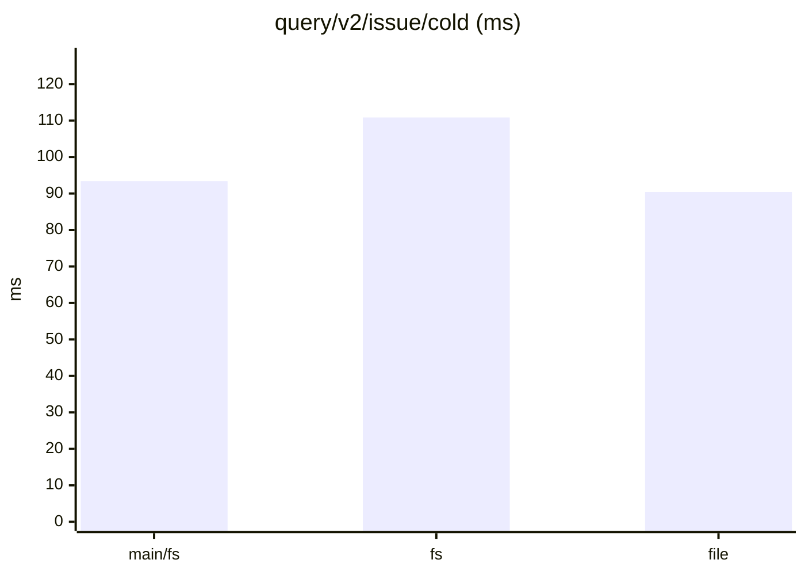
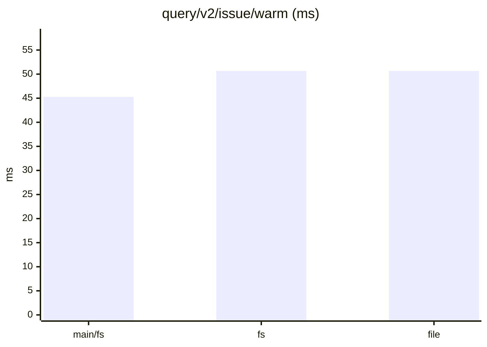
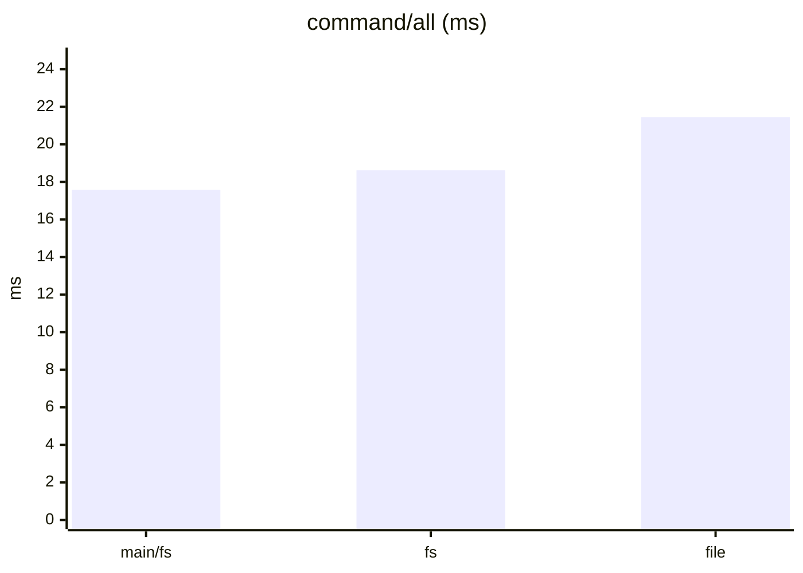
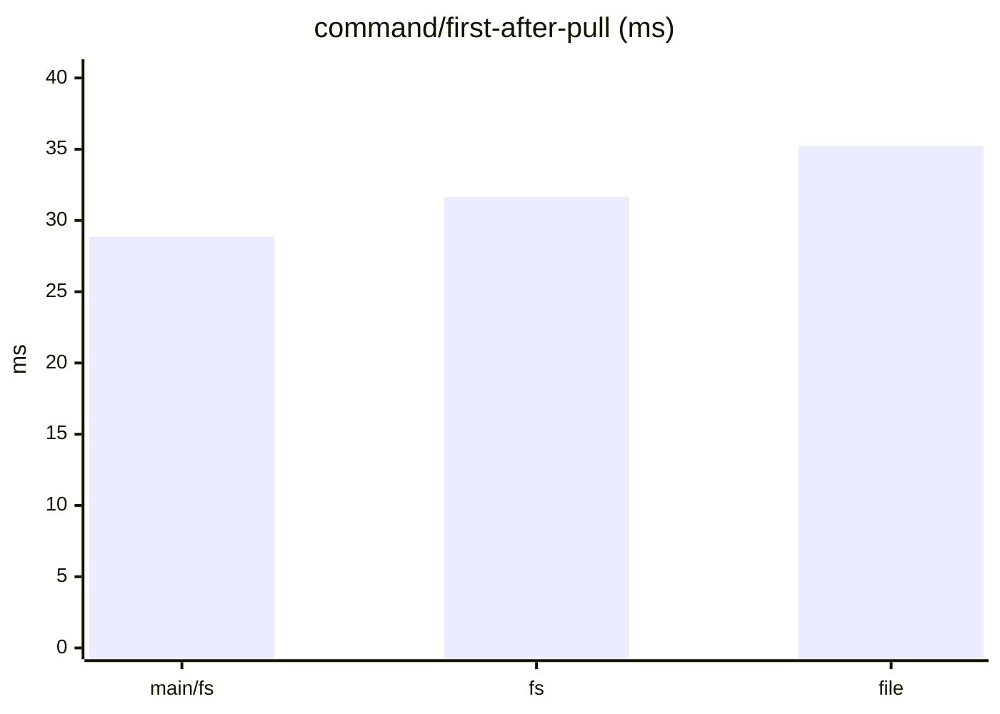
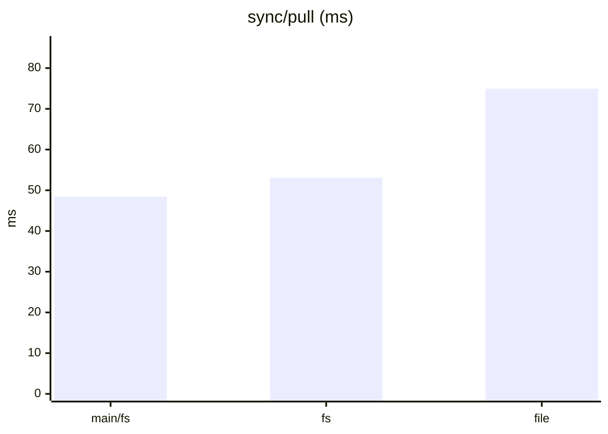
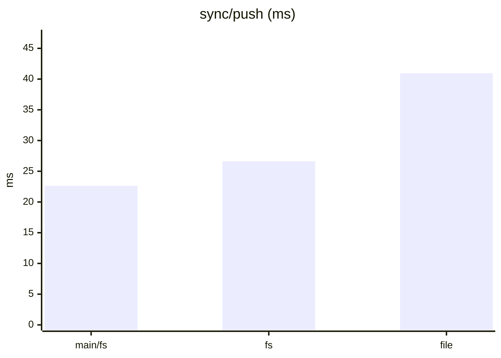
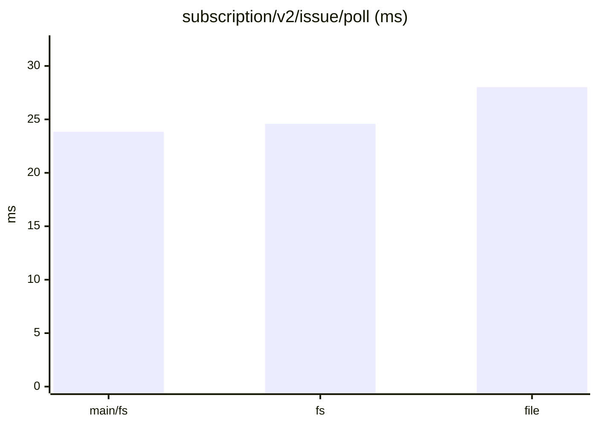
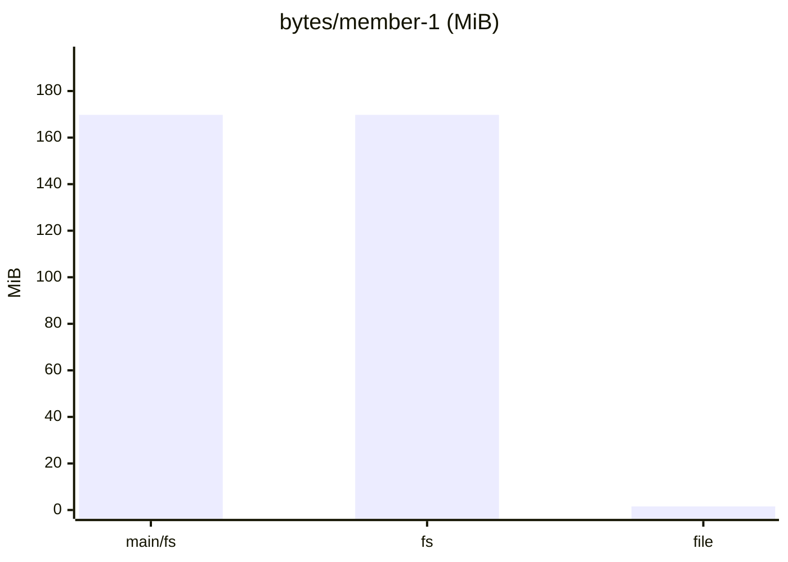

# tonk-shaped 1×, six members: main, the branch, and the file

From `tonk_bench` (see the [evaluation](../evaluation.md)): three runs each of `main/fs` (built from origin/main `5dbde9f` with `bench/main-baseline.sh`), `fs` (this branch, main's archive) and `file` (this branch, the single file with its index in memory), interleaved, in one sitting on one machine. Numbers from different sittings drift by up to 15%: compare within a report, not across.

Dataset `d02fd406dacb607d`. Runs per store: main/fs: 3, fs: 3, file: 3. Each cell is the median across runs of each run's median, with the lowest and highest run in brackets.

#### Queries, cold (a replica that just joined)

| measure | main/fs | fs | file | file ÷ main/fs |
|---|---|---|---|---|
| `query/v2/issue/cold` (ms) | 93.38 (85.59–97.06) | 110.84 (102.37–127.67) | 90.40 (88.09–93.72) | 0.97 |
| `query/v2/activity/cold` (ms) | 101.15 (97.14–128.36) | 117.32 (116.41–157.11) | 111.09 (109.45–114.12) | 1.10 |
| `query/issue-detail/cold` (ms) | 3.31 (3.30–3.69) | 4.31 (3.69–4.71) | 2.81 (2.80–2.89) | 0.85 |
| `query/memo/full/cold` (ms) | 5.01 (4.37–5.82) | 6.28 (4.87–6.93) | 3.83 (3.67–4.20) | 0.76 |
| `query/v2/issue-labels/cold` (ms) | 3.81 (2.78–4.03) | 4.03 (4.03–4.11) | 2.94 (2.69–3.19) | 0.77 |

#### Queries, warm

| measure | main/fs | fs | file | file ÷ main/fs |
|---|---|---|---|---|
| `query/v2/issue/warm` (ms) | 45.29 (44.05–56.01) | 50.66 (50.40–52.70) | 50.67 (49.26–51.39) | 1.12 |
| `query/v2/activity/warm` (ms) | 102.46 (98.71–143.60) | 110.14 (109.34–119.98) | 110.68 (107.50–112.31) | 1.08 |
| `query/issue-detail/warm` (ms) | 0.95 (0.88–1.40) | 1.16 (1.06–1.59) | 1.00 (1.00–1.05) | 1.05 |
| `query/memo/full/warm` (ms) | 1.95 (1.33–2.11) | 1.51 (1.45–2.18) | 1.46 (1.44–1.50) | 0.75 |
| `query/v2/issue-labels/warm` (ms) | 0.54 (0.53–0.55) | 0.53 (0.52–0.55) | 0.54 (0.53–0.55) | 1.00 |

#### Writes: one command a commit, its rules included

| measure | main/fs | fs | file | file ÷ main/fs |
|---|---|---|---|---|
| `command/all` (ms) | 17.58 (16.54–18.60) | 18.62 (18.06–20.16) | 21.45 (21.04–22.34) | 1.22 |
| `command/first-after-pull` (ms) | 28.86 (28.69–29.62) | 31.66 (31.22–33.36) | 35.23 (33.82–35.47) | 1.22 |
| `command/v2/issue-create` (ms) | 29.97 (28.55–30.58) | 31.69 (31.62–33.71) | 34.30 (33.79–35.66) | 1.14 |
| `command/memo/post` (ms) | 14.83 (13.61–15.23) | 13.61 (13.36–15.51) | 14.50 (12.19–17.44) | 0.98 |
| `command/v2/issue-post-comment` (ms) | 19.19 (18.02–20.08) | 19.24 (18.98–20.88) | 23.48 (22.78–23.70) | 1.22 |
| `command/v2/issue-set-status` (ms) | 25.57 (24.21–26.05) | 27.17 (26.96–27.98) | 31.55 (26.86–31.60) | 1.23 |

#### Sync

| measure | main/fs | fs | file | file ÷ main/fs |
|---|---|---|---|---|
| `join/pull` (ms) | 5.29 (2.47–5.40) | 8.74 (8.56–9.54) | 6.94 (2.69–7.03) | 1.31 |
| `sync/pull` (ms) | 48.43 (45.23–53.59) | 53.06 (51.08–58.42) | 74.94 (72.30–76.26) | 1.55 |
| `sync/push` (ms) | 22.64 (20.96–26.81) | 26.61 (23.64–29.52) | 40.96 (35.34–41.62) | 1.81 |
| `setup/push` (ms) | 103.29 (92.19–104.34) | 171.94 (159.74–194.50) | 95.17 (84.12–123.80) | 0.92 |

#### Subscriptions: a poll after each of the reader's pulls

| measure | main/fs | fs | file | file ÷ main/fs |
|---|---|---|---|---|
| `subscription/v2/issue/poll` (ms) | 23.84 (23.21–24.77) | 24.58 (24.24–26.98) | 28.02 (27.22–28.04) | 1.18 |
| `subscription/v2/activity/poll` (ms) | 31.15 (30.97–31.16) | 31.63 (29.35–32.97) | 31.30 (30.58–31.83) | 1.00 |
| `subscription/memo/full/poll` (ms) | 3.84 (3.61–4.01) | 3.75 (3.72–4.17) | 3.81 (3.63–4.17) | 0.99 |

#### Storage

| measure | main/fs | fs | file | file ÷ main/fs |
|---|---|---|---|---|
| `setup/owner-bytes` (MiB) | 74.42 (74.42–74.42) | 74.42 (74.42–74.42) | 0.92 (0.92–0.92) | 0.01 |
| `bytes/member-0` (MiB) | 217.26 (217.26–217.26) | 217.26 (217.26–217.26) | 1.88 (1.87–1.88) | 0.01 |
| `bytes/member-1` (MiB) | 169.78 (169.78–169.78) | 169.78 (169.78–169.78) | 1.53 (1.53–1.53) | 0.01 |
| `bytes/remote` (MiB) | 275.88 (275.88–275.88) | 275.88 (275.88–275.88) | 275.88 (275.88–275.88) | 1.00 |

#### Charts

