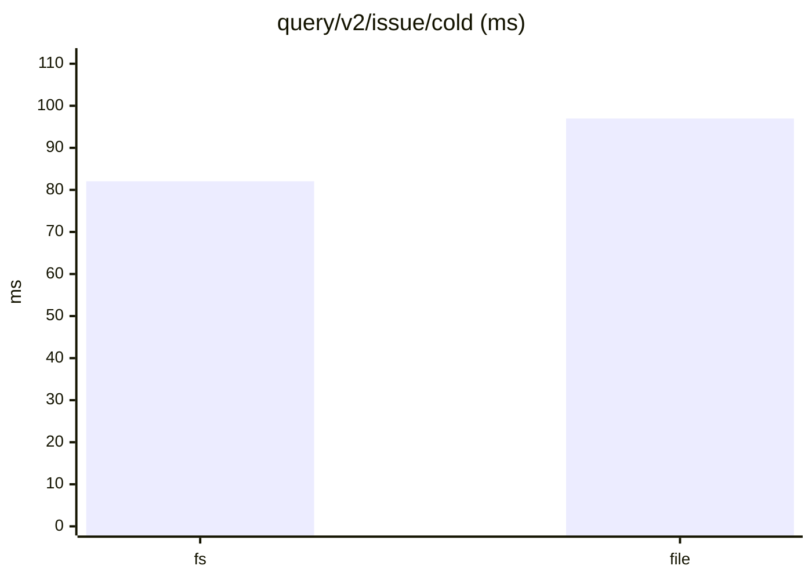
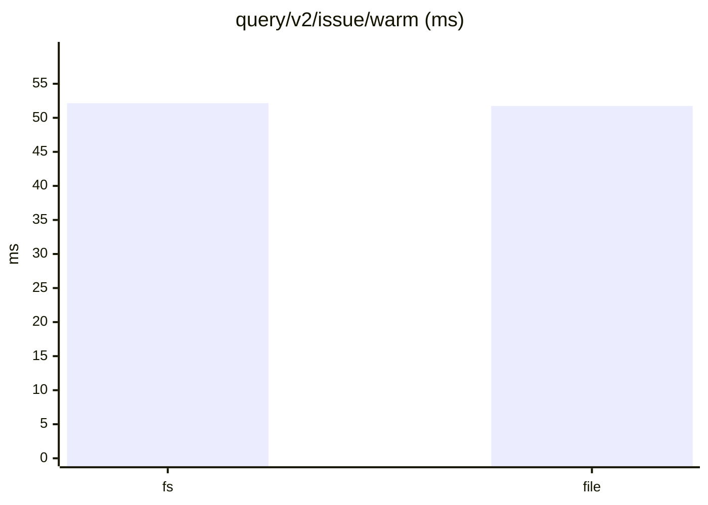
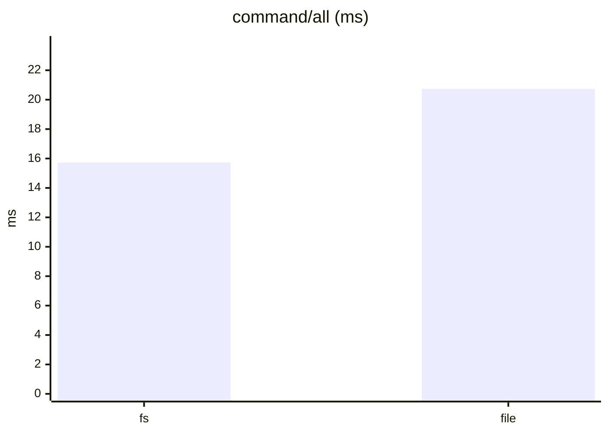
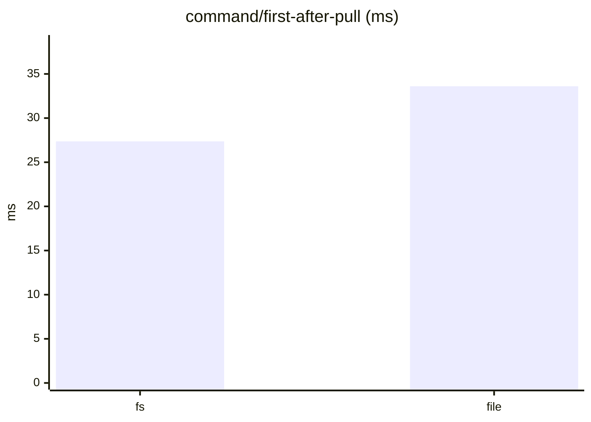
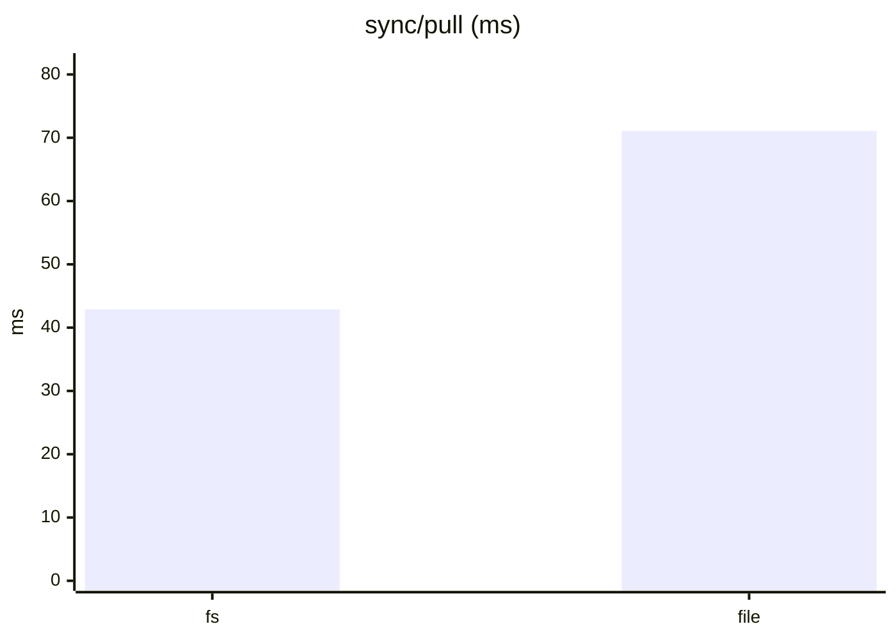
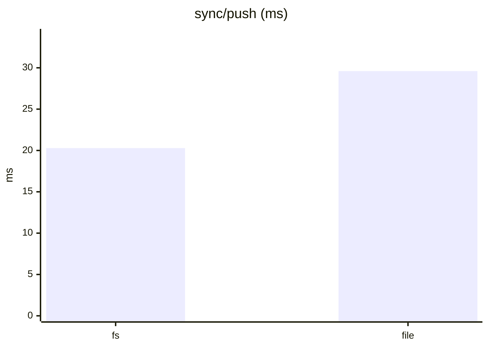
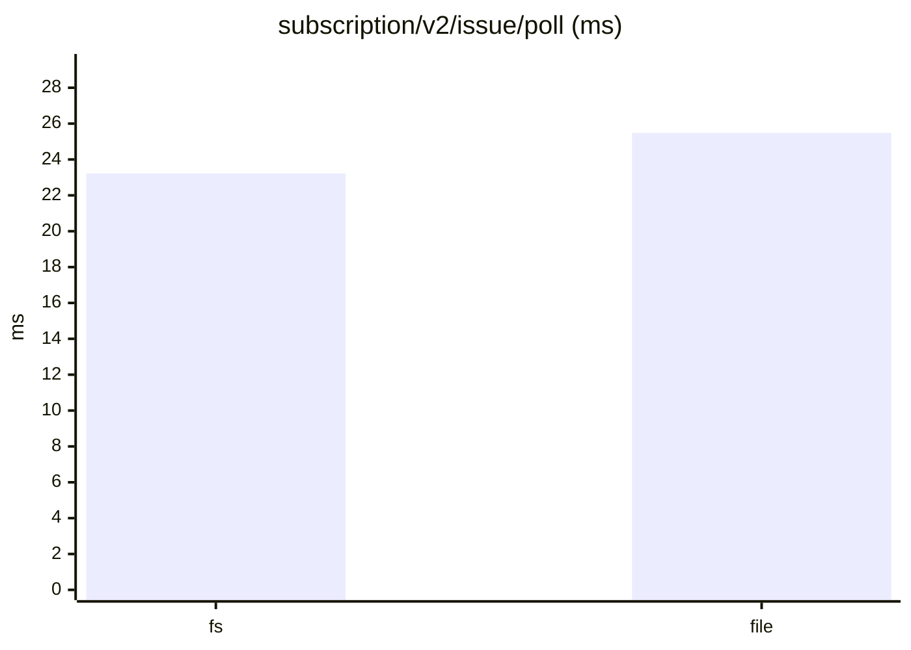
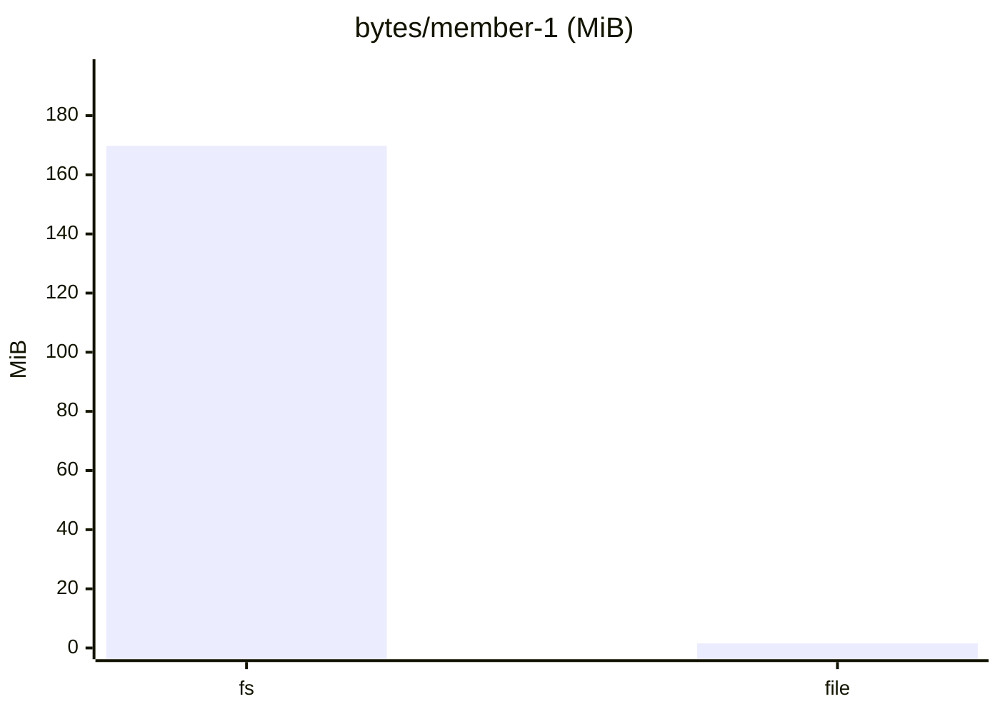

# tonk-shaped 1×, six members: fs against the file as built

From `tonk_bench` (see the [evaluation](../evaluation.md)), three runs of each store, interleaved, on one machine. `file` is the single file with its index in memory (`file/memory`); the in-file index layouts and main are not in this run.

Dataset `d02fd406dacb607d`. Runs per store: fs: 3, file: 3. Each cell is the median across runs of each run's median, with the lowest and highest run in brackets.

#### Queries, cold (a replica that just joined)

| measure | fs | file | file ÷ fs |
|---|---|---|---|
| `query/v2/issue/cold` (ms) | 82.05 (79.64–88.65) | 96.97 (85.66–97.69) | 1.18 |
| `query/v2/activity/cold` (ms) | 112.45 (109.88–112.96) | 110.29 (109.67–113.59) | 0.98 |
| `query/issue-detail/cold` (ms) | 2.97 (2.77–4.40) | 3.03 (2.68–3.04) | 1.02 |
| `query/memo/full/cold` (ms) | 3.63 (3.52–4.09) | 3.84 (3.84–4.00) | 1.06 |
| `query/v2/issue-labels/cold` (ms) | 3.16 (3.11–3.33) | 2.50 (2.46–2.52) | 0.79 |

#### Queries, warm

| measure | fs | file | file ÷ fs |
|---|---|---|---|
| `query/v2/issue/warm` (ms) | 52.15 (50.88–57.61) | 51.74 (50.94–52.98) | 0.99 |
| `query/v2/activity/warm` (ms) | 112.88 (110.43–120.88) | 111.18 (110.09–112.03) | 0.98 |
| `query/issue-detail/warm` (ms) | 1.04 (1.01–1.14) | 1.01 (1.00–1.10) | 0.98 |
| `query/memo/full/warm` (ms) | 1.45 (1.42–1.47) | 1.56 (1.52–1.58) | 1.07 |
| `query/v2/issue-labels/warm` (ms) | 0.52 (0.50–0.53) | 0.53 (0.53–0.54) | 1.02 |

#### Writes: one command a commit, its rules included

| measure | fs | file | file ÷ fs |
|---|---|---|---|
| `command/all` (ms) | 15.73 (15.14–16.67) | 20.74 (20.53–21.74) | 1.32 |
| `command/first-after-pull` (ms) | 27.36 (26.94–30.57) | 33.61 (32.23–35.10) | 1.23 |
| `command/v2/issue-create` (ms) | 27.66 (27.16–30.83) | 33.73 (32.50–33.84) | 1.22 |
| `command/memo/post` (ms) | 11.67 (11.05–18.66) | 12.38 (11.57–12.55) | 1.06 |
| `command/v2/issue-post-comment` (ms) | 17.13 (15.88–19.42) | 23.22 (22.31–23.34) | 1.36 |
| `command/v2/issue-set-status` (ms) | 22.54 (22.31–26.12) | 28.37 (28.03–28.88) | 1.26 |

#### Sync

| measure | fs | file | file ÷ fs |
|---|---|---|---|
| `join/pull` (ms) | 2.41 (2.38–2.52) | 2.05 (1.88–2.67) | 0.85 |
| `sync/pull` (ms) | 42.89 (41.30–45.25) | 71.10 (68.77–72.20) | 1.66 |
| `sync/push` (ms) | 20.29 (19.87–21.48) | 29.60 (28.05–29.98) | 1.46 |
| `setup/push` (ms) | 80.87 (79.78–87.32) | 80.87 (80.54–84.25) | 1.00 |

#### Subscriptions: a poll after each of the reader's pulls

| measure | fs | file | file ÷ fs |
|---|---|---|---|
| `subscription/v2/issue/poll` (ms) | 23.22 (22.35–24.14) | 25.48 (25.16–26.27) | 1.10 |
| `subscription/v2/activity/poll` (ms) | 29.64 (29.57–31.28) | 29.23 (28.80–29.35) | 0.99 |
| `subscription/memo/full/poll` (ms) | 3.70 (3.66–4.11) | 3.81 (3.58–3.87) | 1.03 |

#### Storage

| measure | fs | file | file ÷ fs |
|---|---|---|---|
| `setup/owner-bytes` (MiB) | 74.42 (74.42–74.42) | 0.92 (0.92–0.92) | 0.01 |
| `bytes/member-0` (MiB) | 217.26 (217.26–217.26) | 1.87 (1.87–1.87) | 0.01 |
| `bytes/member-1` (MiB) | 169.78 (169.78–169.78) | 1.53 (1.53–1.53) | 0.01 |
| `bytes/remote` (MiB) | 275.88 (275.88–275.88) | 275.88 (275.88–275.88) | 1.00 |

#### Charts

