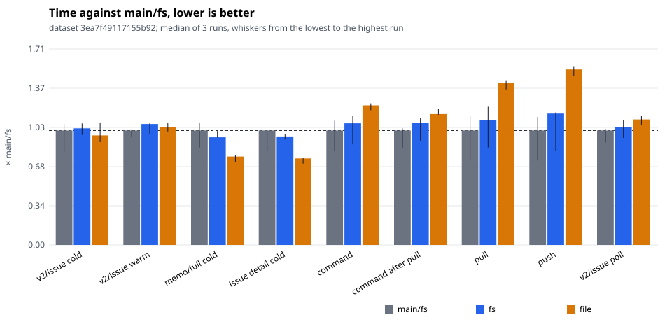
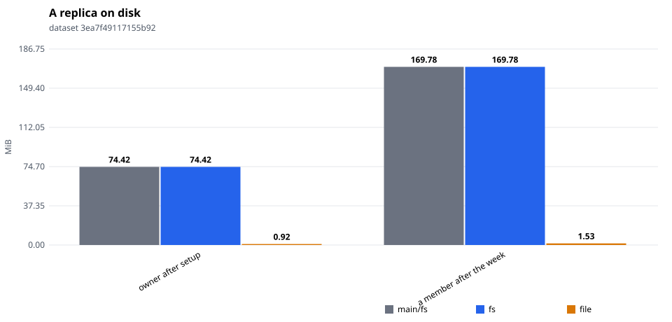
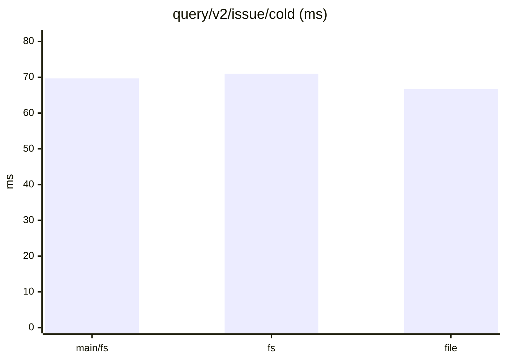
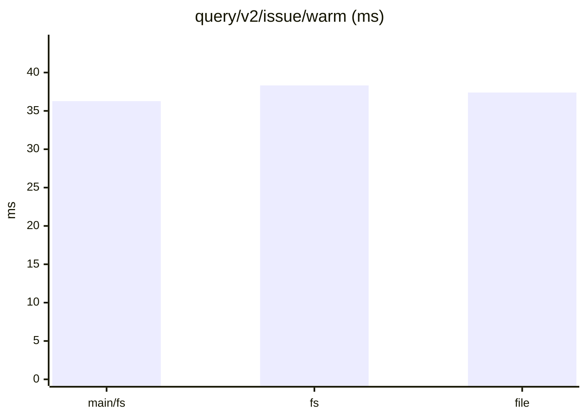
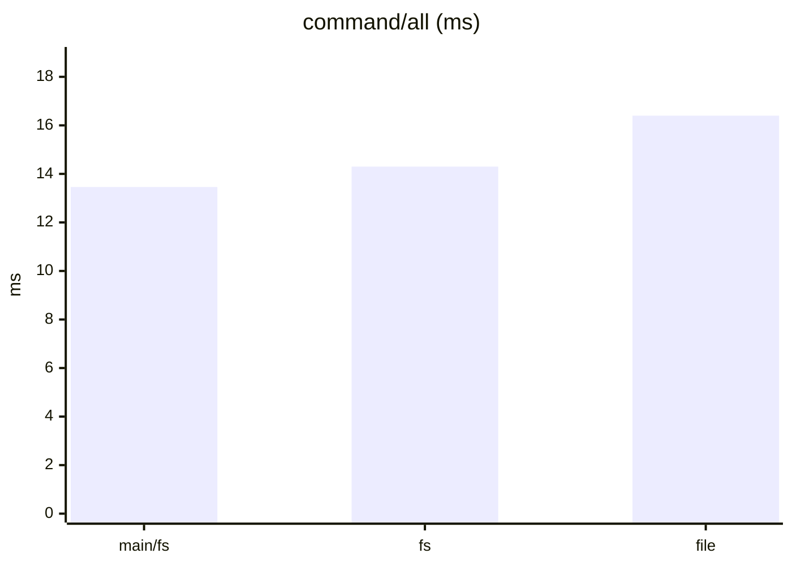
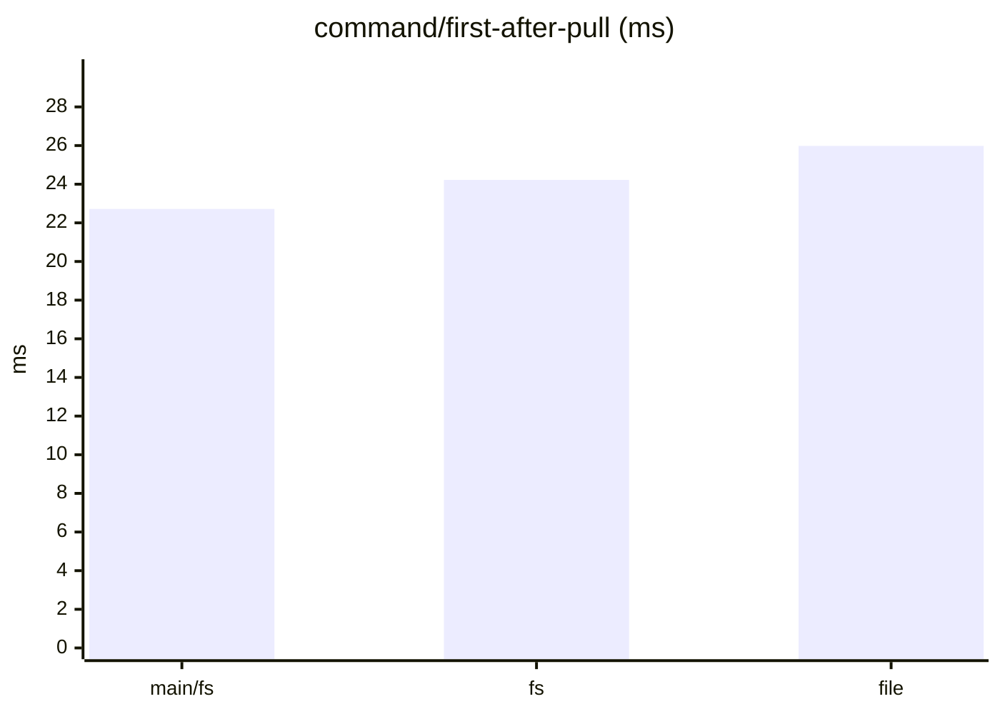
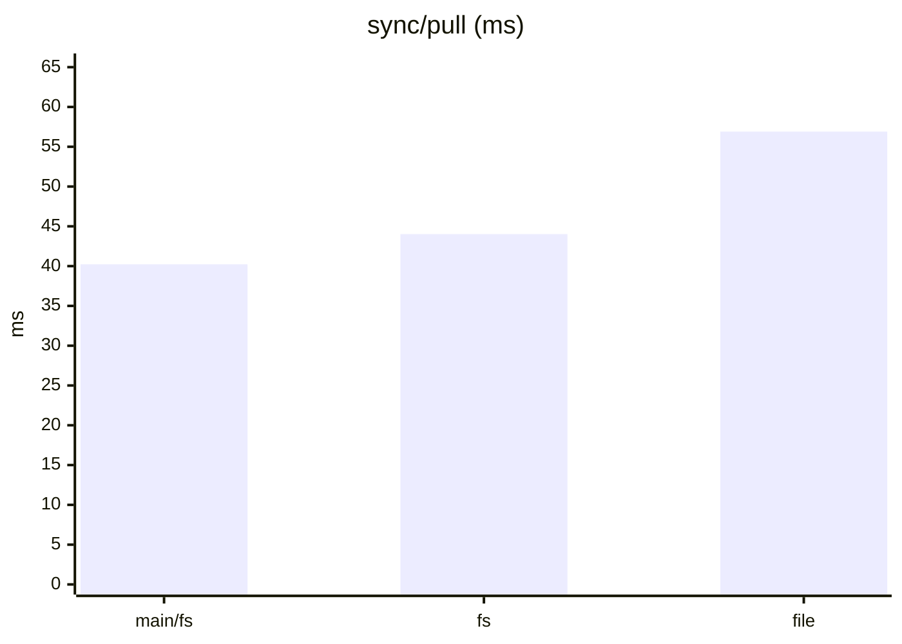
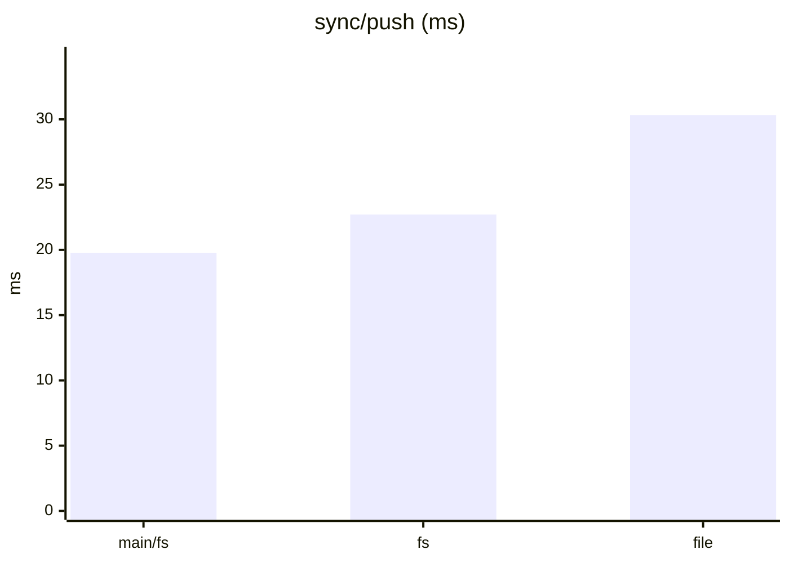
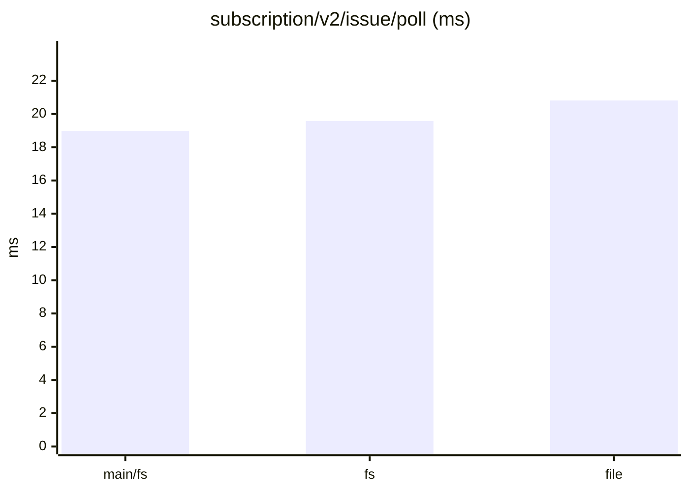
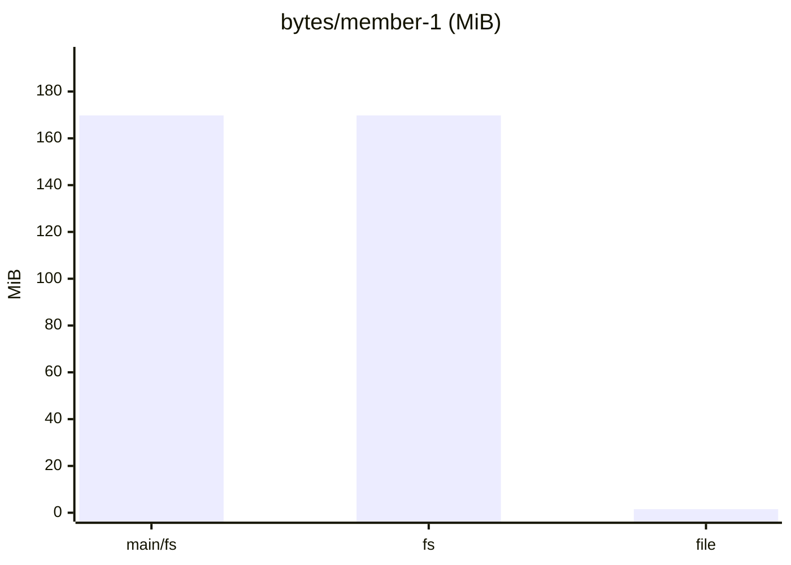

# tonk-shaped 1×, six members: main, the branch, and the file (after the read-path fix)

From `tonk_bench`: three runs each of `main/fs` (origin/main `9b98395`, built with `bench/main-baseline.sh`), `fs` (this branch, main's archive) and `file` (this branch, the single file, its index in memory), interleaved, in one sitting on one machine. The branch has the node-source lookup on a cache miss only and the node as its block or its rows.

Dataset `3ea7f49117155b92`. Runs per store: main/fs: 3, fs: 3, file: 3. Each cell is the median across runs of each run's median, with the lowest and highest run in brackets.

#### Queries, cold (a replica that just joined)

| measure | main/fs | fs | file | file ÷ main/fs |
|---|---|---|---|---|
| `query/v2/issue/cold` (ms) | 69.69 (56.85–73.46) | 71.00 (67.01–73.99) | 66.69 (62.62–74.56) | 0.96 |
| `query/v2/activity/cold` (ms) | 78.53 (72.52–82.87) | 83.44 (77.63–84.03) | 81.18 (80.50–81.84) | 1.03 |
| `query/issue-detail/cold` (ms) | 2.69 (2.21–2.70) | 2.55 (2.48–2.60) | 2.04 (1.91–2.06) | 0.76 |
| `query/memo/full/cold` (ms) | 3.83 (3.26–4.08) | 3.60 (3.59–3.81) | 2.96 (2.76–3.00) | 0.77 |
| `query/v2/issue-labels/cold` (ms) | 3.02 (1.61–3.73) | 3.24 (2.82–3.96) | 2.11 (1.80–3.26) | 0.70 |

#### Queries, warm

| measure | main/fs | fs | file | file ÷ main/fs |
|---|---|---|---|---|
| `query/v2/issue/warm` (ms) | 36.27 (34.12–36.63) | 38.32 (35.24–38.55) | 37.39 (35.95–38.59) | 1.03 |
| `query/v2/activity/warm` (ms) | 79.45 (70.61–85.45) | 80.35 (76.52–82.44) | 77.11 (74.05–78.25) | 0.97 |
| `query/issue-detail/warm` (ms) | 0.71 (0.64–0.75) | 0.76 (0.69–0.80) | 0.68 (0.66–0.78) | 0.96 |
| `query/memo/full/warm` (ms) | 1.14 (0.97–1.29) | 1.17 (1.16–1.21) | 0.99 (0.98–1.17) | 0.87 |
| `query/v2/issue-labels/warm` (ms) | 0.38 (0.37–0.44) | 0.44 (0.43–0.45) | 0.38 (0.37–0.44) | 1.00 |

#### Writes: one command a commit, its rules included

| measure | main/fs | fs | file | file ÷ main/fs |
|---|---|---|---|---|
| `command/all` (ms) | 13.46 (11.09–14.60) | 14.30 (11.83–15.17) | 16.40 (15.84–16.65) | 1.22 |
| `command/first-after-pull` (ms) | 22.72 (19.15–23.14) | 24.22 (20.72–25.25) | 25.98 (25.84–27.05) | 1.14 |
| `command/v2/issue-create` (ms) | 22.05 (19.04–23.89) | 24.53 (19.33–24.60) | 26.22 (25.14–27.10) | 1.19 |
| `command/memo/post` (ms) | 9.29 (8.43–9.50) | 8.73 (8.51–8.84) | 11.19 (10.30–11.43) | 1.20 |
| `command/v2/issue-post-comment` (ms) | 14.62 (12.08–16.44) | 14.83 (12.01–15.09) | 17.95 (17.11–18.48) | 1.23 |
| `command/v2/issue-set-status` (ms) | 18.40 (16.41–19.66) | 18.69 (18.63–19.71) | 22.39 (21.65–22.50) | 1.22 |

#### Sync

| measure | main/fs | fs | file | file ÷ main/fs |
|---|---|---|---|---|
| `join/pull` (ms) | 5.36 (1.68–5.71) | 5.37 (4.91–5.68) | 4.98 (4.70–5.30) | 0.93 |
| `sync/pull` (ms) | 40.23 (29.68–45.18) | 44.02 (34.29–48.58) | 56.90 (54.63–57.64) | 1.41 |
| `sync/push` (ms) | 19.78 (14.60–22.12) | 22.71 (16.21–22.91) | 30.33 (29.16–30.78) | 1.53 |
| `setup/push` (ms) | 116.03 (59.05–125.60) | 121.26 (108.38–125.75) | 117.84 (83.12–118.12) | 1.02 |

#### Subscriptions: a poll after each of the reader's pulls

| measure | main/fs | fs | file | file ÷ main/fs |
|---|---|---|---|---|
| `subscription/v2/issue/poll` (ms) | 18.98 (16.99–19.23) | 19.58 (17.75–20.67) | 20.81 (19.86–21.40) | 1.10 |
| `subscription/v2/activity/poll` (ms) | 22.59 (21.60–25.29) | 22.85 (22.58–23.43) | 22.43 (22.39–23.48) | 0.99 |
| `subscription/memo/full/poll` (ms) | 2.89 (2.58–3.31) | 3.09 (2.82–3.11) | 2.97 (2.86–3.04) | 1.03 |

#### Storage

| measure | main/fs | fs | file | file ÷ main/fs |
|---|---|---|---|---|
| `setup/owner-bytes` (MiB) | 74.42 (74.42–74.42) | 74.42 (74.42–74.42) | 0.92 (0.92–0.92) | 0.01 |
| `bytes/member-0` (MiB) | 217.26 (217.26–217.26) | 217.26 (217.26–217.26) | 1.87 (1.87–1.88) | 0.01 |
| `bytes/member-1` (MiB) | 169.78 (169.78–169.78) | 169.78 (169.78–169.78) | 1.53 (1.53–1.53) | 0.01 |
| `bytes/remote` (MiB) | 275.88 (275.88–275.88) | 275.88 (275.88–275.88) | 275.88 (275.88–275.88) | 1.00 |

#### Charts

