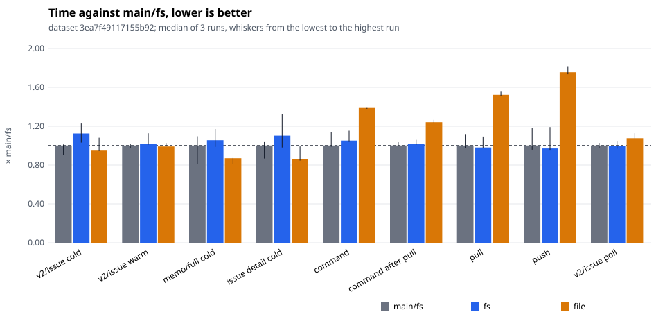
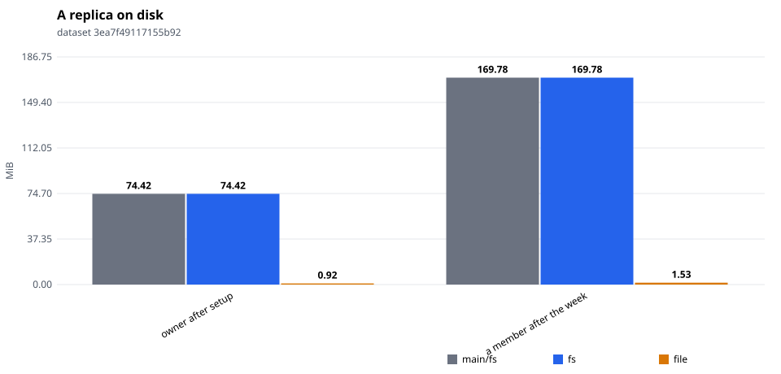
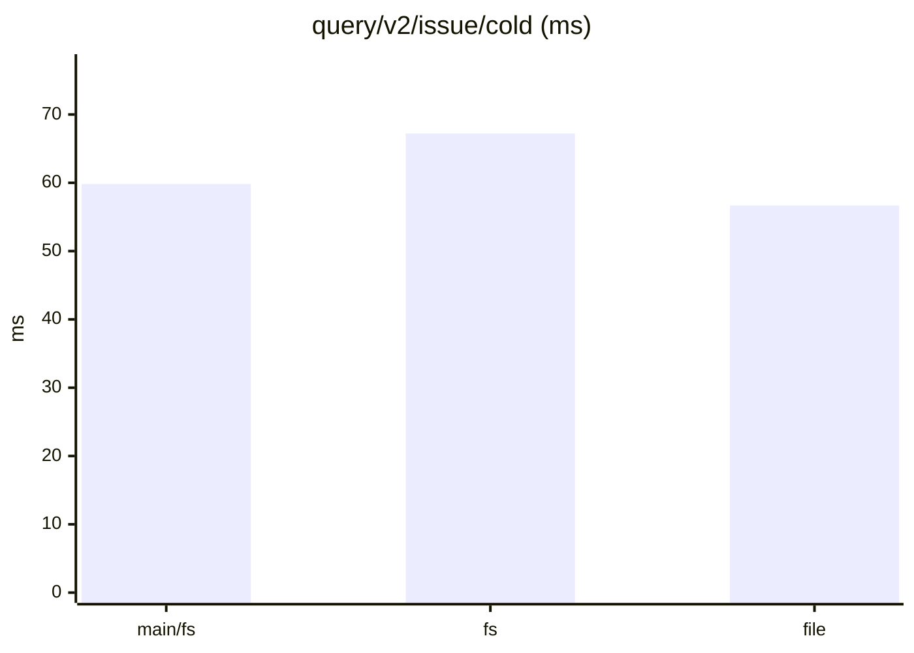
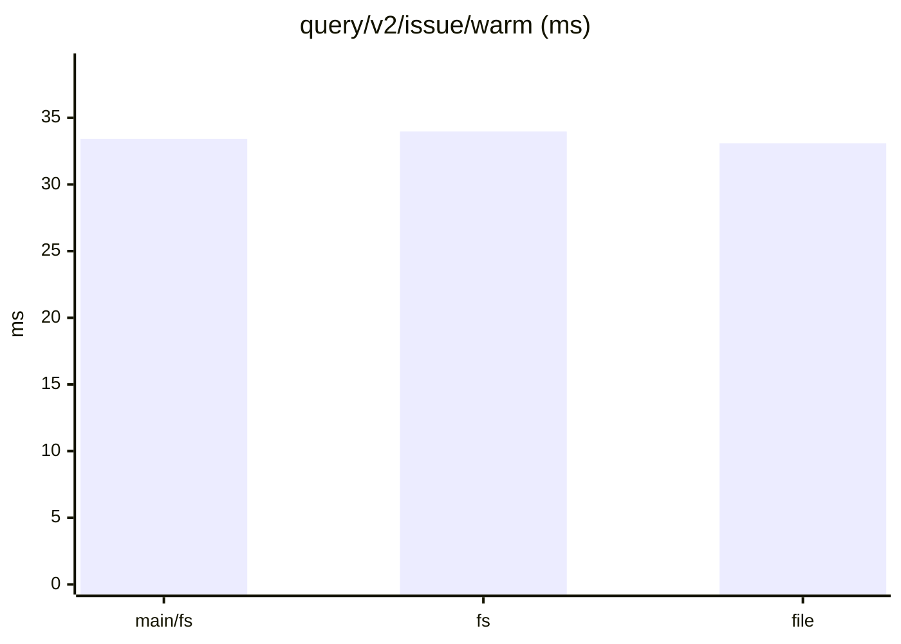
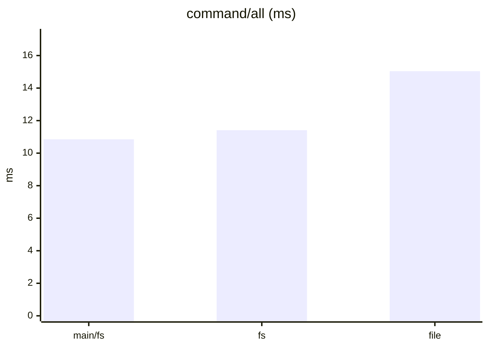
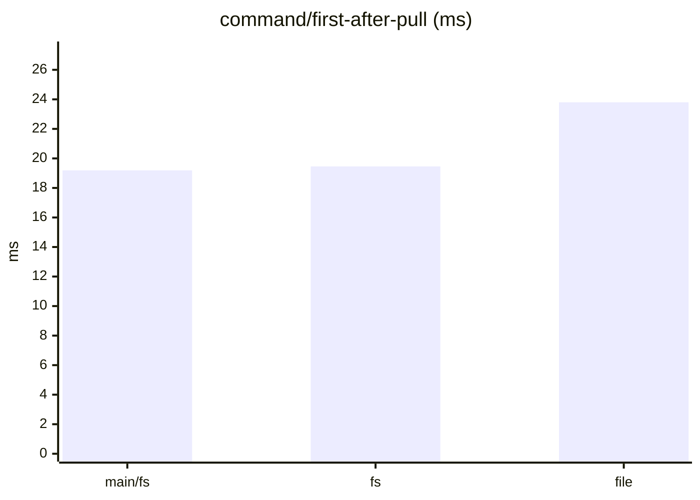
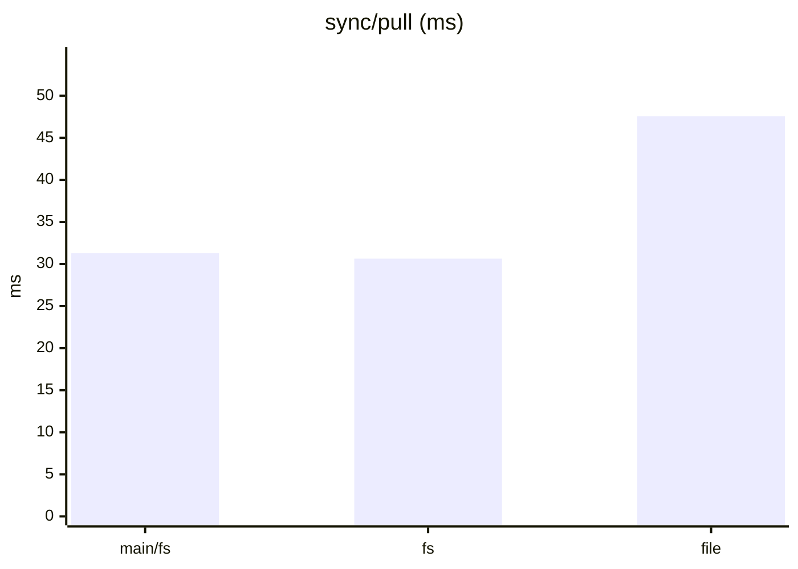
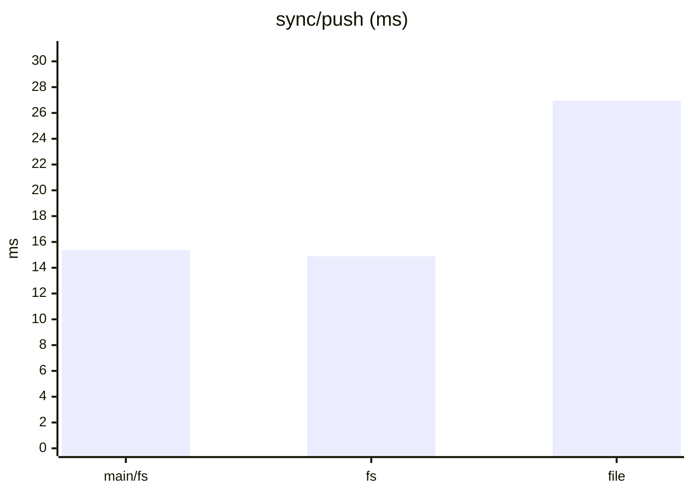
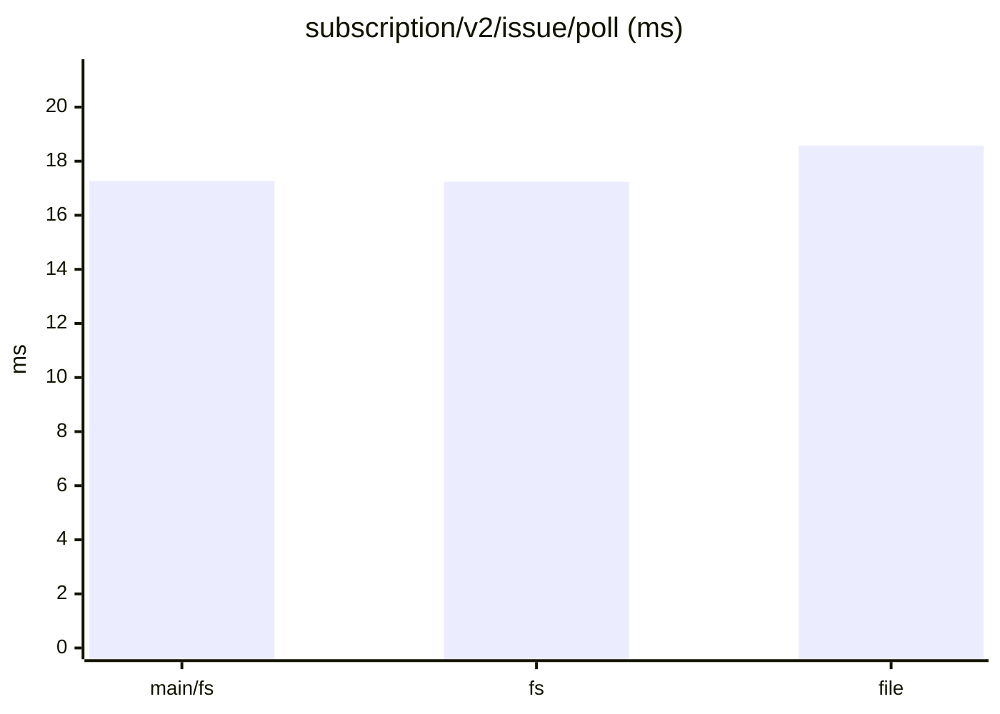
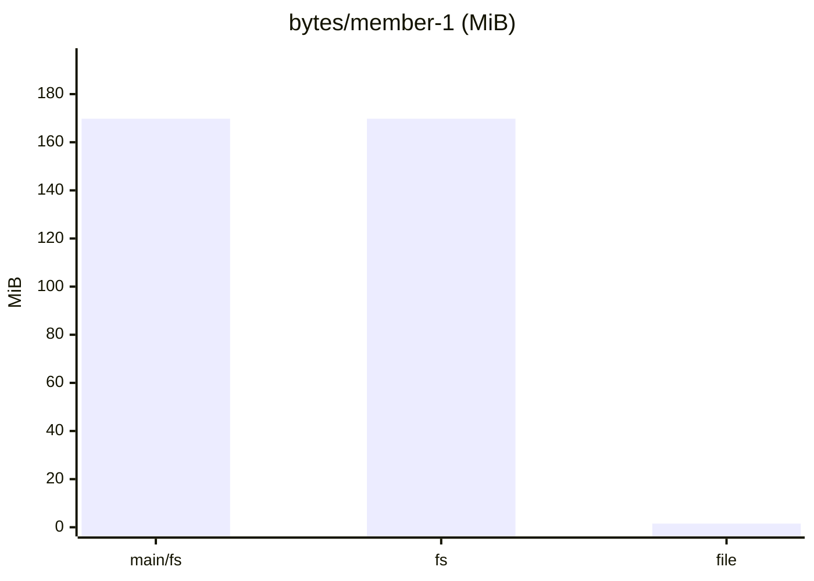

# tonk-shaped 1×, six members: after serving in place and halving the split

Three interleaved runs each of `main/fs` (origin/main `9b98395`), `fs` and `file` (this branch at `b166bcb`; the file serves nodes in place). One sitting; compare within it, not with other sittings.

Dataset `3ea7f49117155b92`. Runs per store: main/fs: 3, fs: 3, file: 3. Each cell is the median across runs of each run's median, with the lowest and highest run in brackets.

#### Queries, cold (a replica that just joined)

| measure | main/fs | fs | file | file ÷ main/fs |
|---|---|---|---|---|
| `query/v2/issue/cold` (ms) | 59.83 (54.15–60.51) | 67.22 (61.65–73.37) | 56.68 (56.40–64.63) | 0.95 |
| `query/v2/activity/cold` (ms) | 74.36 (70.36–79.43) | 86.11 (74.48–95.08) | 73.36 (70.30–74.54) | 0.99 |
| `query/issue-detail/cold` (ms) | 2.12 (1.83–2.19) | 2.33 (2.07–2.80) | 1.83 (1.79–2.10) | 0.86 |
| `query/memo/full/cold` (ms) | 3.35 (2.71–3.67) | 3.53 (3.30–3.92) | 2.91 (2.72–2.92) | 0.87 |
| `query/v2/issue-labels/cold` (ms) | 2.68 (1.84–6.12) | 2.67 (2.35–2.84) | 1.65 (1.64–2.26) | 0.62 |

#### Queries, warm

| measure | main/fs | fs | file | file ÷ main/fs |
|---|---|---|---|---|
| `query/v2/issue/warm` (ms) | 33.41 (32.51–34.08) | 33.97 (33.72–37.62) | 33.09 (33.07–34.27) | 0.99 |
| `query/v2/activity/warm` (ms) | 75.35 (72.04–75.45) | 74.66 (70.74–83.85) | 72.64 (70.97–74.51) | 0.96 |
| `query/issue-detail/warm` (ms) | 0.66 (0.63–0.74) | 0.66 (0.64–0.79) | 0.65 (0.62–0.75) | 0.98 |
| `query/memo/full/warm` (ms) | 0.95 (0.94–1.32) | 0.99 (0.98–1.29) | 1.14 (1.00–1.15) | 1.19 |
| `query/v2/issue-labels/warm` (ms) | 0.42 (0.41–0.43) | 0.44 (0.43–0.44) | 0.43 (0.43–0.44) | 1.02 |

#### Writes: one command a commit, its rules included

| measure | main/fs | fs | file | file ÷ main/fs |
|---|---|---|---|---|
| `command/all` (ms) | 10.85 (10.73–12.37) | 11.41 (11.26–12.50) | 15.04 (14.95–15.05) | 1.39 |
| `command/first-after-pull` (ms) | 19.19 (19.03–19.84) | 19.46 (19.32–20.32) | 23.80 (23.55–24.27) | 1.24 |
| `command/v2/issue-create` (ms) | 18.96 (18.78–20.74) | 19.52 (18.86–21.49) | 23.04 (22.34–23.21) | 1.22 |
| `command/memo/post` (ms) | 7.86 (7.86–11.22) | 10.19 (7.86–11.60) | 10.17 (10.15–11.64) | 1.29 |
| `command/v2/issue-post-comment` (ms) | 12.56 (12.34–13.32) | 12.05 (12.04–12.83) | 16.10 (15.46–16.85) | 1.28 |
| `command/v2/issue-set-status` (ms) | 17.30 (15.83–17.50) | 16.73 (16.22–18.26) | 20.74 (20.03–20.91) | 1.20 |

#### Sync

| measure | main/fs | fs | file | file ÷ main/fs |
|---|---|---|---|---|
| `join/pull` (ms) | 4.24 (1.86–4.49) | 5.03 (4.64–5.29) | 5.78 (5.77–6.23) | 1.36 |
| `sync/pull` (ms) | 31.28 (30.58–34.97) | 30.64 (30.51–34.17) | 47.57 (47.09–48.80) | 1.52 |
| `sync/push` (ms) | 15.36 (14.69–18.18) | 14.89 (14.57–18.28) | 26.93 (26.61–27.89) | 1.75 |
| `setup/push` (ms) | 100.92 (59.65–108.50) | 105.86 (103.92–119.35) | 125.06 (120.74–130.89) | 1.24 |

#### Subscriptions: a poll after each of the reader's pulls

| measure | main/fs | fs | file | file ÷ main/fs |
|---|---|---|---|---|
| `subscription/v2/issue/poll` (ms) | 17.27 (16.87–17.73) | 17.24 (16.69–17.98) | 18.57 (18.54–19.46) | 1.08 |
| `subscription/v2/activity/poll` (ms) | 21.11 (20.96–22.70) | 22.04 (20.72–22.38) | 21.16 (21.03–22.68) | 1.00 |
| `subscription/memo/full/poll` (ms) | 2.75 (2.72–2.86) | 2.80 (2.68–2.84) | 2.63 (2.60–2.83) | 0.96 |

#### Storage

| measure | main/fs | fs | file | file ÷ main/fs |
|---|---|---|---|---|
| `setup/owner-bytes` (MiB) | 74.42 (74.42–74.42) | 74.42 (74.42–74.42) | 0.92 (0.92–0.92) | 0.01 |
| `bytes/member-0` (MiB) | 217.26 (217.26–217.26) | 217.26 (217.26–217.26) | 1.87 (1.87–1.88) | 0.01 |
| `bytes/member-1` (MiB) | 169.78 (169.78–169.78) | 169.78 (169.78–169.78) | 1.53 (1.53–1.53) | 0.01 |
| `bytes/remote` (MiB) | 275.88 (275.88–275.88) | 275.88 (275.88–275.88) | 275.88 (275.88–275.88) | 1.00 |

#### Charts

