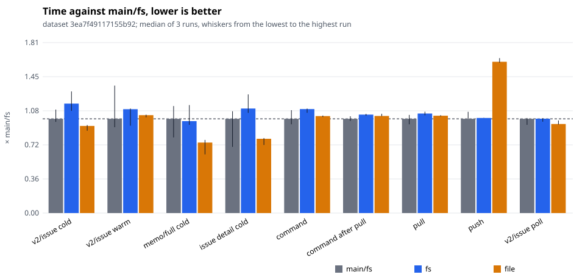
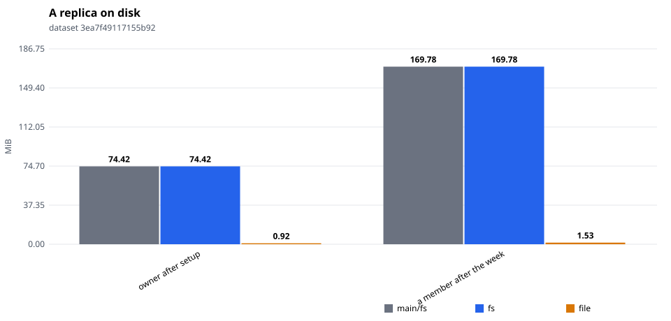
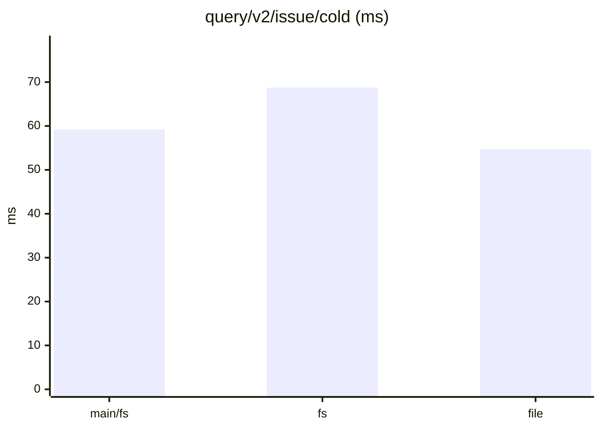
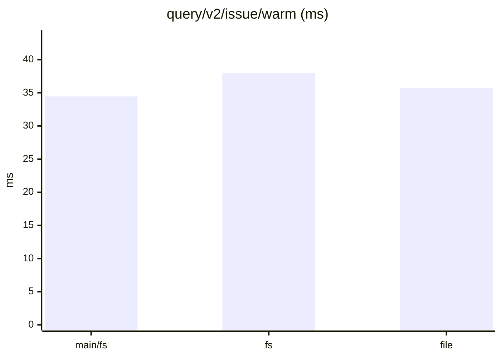
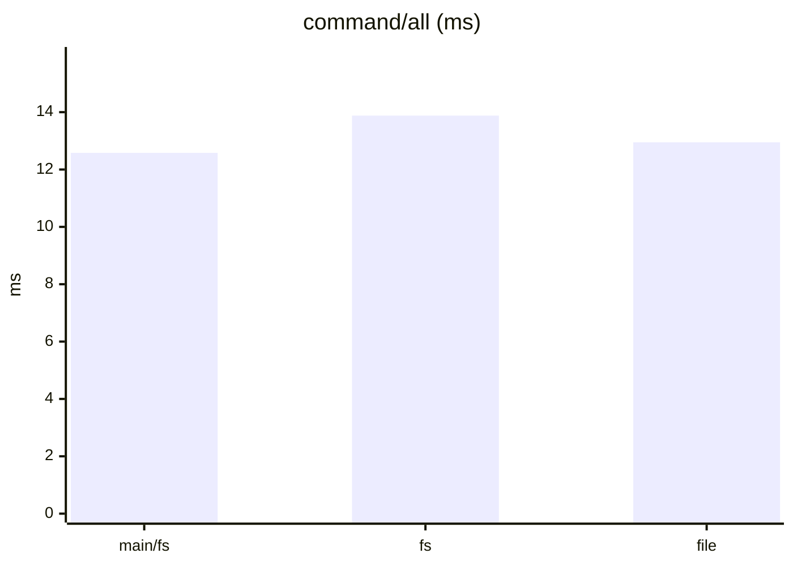
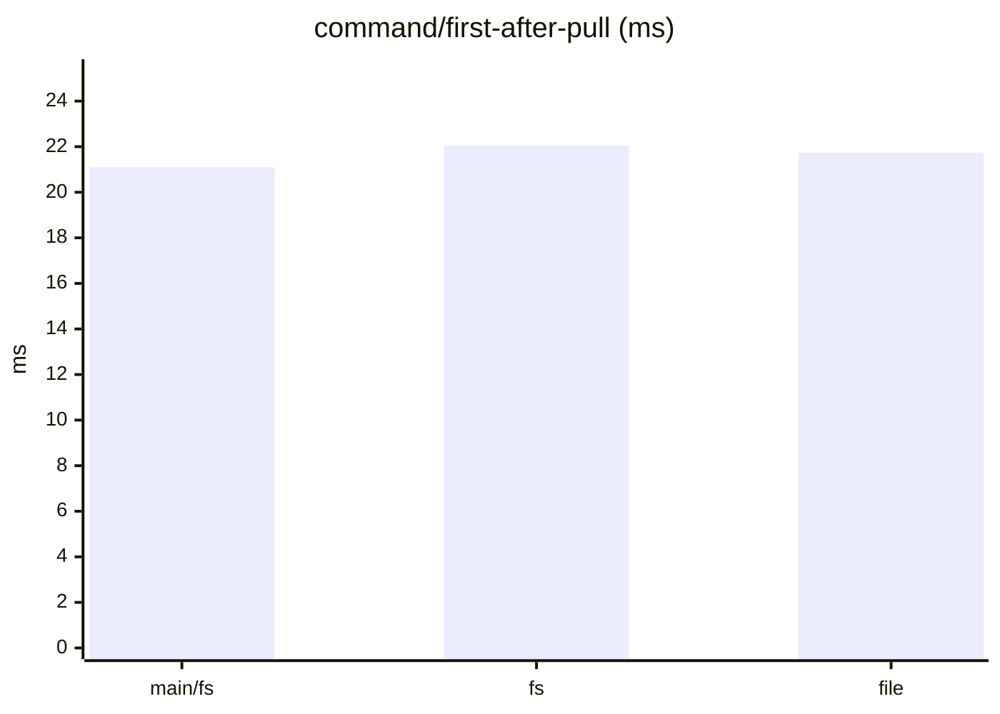
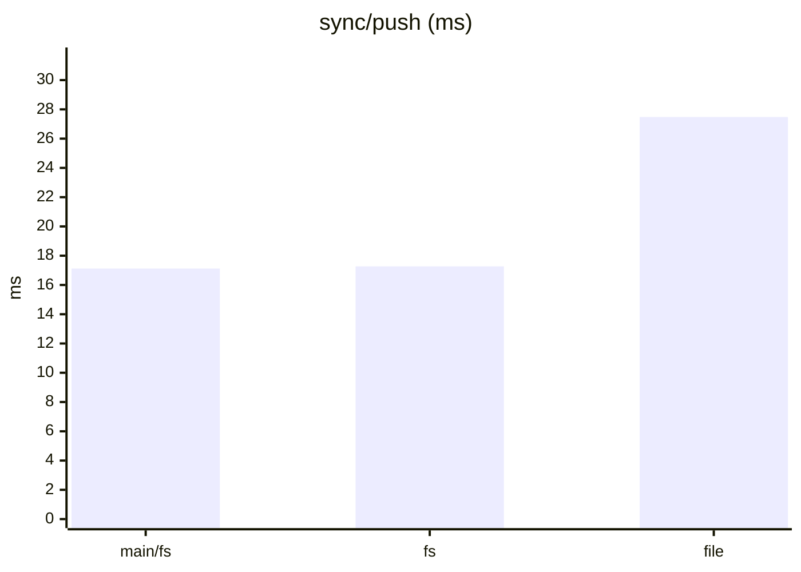
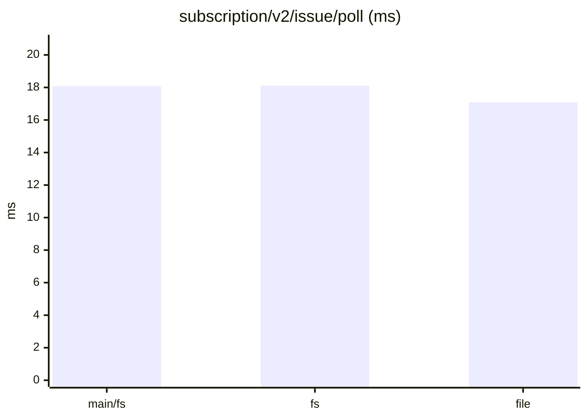
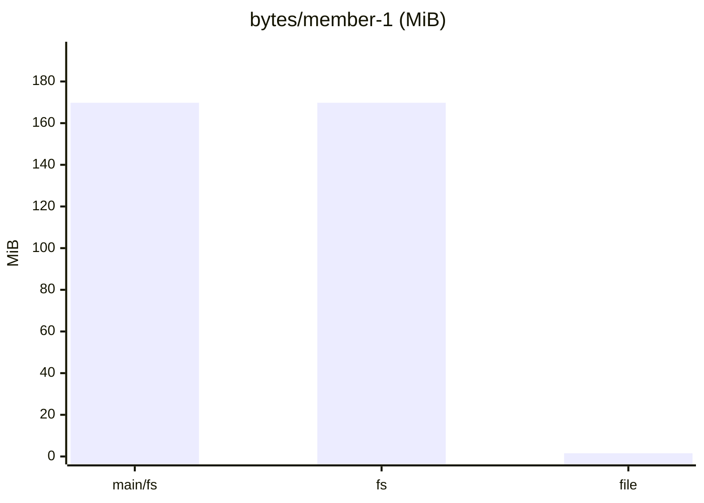

# tonk-shaped 1×, six members: after the second encode went

Three interleaved runs each of `main/fs` (origin/main `9b98395`), `fs` and `file` (this branch at `1c84661`: nodes served in place, the split's serializer reused, a frame's block rebuilt to check it only when verifying). One sitting; compare within it.

Dataset `3ea7f49117155b92`. Runs per store: main/fs: 3, fs: 3, file: 3. Each cell is the median across runs of each run's median, with the lowest and highest run in brackets.

#### Queries, cold (a replica that just joined)

| measure | main/fs | fs | file | file ÷ main/fs |
|---|---|---|---|---|
| `query/v2/issue/cold` (ms) | 59.19 (57.28–65.01) | 68.73 (64.19–76.37) | 54.72 (51.70–55.28) | 0.92 |
| `query/v2/activity/cold` (ms) | 82.16 (71.64–82.20) | 82.19 (73.40–86.48) | 71.22 (70.04–76.78) | 0.87 |
| `query/issue-detail/cold` (ms) | 2.53 (1.77–2.73) | 2.80 (2.69–3.18) | 1.99 (1.83–2.01) | 0.79 |
| `query/memo/full/cold` (ms) | 3.71 (2.97–4.21) | 3.61 (3.47–4.25) | 2.77 (2.31–2.87) | 0.75 |
| `query/v2/issue-labels/cold` (ms) | 2.71 (2.43–4.02) | 2.94 (2.81–3.11) | 1.57 (1.56–1.84) | 0.58 |

#### Queries, warm

| measure | main/fs | fs | file | file ÷ main/fs |
|---|---|---|---|---|
| `query/v2/issue/warm` (ms) | 34.46 (31.37–46.59) | 37.97 (31.93–38.21) | 35.77 (35.01–35.95) | 1.04 |
| `query/v2/activity/warm` (ms) | 78.25 (68.26–80.27) | 77.92 (74.69–82.05) | 75.10 (71.41–76.38) | 0.96 |
| `query/issue-detail/warm` (ms) | 0.65 (0.61–0.76) | 0.74 (0.74–0.78) | 0.76 (0.74–0.77) | 1.18 |
| `query/memo/full/warm` (ms) | 1.13 (0.97–1.27) | 1.08 (0.98–1.18) | 1.00 (0.98–1.15) | 0.88 |
| `query/v2/issue-labels/warm` (ms) | 0.45 (0.39–0.58) | 0.43 (0.40–0.44) | 0.43 (0.38–0.43) | 0.95 |

#### Writes: one command a commit, its rules included

| measure | main/fs | fs | file | file ÷ main/fs |
|---|---|---|---|---|
| `command/all` (ms) | 12.58 (11.85–13.73) | 13.88 (13.39–13.95) | 12.95 (12.82–13.02) | 1.03 |
| `command/first-after-pull` (ms) | 21.10 (20.63–21.66) | 22.04 (21.78–22.21) | 21.74 (21.67–22.23) | 1.03 |
| `command/v2/issue-create` (ms) | 20.94 (20.94–23.35) | 23.39 (22.13–23.70) | 20.99 (20.00–21.46) | 1.00 |
| `command/memo/post` (ms) | 9.47 (9.38–9.76) | 9.90 (9.48–13.76) | 8.96 (8.81–11.23) | 0.95 |
| `command/v2/issue-post-comment` (ms) | 14.28 (13.65–15.05) | 14.58 (13.99–15.38) | 13.78 (13.77–14.33) | 0.96 |
| `command/v2/issue-set-status` (ms) | 18.97 (18.50–19.06) | 18.52 (18.48–18.63) | 18.92 (18.49–19.11) | 1.00 |

#### Sync

| measure | main/fs | fs | file | file ÷ main/fs |
|---|---|---|---|---|
| `join/pull` (ms) | 5.59 (1.77–6.62) | 5.90 (5.76–6.45) | 5.53 (5.37–5.88) | 0.99 |
| `sync/pull` (ms) | 35.56 (33.48–37.02) | 37.56 (36.88–38.24) | 36.72 (36.46–36.90) | 1.03 |
| `sync/push` (ms) | 17.12 (17.11–18.39) | 17.27 (17.26–17.30) | 27.48 (27.32–28.15) | 1.60 |
| `setup/push` (ms) | 97.68 (88.17–116.87) | 109.05 (106.98–115.73) | 127.13 (125.37–139.17) | 1.30 |

#### Subscriptions: a poll after each of the reader's pulls

| measure | main/fs | fs | file | file ÷ main/fs |
|---|---|---|---|---|
| `subscription/v2/issue/poll` (ms) | 18.09 (16.93–18.24) | 18.11 (17.53–18.19) | 17.09 (17.00–17.77) | 0.94 |
| `subscription/v2/activity/poll` (ms) | 22.45 (21.81–22.57) | 22.10 (21.94–22.88) | 21.44 (21.19–22.12) | 0.95 |
| `subscription/memo/full/poll` (ms) | 2.81 (2.75–2.88) | 3.01 (2.98–3.09) | 2.59 (2.55–2.63) | 0.92 |

#### Storage

| measure | main/fs | fs | file | file ÷ main/fs |
|---|---|---|---|---|
| `setup/owner-bytes` (MiB) | 74.42 (74.42–74.42) | 74.42 (74.42–74.42) | 0.92 (0.92–0.92) | 0.01 |
| `bytes/member-0` (MiB) | 217.26 (217.26–217.26) | 217.26 (217.26–217.26) | 1.87 (1.87–1.88) | 0.01 |
| `bytes/member-1` (MiB) | 169.78 (169.78–169.78) | 169.78 (169.78–169.78) | 1.53 (1.53–1.53) | 0.01 |
| `bytes/remote` (MiB) | 275.88 (275.88–275.88) | 275.88 (275.88–275.88) | 275.88 (275.88–275.88) | 1.00 |

#### Charts

