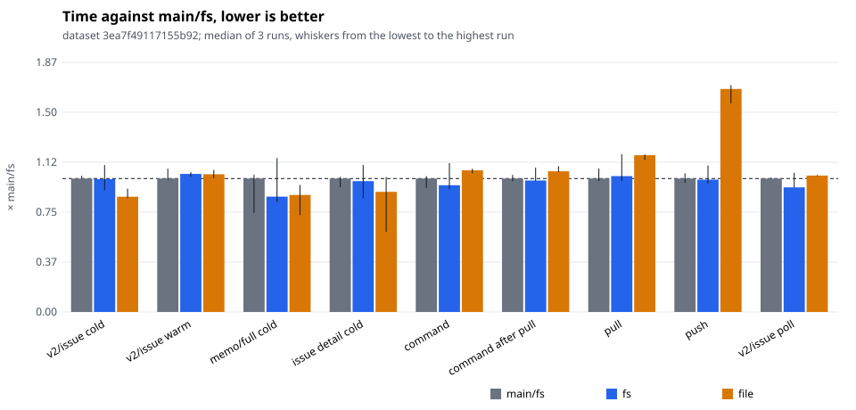
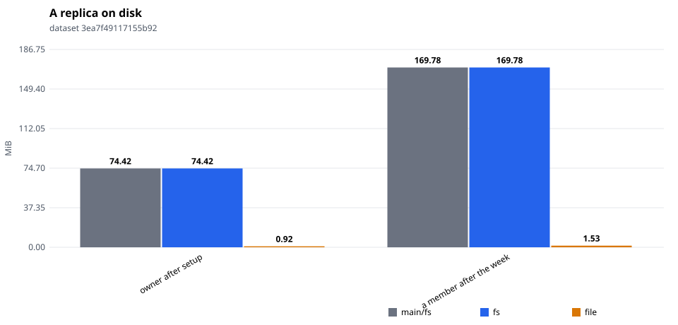

# tonk-shaped 1×, six members: a segment's columns from its tokens

Three interleaved runs each of `main/fs` (origin/main `9b98395b`), `fs` and `file` (this branch at `15f01e9`: a segment's key columns built from its tokens, aligned datums read in place). One sitting; compare within it.

Dataset `3ea7f49117155b92`. Runs per store: main/fs: 3, fs: 3, file: 3. Each cell is the median across runs of each run's median, with the lowest and highest run in brackets.

#### Queries, cold (a replica that just joined)

| measure | main/fs | fs | file | file ÷ main/fs |
|---|---|---|---|---|
| `query/v2/issue/cold` (ms) | 63.15 (63.12–64.49) | 62.90 (57.60–69.55) | 54.53 (53.82–58.41) | 0.86 |
| `query/v2/activity/cold` (ms) | 79.05 (74.56–81.52) | 75.63 (71.72–75.70) | 71.75 (71.44–75.39) | 0.91 |
| `query/issue-detail/cold` (ms) | 2.35 (2.20–2.38) | 2.30 (2.00–2.59) | 2.11 (1.41–2.37) | 0.90 |
| `query/memo/full/cold` (ms) | 3.18 (2.35–3.26) | 2.75 (2.61–3.66) | 2.78 (2.30–3.02) | 0.88 |
| `query/v2/issue-labels/cold` (ms) | 2.37 (2.16–2.43) | 2.18 (2.01–2.31) | 1.47 (1.42–1.74) | 0.62 |

#### Queries, warm

| measure | main/fs | fs | file | file ÷ main/fs |
|---|---|---|---|---|
| `query/v2/issue/warm` (ms) | 33.95 (33.62–36.46) | 35.13 (34.47–35.60) | 35.05 (34.00–36.16) | 1.03 |
| `query/v2/activity/warm` (ms) | 77.57 (70.87–77.66) | 74.48 (71.37–75.45) | 73.35 (72.94–84.50) | 0.95 |
| `query/issue-detail/warm` (ms) | 0.62 (0.61–0.75) | 0.78 (0.77–0.80) | 0.88 (0.66–1.03) | 1.42 |
| `query/memo/full/warm` (ms) | 1.14 (0.96–1.16) | 0.97 (0.97–1.18) | 1.17 (1.14–1.18) | 1.03 |
| `query/v2/issue-labels/warm` (ms) | 0.44 (0.37–0.48) | 0.38 (0.36–0.42) | 0.43 (0.37–0.44) | 1.00 |

#### Writes: one command a commit, its rules included

| measure | main/fs | fs | file | file ÷ main/fs |
|---|---|---|---|---|
| `command/all` (ms) | 12.07 (11.22–12.29) | 11.47 (11.10–13.47) | 12.82 (12.55–12.96) | 1.06 |
| `command/first-after-pull` (ms) | 19.94 (19.54–20.49) | 19.65 (19.59–21.59) | 21.04 (20.93–21.78) | 1.05 |
| `command/v2/issue-create` (ms) | 20.33 (18.48–20.74) | 20.73 (19.32–21.45) | 20.53 (20.44–20.74) | 1.01 |
| `command/memo/post` (ms) | 9.70 (9.31–12.64) | 10.15 (9.45–11.87) | 9.84 (8.38–11.01) | 1.01 |
| `command/v2/issue-post-comment` (ms) | 12.78 (12.43–13.04) | 12.23 (12.06–15.66) | 14.32 (13.99–15.61) | 1.12 |
| `command/v2/issue-set-status` (ms) | 17.17 (16.61–17.81) | 17.15 (15.91–19.20) | 18.43 (18.02–18.98) | 1.07 |

#### Sync

| measure | main/fs | fs | file | file ÷ main/fs |
|---|---|---|---|---|
| `join/pull` (ms) | 4.25 (3.79–4.32) | 3.82 (2.76–5.28) | 4.50 (4.38–4.68) | 1.06 |
| `sync/pull` (ms) | 31.38 (30.79–33.74) | 31.96 (30.85–37.09) | 36.89 (35.75–37.04) | 1.18 |
| `sync/push` (ms) | 15.67 (15.16–16.28) | 15.55 (15.10–17.21) | 26.20 (24.50–26.65) | 1.67 |
| `setup/push` (ms) | 87.71 (74.95–92.68) | 75.82 (75.17–132.91) | 83.22 (80.79–95.91) | 0.95 |

#### Subscriptions: a poll after each of the reader's pulls

| measure | main/fs | fs | file | file ÷ main/fs |
|---|---|---|---|---|
| `subscription/v2/issue/poll` (ms) | 17.38 (17.35–17.51) | 16.24 (16.20–18.13) | 17.77 (17.71–17.84) | 1.02 |
| `subscription/v2/activity/poll` (ms) | 22.17 (22.16–22.38) | 22.09 (21.77–23.24) | 21.72 (21.23–22.11) | 0.98 |
| `subscription/memo/full/poll` (ms) | 2.72 (2.66–2.75) | 2.70 (2.66–2.99) | 2.60 (2.44–2.69) | 0.96 |

#### Storage

| measure | main/fs | fs | file | file ÷ main/fs |
|---|---|---|---|---|
| `setup/owner-bytes` (MiB) | 74.42 (74.42–74.42) | 74.42 (74.42–74.42) | 0.92 (0.92–0.93) | 0.01 |
| `bytes/member-0` (MiB) | 217.26 (217.26–217.26) | 217.26 (217.26–217.26) | 1.88 (1.87–1.89) | 0.01 |
| `bytes/member-1` (MiB) | 169.78 (169.78–169.78) | 169.78 (169.78–169.78) | 1.53 (1.53–1.53) | 0.01 |
| `bytes/remote` (MiB) | 275.88 (275.88–275.88) | 275.88 (275.88–275.88) | 275.88 (275.88–275.88) | 1.00 |

