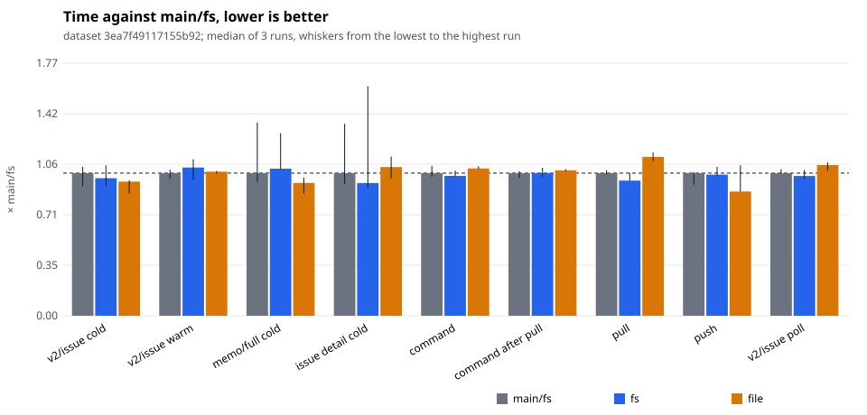
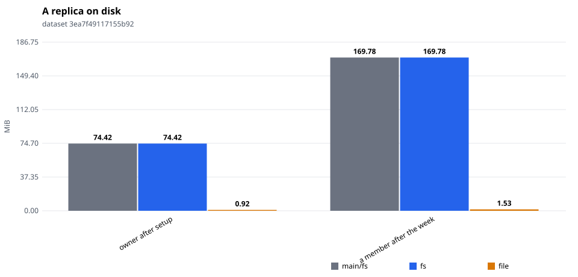

# tonk-shaped 1×, six members: an upload's blocks built as tasks of their own

Three interleaved runs each of `main/fs` (origin/main `9b98395b`), `fs` and `file` (this branch at `3e39b31`: an upload builds each block in a task of its own and puts it as soon as it is built). One sitting; compare within it. Four cores.

Dataset `3ea7f49117155b92`. Runs per store: main/fs: 3, fs: 3, file: 3. Each cell is the median across runs of each run's median, with the lowest and highest run in brackets.

#### Queries, cold (a replica that just joined)

| measure | main/fs | fs | file | file ÷ main/fs |
|---|---|---|---|---|
| `query/v2/issue/cold` (ms) | 59.90 (54.41–62.53) | 57.76 (54.50–63.10) | 56.32 (51.32–56.94) | 0.94 |
| `query/v2/activity/cold` (ms) | 73.42 (72.49–77.05) | 78.35 (78.32–79.00) | 81.92 (73.24–83.37) | 1.12 |
| `query/issue-detail/cold` (ms) | 1.90 (1.75–2.55) | 1.76 (1.70–3.05) | 1.98 (1.83–2.12) | 1.04 |
| `query/memo/full/cold` (ms) | 2.90 (2.72–3.93) | 2.99 (2.97–3.71) | 2.70 (2.48–2.81) | 0.93 |
| `query/v2/issue-labels/cold` (ms) | 2.84 (2.65–3.05) | 2.34 (2.26–2.39) | 1.81 (1.52–2.19) | 0.64 |

#### Queries, warm

| measure | main/fs | fs | file | file ÷ main/fs |
|---|---|---|---|---|
| `query/v2/issue/warm` (ms) | 34.00 (32.57–34.80) | 35.33 (32.43–37.31) | 34.33 (33.92–34.52) | 1.01 |
| `query/v2/activity/warm` (ms) | 71.30 (70.49–82.05) | 76.08 (72.97–77.69) | 75.79 (75.34–82.40) | 1.06 |
| `query/issue-detail/warm` (ms) | 0.76 (0.60–0.76) | 0.66 (0.65–1.19) | 0.75 (0.74–0.76) | 0.99 |
| `query/memo/full/warm` (ms) | 1.14 (0.95–1.74) | 1.00 (0.99–1.15) | 0.99 (0.97–1.15) | 0.87 |
| `query/v2/issue-labels/warm` (ms) | 0.37 (0.36–0.44) | 0.41 (0.37–0.43) | 0.44 (0.40–0.46) | 1.19 |

#### Writes: one command a commit, its rules included

| measure | main/fs | fs | file | file ÷ main/fs |
|---|---|---|---|---|
| `command/all` (ms) | 11.66 (11.35–12.25) | 11.43 (11.40–11.87) | 12.04 (12.00–12.22) | 1.03 |
| `command/first-after-pull` (ms) | 20.36 (19.66–20.65) | 20.37 (19.80–21.12) | 20.76 (20.65–20.93) | 1.02 |
| `command/v2/issue-create` (ms) | 20.06 (18.75–20.38) | 19.97 (19.83–20.92) | 20.44 (19.95–20.51) | 1.02 |
| `command/memo/post` (ms) | 8.16 (7.92–8.86) | 9.19 (9.13–11.53) | 12.99 (7.92–13.70) | 1.59 |
| `command/v2/issue-post-comment` (ms) | 13.05 (11.91–13.29) | 12.72 (12.37–12.73) | 13.21 (12.80–13.76) | 1.01 |
| `command/v2/issue-set-status` (ms) | 17.36 (17.15–17.68) | 17.45 (17.13–17.85) | 17.82 (17.44–18.64) | 1.03 |

#### Sync

| measure | main/fs | fs | file | file ÷ main/fs |
|---|---|---|---|---|
| `join/pull` (ms) | 2.81 (1.75–3.78) | 1.97 (1.54–3.12) | 1.83 (1.64–2.53) | 0.65 |
| `sync/pull` (ms) | 32.66 (32.47–33.31) | 30.95 (30.89–32.72) | 36.37 (35.46–37.43) | 1.11 |
| `sync/push` (ms) | 16.11 (14.79–16.23) | 15.93 (15.80–16.83) | 14.02 (14.02–17.01) | 0.87 |
| `setup/push` (ms) | 75.05 (65.20–91.25) | 73.72 (57.03–79.14) | 54.40 (51.19–57.89) | 0.72 |

#### Subscriptions: a poll after each of the reader's pulls

| measure | main/fs | fs | file | file ÷ main/fs |
|---|---|---|---|---|
| `subscription/v2/issue/poll` (ms) | 17.47 (17.40–17.96) | 17.11 (16.77–17.86) | 18.45 (17.77–18.79) | 1.06 |
| `subscription/v2/activity/poll` (ms) | 23.47 (21.92–23.87) | 22.01 (21.18–22.78) | 22.53 (21.98–22.79) | 0.96 |
| `subscription/memo/full/poll` (ms) | 2.93 (2.70–3.05) | 2.65 (2.63–2.83) | 2.68 (2.66–2.98) | 0.91 |

#### Storage

| measure | main/fs | fs | file | file ÷ main/fs |
|---|---|---|---|---|
| `setup/owner-bytes` (MiB) | 74.42 (74.42–74.42) | 74.42 (74.42–74.42) | 0.92 (0.92–0.93) | 0.01 |
| `bytes/member-0` (MiB) | 217.26 (217.26–217.26) | 217.26 (217.26–217.26) | 1.88 (1.87–1.88) | 0.01 |
| `bytes/member-1` (MiB) | 169.78 (169.78–169.78) | 169.78 (169.78–169.78) | 1.53 (1.53–1.53) | 0.01 |
| `bytes/remote` (MiB) | 275.88 (275.88–275.88) | 275.88 (275.88–275.88) | 275.88 (275.88–275.88) | 1.00 |

