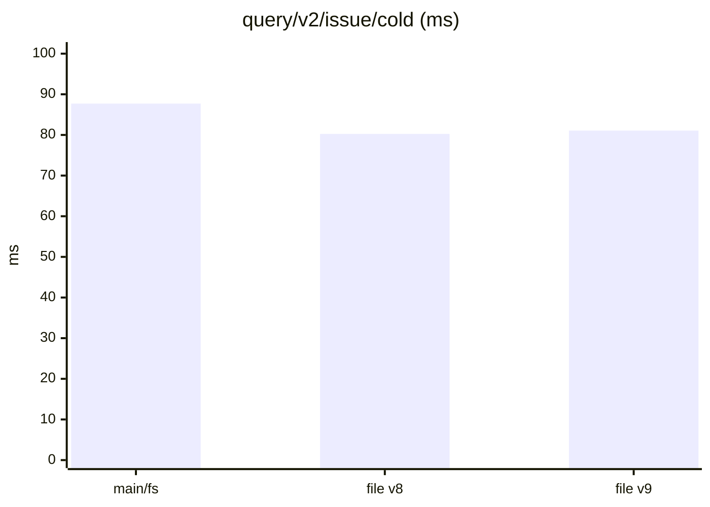
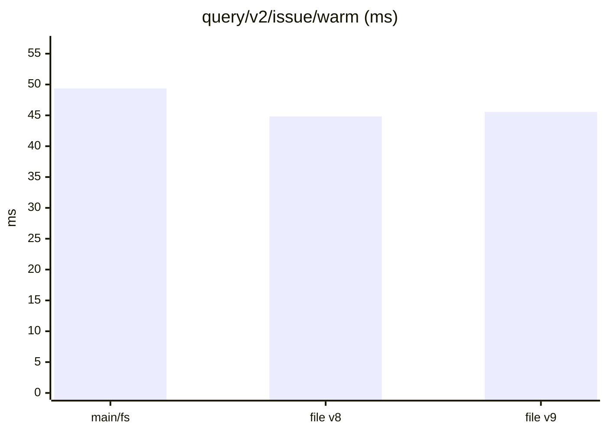
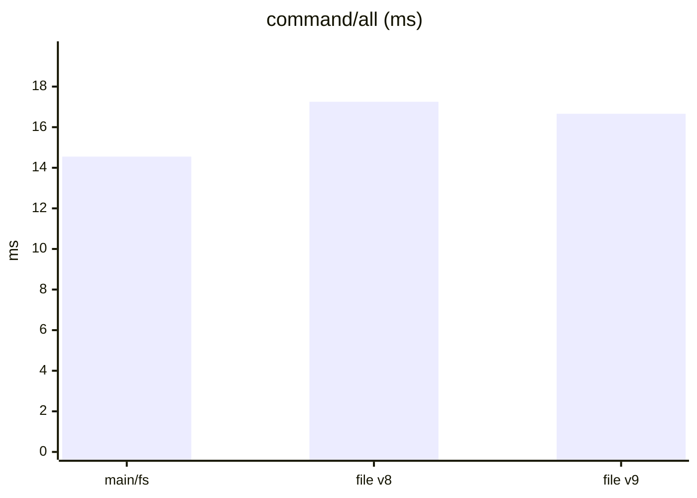
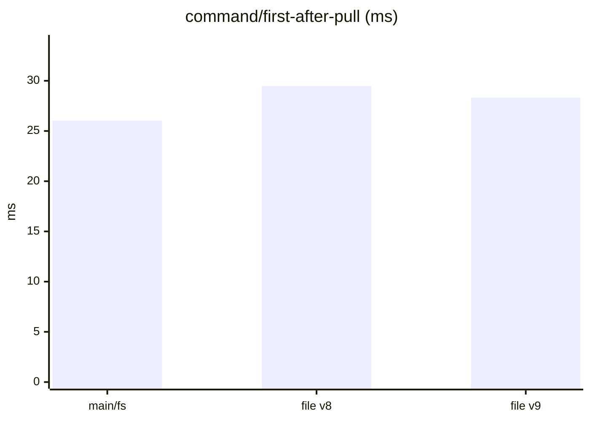
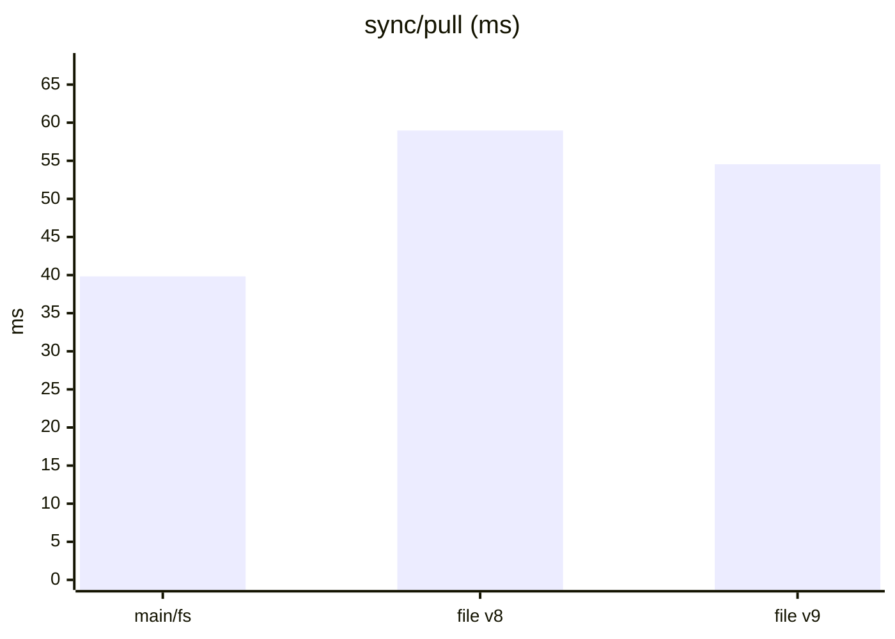
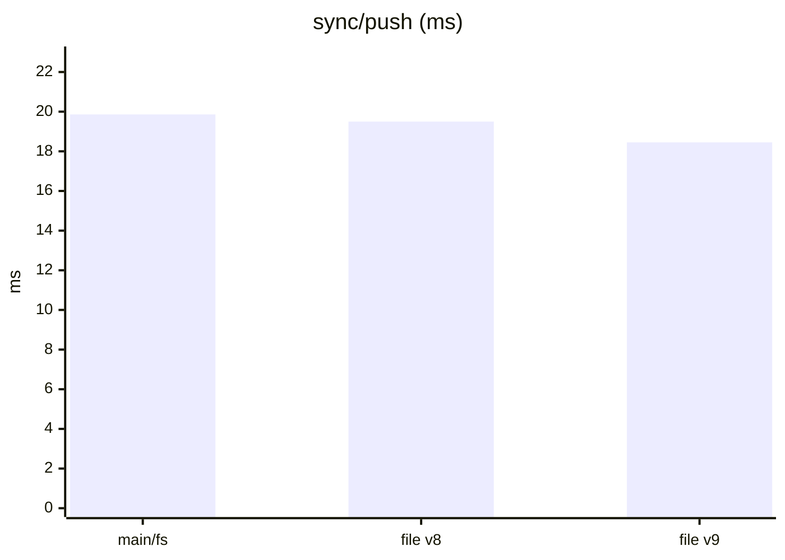
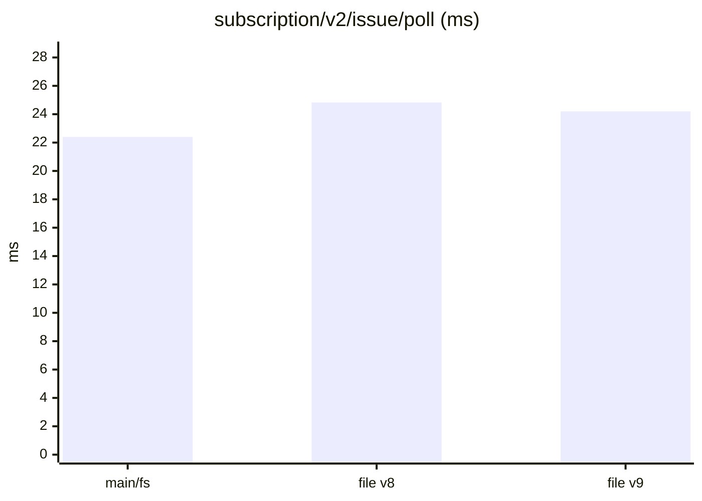
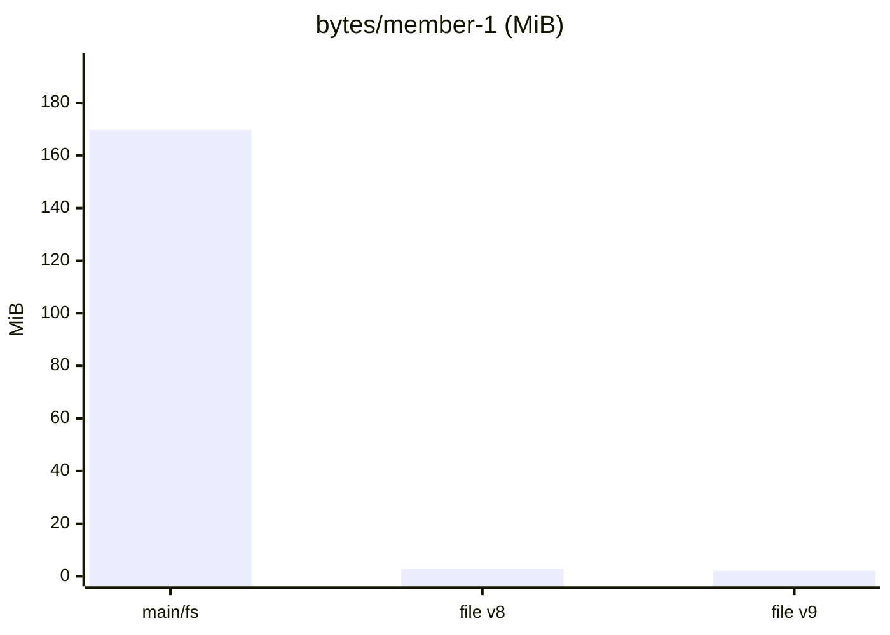

Dataset `3ea7f49117155b92`. Runs per store: main/fs: 3, file v8: 3, file v9: 3. Each cell is the median across runs of each run's median, with the lowest and highest run in brackets.

#### Queries, cold (a replica that just joined)

| measure | main/fs | file v8 | file v9 | file v9 ÷ main/fs |
|---|---|---|---|---|
| `query/v2/issue/cold` (ms) | 87.71 (72.77–91.91) | 80.25 (79.88–85.40) | 81.07 (80.56–81.90) | 0.92 |
| `query/v2/activity/cold` (ms) | 101.02 (96.67–105.20) | 99.01 (98.43–103.00) | 100.23 (100.19–102.08) | 0.99 |
| `query/issue-detail/cold` (ms) | 2.76 (2.40–2.86) | 2.49 (2.37–2.54) | 2.63 (2.62–2.65) | 0.95 |
| `query/memo/full/cold` (ms) | 3.61 (3.57–3.84) | 3.60 (3.48–4.61) | 3.63 (3.47–4.54) | 1.01 |
| `query/v2/issue-labels/cold` (ms) | 3.38 (3.26–4.31) | 2.56 (2.33–3.02) | 3.43 (3.19–3.69) | 1.01 |

#### Queries, warm

| measure | main/fs | file v8 | file v9 | file v9 ÷ main/fs |
|---|---|---|---|---|
| `query/v2/issue/warm` (ms) | 49.36 (47.30–57.57) | 44.83 (44.68–44.88) | 45.56 (44.88–48.49) | 0.92 |
| `query/v2/activity/warm` (ms) | 96.25 (95.85–98.80) | 100.20 (97.65–100.87) | 99.19 (98.03–99.43) | 1.03 |
| `query/issue-detail/warm` (ms) | 0.90 (0.87–0.92) | 0.90 (0.90–0.96) | 0.92 (0.92–0.98) | 1.02 |
| `query/memo/full/warm` (ms) | 1.34 (1.33–1.36) | 1.37 (1.37–2.01) | 1.41 (1.39–1.41) | 1.05 |
| `query/v2/issue-labels/warm` (ms) | 0.54 (0.52–0.76) | 0.53 (0.52–0.54) | 0.53 (0.53–0.54) | 0.98 |

#### Writes: one command a commit, its rules included

| measure | main/fs | file v8 | file v9 | file v9 ÷ main/fs |
|---|---|---|---|---|
| `command/all` (ms) | 14.55 (14.54–15.13) | 17.25 (16.92–17.48) | 16.66 (16.16–16.88) | 1.15 |
| `command/first-after-pull` (ms) | 26.03 (25.30–26.18) | 29.48 (29.25–30.07) | 28.33 (28.26–28.92) | 1.09 |
| `command/v2/issue-create` (ms) | 25.25 (23.72–25.61) | 29.99 (28.39–30.42) | 27.54 (27.22–27.72) | 1.09 |
| `command/memo/post` (ms) | 10.64 (10.52–12.95) | 15.36 (13.50–18.03) | 11.01 (10.59–15.75) | 1.04 |
| `command/v2/issue-post-comment` (ms) | 16.37 (16.27–16.86) | 19.59 (18.04–19.64) | 18.49 (18.27–18.95) | 1.13 |
| `command/v2/issue-set-status` (ms) | 22.33 (21.97–23.82) | 24.97 (24.66–25.89) | 24.22 (23.93–25.20) | 1.08 |

#### Sync

| measure | main/fs | file v8 | file v9 | file v9 ÷ main/fs |
|---|---|---|---|---|
| `join/pull` (ms) | 2.67 (2.15–3.29) | 2.21 (1.94–3.12) | 2.29 (1.92–2.80) | 0.86 |
| `sync/pull` (ms) | 39.83 (38.57–40.75) | 58.97 (57.22–59.65) | 54.54 (54.41–55.67) | 1.37 |
| `sync/push` (ms) | 19.86 (19.31–20.20) | 19.50 (18.47–19.87) | 18.45 (18.38–19.09) | 0.93 |
| `setup/push` (ms) | 80.47 (75.86–112.26) | 65.23 (65.03–73.67) | 63.54 (63.48–69.06) | 0.79 |

#### Subscriptions: a poll after each of the reader's pulls

| measure | main/fs | file v8 | file v9 | file v9 ÷ main/fs |
|---|---|---|---|---|
| `subscription/v2/issue/poll` (ms) | 22.40 (22.07–22.96) | 24.83 (24.50–26.12) | 24.20 (23.90–24.46) | 1.08 |
| `subscription/v2/activity/poll` (ms) | 29.49 (28.68–29.53) | 28.51 (28.49–29.32) | 28.55 (27.90–28.61) | 0.97 |
| `subscription/memo/full/poll` (ms) | 3.70 (3.64–3.72) | 3.68 (3.66–3.90) | 3.59 (3.57–3.67) | 0.97 |

#### Storage

| measure | main/fs | file v8 | file v9 | file v9 ÷ main/fs |
|---|---|---|---|---|
| `setup/owner-bytes` (MiB) | 74.42 (74.42–74.42) | 1.42 (1.42–1.42) | 1.21 (1.20–1.21) | 0.02 |
| `bytes/member-0` (MiB) | 217.26 (217.26–217.26) | 3.26 (3.24–3.27) | 2.49 (2.45–2.50) | 0.01 |
| `bytes/member-1` (MiB) | 169.78 (169.78–169.78) | 2.82 (2.82–2.83) | 2.12 (2.12–2.12) | 0.01 |
| `bytes/remote` (MiB) | 275.88 (275.88–275.88) | 275.88 (275.88–275.88) | 275.88 (275.88–275.88) | 1.00 |

#### Charts

