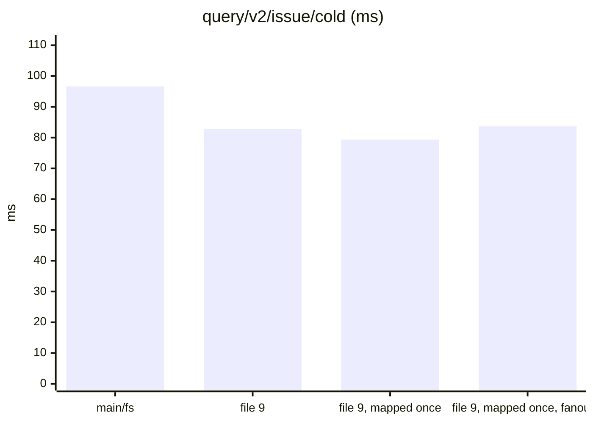
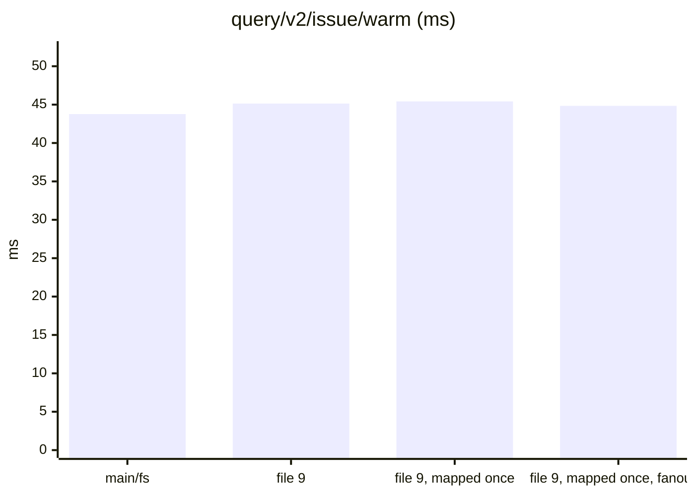
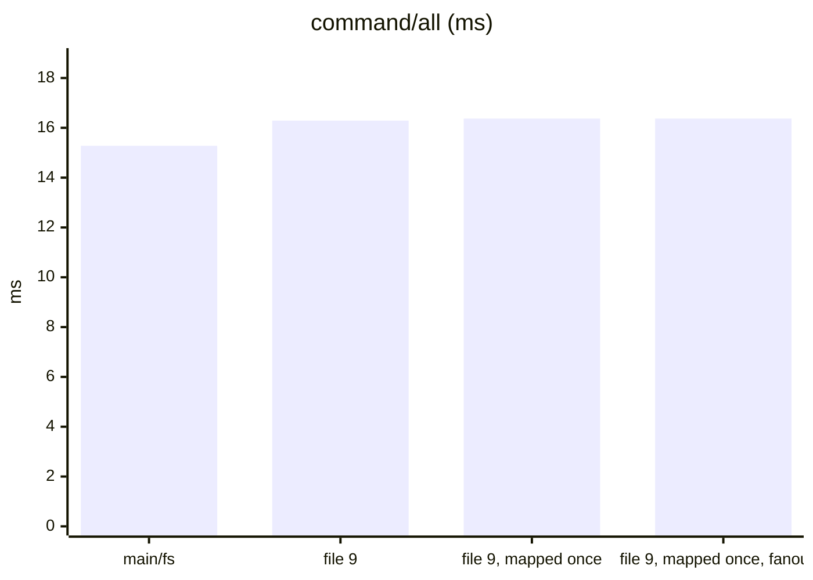
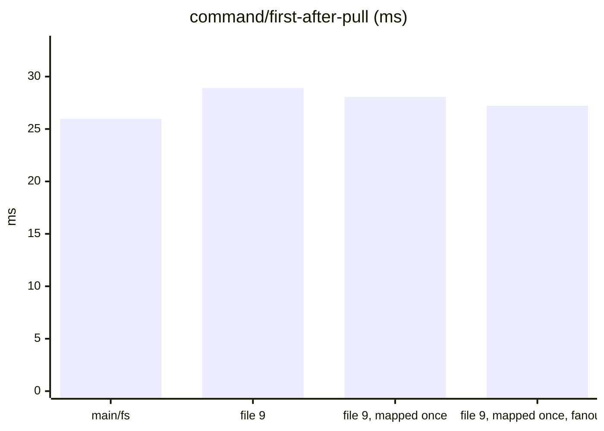
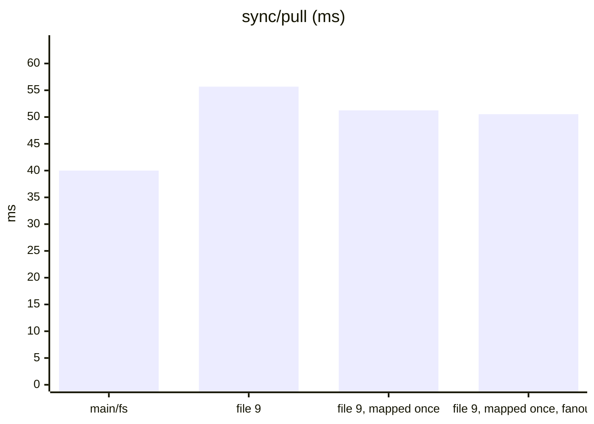
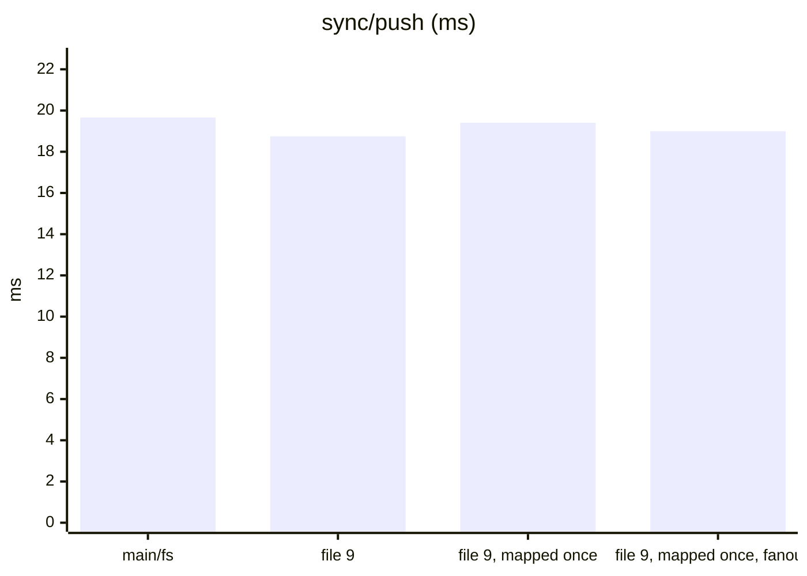
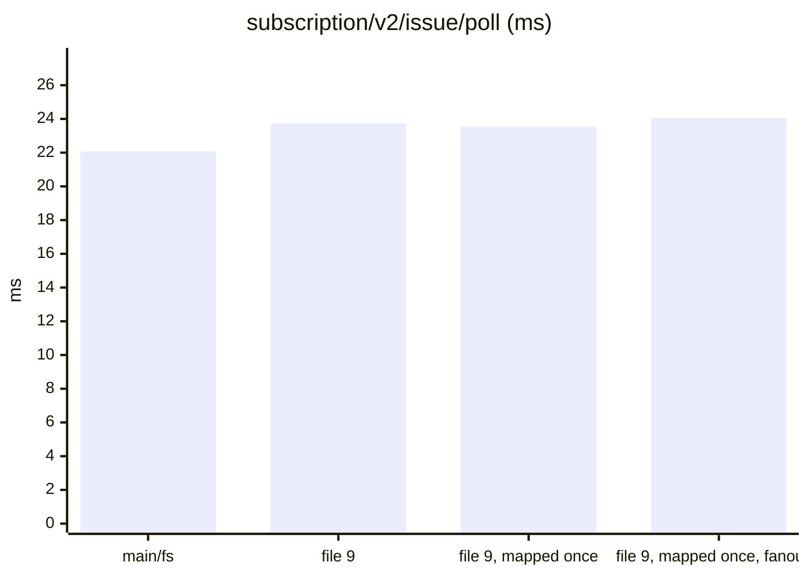
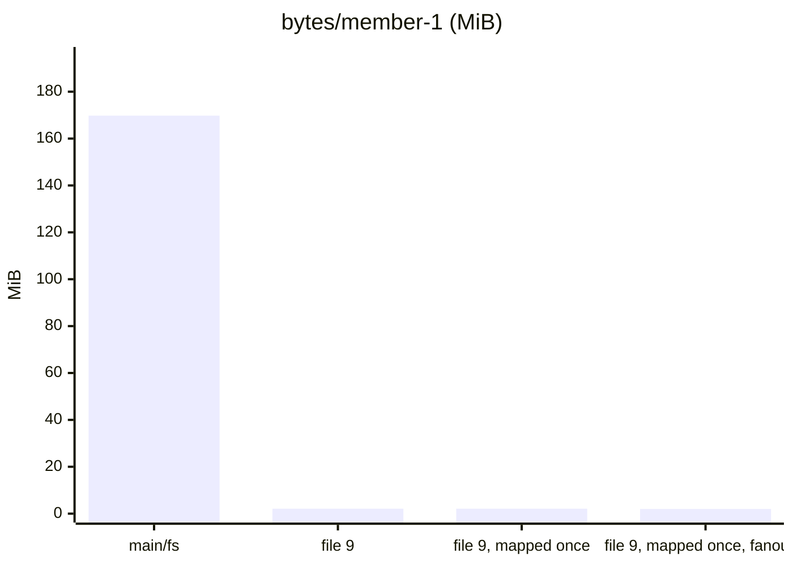

Dataset `3ea7f49117155b92`. Runs per store: main/fs: 3, file 9: 3, file 9, mapped once: 3, file 9, mapped once, fanout 8: 3. Each cell is the median across runs of each run's median, with the lowest and highest run in brackets.

#### Queries, cold (a replica that just joined)

| measure | main/fs | file 9 | file 9, mapped once | file 9, mapped once, fanout 8 | file 9, mapped once, fanout 8 ÷ main/fs |
|---|---|---|---|---|---|
| `query/v2/issue/cold` (ms) | 96.63 (69.35–98.69) | 82.82 (79.06–85.87) | 79.38 (76.07–82.22) | 83.69 (75.96–93.99) | 0.87 |
| `query/v2/activity/cold` (ms) | 116.77 (96.08–145.09) | 100.25 (99.84–105.06) | 99.06 (99.02–101.44) | 103.48 (97.71–107.84) | 0.89 |
| `query/issue-detail/cold` (ms) | 2.60 (2.32–2.63) | 2.49 (2.45–3.23) | 2.38 (2.36–2.68) | 2.42 (2.38–2.63) | 0.93 |
| `query/memo/full/cold` (ms) | 3.54 (3.21–3.62) | 3.46 (3.35–3.50) | 3.40 (3.25–3.56) | 3.35 (3.28–3.45) | 0.95 |
| `query/v2/issue-labels/cold` (ms) | 2.92 (2.73–3.83) | 2.86 (2.86–3.96) | 2.32 (2.19–5.40) | 2.93 (2.33–3.44) | 1.00 |

#### Queries, warm

| measure | main/fs | file 9 | file 9, mapped once | file 9, mapped once, fanout 8 | file 9, mapped once, fanout 8 ÷ main/fs |
|---|---|---|---|---|---|
| `query/v2/issue/warm` (ms) | 43.77 (42.79–44.51) | 45.14 (44.96–46.44) | 45.42 (44.50–48.35) | 44.84 (44.26–45.46) | 1.02 |
| `query/v2/activity/warm` (ms) | 99.31 (96.00–110.43) | 97.30 (95.95–100.21) | 98.95 (97.88–99.18) | 99.28 (98.91–106.15) | 1.00 |
| `query/issue-detail/warm` (ms) | 0.87 (0.87–0.88) | 0.94 (0.94–1.38) | 0.92 (0.88–0.93) | 0.92 (0.90–0.93) | 1.05 |
| `query/memo/full/warm` (ms) | 1.33 (1.32–1.33) | 1.41 (1.38–1.48) | 1.37 (1.37–1.38) | 1.39 (1.37–1.39) | 1.05 |
| `query/v2/issue-labels/warm` (ms) | 0.55 (0.54–0.56) | 0.54 (0.54–0.65) | 0.53 (0.53–0.54) | 0.53 (0.52–0.59) | 0.95 |

#### Writes: one command a commit, its rules included

| measure | main/fs | file 9 | file 9, mapped once | file 9, mapped once, fanout 8 | file 9, mapped once, fanout 8 ÷ main/fs |
|---|---|---|---|---|---|
| `command/all` (ms) | 15.28 (14.16–15.30) | 16.29 (16.29–16.40) | 16.37 (16.08–16.76) | 16.37 (15.78–16.59) | 1.07 |
| `command/first-after-pull` (ms) | 25.96 (25.24–26.48) | 28.91 (28.22–30.32) | 28.06 (26.86–29.92) | 27.23 (27.21–28.01) | 1.05 |
| `command/v2/issue-create` (ms) | 25.31 (24.82–25.93) | 28.23 (27.81–29.99) | 27.36 (25.75–29.81) | 26.84 (26.78–27.05) | 1.06 |
| `command/memo/post` (ms) | 10.83 (10.76–16.46) | 13.94 (11.21–18.02) | 10.65 (10.23–10.89) | 10.93 (10.13–11.03) | 1.01 |
| `command/v2/issue-post-comment` (ms) | 16.47 (15.52–16.87) | 18.60 (18.36–18.69) | 18.57 (17.66–18.92) | 18.55 (17.70–18.61) | 1.13 |
| `command/v2/issue-set-status` (ms) | 22.75 (20.93–22.86) | 23.41 (23.28–24.81) | 24.07 (23.84–25.50) | 23.79 (22.55–23.87) | 1.05 |

#### Sync

| measure | main/fs | file 9 | file 9, mapped once | file 9, mapped once, fanout 8 | file 9, mapped once, fanout 8 ÷ main/fs |
|---|---|---|---|---|---|
| `join/pull` (ms) | 2.57 (2.34–6.91) | 2.36 (2.17–3.42) | 2.84 (1.98–2.92) | 2.40 (2.11–2.80) | 0.94 |
| `sync/pull` (ms) | 40.00 (37.50–42.02) | 55.67 (53.55–55.84) | 51.25 (49.91–53.71) | 50.53 (49.43–51.76) | 1.26 |
| `sync/push` (ms) | 19.66 (19.00–20.39) | 18.75 (18.49–18.94) | 19.41 (18.33–19.45) | 19.00 (18.79–19.08) | 0.97 |
| `setup/push` (ms) | 87.52 (80.03–163.87) | 74.45 (67.58–81.78) | 67.27 (63.67–68.35) | 66.42 (64.87–81.93) | 0.76 |

#### Subscriptions: a poll after each of the reader's pulls

| measure | main/fs | file 9 | file 9, mapped once | file 9, mapped once, fanout 8 | file 9, mapped once, fanout 8 ÷ main/fs |
|---|---|---|---|---|---|
| `subscription/v2/issue/poll` (ms) | 22.07 (21.42–23.17) | 23.74 (23.13–23.95) | 23.56 (23.02–24.04) | 24.06 (23.15–24.50) | 1.09 |
| `subscription/v2/activity/poll` (ms) | 28.17 (27.53–29.92) | 29.11 (26.79–29.14) | 28.73 (27.92–29.31) | 28.58 (27.41–30.95) | 1.01 |
| `subscription/memo/full/poll` (ms) | 3.57 (3.45–3.60) | 3.61 (3.43–3.88) | 3.72 (3.55–3.80) | 3.59 (3.55–3.61) | 1.01 |

#### Storage

| measure | main/fs | file 9 | file 9, mapped once | file 9, mapped once, fanout 8 | file 9, mapped once, fanout 8 ÷ main/fs |
|---|---|---|---|---|---|
| `setup/owner-bytes` (MiB) | 74.42 (74.42–74.42) | 1.21 (1.20–1.22) | 1.20 (1.20–1.21) | 1.22 (1.22–1.23) | 0.02 |
| `bytes/member-0` (MiB) | 217.26 (217.26–217.26) | 2.49 (2.49–2.51) | 2.49 (2.49–2.49) | 2.42 (2.42–2.45) | 0.01 |
| `bytes/member-1` (MiB) | 169.78 (169.78–169.78) | 2.12 (2.12–2.12) | 2.12 (2.12–2.12) | 2.00 (2.00–2.01) | 0.01 |
| `bytes/remote` (MiB) | 275.88 (275.88–275.88) | 275.88 (275.88–275.88) | 275.88 (275.88–275.88) | 275.88 (275.88–275.88) | 1.00 |

#### Charts

