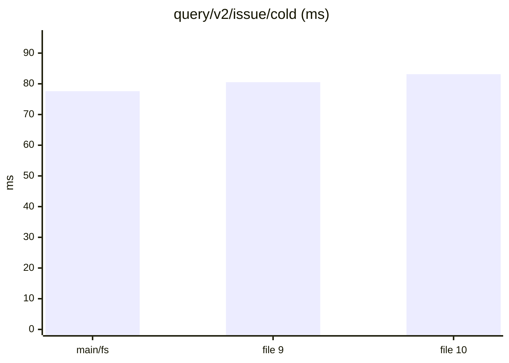
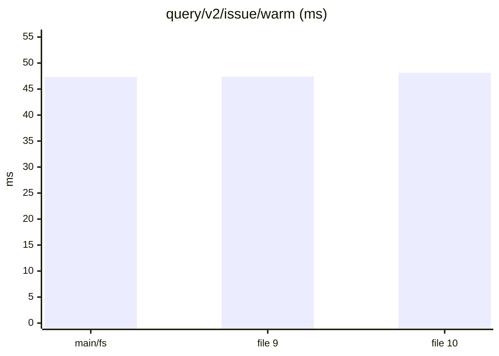
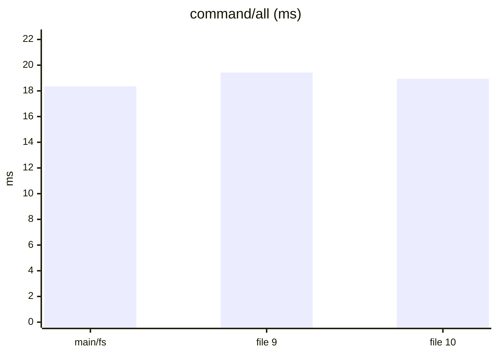
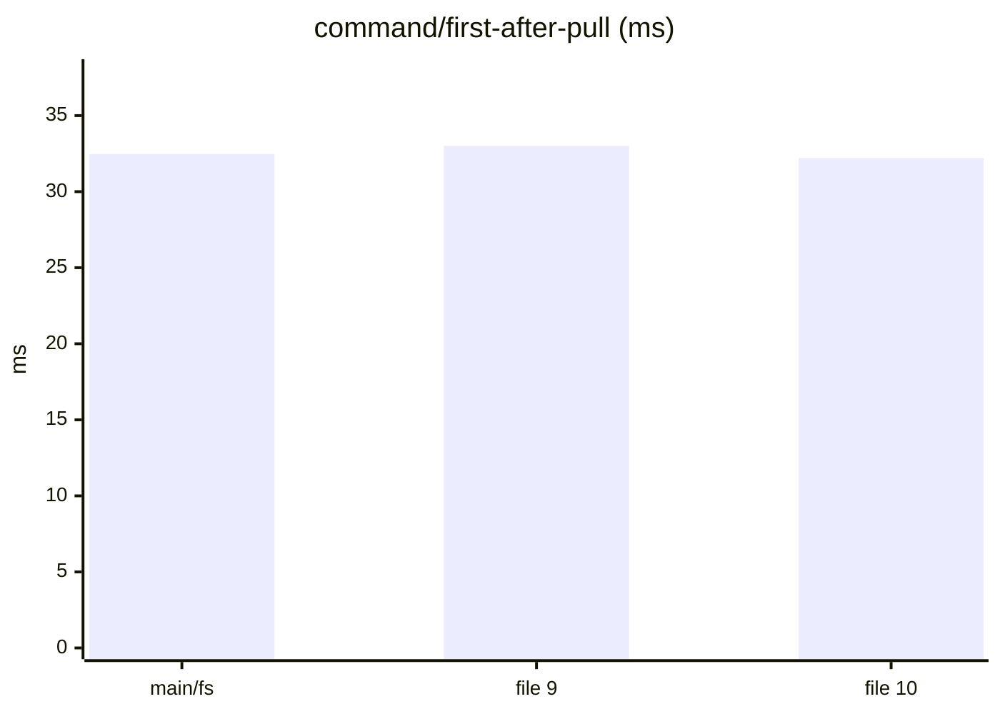
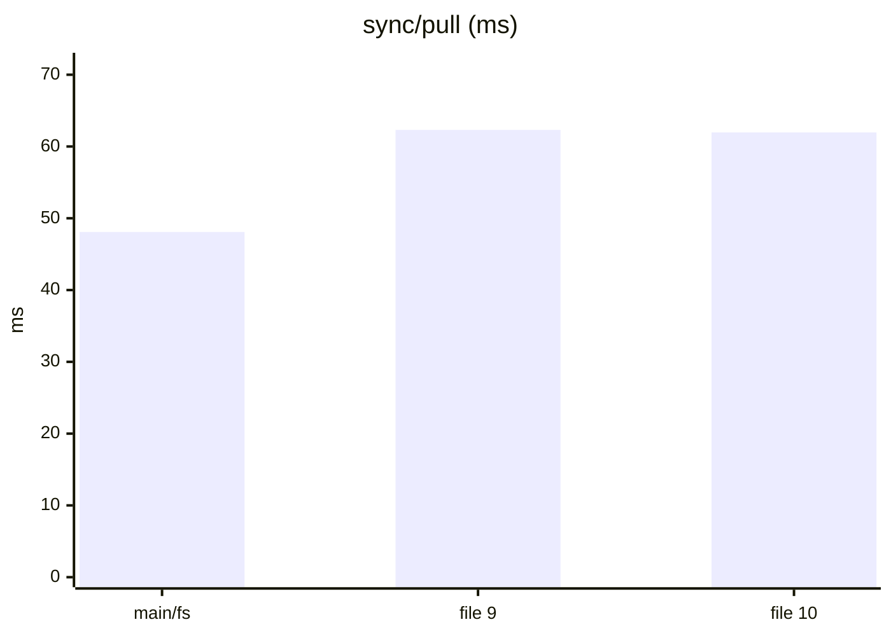
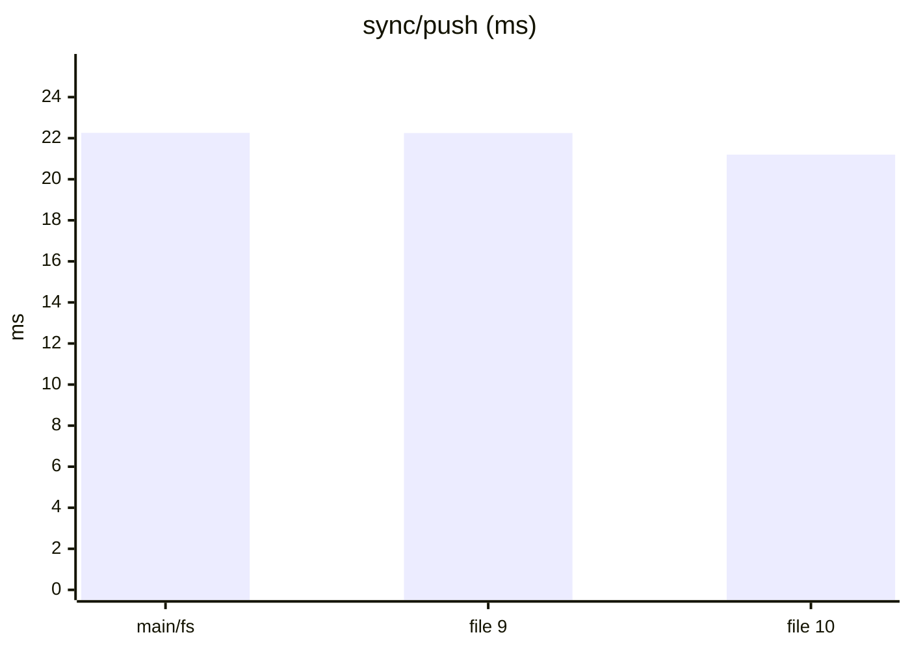
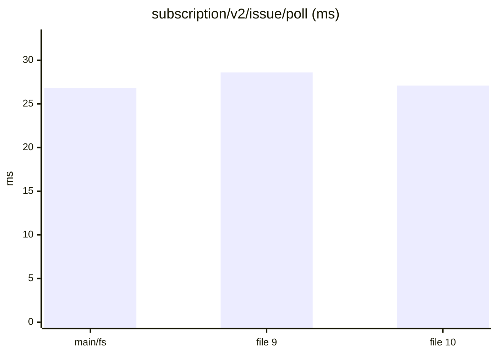
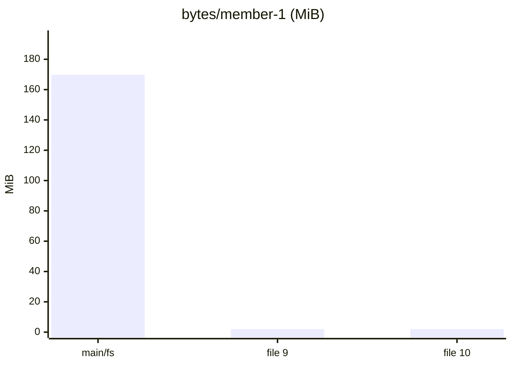

Dataset `3ea7f49117155b92`. Runs per store: main/fs: 3, file 9: 3, file 10: 3. Each cell is the median across runs of each run's median, with the lowest and highest run in brackets.

#### Queries, cold (a replica that just joined)

| measure | main/fs | file 9 | file 10 | file 10 ÷ main/fs |
|---|---|---|---|---|
| `query/v2/issue/cold` (ms) | 77.59 (74.41–78.37) | 80.54 (78.46–83.80) | 83.14 (81.00–90.33) | 1.07 |
| `query/v2/activity/cold` (ms) | 146.06 (125.14–146.53) | 112.94 (106.78–147.44) | 102.12 (100.63–103.51) | 0.70 |
| `query/issue-detail/cold` (ms) | 2.57 (2.49–3.48) | 2.59 (2.40–3.22) | 2.53 (2.45–2.60) | 0.98 |
| `query/memo/full/cold` (ms) | 3.94 (3.63–4.85) | 3.57 (3.35–4.29) | 3.60 (3.39–3.69) | 0.91 |
| `query/v2/issue-labels/cold` (ms) | 3.80 (2.95–4.31) | 3.21 (2.83–3.47) | 2.81 (2.78–2.97) | 0.74 |

#### Queries, warm

| measure | main/fs | file 9 | file 10 | file 10 ÷ main/fs |
|---|---|---|---|---|
| `query/v2/issue/warm` (ms) | 47.33 (46.62–51.37) | 47.40 (47.06–50.57) | 48.14 (48.11–49.24) | 1.02 |
| `query/v2/activity/warm` (ms) | 137.53 (97.86–148.62) | 105.40 (98.10–112.07) | 100.77 (99.64–101.48) | 0.73 |
| `query/issue-detail/warm` (ms) | 0.92 (0.87–1.44) | 0.91 (0.90–1.40) | 0.97 (0.89–1.07) | 1.06 |
| `query/memo/full/warm` (ms) | 1.40 (1.33–2.12) | 1.44 (1.39–2.08) | 1.36 (1.30–1.47) | 0.98 |
| `query/v2/issue-labels/warm` (ms) | 0.79 (0.52–0.83) | 0.57 (0.52–0.71) | 0.54 (0.54–0.56) | 0.69 |

#### Writes: one command a commit, its rules included

| measure | main/fs | file 9 | file 10 | file 10 ÷ main/fs |
|---|---|---|---|---|
| `command/all` (ms) | 18.35 (16.24–18.45) | 19.42 (18.52–19.64) | 18.94 (18.49–19.15) | 1.03 |
| `command/first-after-pull` (ms) | 32.47 (30.21–32.94) | 33.01 (32.41–33.54) | 32.21 (31.16–33.75) | 0.99 |
| `command/v2/issue-create` (ms) | 30.28 (28.15–33.51) | 30.91 (30.40–31.10) | 31.09 (29.36–33.20) | 1.03 |
| `command/memo/post` (ms) | 14.37 (11.81–15.06) | 14.40 (11.12–15.50) | 14.39 (14.00–15.91) | 1.00 |
| `command/v2/issue-post-comment` (ms) | 19.31 (18.97–19.57) | 21.36 (20.46–21.36) | 20.50 (19.17–23.27) | 1.06 |
| `command/v2/issue-set-status` (ms) | 25.77 (25.20–25.97) | 26.48 (26.07–27.10) | 27.10 (26.31–28.55) | 1.05 |

#### Sync

| measure | main/fs | file 9 | file 10 | file 10 ÷ main/fs |
|---|---|---|---|---|
| `join/pull` (ms) | 2.51 (2.51–2.90) | 3.07 (2.86–3.07) | 2.76 (2.74–2.76) | 1.10 |
| `sync/pull` (ms) | 48.09 (46.09–51.75) | 62.31 (59.69–62.95) | 61.96 (60.89–63.27) | 1.29 |
| `sync/push` (ms) | 22.26 (22.22–23.38) | 22.25 (21.86–22.51) | 21.20 (20.84–22.30) | 0.95 |
| `setup/push` (ms) | 93.95 (81.36–113.36) | 81.54 (78.58–86.41) | 73.97 (72.72–80.47) | 0.79 |

#### Subscriptions: a poll after each of the reader's pulls

| measure | main/fs | file 9 | file 10 | file 10 ÷ main/fs |
|---|---|---|---|---|
| `subscription/v2/issue/poll` (ms) | 26.82 (25.00–29.19) | 28.60 (28.08–30.45) | 27.10 (25.23–29.54) | 1.01 |
| `subscription/v2/activity/poll` (ms) | 35.32 (33.26–38.18) | 36.14 (32.18–36.24) | 32.74 (30.60–34.30) | 0.93 |
| `subscription/memo/full/poll` (ms) | 4.43 (4.30–4.56) | 4.29 (4.07–4.38) | 4.23 (4.14–4.63) | 0.95 |

#### Storage

| measure | main/fs | file 9 | file 10 | file 10 ÷ main/fs |
|---|---|---|---|---|
| `setup/owner-bytes` (MiB) | 74.42 (74.42–74.42) | 1.22 (1.22–1.22) | 1.31 (1.31–1.31) | 0.02 |
| `bytes/member-0` (MiB) | 217.26 (217.26–217.26) | 2.43 (2.42–2.43) | 2.33 (2.33–2.33) | 0.01 |
| `bytes/member-1` (MiB) | 169.78 (169.78–169.78) | 2.01 (2.00–2.01) | 2.03 (2.03–2.04) | 0.01 |
| `bytes/remote` (MiB) | 275.88 (275.88–275.88) | 275.88 (275.88–275.88) | 275.88 (275.88–275.88) | 1.00 |

#### Charts

