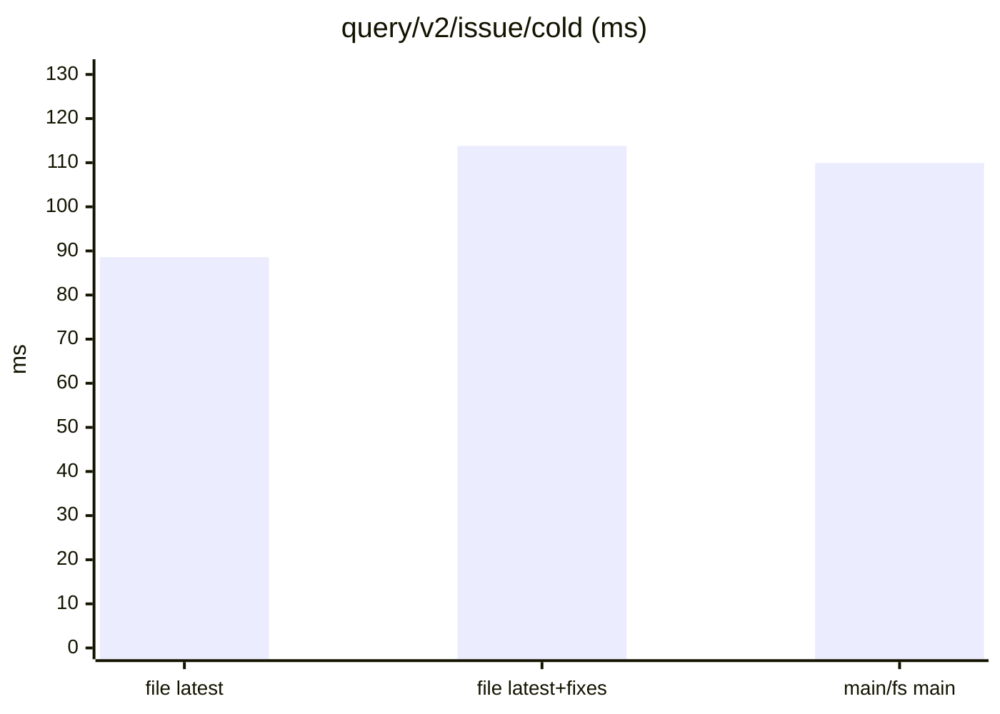
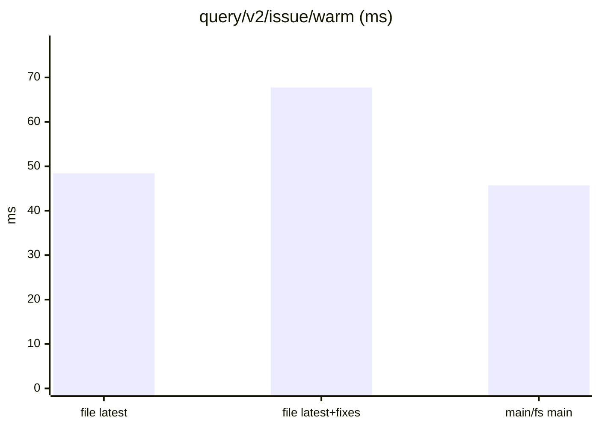
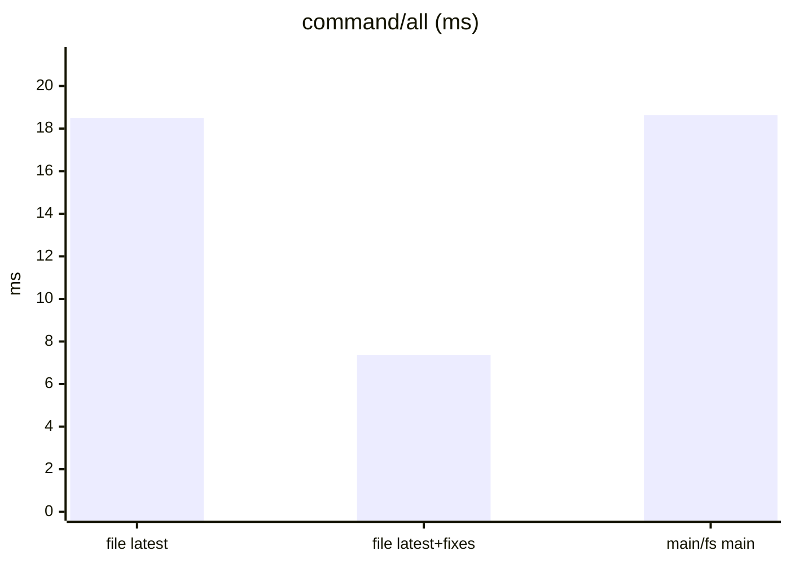
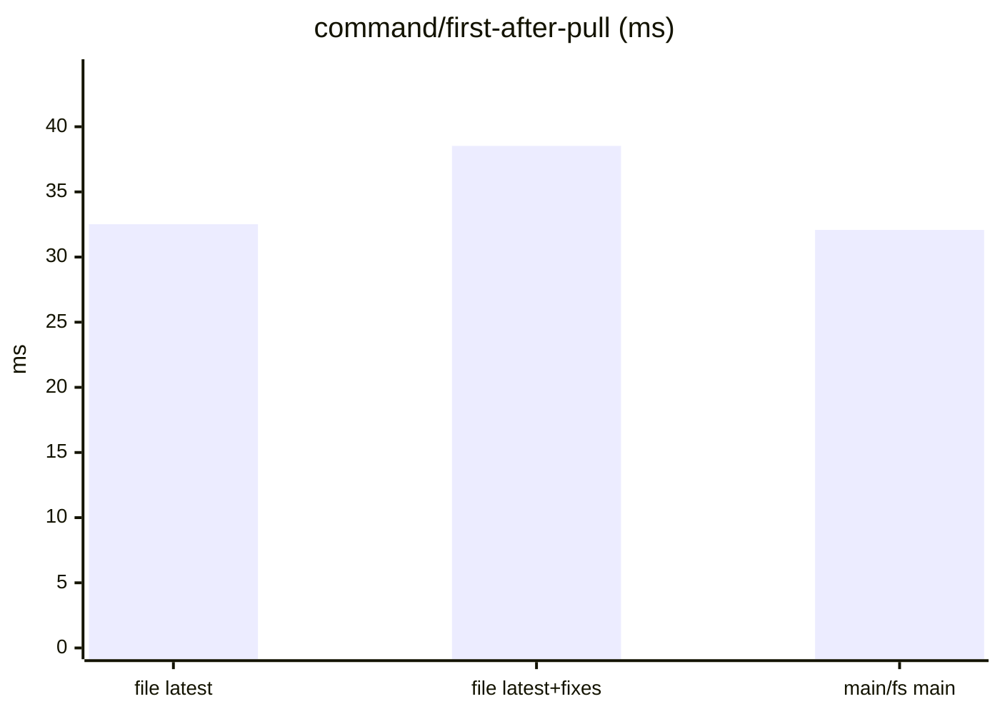
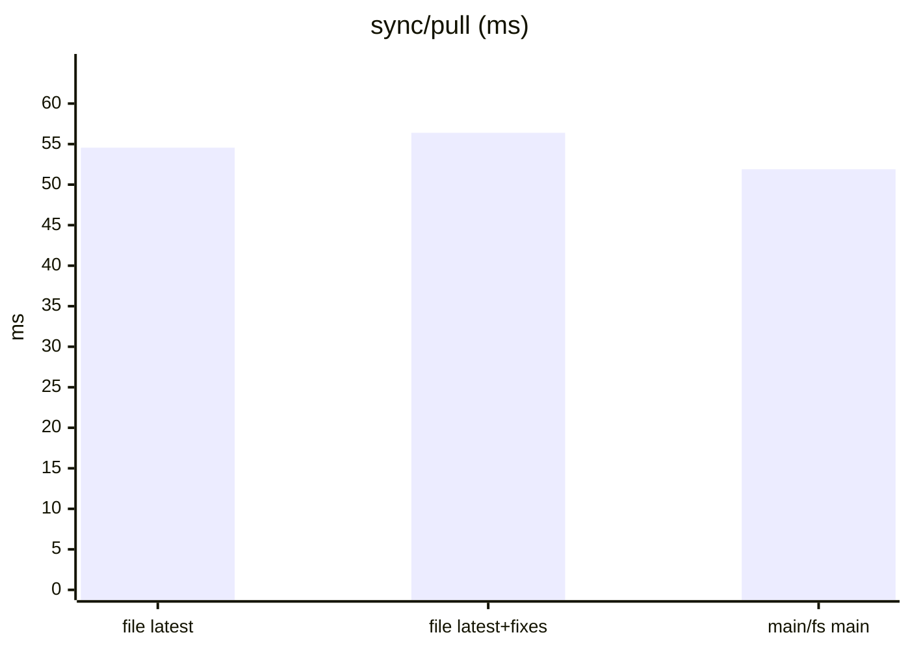
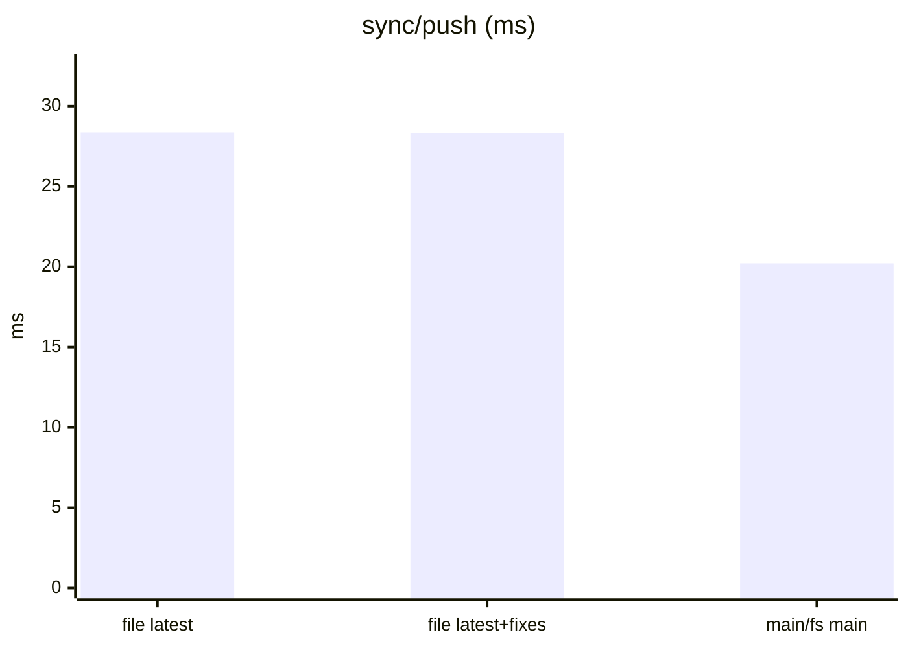
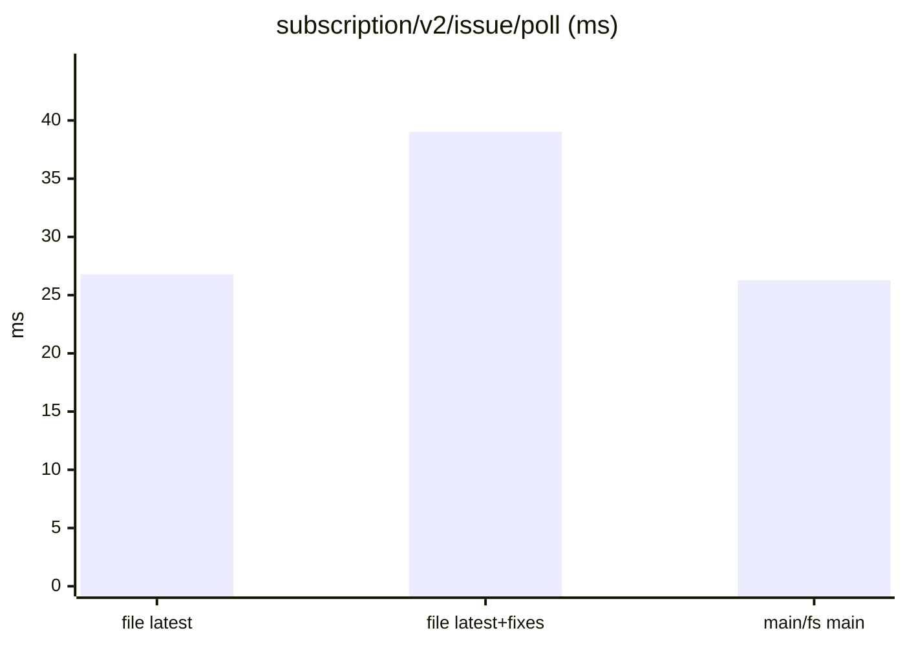
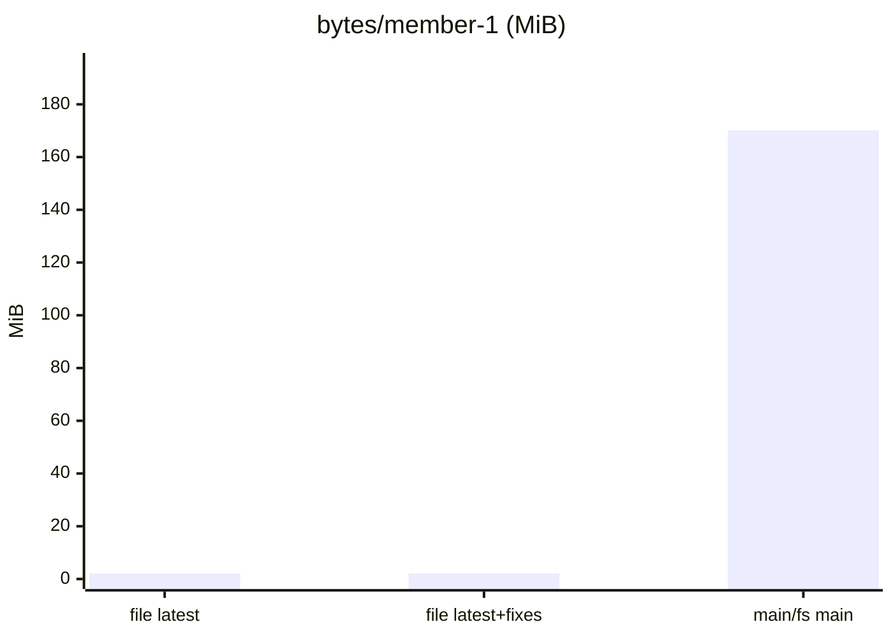

Dataset `40f769d902274835`. Runs per store: file latest: 5, file latest+fixes: 5, main/fs main: 5. Each cell is the median across runs of each run's median, with the lowest and highest run in brackets.

#### Queries, cold (a replica that just joined)

| measure | file latest | file latest+fixes | main/fs main | main/fs main ÷ file latest |
|---|---|---|---|---|
| `query/v2/issue/cold` (ms) | 88.59 (81.63–114.86) | 113.81 (97.18–151.78) | 109.93 (74.70–119.29) | 1.24 |
| `query/v2/activity/cold` (ms) | 120.50 (102.13–161.29) | 148.21 (142.15–233.39) | 103.68 (101.15–148.26) | 0.86 |
| `query/issue-detail/cold` (ms) | 2.74 (2.52–3.10) | 3.12 (3.01–3.91) | 3.44 (2.81–3.86) | 1.25 |
| `query/memo/full/cold` (ms) | 3.56 (3.42–5.14) | 4.23 (3.97–6.51) | 4.52 (3.58–4.75) | 1.27 |
| `query/v2/issue-labels/cold` (ms) | 3.03 (2.85–4.33) | 3.13 (2.84–6.08) | 4.14 (2.97–4.44) | 1.37 |

#### Queries, warm

| measure | file latest | file latest+fixes | main/fs main | main/fs main ÷ file latest |
|---|---|---|---|---|
| `query/v2/issue/warm` (ms) | 48.45 (45.76–57.43) | 67.75 (62.34–99.93) | 45.71 (44.27–68.08) | 0.94 |
| `query/v2/activity/warm` (ms) | 113.68 (102.99–139.91) | 149.79 (141.28–229.10) | 109.67 (101.85–157.66) | 0.96 |
| `query/issue-detail/warm` (ms) | 0.92 (0.89–2.19) | 1.48 (1.32–2.38) | 1.18 (0.91–1.50) | 1.28 |
| `query/memo/full/warm` (ms) | 1.38 (1.36–1.46) | 2.02 (1.96–2.13) | 1.39 (1.33–1.55) | 1.01 |
| `query/v2/issue-labels/warm` (ms) | 0.54 (0.52–0.88) | 0.78 (0.54–0.85) | 0.55 (0.54–0.87) | 1.02 |

#### Writes: one command a commit, its rules included

| measure | file latest | file latest+fixes | main/fs main | main/fs main ÷ file latest |
|---|---|---|---|---|
| `command/all` (ms) | 18.50 (17.35–19.74) | 7.37 (7.22–7.46) | 18.63 (16.11–20.10) | 1.01 |
| `command/first-after-pull` (ms) | 32.52 (30.01–34.58) | 38.53 (37.07–40.05) | 32.08 (28.85–32.76) | 0.99 |
| `command/v2/issue-create` (ms) | 28.93 (28.64–32.72) | 11.29 (10.83–12.37) | 31.91 (27.52–33.17) | 1.10 |
| `command/memo/post` (ms) | 16.73 (13.75–21.00) | 12.07 (10.82–14.38) | 14.96 (13.30–16.55) | 0.89 |
| `command/v2/issue-post-comment` (ms) | 20.90 (19.57–21.71) | 8.53 (8.38–10.49) | 20.68 (18.95–22.14) | 0.99 |
| `command/v2/issue-set-status` (ms) | 27.43 (26.02–28.33) | 17.06 (14.38–17.49) | 26.32 (25.34–28.10) | 0.96 |

#### Sync

| measure | file latest | file latest+fixes | main/fs main | main/fs main ÷ file latest |
|---|---|---|---|---|
| `join/pull` (ms) | 7.53 (7.14–8.62) | 7.32 (7.18–8.17) | 5.28 (2.33–6.04) | 0.70 |
| `sync/pull` (ms) | 54.56 (51.21–58.50) | 56.39 (52.88–59.12) | 51.90 (45.03–55.04) | 0.95 |
| `sync/push` (ms) | 28.36 (26.88–30.11) | 28.33 (26.67–29.09) | 20.21 (16.50–26.06) | 0.71 |
| `setup/push` (ms) | 128.63 (100.82–144.70) | 145.08 (109.57–163.33) | 86.37 (63.16–101.42) | 0.67 |

#### Subscriptions: a poll after each of the reader's pulls

| measure | file latest | file latest+fixes | main/fs main | main/fs main ÷ file latest |
|---|---|---|---|---|
| `subscription/v2/issue/poll` (ms) | 26.79 (24.46–31.26) | 39.01 (37.99–39.56) | 26.26 (23.23–27.59) | 0.98 |
| `subscription/v2/activity/poll` (ms) | 31.48 (30.41–38.35) | 51.32 (45.41–54.39) | 32.76 (29.08–35.99) | 1.04 |
| `subscription/memo/full/poll` (ms) | 3.88 (3.66–4.14) | 5.80 (5.52–5.92) | 3.83 (3.55–4.58) | 0.99 |

#### Storage

| measure | file latest | file latest+fixes | main/fs main | main/fs main ÷ file latest |
|---|---|---|---|---|
| `setup/owner-bytes` (MiB) | 1.31 (1.31–1.31) | 1.29 (1.28–1.31) | 74.42 (74.42–74.42) | 56.84 |
| `bytes/member-0` (MiB) | 2.33 (2.33–2.33) | 2.37 (2.37–2.38) | 217.88 (217.88–217.88) | 93.41 |
| `bytes/member-1` (MiB) | 2.04 (2.04–2.05) | 2.08 (2.07–2.08) | 170.12 (170.12–170.12) | 83.41 |
| `bytes/remote` (MiB) | 276.04 (276.04–276.04) | 279.67 (279.67–279.67) | 276.04 (276.04–276.04) | 1.00 |

#### Charts

