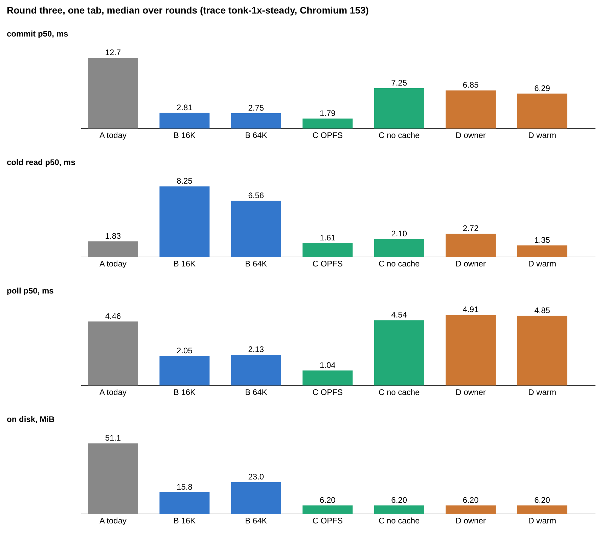
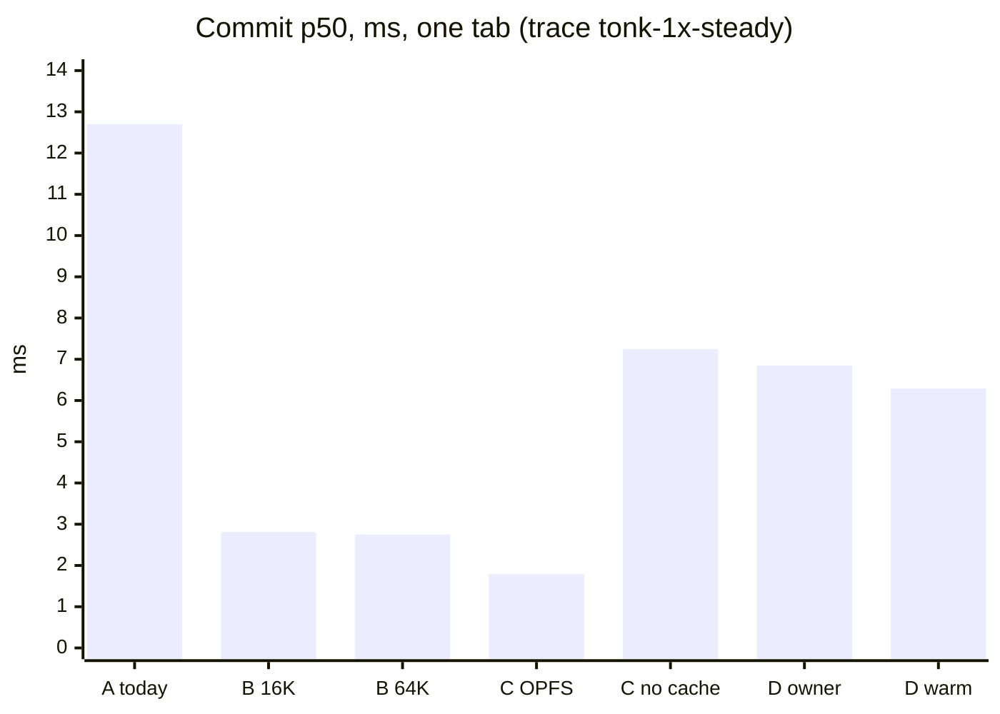
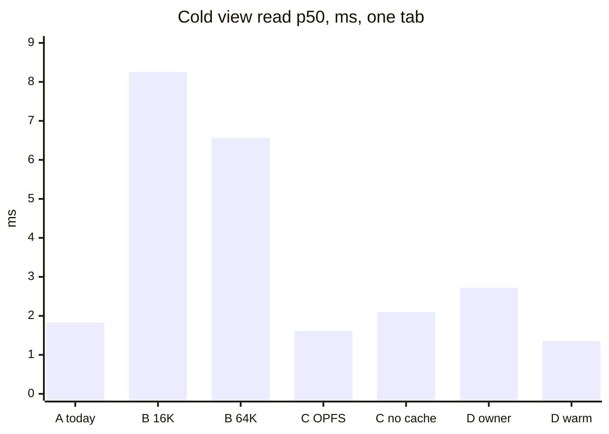
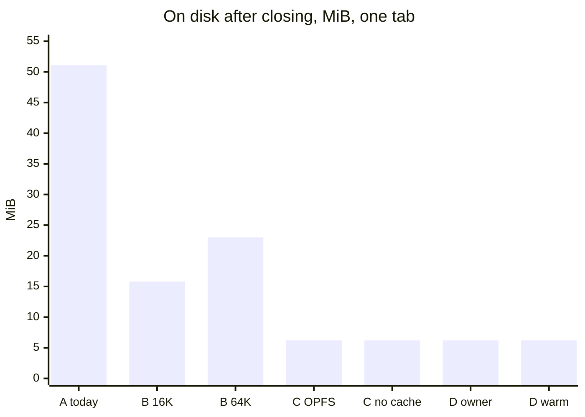
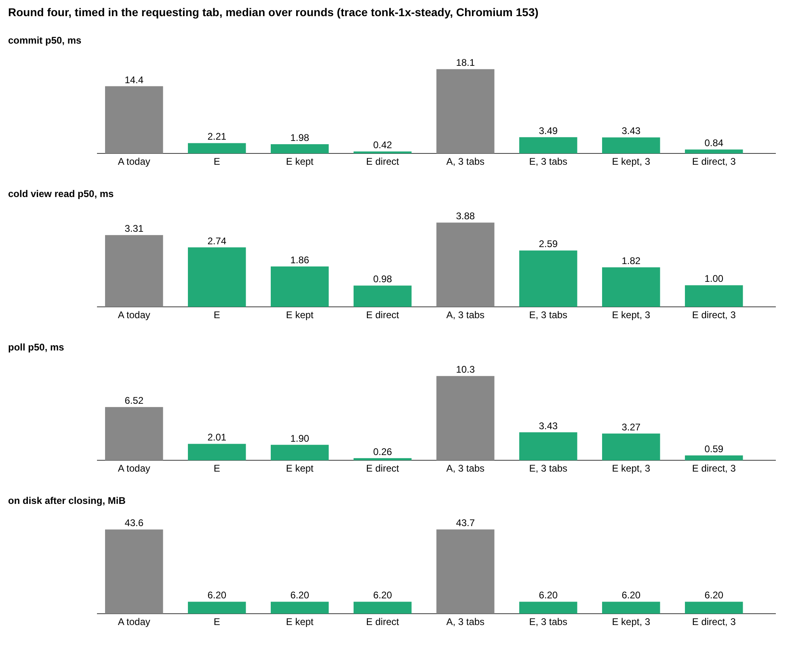
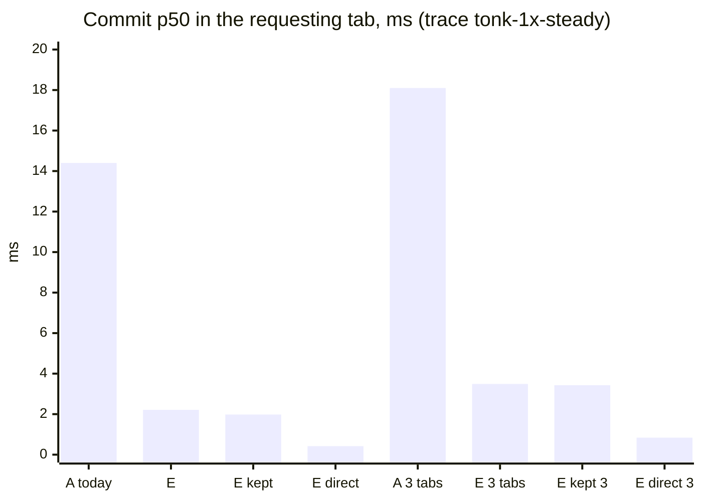
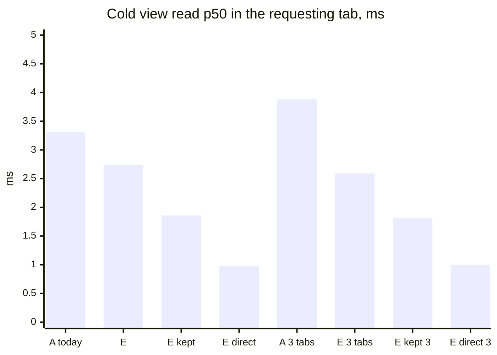
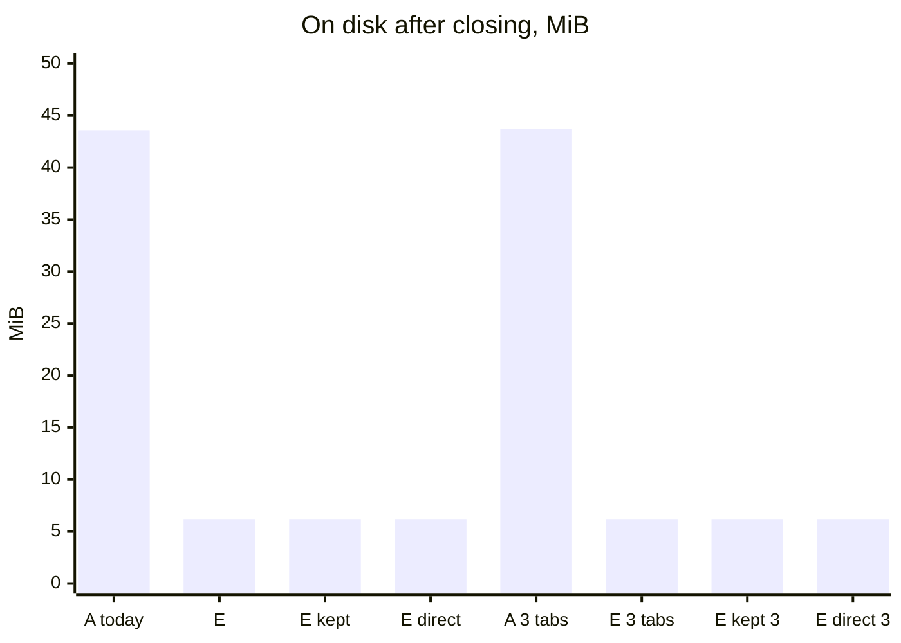

# Web spike: journal

What was tried, measured and decided, newest last. The questions come from
the "What applies to us" and "Open questions" sections of
[web-opfs.md](../single-file-format/web-opfs.md); the native design they
port is [design/file-writers.md](../../design/file-writers.md) and the end
of its [journal](../../design/file-writers/journal.md). How to run the
harness: [README.md](README.md). Raw numbers: `results/`, rendered with
`node report.js <file>`.

## Where things stand

**Status: Exploring** (a spike, four rounds; nothing here is built into the archive).

- **One browser.** Headless Chromium 153.0.8010.12 on a 4-CPU Linux VM
  (Xeon 2.10 GHz, 16 GiB, ext4 on a virtio disk with online discard).
  Firefox and WebKit were not available: nothing below says anything
  about them, and I do not guess.
- **Sync access handle calls are cheap** on a disk-backed profile: 1–2 µs
  to read 4 KiB, 7–9 µs for 100 KiB, 12–40 µs to write 4 KiB. Opening a
  handle and closing it costs 0.7–0.9 ms with the file handle's lookup.
- **A shared worker cannot create workers or open sync handles** in
  Chromium: it can only broker ports. Each tab makes its own dedicated
  worker and hands the shared worker a port; once two workers have a
  direct port, a call between pages costs about 110 µs round trip.
- **Web Locks carry the native locks' semantics** (first in, first out;
  released 3–13 ms after a worker or page dies; a try that refuses) **but
  cost 120–155 µs a lock and unlock**, against about 1 µs for the native
  `fcntl` byte lock on the same machine.
- **`readwrite-unsafe` works as the native file does**: several pages hold
  the file at once, a write is visible to a read in another page as soon
  as it returns (0 misses in 4,000), and reads tear mid-write, so the
  checksums stay load-bearing.
- **The prototype lost nothing**: 64 runs, 492,809 committed records
  verified, a page closed or crashed mid-run in 16 of them, no record
  lost or torn.
- **Neither design wins outright.** Without flushes, one owner worker
  serving the others commits 1.7–3.6x faster than `readwrite-unsafe`
  workers taking Web Locks; `readwrite-unsafe` readers read 12–29x faster
  (15–20 µs against 230–440 µs) and do not queue behind commits.
- **Flush numbers here describe this VM, not Chromium**: `fdatasync` on
  its disk is sometimes 40–300 µs and sometimes 4 ms flat, natively too.

Round two (below), against dialog's IndexedDB store on one tonk-shaped
workload, goal "space savings without becoming slow":

- **Space comes from the format, not the medium.** The same raw blocks
  take 0.97–1.0x of today's bytes in every medium. The same compact payload
  (an emulation at 1/3 and 1/20 of the raw bytes) takes 0.33–0.35x and
  0.05–0.08x of today's in IndexedDB records and in an OPFS file alike;
  pages in IndexedDB take 0.35–0.66x and 0.19x, because rewritten pages
  wait for LevelDB to compact them.
- **Every compact design was smaller and not slower** than today's store
  in the emulation; compact records in IndexedDB commit in 0.5–0.7x
  today's time and read a chain of 8 in 0.55–0.6x. No raw-block design was
  smaller, so none meets the goal without a new format.
- **OPFS is much faster, not smaller.** An OPFS file in the tab's worker
  commits in 0.05x today's time and reads a chain of 8 in 0.03–0.04x;
  behind an owner worker in another tab, 0.23x and 0.08x.
- **Sync reads are worth 0.2–0.3 ms a dependent read** against IndexedDB
  and 0.13–0.19 ms against an RPC per read. That is 2–3 ms for a chain of
  8 today, and, inferred, much more for the native format, whose cold
  node read is a frame against its predecessors plus the tokens it names.
- **Dialog in a shared worker with a replaceable owner works**: 42
  failovers with no acknowledged write lost, no request answered twice
  and no error; tabs saw 81–151 ms of outage, 60–110 ms of it the new
  owner rebuilding its index from the file.

Round three (below), go/no-go on the native file format's own trace
(one member of a tonk-shaped team: views, subscriptions, the week's
commits, pulls and pushes), each design against today's IndexedDB store
(A) in the same sitting; kill if over 0.8x on disk or over 1.1x on
commit, cold read or poll, p50 or p95, at one tab or three:

- **C, OPFS in every tab's worker (`readwrite-unsafe`, Web Locks): keep.**
  The only survivor, every round: 0.10–0.13x A's bytes, commits
  0.12–0.17x, cold reads 0.71–0.96x at p50, polls 0.15–0.24x. Chromium
  only. Web Locks are most of its commit (13.9 a commit, 0.13 ms each);
  without its page cache it fails.
- **B, the file as IndexedDB slices keyed by position: discard.** Cold
  reads 3.5–5.3x A at every slice size (each miss an awaited request), and
  5–23 MiB on disk while LevelDB keeps rewritten slices.
- **D, an owner worker: discard as the design**; it is level with A on
  reads (a message per block operation) at a tenth of the bytes and half
  the commit time, which makes it the fallback where `readwrite-unsafe` is
  missing (Firefox, Safari).
- **No store makes a whole commit 5 ms**: natively a commit is 16.8 ms
  p50, nearly all dialog's own work; C's storage work is 1.7–2.6 ms.

Round four (below), one dialog worker hosted by a tab against dialog in
the service worker on IndexedDB as tonk runs it today, every request timed
in the tab that makes it, same trace and bars (the user's: "level with
current and offers space savings"):

- **E, one dialog worker in a tab elected by a Web Lock, holding the file
  with the exclusive handle, behind the service worker: keep.** Every
  round, at one tab and three: 0.14x A's bytes, commits 0.15–0.20x
  (2.1–3.8 ms p50 against 14–20), polls 0.29–0.40x, cold view reads
  0.66–0.96x at p50 with the host's cache dropped at every cold read. It
  needs nothing Chromium-only.
- **Losing the host costs what losing today's dialog instance does**:
  50–90 ms to the first answer from a replacement (closed, crashed, or
  handed off when hidden) against 74–85 ms for A's service worker
  restarting, Wasm start excluded from both; nothing acknowledged lost,
  nothing answered twice. A crash of the host tab also restarted the
  service worker, and once took another tab with it.
- **The service worker's `fetch` is about 1.5 ms of every request**, in
  A and E alike; a port straight to the host takes a warm read to
  0.07 ms and a commit to 0.4 ms.
- **With no host, the service worker can only read, through `getFile()`**:
  cold view reads 10–11x A's, polls level, no writes.

## 2026-11-11, the setup and what a Playwright benchmark gets wrong

**Question.** Can headless Chromium under Playwright measure OPFS at all,
and with what timer?

**Measured.** `performance.now()` steps by 100 µs in a page that is not
cross-origin isolated, 5 µs in one that is. The harness serves COOP and
COEP on every response, so pages and dedicated workers are isolated
(`crossOriginIsolated: true`, timer step measured at 5 µs). The shared
worker reports `crossOriginIsolated: false` under the same headers, so
nothing is timed inside it. Calls shorter than the step are also timed
in batches of 20 and divided.

**Surprise.** A context from Playwright's `browser.newContext()` is off
the record, and there the same calls cost 100–300 times more (table
below) and `flush()` costs nothing. Its OPFS is not on disk. A benchmark
of OPFS written the usual Playwright way measures that path. The harness
uses `launchPersistentContext` with a fresh profile directory for every
number except that comparison.

## 2026-11-11, question 1: calls on a held sync access handle

**Question.** What do `read`, `write`, `getSize` and `flush` cost on a
handle held in a dedicated worker, for 4 KiB pages and 100 KiB appends,
and what does `createSyncAccessHandle` plus `close` cost?

**Measured.** A 32 MiB file of random bytes, held open in a dedicated
worker; 2,000 calls of each kind at random 4 KiB-aligned offsets (the file
is in the page cache), appends at the end, 200 flushes. Two full runs
(`T1026`, `T1029`); the table gives both where they differ. "Batch" is
20 calls timed together and divided, which is the honest number below
the 5 µs step.

| call (µs) | disk, median | disk, p95 | disk, batch median | off the record, median | off the record, p95 |
|---|---:|---:|---:|---:|---:|
| read 4 KiB | 0 | 5 | 1.2–2.0 | 260–285 | 340–435 |
| read 100 KiB | 10 | 20 | 6.5–9.0 | 1035–1255 | 1325–1865 |
| write 4 KiB (overwrite) | 15–25 | 30–40 | 12.7–24.2 | 620–750 | 890–1130 |
| write 100 KiB (overwrite) | 25–35 | 45–55 | 26–44 | 925–1010 | 1150–1440 |
| append 4 KiB | 5–30 | 20–40 | 6.8–8.0 | 695–810 | 915–1875 |
| append 100 KiB | 35–45 | 65–70 | 41–58 | 920–1060 | 1255–1965 |
| getSize | 0 | 5 | 0.3–0.5 | 215–240 | 265–350 |
| flush, nothing written | 35–45 | 165–3995 | | 0 | 5 |
| write 4 KiB then flush | 245–560 | 430–3945 | | 0–5 | 5–10 |
| append 4 KiB and flush | 315–345 | 425–525 | | 680–705 | 850–1060 |

Opening (µs, median / p95, disk profile):

| mode | `getFileHandle` | `createSyncAccessHandle` | `close` | open + close |
|---|---:|---:|---:|---:|
| readwrite (exclusive) | 345–415 / 425–840 | 420–515 / 500–1185 | 275–355 / 340–685 | 695–875 / 825–2210 |
| readwrite-unsafe | 360–385 / 435–580 | 440–475 / 525–770 | 290–315 / 355–500 | 720–800 / 870–1220 |
| read-only | 360–385 / 480 | 445–475 / 580–635 | 295–310 / 400–470 | 745–790 / 950–1110 |

**Flush is `fdatasync`, and its cost here is the VM's.** `strace` on the
renderer shows the `DedicatedWorker` thread calling `fdatasync(fd)`
itself, once per `flush()`, so on Linux the flush is a direct system
call in the renderer, not a request to the browser process. Its time
on this VM is bimodal: in some runs 40 µs clean and 250–550 µs after a
4 KiB write; in others 4.0 ms flat (`strace` shows 3.5–3.9 ms inside
the call), once 4 ms in every flush of a run, and once commits stalling
for hundreds of milliseconds (question 5). Node calling `fdatasync` on
the same disk reproduces both modes (38–270 µs in one sitting, 4.0 ms
flat in another), and the kernel's tick is 250 Hz (4 ms). So the 4 ms is
the machine, not Chromium, and no flush number from this spike says
what a laptop's disk does.

**What it means.** A read through a held handle costs about what a
`memcpy` from the page cache costs plus a microsecond, so the absence of
`mmap` is a copy, not a round trip: a Wasm-side cache need not be large
for speed's sake. Opening per turn costs 0.7–0.9 ms, 400–700 reads' worth,
which is why handing an exclusive handle from worker to worker per turn
loses (question 4). Off-the-record windows are a different, slower and
non-durable store and should be treated as one.

## 2026-11-11, question 2: one shared worker and many dedicated workers

**Question.** Can a shared worker create dedicated workers in Chromium?
If not, does the pattern of each tab making its worker and handing the
shared worker a port work, and what do the round trips cost?

**Measured.** The shared worker's own probe:

| in `SharedWorkerGlobalScope` | result |
|---|---|
| `typeof Worker` | `undefined`: nested workers cannot be made |
| `createSyncAccessHandle` on a file handle | not defined: no sync access there |
| `getFile()` | works |
| `navigator.locks` | works |
| `crossOriginIsolated` | `false`, though its script is served with COOP and COEP |

Round trips of a small message (µs; two runs, 2,000 each after 200 to
warm):

| path | median | p95 | p99 |
|---|---:|---:|---:|
| page to its own dedicated worker | 45–55 | 75–85 | 130 |
| page to the shared worker | 105–120 | 150–195 | 245–335 |
| page to shared worker to a worker of the same page, and back | 210–260 | 345–510 | 530–810 |
| page to shared worker to a worker of another page, and back | 245–270 | 420–565 | 655–1130 |
| worker to worker, same page, over a port the shared worker made | 50–55 | 85–95 | 150–405 |
| worker to worker, two pages, same | 110 | 155–160 | 270–280 |
| the same after the shared worker forgot both | 110–115 | 155 | 220–245 |

**Inferred, from the crash tests below:** each page runs in a renderer of
its own (crashing one page with `Page.crash` left the reader and the
other writers running), so the two-page numbers cross processes.

**What it means.** "One SharedWorker plus dedicated workers" is viable
only as a broker: the shared worker is where workers find each other and
get a `MessageChannel` between them, and then it is out of the path (the
port keeps working after it forgets them). It cannot own the file, so
the owner of an exclusive handle is some tab's dedicated worker, and the
shared worker cannot respawn it when that tab goes; another tab's worker
has to take over, elected by a Web Lock. Relaying every call through the
shared worker doubles a round trip (about 250 µs against 110 µs), so it
should not sit on the data path. Not checked: whether Android Chrome and
Safari have `SharedWorker` (nothing here tests them); Web Locks and
`BroadcastChannel` could do the brokering without one, which this spike
did not try.

## 2026-11-11, question 3: Web Locks as byte-range locks

**Question.** What does a Web Lock cost uncontended (exclusive, shared,
and an `ifAvailable` try, the native non-blocking `F_SETLK`), how fast and
how fairly does it pass between workers in different pages, and is it
released when its holder's page closes or worker ends?

**Measured, uncontended** (µs, in a dedicated worker; five runs):

| call | median | p95 |
|---|---:|---:|
| `request(exclusive)`, callback returns at once | 120–155 | 165–205 |
| `request(shared)` | 120–150 | 165–205 |
| `ifAvailable`, lock free (granted) | 120–135 | 160–195 |
| `ifAvailable`, lock held (refused) | 95–115 | 130–175 |
| held as a pair: acquire | 120–130 | 160–190 |
| held as a pair: release until its request settles | 15–20 | 30–40 |
| `query()` | 85–100 | 135–165 |
| `request(exclusive)` in the page's main thread | 120–145 | 185–205 |
| native `fcntl(F_SETLK)` lock and unlock of one byte, same VM (Python) | 0.99 | 1.14 |

**Contention**: workers in 2–4 pages each take one exclusive lock in a
loop (1,000 rounds each); hand-off is the time from one holder's release
to the next holder's callback, across contexts on the wall clock (five
runs):

| pages, hold | grants/s | hand-off median (µs) | p95 | p99 | same holder twice in a row | grants out of request order |
|---|---:|---:|---:|---:|---:|---:|
| 2, 0 ms | 6,000–7,000 | 135–160 | 200–255 | 270–675 | 0–13 of 2,000 | 0–8 |
| 3, 0 ms | 5,600–6,700 | 135–160 | 200–255 | 280–600 | 0–2 of 3,000 | 1–6 |
| 3, 0.2 ms | 2,000–2,100 | 230–275 | 370–425 | 520–1,580 | 0 | 0–2 |
| 4, 0 ms | 5,400–6,500 | 140–165 | 205–280 | 275–415 | 0–5 of 4,000 | 1–31 |

"Out of order" counts a grant made while an older request (by more than
50 µs on the two contexts' clocks) was waiting; at most 0.8% of grants,
which I cannot tell from clock error between contexts. The holders take
turns round robin: the lock behaves first in, first out.

**Release when the holder goes** (ms from the runner's action to the
waiter's grant, 25 trials each over five runs; the runner's own call
costs 2–5 ms, the "release" row):

| holder goes by | granted after (ms) |
|---|---|
| releasing (baseline) | 2–5 |
| `worker.terminate()` | 2–4 |
| closing its page (lock held in the worker) | 7–13 |
| closing its page (lock held by the page's main thread) | 7–15 |
| renderer crash (`Page.crash`) | 6–13 |
| navigating its page away | 27–51 |

**Freezing and stealing.** With a worker holding a lock and sending a
heartbeat every 10 ms, the page was frozen with the DevTools protocol
(`Page.setWebLifecycleState: frozen`) for 1.5 s (the same in five runs):

| | result |
|---|---|
| a waiter granted while the holder's page was frozen | no |
| heartbeats from the frozen page's worker in 1.5 s | 146–147: the worker kept running |
| `steal: true` from a third page | granted in 3–4 ms |
| what the holder saw on unfreezing | its request rejected, `AbortError: Lock broken by another request with the 'steal' option.` |
| the original waiter | granted after the stealer finished |

**The present lock.** Four workers hold `present` shared; each leaves by
releasing it and trying it exclusive with `ifAvailable`, all at once. A
worker that is granted believes it is last.

| | trials where one worker was last | trials where two were |
|---|---:|---:|
| leaving without the turn (five runs) | 97 of 100 | 3 of 100 (all in one run) |
| leaving inside the turn, as the native close does (three runs) | 60 of 60 | 0 |

**Surprises.** A lock and unlock costs about 130 µs, 130 times the
native byte lock; I infer it is a round trip to the browser process,
where Chromium keeps the lock manager, but did not trace it. And a frozen page's
dedicated worker kept running under the protocol's freeze, so what was
frozen was the page, not its writer; how Chrome's own background-tab
freezing and discarding treat workers is not something headless can show.

**What it means.** Semantically the locks map: exclusive and shared
modes, a try that refuses, first-in-first-out hand-off, and release when
the worker, the page or the renderer dies, which is what the native
design relies on for a dead writer's extent. The native close order
(release `present`, try it exclusive, inside the turn) gives exactly one
last closer with Web Locks too; without the turn, two closers can each
see themselves last, one after the other, so the turn has to stay
around that step. What does not map is the cost: at 130 µs a lock, a
design that takes a lock per commit or per cell write is bounded near
3,000–7,000 operations a second by the locks alone, where native pays a
microsecond. And `steal` is not death: the robbed holder learns of it
only through a rejected promise and can go on writing through its
handle, so stealing a lock from a frozen tab is safe only if the stolen
holder checks before every write, which the native design never needed.

## 2026-11-11, question 4: one file, several handles

**Question.** With `readwrite-unsafe`, can workers in several pages hold
one file; is one handle's write visible to another's read as soon as it
returns; does one handle's flush cover another's writes? In the default
mode, does a second open fail, and what does handing the file over per
turn cost?

**The mode matrix**: a worker in page A holds the file in the row's mode;
page B (and A again) opens it in the column's mode, and B tries
`getFile()` and `createWritable()`:

| held \ opened | readwrite | readwrite-unsafe | read-only | `getFile()` | `createWritable()` |
|---|---|---|---|---|---|
| readwrite | refused | refused | refused | reads | refused |
| readwrite-unsafe | refused | opens | refused | reads | refused |
| read-only | refused | refused | opens | reads | refused |

"Refused" is `NoModificationAllowedError` ("Access Handles cannot be
created if there is another open Access Handle or Writable stream
associated with the same file"), the same in the holder's own worker.
Three pages held the file `readwrite-unsafe` at once. So readers cannot
use `read-only` beside `readwrite-unsafe` writers: they open
`readwrite-unsafe` too.

**Visibility.** A writes a block whose every byte names the round, then
tells B over a direct port; B reads at once and checks:

| block | rounds | B read something else | write, tell, read (µs, median / p95) |
|---|---:|---:|---:|
| 4 KiB | 2,000 ×2 runs | 0 | 120–140 / 195–220 |
| 100 KiB | 2,000 ×2 runs | 0 | 210–220 / 305–380 |

**Torn reads.** A rewrites one region as fast as it can, alternating
contents; B reads it as fast as it can and counts reads that hold both:

| region | A's writes | B's reads | reads mixing two writes |
|---|---:|---:|---:|
| 4 KiB | 126,000–259,000 | 96,000–195,000 | 0.5–2.2% |
| 100 KiB | 53,000–92,000 | 7,800–12,300 | 6.7–39% |
| 1 MiB | 7,500–10,700 | 720–880 | 1.7–29% |

With two writers rewriting one region at once and a reader watching (10
trials per size, 300 ms each), the reader saw mixed contents in every
trial, and what was left afterwards was always one writer's whole block
(one distinct byte value in 20 of 20).

**Flush coverage** (ms; ten trials, two runs):

| | median | p95 |
|---|---:|---:|
| B's flush, nothing written | 0.1–0.2 | 0.2–0.3 |
| A writes 16 MiB (no flush) | 10.7–14.7 | 17–21 |
| then B's flush | 18.2–25.1 | 20–27 |
| A writes 16 MiB, then A's own flush | 18.0–24.7 | 19.6–26.7 |

**Turns, exclusive against held.** One or two pages take a Web Lock in
turn and append 4 KiB in each, either opening the file exclusively and
closing it every turn, or through a `readwrite-unsafe` handle each keeps
open (2 s each; two runs):

| | turns/s | turn median (µs) | open median | close median |
|---|---:|---:|---:|---:|
| open and close per turn, 1 page | 620–800 | 1,040–1,100 | 445–515 | 295–305 |
| open and close per turn, 2 pages | 615–720 | 1,150–1,175 | 495–545 | 320–340 |
| held handle, 1 page | 3,100–6,100 | 10–20 | | |
| held handle, 2 pages | 3,100–5,400 | 20–30 | | |
| open and close per turn, flushed, 2 pages | 480–535 | 1,610–1,620 | 485–540 | 350–390 |
| held handle, flushed, 2 pages | 295–1,550 | 355–3,680 | | |

**Failover.** A page holds the file exclusively; another page's worker
retries `createSyncAccessHandle` in a loop. Time from the holder's
going to the other's open (ms, five trials, two runs):

| holder goes by | other page opens after (ms) |
|---|---|
| `close()` on the handle | 3–5 |
| `worker.terminate()` | 4–7 |
| closing its page | 10–29 |
| renderer crash | 10–15 |

**`getFile()` beside an exclusive handle.** While A holds the file
exclusively, B reads it through `getFile()` (µs, two runs):

| | median | p95 |
|---|---:|---:|
| `getFile()` | 305–445 | 420–555 |
| `slice(4 KiB).arrayBuffer()` | 930–1,190 | 1,435–3,615 |
| A writes, tells B, B reads through a fresh `getFile()` | 2,330–2,745 | 2,770–3,760 |

B saw every write (0 of 500 wrong). A `File` taken before A's write and
read after it fails with `NotReadableError`: a `File` is a snapshot that
dies at the next write, so each read takes a fresh one.

**What I measured and what I infer.** Measured: shared handles, immediate
visibility, torn reads, one writer's block left whole, B's flush taking as
long as A's own after A's writes. Inferred, not shown: that B's flush made
A's writes durable. It is consistent with both handles being one inode
and `fdatasync` writing back the inode's dirty pages whoever made them,
but nothing here cuts the power. Whether two writers' blocks can ever be
left interleaved is not settled by 20 trials; Linux serializes writes to
one inode, the specification promises nothing.

**What it means.** On Chromium, `readwrite-unsafe` behaves like the
native file: processes share it, see each other's writes at once, and
see torn writes in progress, which the native records' checksums and the
two rolling slots already handle. Handing an exclusive handle over per
turn costs a millisecond a turn and caps turns near 700 a second, five
times fewer than a held handle under the same Web Lock. `getFile()` is a
lock-free read path that works beside an exclusive owner, at about
1–3 ms a read: too slow for tree nodes, possibly enough for a cold open
or a sealed extent.

## 2026-11-11, question 5: a space file written by several pages

**Question.** One space file and N pages in one browser context, each with
a dedicated worker. Each writer appends checksummed records to its own
extent under that extent's Web Lock, publishes a slot under a short turn
lock, and updates a cell under its cell lock; a reader reads at once.
Commits per second and read latency for N = 1, 2, 4, for the
`readwrite-unsafe` single file and for one owner worker serving the
others; and is any record lost or torn, including when a page is closed
mid-run?

**The prototype** (`harness/proto.js`). The file holds two rolling slots
(each naming how many records every extent has committed, with a CRC),
memory cells from 8 KiB, and extents of 128 MiB from 64 KiB. A record is
4 KiB: magic, extent, sequence, writer, and a CRC-32 over the rest, which
repeats extent and sequence.

- **unsafe**: every worker opens the file `readwrite-unsafe` and holds
  `space/<id>/present` shared. A writer claims the first extent whose
  `space/<id>/extent/<n>` it can take with `ifAvailable` and holds it for
  its life; adopting an extent, it reads the newest slot and continues
  from that extent's committed count (overwriting anything a dead owner
  left unpublished). A commit appends one record (no lock), takes
  `space/<id>/turn`, reads the slots, checks the slot still names its own
  count, writes the other slot, and then takes `space/<id>/cell/0` to
  increment a counter cell. The reader takes no lock: it reads the
  slots, a random committed record, the counter cell, and walks every
  newly committed record.
- **owner**: one worker holds the exclusive handle (elected by
  `space/<id>/owner`) and does every read and write; writers keep claiming
  extents by Web Lock and send each record over a port the shared worker
  connected; the owner's commit handler is synchronous, so requests are
  the turn. The reader asks the owner for slots, records and the cell.
- **flush**: none, or per commit (after the record and after the slot,
  in both designs).
- **kill**: halfway through a 3 s run, the last writer's page is closed,
  or its renderer crashed, and a new page is started; its writer finds
  the dead page's extent free and adopts it.

After each run every worker stops, and a verifier opens the file
exclusively and checks every record the newest slot names, and that every
commit a writer had reported (every 100 ms, to the runner) is still named.

**Numbers**: four runs of each configuration (`T1026`, `T1029`, `T1031`,
`T1032`), each 3 s with one reader page.

| design | writers | flush | kill | commits/s, median (min–max) | commit median (µs) | reads/s, median (min–max) | read median (µs) |
|---|---:|---|---|---:|---:|---:|---:|
| unsafe | 1 | none | | 1,799 (1,243–1,964) | 490 | 23,913 (14,367–40,567) | 20 |
| unsafe | 2 | none | | 2,147 (1,586–2,575) | 792 | 35,133 (15,982–39,369) | 17.5 |
| unsafe | 4 | none | | 2,093 (1,684–2,827) | 1,597 | 27,826 (13,864–39,770) | 15 |
| owner | 1 | none | | 3,044 (2,446–3,714) | 287 | 1,434 (1,052–1,645) | 233 |
| owner | 2 | none | | 5,467 (3,629–6,138) | 323 | 1,127 (703–1,224) | 295 |
| owner | 4 | none | | 7,608 (6,103–8,904) | 460 | 721 (591–880) | 438 |
| unsafe | 1 | per commit | | 455 (292–790) | 1,292 | 35,158 (29,147–41,834) | 17.5 |
| unsafe | 2 | per commit | | 369 (287–1,074) | 4,212 | 34,983 (30,613–39,495) | 15 |
| unsafe | 4 | per commit | | 841 (623–990) | 3,982 | 37,165 (28,215–40,642) | 15 |
| owner | 1 | per commit | | 422 (280–842) | 1,687 | 206 (127–456) | 935 |
| owner | 2 | per commit | | 562 (133–1,119) | 2,272 | 129 (34–255) | 1,570 |
| owner | 4 | per commit | | 379 (7–1,319) | 7,565 | 39 (2–129) | 3,575 |
| unsafe | 4 | none | close | 2,109 (1,869–2,621) | 1,316 | 19,971 (15,965–36,848) | 20 |
| unsafe | 4 | none | crash | 1,831 (1,495–2,606) | 1,526 | 24,872 (18,886–31,860) | 17.5 |
| owner | 4 | none | close | 5,412 (4,531–8,099) | 583 | 526 (474–794) | 555 |
| owner | 4 | none | crash | 5,641 (4,170–7,911) | 581 | 531 (385–779) | 570 |

In the unsafe design a writer waited for the turn 145 µs (median) alone,
255 µs with two and 550 µs with four; the slot read takes 5 µs, against
165–335 µs through the owner.

**Checks**, over all 64 runs:

| check | result |
|---|---:|
| committed records verified after the runs | 492,809 |
| records read back wrong (by the verifier or the reader during runs) | 0 |
| random reads during runs | 2,925,604 |
| committed records the unsafe reader walked as they were committed | 143,507 |
| commits reported to the runner and later missing | 0 |
| a slot found naming another count for a writer's own extent | 0 |
| torn cell reads, or a cell read going backwards | 0 |
| counter cell short of the records committed | by 1, in 2 of 8 crash runs (unsafe) |
| extents adopted from a closed or crashed page | 16 of 16, continuing at the committed count |

The cell short by one is a writer crashed between publishing its slot
and updating the cell: the cell is not part of the commit, here as in the
native design.

**What surprised me.** The owner wins on writes, by 1.7x with one writer
and 3.6x with four, because an unsafe commit takes two Web Locks (about
2 × 140 µs before any waiting) where an owner commit takes one round trip
(110–250 µs), and the owner serializes for free. And the unsafe design
does not scale with writers: its commits are bound by the turn's Web Lock
hand-off (150–170 µs), not by the disk. The four-writer runs also put
five or six busy threads on four CPUs, which is in the spread.

**What it means.** On writes without flushes, an owner worker beats Web
Locks taken per commit. On reads, `readwrite-unsafe` is 12–29x faster and
readers never wait for writers, while the owner's reads slow as writers
are added (233 to 438 µs median, 1,434 to 721 reads a second) since they
queue behind commits. With a flush per commit, the flush decides both
and this VM's flush is not a measurement (one owner run fell to 7 commits
a second on stalled flushes). Batching would change the unsafe numbers:
taking the turn once per batch of records, as the native design takes it
once per integration rather than per commit, removes most of the lock
cost; this spike did not measure that.

## 2026-11-11, what it means for porting the native design

**Which locks map onto Web Locks.**

| native lock | Web Lock | maps? |
|---|---|---|
| the writer's turn (exclusive byte) | `space/<id>/turn`, exclusive | yes: FIFO, released on death in 3–13 ms; 130 µs a take, so per integration, not per commit |
| an extent's owner (exclusive byte, held while it is one's own; a try finds a dead owner's) | `space/<id>/extent/<n>`, exclusive, held for the worker's life; `ifAvailable` to find a free or dead one | yes, cleanly: the case Web Locks do best; adoption from closed and crashed pages worked in every run |
| a reader's shared lock on an extent it reads | the same name, shared | yes, at 130 µs a take |
| a cell's lock (per-cell byte, compare-and-swap) | `space/<id>/cell/<name>`, exclusive | in meaning; at 130 µs per cell write it is the cost that bounds a commit |
| present (shared while open; exclusive try at the last close) | `space/<id>/present`, shared, then `ifAvailable` exclusive | only inside the turn, as native does it: there 60 of 60 trials gave exactly one last closer; outside it, two |
| a process's locks dying with it | a worker's or page's locks dying with it | yes, but `steal` is not death: a robbed holder keeps its handle and must check before it writes |

What has no counterpart: the native locks are free next to an I/O, Web
Locks cost about one 4 KiB read per 100. And the native design's locks
belong to a process; a Web Lock belongs to the worker or page that asked,
so two workers of one tab exclude each other, which is simpler than POSIX
(no in-process mutexes needed for that).

**Is "one SharedWorker plus dedicated workers" viable?** Yes, as a
broker and nothing more. In Chromium 153 a shared worker cannot create
workers or open a sync access handle, so each tab creates its dedicated
worker and gives the shared worker a port; the shared worker connects
workers to one another and to an owner with `MessageChannel`s and then
stays off the data path (a direct cross-page round trip is about 110 µs,
one through the shared worker about 250 µs). Readers can run concurrently
in several workers either way: with `readwrite-unsafe` each reads the file
itself; with an owner they can read through `getFile()` at 1–3 ms, or ask
the owner at 0.2–0.5 ms.

**Does the `readwrite-unsafe` single file beat an owner worker?** Not
outright:

- Reads: `readwrite-unsafe` by 12–29x, and readers never queue behind
  writers.
- Writes taking Web Locks per commit: the owner, by 1.7–3.6x.
- Portability: the owner works with the standard's exclusive handle;
  `readwrite-unsafe` is Chromium only.

My reading, an inference from these numbers: the portable design is an
owner worker elected by a Web Lock and reached over ports a shared worker
brokers, which is the native writer with an in-process turn. On Chromium,
`readwrite-unsafe` can be added behind a feature check for readers (every
tab reads the file itself, as native readers do) and for appends to a
tab's own extent, provided the turn is taken per integration, not per
commit, as the native design already does. Measuring that hybrid, and
batched turns, is the next step.

**What this spike cannot tell.**

- Firefox and Safari: not available here. Outside Chromium the exclusive
  handle is the only mode (per web-opfs.md), and none of these numbers
  carry over.
- Real disks: flush times here are a virtual disk's, bimodal and stalling
  natively too; macOS (`F_BARRIERFSYNC`), Windows and mobile flash are
  not measured.
- Durability: nothing cut the power; "B's flush covers A's writes" is
  inferred from timing.
- Background tabs: the freeze here is the DevTools protocol's, which left
  the worker running. Chrome's own freezing of hidden tabs, tab discarding
  and memory-pressure kills, and iOS backgrounding, were not observed.
- Headless rendering and four CPUs: the four-writer runs oversubscribe
  the machine; on more cores the unsafe readers and the owner may both do
  better.
- Wasm: the prototype is plain JavaScript; the archive in Wasm would add
  copies into linear memory and its own CPU cost per commit.

## 2026-11-11, round two: what would replace dialog's IndexedDB store

**Questions.** The maintainer's direction, and, part way through, the
goal it serves: "space savings without becoming slow".

1. Against the IndexedDB store dialog uses on the web today, on one
   workload, what do a paged file in IndexedDB, an OPFS file held in the
   tab's own worker, and an OPFS file behind an owner worker in another
   tab cost, in commit and read latency and in bytes on disk?
2. Are synchronous reads crucial? Dialog walks a search tree, so a read
   is a chain of dependent lookups (each node names the next). What does a
   chain of depth 1, 4 and 8 cost with an awaited IndexedDB get per hop,
   an RPC per hop to the worker holding an OPFS handle, and the whole
   chain walked synchronously where the file is (one RPC for the chain)?
3. Is dialog in a shared worker, served by one owner dedicated worker that
   a tab creates and that another tab replaces when it goes, viable? What
   does an operation cost from the shared worker, how long does a failover
   take, and is any acknowledged write lost or any request answered twice
   or wrongly?
4. Which designs are smaller than today's store and not slower than it?
   Separating format from medium: is the saving the native file gets a
   property of OPFS, or of the format, which could sit in IndexedDB?

**The baseline, mirrored from dialog.** From
`rust/dialog-storage/src/storage/provider/indexeddb.rs`, `archive.rs` and
`memory.rs`, mirrored in `IdbArchive` (`harness/store.js`): one database
per space; object store `archive/<catalog>` keyed by the base58 of the
block's digest, value a `Uint8Array` copy of the bytes; `memory` keyed
`<space>/<cell>`, value the content's bytes; one connection per context,
shared; a get is its own read-only transaction, answered when its request
succeeds (not on `complete`); an import is one read-write transaction that
awaits each put's request before issuing the next, answered on
`complete`; a publish is one read-write transaction that gets the cell,
checks it (a cell already holding the content succeeds without writing;
otherwise the expected version must match, or the cell be empty) and puts
it; no durability is passed, so the browser's default applies (Chromium
reports it as `default`). Simplified: both stores are made at open
instead of by a version upgrade on first use, there is no schema mutex
around starting a transaction, a version is a 32-bit hash rather than
BLAKE3, keys are computed before timing, and there is no Wasm (no copies
in or out of linear memory, no hashing). `pipelined` is the one change
measured on top: issue every put of an import before waiting.

**The other stores.** All in `harness/store.js`, one interface:

- **The log archive** (`LogArchive`): blocks appended as records (a
  64-byte header with the key and a word checksum, then the bytes), two
  rolling slots naming the log's end and the memory cells, an index from
  key to record in memory, rebuilt on open by walking the record headers
  (the native file reads index pages instead). An import writes its new
  blocks in one write, then the next slot; a publish writes the next slot.
  Blocks already held are skipped, so a retried import writes nothing.
- **Over an OPFS file** (`OpfsFile`): the exclusive sync access handle
  (`readwrite`, the portable mode). `opfs` holds it in the tab's own
  worker, so dialog would run where the file is; `owner` holds it in an
  owner worker in another tab and serves the archive over a MessagePort
  (`serveArchive`), each request answered in the task that received it.
- **Over pages in IndexedDB** (`PagedIdbFile`, `pidb`): the same file's
  bytes as page records (`<space>.paged`, store `pages`, key the page
  number, value the page), in the style of absurd-sql and wa-sqlite's
  IDBBatchAtomicVFS. Writes go to cached pages; an import or publish puts
  its dirty pages in one read-write transaction, which is atomic, so
  records and slot land together. Reads come from the page cache
  synchronously; a miss fetches the pages it spans with one `getAll`.
  Unbounded cache unless a size is given; "cold" drops it before each
  read.

**The workload** (`harness/host.js`), the same for every store, written
from seeds so every store is given the same bytes (77.1 MB per
single-tab run). Blocks are 1 to 8 KiB, one in ten 64 KiB, of
incompressible bytes whose first 48 bytes name the next block of a chain.
A commit imports 10 to 50 new blocks (about 300 KiB) and publishes the
committer's head cell, compare-and-swap on the version it last got. A
preload writes 3,000 blocks, 150 of them chains of 8. Reads: single gets;
16 gets at once; chains of depth 1, 4 and 8 from a random chain's root,
per hop (`hop`) or walked by the store (`walk`: synchronously over OPFS
or cached pages, one request to an owner); a get issued just after an
import starts. Three tabs run a mixed loop: a commit, chains of depth 1,
4, 8 and one more, and a batch. Every block written is read back and
checked at the end, and every cell must hold the last acknowledged
content.

**Durability, like with like.** IndexedDB `relaxed` (and `default`,
which is relaxed in Chromium since 121): `complete` fires once LevelDB has
the write, before it is flushed; it survives the tab, worker or renderer
dying, not the machine (from Chromium's documented semantics; nothing
here cut the power). `strict`: flushed before `complete`. OPFS without
flush: the bytes are in the operating system's file before the answer,
the same class as relaxed (the failovers below check the process-death
half). OPFS with flush: `flush()` (fdatasync) after the records and after
the slot, three per commit. The paged file follows IndexedDB's setting.
Unflushed is compared with relaxed, flushed with strict.

**Where it is timed.** Question 6: in the tab's dedicated worker
(cross-origin isolated, 5 µs timer). Question 7: dialog runs in the shared
worker, which is not isolated (100 µs timer, measured), so each operation
is timed in the tab that asked for it, which adds the tab-to-shared-worker
round trip (`echo`, 0.10–0.14 ms). Every configuration ran in a fresh
persistent profile; bytes on disk are the profile's `IndexedDB` and `File
System` directories, measured from Node after the context closed, beside
`navigator.storage.estimate()`. Two full runs, `T1131` and `T1139`
(`node run.js q6 q7 q8 q9`, 7 minutes each); ranges below are the two
runs, medians and p95 in milliseconds.

**Question 6, one tab, dialog in the tab's own worker** (commit is import
then publish; 100 commits):

| store | commit p50 | commit p95 | commits/s | on disk / logical |
|---|---:|---:|---:|---:|
| today: idb, default | 12.9–14.3 | 20.2–25.0 | 65–76 | 1.03x, 724 of 7,157 blocks as blob files |
| idb, relaxed | 14.3–16.4 | 24.4–26.5 | 59–68 | 1.03x |
| idb, strict | 14.7–15.6 | 24.4–26.8 | 60–67 | 1.03x |
| idb, pipelined puts | 9.2–9.3 | 15.4–18.6 | 99 | 1.03x |
| pidb, 4 KiB pages | 9.6–10.4 | 16.1–17.3 | 92–98 | 1.04x |
| pidb, 32 KiB pages, relaxed | 4.9–5.4 | 17.3–24.9 | 135–137 | 1.01–1.07x |
| pidb, 32 KiB pages, strict | 8.4–9.0 | 14.9–16.6 | 101–107 | 1.01–1.17x |
| pidb, 64 KiB pages | 11.6–12.1 | 17.8–19.2 | 76–80 | 1.05x, every page a blob file |
| opfs in the tab's worker, no flush | 0.81–0.83 | 1.53–1.65 | 621–655 | 1.01x |
| opfs in the tab's worker, flush | 2.0–2.4 | 3.5–4.2 | 319–360 | 1.01x |
| owner in another tab, no flush | 2.90–2.96 | 4.8–5.0 | 278–284 | 1.01x |
| owner in another tab, flush | 4.7–5.2 | 6.7–11.5 | 160–190 | 1.01x |

Reads, same runs (pidb's single gets and batches ran after a cold phase
had emptied its cache, so they are partly cold):

| store | get 1–8 KiB | get 64 KiB | 16 gets at once | get issued during an import (answered before it) |
|---|---:|---:|---:|---:|
| today: idb, default | 0.17–0.25 / 0.28–0.42 | 0.92–1.20 / 1.25–1.47 | 2.2–2.8 / 5.6 | 13.5–14.5, the import's own time (0 of 30) |
| pidb, 32 KiB | 0.34–0.38 / 0.64–0.66 | 0.74–0.83 / 1.05–1.14 | 1.4–1.6 / 4.0 | 3.5–4.3 (8–9 of 30) |
| opfs, no flush | 0.01 / 0.01 | 0.04–0.05 / 0.09 | 0.19–0.22 / 0.32–0.40 | 0.56–0.68 (0 of 30) |
| owner, no flush | 0.13–0.14 / 0.20–0.38 | 0.23 / 0.39–0.63 | 0.89–1.05 / 1.5–1.6 | 2.9–3.1 (0 of 30) |

Chains of dependent reads, p50 / p95:

| store, how | depth 1 | depth 4 | depth 8 | per hop at depth 8 |
|---|---:|---:|---:|---:|
| today: idb, an awaited get per hop | 0.25 / 1.8–2.0 | 0.83–0.98 / 2.4–2.6 | 2.1–2.4 / 3.9–6.4 | 0.27–0.30 |
| owner, an RPC per hop | 0.13–0.14 / 0.27–0.28 | 0.58–0.59 / 1.0–1.3 | 1.22–1.40 / 2.3–3.0 | 0.15–0.17 |
| owner, walked in the owner (one RPC) | 0.13–0.14 / 0.28–0.36 | 0.17–0.23 / 0.35–0.52 | 0.31–0.32 / 0.53–0.69 | 0.02 past the RPC |
| opfs, walked in the tab's worker | 0.01 / 0.04 | 0.03 / 0.09 | 0.07–0.10 / 0.17–0.18 | 0.01 |
| pidb 32 KiB, cached, walked | 0.01 / 0.05–0.20 | 0.03 / 0.12–0.23 | 0.09 / 0.23–0.58 | 0.01 |
| pidb 32 KiB, cold, per hop | 0.40–0.61 / 1.5–1.6 | 0.74–0.92 / 1.7–2.2 | 1.31–1.40 / 3.0–3.3 | 0.16–0.18 |

Three tabs, each with its own worker and store (IndexedDB: three
connections to one database; owner: one owner, three clients), running
the mixed loop for 3 s:

| store | commits/s, all tabs | commit p50, per tab | chain 8 p50, per tab | batch 16 p50 |
|---|---:|---:|---:|---:|
| today: idb, relaxed | 48–51 | 14.6–20.5 | 6.3–14.1 | 3.2–3.7 |
| idb, strict | 42 | 19.6–25.7 | 6.5–16.0 | 3.4–4.6 |
| owner, no flush (RPC per hop) | 207–211 | 3.7–4.0 | 2.6–3.0 | 1.2–1.3 |
| owner, flush | 156–168 | 6.1–6.8 | 2.8–3.1 | 1.2–1.4 |

**Question 7, dialog in the shared worker**, timed in the tab (one tab
first, then three tabs driving the shared worker at once):

| store | commit p50 / p95 | chain 8 p50 / p95 | batch 16 p50 | three tabs: commits/s | three tabs: chain 8 p50 |
|---|---:|---:|---:|---:|---:|
| today: idb, relaxed (per hop) | 16.3–17.4 / 30.0–32.8 | 3.06–3.27 / 6.6–7.9 | 3.1–3.2 | 38–41 | 6.8–12.3 |
| idb, strict | 18.2–19.6 / 30.9–37.6 | 3.21–3.23 / 5.3–5.9 | 3.0 | 39 | 7.2–13.5 |
| pidb 32 KiB, whole file cached, walked | 5.9–6.2 / 12.2–12.6 | 0.23–0.26 / 0.52–0.58 | 0.45–0.46 | 135–144 | 0.35–0.44 |
| pidb 32 KiB, 8 MiB cache, per hop | 5.7–6.0 / 11.3–11.6 | 1.83–2.00 / 4.1 | 3.4–3.6 | 75–79 | 4.5–5.6 |
| pidb 32 KiB, strict, walked | 8.8–9.6 / 16.7–18.4 | 0.27–0.31 / 0.50–0.71 | 0.47–0.51 | 98–99 | 0.35–0.40 |
| owner, no flush, RPC per hop | 3.81–3.85 / 6.2–7.0 | 1.61–1.63 / 2.95–3.05 | 1.21–1.25 | 150–153 | 4.0–5.4 |
| owner, no flush, walked in the owner | 3.52–3.77 / 6.4 | 0.41–0.47 / 0.74–0.91 | 1.26–1.35 | 207–210 | 0.58–0.70 |
| owner, flush, walked in the owner | 5.4–5.6 / 8.7–10.0 | 0.48–0.55 / 0.96–1.05 | 1.3–1.5 | 143–176 | 0.60–0.79 |

The shared worker adds its round trip to everything (0.10–0.14 ms), and,
being one thread, queues every tab's operations: three tabs' commits
through it take 14–15 ms on the paged store against 6 ms for one tab.
With an RPC per hop, a chain of 8 waits behind other tabs' commits at the
owner eight times (4.0–5.4 ms); walked in the owner it waits once
(0.58–0.70 ms).

**Question 8, failover.** Three tabs drive the shared worker for 6 s; at
2 s the owner's tab is closed, its renderer crashed (`Page.crash`), or
its owner worker terminated (the tab stays). `cold`: the shared worker
queues on the owner lock and, granted, asks another live tab for a new
owner. `standby`: a second owner, already loaded in another tab, waits
on the lock and takes over itself. Milliseconds from the runner's action;
three trials of each per run, both runs:

| standby | owner goes by | detected | lock taken | file open (tries) | index rebuilt | first request served | longest gap a tab saw |
|---|---|---:|---:|---:|---:|---:|---:|
| cold | tab closed | 11.5–15.8 | 28–35 | 29–37 (1) | 95–132 | 97–137 | 96–138 |
| cold | renderer crashed | 11.4–17.9 | 28–47 | 31–50 (1) | 95–136 | 100–137 | 97–137 |
| cold | worker terminated | 2.0–4.5 | 19–32 | 21–35 (1) | 89–136 | 93–138 | 92–145 |
| standby | tab closed | | 11–22 | 13–27 (1) | 88–110 | 90–112 | 87–112 |
| standby | renderer crashed | | 8–18 | 14–22 (1) | 81–123 | 83–125 | 81–129 |
| standby | worker terminated | | 2–4 | 6–7 (1) | 97–104 | 99–109 | 101–126 |
| cold, flushed | tab closed | 12–25 | 30–43 | 32–45 (1) | 96–122 | 108–124 | 104–151 |

| check, over all 42 failovers | result |
|---|---:|
| requests in flight retried against the new owner | 2–18 a failover |
| answers to a request already answered | 0 |
| requests answered with an error, in the tabs or the link | 0 |
| acknowledged blocks read back and checked afterwards | 23,326–31,073 a run, 0 wrong or missing |
| head cells not holding their last acknowledged content | 0 |
| the shared worker lost | never; the owner was always in the tab that created the shared worker, so every crash run crashed that tab |

The new owner always opened the file at its first try. What the tabs
wait for is the new owner rebuilding its index: walking 11,000–13,300
record headers of a 114–142 MB file took 62–109 ms, 5–9 µs a record.
Without it a cold failover is about 20–50 ms and a standby one 6–27 ms;
the standby saves the 15–25 ms of starting a worker and nothing else.

**Question 9, format against medium.** The native file is smaller
because of its format: tree nodes as frames of rows over shared tokens,
each written against the version it supersedes and whole every 32
(`research/single-file-format/journal.md`, 2026-11-05). Porting that to
JavaScript is out of scope, so a compact format is emulated: every block
is stored as a payload of a fixed fraction of its bytes (incompressible,
link kept readable), and the same written dataset is stored four ways.
Gzip of the blocks as a stand-in would have measured my generator, whose
bytes are random; the ratio is set instead. The brief suggested a third
to a half of the raw bytes; I could not find that figure in the native
journal, which records much larger savings over whole histories (568.5
MiB of tonk-team's blocks in 25.4 MiB, 22x; Stack Exchange 1,160.7 MiB in
13.4 MiB, 87x; a member's replica 2.0 MiB against main's 170 MiB, and
frames of token offsets alone, written whole, 9.9–20x). So 1/3 and 1/20
were run. Single tab, dialog in the tab's worker, unflushed (relaxed)
throughout; today's layout is 79.6 MB on disk, `estimate()` 79.6 MB,
commit 12.9–13.0 / 21.2–21.9 ms, chain of 8 2.35–2.47 / 4.96–5.11 ms.
"x" is the ratio to today's layout (p50 / p95):

| format | medium | on disk MB | size x | commit x | chain 8 x (best way) | smaller and not slower |
|---|---|---:|---:|---:|---:|---|
| raw | idb records (today) | 79.6 | 1.00 | 1 / 1 | 1 / 1 | the baseline |
| raw | pidb pages | 78.2 | 0.98 | 0.38–0.39 / 0.50–0.52 | 0.03–0.04 / 0.04 warm; 0.55–0.65 cold | no, not smaller |
| raw | opfs, tab's worker | 77.6 | 0.97 | 0.05–0.06 / 0.06–0.07 | 0.03–0.04 / 0.03–0.04 | no, not smaller |
| raw | owner, other tab | 77.6 | 0.97 | 0.23 / 0.24 | 0.08–0.09 / 0.07–0.09 | no, not smaller |
| 1/3 | idb records | 27.9 | 0.35 | 0.59–0.70 / 0.63–0.84 | 0.57–0.58 / 0.34–0.43 | yes |
| 1/3 | pidb pages | 27.8–52.7 | 0.35–0.66 | 0.23–0.24 / 0.24–0.33 | 0.01–0.02 / 0.04–0.05 warm | yes |
| 1/3 | opfs, tab's worker | 26.2 | 0.33 | 0.02–0.03 / 0.03–0.05 | 0.02 / 0.01–0.02 | yes |
| 1/3 | owner, other tab | 26.2 | 0.33 | 0.15 / 0.13–0.15 | 0.07 / 0.05–0.07 | yes |
| 1/20 | idb records | 6.0 | 0.08 | 0.48–0.50 / 0.46–0.49 | 0.55–0.59 / 0.38–0.41 | yes |
| 1/20 | pidb pages | 15.1 | 0.19 | 0.13–0.16 / 0.18–0.19 | 0.01 / 0.01 warm | yes |
| 1/20 | opfs, tab's worker | 4.3 | 0.05 | 0.01 / 0.02 | 0.01 / 0.01 | yes |
| 1/20 | owner, other tab | 4.3 | 0.05 | 0.07 / 0.07–0.10 | 0.07–0.08 / 0.07–0.13 | yes |

"Smaller" is at most 0.8x; "not slower" is commit and chain-of-8 p50 and
p95 each at most 1.1x today's. In the shared worker the compact records
in IndexedDB hold the same relation (question 7): at 1/20, commit
6.6–7.3 / 10.9–14.4 ms against today's 16.3–17.4 / 30.0–32.8, chain of 8
1.59–1.67 / 2.5–3.1 against 3.06–3.27 / 6.6–7.9. (Sizes there do not
compare: those runs write for a fixed time, so faster stores write more.)

How the bytes are spent: IndexedDB records hold a payload with little
overhead at 1/3 (27.9 MB for 25.7) and 1.6x at 1/20 (6.0 MB for 3.9 MB,
values of about 200 bytes each carrying a 44-byte key and LevelDB's
framing). The OPFS file holds the payload plus 64-byte headers. Pages in
IndexedDB rewrite their tail page and the slot's page at every import and
publish, and LevelDB keeps the superseded versions until it compacts: the
same 1/3 dataset took 52.7 MB in one run and 27.8 MB in the other, and
1/20 took 15.1 MB for 3.9 MB in both (inferred from the variance; I did
not inspect LevelDB's levels). `estimate()` matches the disk for
IndexedDB and over-reports OPFS: 134.2 MB (128 MiB) for a 77.6 MB file,
33.6 MB for 26.2, 8.4 for 4.3, as if rounded up to a power of two
(measured with the handle open; inferred to be quota Chromium reserves
for the handle).

**What surprised me.**

- **Today's store writes every 64 KiB block as a file of its own.** 724
  of 7,157 blocks, 47.5 of 79.6 MB, sat in the profile's
  `.indexeddb.blob` directory, one file each: Chromium wraps values above
  about 64 KiB as blobs. Reading one costs 0.9–1.2 ms against 0.17–0.25
  ms for a small block, and they are why a raw chain of 8 costs 2.1–2.5
  ms. Pages of 64 KiB fall over the same line (every page a blob file,
  commits 2.3x slower than 32 KiB pages); 32 KiB pages stay under it.
- **A read waits for any write in flight.** A read-only IndexedDB
  transaction created after a read-write one on the same store waits for
  it: 0 of 30 gets issued during an import were answered before it, and
  took the import's 13–14 ms. With three tabs a chain of 8 went from 2–3
  to 6–16 ms. The OPFS archive serializes too, but its import takes 0.6–3
  ms; the paged store's cache answers hits during a commit (8–15 of 30).
- **Strict costs nothing over relaxed here** (commit 14.7–15.6 against
  14.3–16.4 ms), and `default` is relaxed's speed: on this VM IndexedDB's
  commit is the browser's work per value and per blob file, not the
  flush. The flush is this VM's (round one); a laptop's disk may not
  agree.
- **Awaiting each put is a third of today's commit.** Issuing all of an
  import's puts before waiting takes commits from 12.9–14.3 to 9.2–9.3
  ms, a one-line change to `indexeddb/archive.rs` that needs none of the
  rest.
- **Failover is the index, not the locks.** Detection (2–25 ms) and
  starting a worker are small; rebuilding the in-memory index from the
  file is two thirds of every outage.

**What it means.**

- **Does any OPFS design beat the IndexedDB baseline?** On speed, by a
  lot: in the tab's worker a commit is 16–18x faster and a chain of 8
  21–34x; behind an owner in another tab, 4.4–4.9x and 6.6–7.7x (walked
  in the owner); from the shared worker, commits 4.3–4.9x faster and chains of 8 walked in the
  owner 6.5–8x. On size, not at all: raw blocks take the same bytes in
  every medium (0.97–1.0x). OPFS is not where the space saving comes
  from.
- **Where the paged IndexedDB design falls.** Between the two: commits
  2.4–2.9x faster than today in the tab's worker and in the shared worker
  (5–6 ms against 13–17), reads as fast as OPFS while the file is in its
  cache and about 0.55–0.65x of today's when cold (one `getAll` a hop,
  without blob files). It needs one instance per space, so its home is
  the shared worker, where it needs no owner and no failover. What it
  costs: the cache in the shared worker's memory (an 8 MiB cache over a
  file of about 180 MB gave chains of 8 at 1.8–2.0 ms, still 0.6x of
  today's), and space amplification from rewriting pages, which LevelDB
  reclaims only when it compacts.
- **Are sync reads crucial? Quantified:** a dependent read costs
  0.17–0.30 ms awaited from IndexedDB (0.9–1.2 ms for a 64 KiB block),
  0.13–0.19 ms as an RPC to an owner, and 0.01–0.02 ms synchronously from
  an OPFS handle or a cached page. A chain of 8 is 2.1–3.3 ms against
  IndexedDB, 1.2–1.6 ms with an RPC per hop, 0.3–0.5 ms walked in the
  owner and 0.07–0.10 ms walked locally; under three tabs, RPC per hop is
  4–5 ms and walking 0.6–0.7 ms, so where the reads run decides more than
  the medium. For today's layout (a block per node, descents of a few
  nodes, a node cache above) that is 1–3 ms per cold descent: noticeable,
  not decisive. For the native format it is decisive, inferred, not
  measured: serving a cold node decodes its frame against its
  predecessor (written whole every 32 versions, so a chain of up to 31
  frames) and reads the tokens its rows name by position
  (`research/single-file-format/design.md`, "Rows" and "Reads"). That is
  tens of small dependent reads per node: at 0.2 ms each, several
  milliseconds a node in IndexedDB records, against well under one
  millisecond from a file read synchronously. The emulation in question 9
  gives each block one payload and does not see this.
- **Smaller and not slower, per design** (question 9, single tab, against
  today's layout; size, then commit and chain-of-8 p50 / p95):
  - compact records in IndexedDB: 0.35x at 1/3, 0.08x at 1/20; commit
    0.59–0.70 / 0.63–0.84x and 0.48–0.50 / 0.46–0.49x; chain 0.57–0.58 /
    0.34–0.43x and 0.55–0.59 / 0.38–0.41x. **Meets it, in the
    emulation**, mostly because small values avoid blob files.
  - compact pages in IndexedDB: 0.35–0.66x and 0.19x; commit 0.23–0.24 /
    0.24–0.33x and 0.13–0.16 / 0.18–0.19x; chain 0.01–0.02 / 0.04–0.05x
    warm. **Meets it**, smaller by less than records until LevelDB
    compacts.
  - compact OPFS file in the tab's worker: 0.33x and 0.05x; commit
    0.02–0.03x and 0.01–0.02x; chain 0.01–0.02x. **Meets it**, by the
    widest margin.
  - compact OPFS file behind an owner: 0.33x and 0.05x; commit 0.13–0.15x
    and 0.07–0.10x; chain 0.05–0.07x and 0.07–0.13x. **Meets it.**
  - raw blocks in pages, in OPFS, behind an owner: 0.97–0.98x. **Faster,
    not smaller: fails the goal.**

  So a compact format gets the space in IndexedDB too, and OPFS is not
  needed for space. Whether the compact format stays fast in IndexedDB
  records depends on its read pattern, which this emulation does not
  model; the native one argues for a medium with synchronous reads: an
  OPFS file read where it is held, or pages in IndexedDB behind a page
  cache in the shared worker. Not modelled either: the format's own CPU.
  Natively a frame took about 600 µs to write (2.3 ms a commit) when
  first built and a node's rows 5–27 µs to decode (journal, 2026-11-05);
  in Wasm it will be at least that, which the 4–7 ms a compact IndexedDB
  commit saves can pay for but a compact OPFS commit's 0.1–0.4 ms cannot.
- **Is the shared worker with a replaceable owner viable?** Yes, in
  Chromium: from the shared worker a commit is 3.5–3.9 ms, a chain of 8
  walked in the owner 0.41–0.47 ms, 128–210 commits a second from one to
  three tabs; 42 failovers lost nothing acknowledged and answered nothing
  twice, retrying 2–18 requests each, with 81–151 ms of outage. What it
  relies on, and what would break it:
  - idempotent retries: an import skips blocks it holds; a publish finds
    the cell already holding its content. A publish whose cell another
    writer moved on between the first try and the retry would be refused
    though it had succeeded; each tab had its own cell here, so that case
    was not exercised;
  - the owner lock dying with the owner (it did, in 2–25 ms) and the
    exclusive handle with it (the new owner opened first time, every
    time);
  - a live tab to host the owner, read from held `page/<id>` locks; the
    dead owner's tab is avoided, since its page lock is released some
    milliseconds after its owner lock;
  - Chromium's shared worker: web-opfs.md records it disabled by default
    on Android, iOS and Safari, where this design has no host and a tab
    elected by a Web Lock would have to run dialog instead;
  - the owner's tab staying awake: a frozen or discarded background tab
    would keep the lock and stop answering, which needs a heartbeat and a
    steal, and round one found a stolen holder keeps writing unless it
    checks. Not tested.
  - the index rebuild on open: 5–9 µs a record in JavaScript, so a file
    of a million records would take seconds to fail over; the native
    file's index pages, or a standby that keeps its own index current
    from the owner's answers, would remove it.

**Measured and inferred.** Measured: every latency, rate and size in the
tables; the blob files and the read waiting behind a write; no loss or
double answer across the failovers; the shared worker surviving the
crash of the tab that created it. Inferred: what an acknowledgement
survives (no power was cut); why `estimate()` over-reports OPFS; that
LevelDB compaction explains the paged store's size spread; everything
about the native format's read pattern and CPU in Wasm, and therefore
whether a compact format stays fast in IndexedDB records.

**What this cannot tell.**

- Firefox and Safari were not available, and nothing here is guessed for
  them. Outside Chromium the exclusive handle is the only OPFS mode, which
  is what these OPFS designs use; IndexedDB there is a different engine
  (Firefox and Safari use SQLite), so the baseline and the paged store
  would both move.
- Chromium's IndexedDB here stores into LevelDB (the profile's
  `.indexeddb.leveldb` and `.indexeddb.blob` directories); a different
  backend would change the baseline and the blob-file cliff.
- Real disks, mobile, Windows and macOS: flushes here are this VM's
  (round one), and strict costing what relaxed does may not hold on a
  laptop.
- Sizes over time: measured minutes after writing, at close; LevelDB
  compaction later could shrink the paged store and today's store
  further.
- Tab freezing, discarding and memory pressure in a real browser, and
  Android, where there is no shared worker.
- The real format: an emulated payload, its read indirection and CPU not
  modelled; and no Wasm.
- Four CPUs: three tabs, a shared worker and an owner oversubscribe them.

## 2026-11-11, round three: is there any hope, on the file format's own pattern?

**Question.** Round two emulated a compact format by shrinking blocks to a
set fraction. Does the real file format, as the native archive reads and
writes it on a tonk-shaped workload, survive against today's store in
the browser? The user's framing: the worker setups have to be compared
with what dialog runs today, and a design with no hope is discarded.

**Designs**, each fed the same trace (below), in one sitting, a fresh
profile per run, variants interleaved:

- **A, baseline:** dialog's IndexedDB store as today (round two's
  `IdbArchive`): a record per block keyed by base58 hash, gets awaited one
  by one, imports awaiting each put, Chromium's default durability.
- **B, the file as IndexedDB slices:** the file's bytes as records of a
  fixed slice size, keyed by the slice's start, so a range of the file is
  one `getAll` over a key range. Writes go to cached slices; each
  operation's dirty slices are put in one read-write transaction,
  `strict` when the native archive synced in that operation, `relaxed`
  otherwise. IndexedDB orders number keys numerically, so a position needs
  no lexicographic encoding as a number key; it would as a string or
  binary key.
- **C, OPFS in every tab's own worker:** each tab's dedicated worker holds
  the file `readwrite-unsafe`, the native lock bytes (turn, sync,
  presence, recovery, extent owners) taken as Web Locks of those names;
  writes go to the handle, a native sync is `flush()`. Chromium only:
  `readwrite-unsafe` ships in Chrome and Edge 121+ and not in Firefox or
  Safari ([web-opfs.md](../single-file-format/web-opfs.md)), where tabs
  would have to hand the exclusive handle over per turn or use an owner.
  Round one measured this design on a toy log: an owner committed
  1.7–3.6x faster, `readwrite-unsafe` readers read 12–29x faster.
- **D, reference:** round two's owner: one worker in another tab holds
  the file exclusively and runs the archive; the tab sends it each block
  read, block write and cell operation as a message.

B, C and D keep the same page cache in the worker that holds the bytes
(a port cannot map the file), so they differ only in the medium behind a
miss. Cold reads drop it first.

**The trace.** The native `dialog-archive-file`, built with a new `trace`
feature, runs `tonk_bench` on the synthetic `tonk-1x-steady` dataset with
blocks and cells in the file (`file-cells` store), and records member 1's
file: every page of the mapping each operation reads (the mapping is
protected at each operation's start and each page caught once with
`SIGSEGV`, so the order of first touches is kept), every positioned read,
write, length change, sync and lock, and the same operations as blocks
and cells (block reads by hash, blocks written with their bytes, cells
resolved and published) for A. Member 1 is the tab: it joins by pulling
the space, reads the views cold and warm, keeps three subscribed, then
through the week commits its commands, pulls, pushes and polls, then
runs the steady commands. The trace is replayed, not the format: what it
cannot carry is the format's CPU, which a Wasm port adds on top (natively
about 600 µs to write a frame, 5 to 27 µs to decode a node's rows), and
any read the port could batch that the native code makes one after
another (a run of adjacent pages is one read; a jump is the next,
dependent read).

**Kill criteria**, written before measuring. On the trace, against A in
the same sitting, a design survives only if it is:

1. **smaller on disk**: at most 0.8x A's bytes after closing; and
2. **not slower**: commit, cold read and warm read, p50 and p95 each, at
   most 1.1x A's;

at one tab and at three. Whether a commit fits the 5 ms budget is
reported but kills nothing: A itself does not fit it (round two: 13–14 ms
a commit). The cheapest variant of each design is measured first, and a
design that clearly fails is dropped without building the rest
(awaited reads before the `Atomics` bridge, one slice size before the
sweep). The entry ends with a verdict per design.

**A correction to the bars, made after a smoke run and before the sitting
they judge.** In the trace a warm view read touches no storage at all:
dialog's node cache answers it in every design (the 41 warm reads hold
no event). The warm-read criterion would compare nothing, so the polls of
the three subscribed views take its place: they read storage (109 runs of
pages and 8 block reads each, on average) and write what they fetch.
Reader tabs (the three-tab runs) replay the cold view reads and the polls
over and over while the writer tab runs the week. The smoke run also
showed what a whole commit costs natively, untraced, on this VM: 16.8 ms
p50 (12.3 ms in the steady phase), almost all of it dialog's own work,
which no store changes.

**Method.** `tonk_bench` with the `trace` feature on `tonk-1x-steady`
(synthetic, generated from the tonk-team schema; sha256 `ce012eb67af6c628…`;
not committed), store `file-cells`, `DIALOG_TRACE` on member 1: a trace of
236 operations over member 1's two archive files (its profile's and the
space's), 25,146 pages caught, 197.7 MiB (most of it the blocks' bytes, for
A; not committed). `round3.js` replays it in headless Chromium 153 on this
4-CPU VM: one sitting of three rounds of A, B (16 KiB slices), C, D at one
tab and at three, B at 64 KiB slices and C without a page cache
([`2026-11-11T1555-chromium-153-round3.json`](https://github.com/dialog-db/dialog-db/blob/research-data/research/web-spike/results/2026-11-11T1555-chromium-153-round3.json), on the `research-data` branch), and a second sitting
of three rounds of A and D with the owner's cache kept warm across tabs
(`…T1600…`). A fresh profile per run; B, C and D rebuild both files byte
for byte (checked against the native files in every run). Page caches of
64 MiB, which hold both files (6.2 MiB). Cold reads drop the replaying
worker's cache (the owner's, for D, unless it is kept), since a new tab's
worker starts with nothing; A keeps what IndexedDB caches in the browser
process, as a new tab would. Three tabs: one tab replays the trace, two
replay the cold view reads and the polls over and over through the week.
Durability as natively: B commits each operation's slices `relaxed`, and
`strict` where the native archive synced (in 12 of the 55 commits, and
46 times over the 25 pulls); C calls `flush()` where it synced; A uses Chromium's
default.

**What the trace says about the pattern** (per operation, means):

| operation | n | native ms p50 | file reads | KiB read | KiB written | locks | block gets | KiB put as blocks |
|---|--:|--:|--:|--:|--:|--:|--:|--:|
| commit (`command`) | 55 | 22.7 (traced) | 194 | 2,429 | 67.7 | 13.9 | 5.8 | 598 |
| cold view read | 9 | 2.5 | 56 | 1,839 | 106 | 15.7 | 11.0 | 229 |
| warm view read | 41 | 0.5 | 0 | 0 | 0 | 0 | 0 | 0 |
| poll | 75 | 28.6 | 109 | 1,682 | 45.8 | 12.1 | 8.1 | 221 |
| pull | 25 | 55.9 | 500 | 19,415 | 657 | 169 | 107 | 4,931 |
| push | 25 | 15.2 | 38 | 837 | 35.1 | 4.1 | 0.3 | 0 |

- A commit writes 598 KiB as whole blocks and 68 KiB into the file: the
  file's frames are about 9x smaller per write, before any compaction.
- A commit touches 2.4 MiB of the file's pages (rules over the space),
  so a port without a page cache reads that much per commit; with one,
  almost all of it hits.
- Natively, untraced, a whole commit is 16.8 ms p50 (12.3 ms in the
  steady phase): dialog's work, which no store removes.

**Results**, ms, p50 / p95, the range over three rounds:

| design | commit | cold read | poll | pull | on disk, MiB (after idle) |
|---|---|---|---|---|---|
| **A**, today | 12.0–13.6 / 27–43 | 1.5–2.1 / 58–102 | 4.1–4.8 / 19–24 | 116–126 / 158–190 | 48–62 (43.7) |
| B, 16 KiB slices | 2.7–3.1 / 7.4–9.8 | **6.6–9.5** / 22–32 | 1.9–2.3 / 6.8–7.3 | 25–27 / 32–40 | 7.5–15.8 |
| B, 64 KiB slices | 2.6–3.0 / 8.6–9.7 | **5.9–8.1** / 21–24 | 2.1 / 6.9–7.4 | 25–26 / 30–40 | 23.0 |
| **C**, OPFS per tab | 1.7–1.9 / 4.9–5.9 | 1.6–1.8 / 19–25 | 0.9–1.1 / 5.7–6.3 | 23–25 / 33–34 | 6.2 |
| C, no page cache | 6.8–7.4 / 35–43 | 2.1–2.4 / 42–50 | 3.6–4.7 / 19–47 | 97–103 / 132–139 | 6.2 |
| D, owner, cold owner | 6.2–7.4 / 22–25 | 2.1–3.0 / 60–85 | 4.4–5.1 / 23–27 | 100–103 / 127–162 | 6.2 |
| D, owner kept warm | 5.7–6.6 / 18–23 | 1.2–1.8 / 71–78 | 4.6–4.9 / 22–26 | 98–106 / 132–149 | 6.2 |

Three tabs (the writer tab, and the two reader tabs' cold reads and polls):

| design | commit | cold read | poll | readers' cold read | readers' poll |
|---|---|---|---|---|---|
| **A** | 14.5–16.2 / 46–58 | 1.4–1.9 / 55–68 | 5.5–7.9 / 33–48 | 2.1–2.5 / 124–145 | 5.3–5.9 / 43–52 |
| B, 16 KiB | 4.4–5.7 / 12–13 | **7.3–10.1** / 20–24 | 3.4–3.5 / 11–12 | **11.3–12.2** / 22–24 | 0.9–1.0 / 4.1–4.3 |
| **C** | 2.0–2.6 / 5.4–9.3 | 1.4–1.6 / 19–26 | 1.1–1.2 / 7.6–8.7 | 0.56–0.58 / 1.4–1.5 | 0.06 / 0.28 |
| D, cold owner | 8.3–9.4 / 24–32 | 2.3–4.2 / 62–97 | 5.3–6.2 / 28–30 | 1.9–2.2 / 67–76 | 4.6–4.9 / 26–27 |
| D, kept warm | 8.0–8.6 / 25–31 | 1.3–1.9 / 59–79 | 5.5–6.0 / 26–30 | 1.5–1.7 / 68–78 | 4.5–4.9 / 26 |

Against A in the same round and at the same tabs (`node round3-report.js`):

| design | disk | commit p50 / p95 | cold read p50 / p95 | poll p50 / p95 | rounds survived |
|---|---|---|---|---|---|
| B, 16 KiB, 1 tab | 0.12–0.33 | 0.21–0.24 / 0.17–0.27 | **3.6–4.8** / 0.36–0.52 | 0.43–0.56 / 0.28–0.38 | 0 of 3 |
| B, 16 KiB, 3 tabs | 0.08–0.11 | 0.27–0.37 / 0.24–0.28 | **3.9–5.3** / 0.32–0.40 | 0.43–0.58 / 0.22–0.33 | 0 of 3 |
| B, 64 KiB, 1 tab | 0.37–0.48 | 0.19–0.23 / 0.22–0.26 | **3.5–3.8** / 0.34–0.40 | 0.45–0.50 / 0.29–0.38 | 0 of 3 |
| **C, 1 tab** | 0.10–0.13 | 0.13–0.15 / 0.14–0.15 | 0.76–0.96 / 0.29–0.42 | 0.22–0.24 / 0.26–0.29 | **3 of 3** |
| **C, 3 tabs** | 0.10–0.13 | 0.12–0.17 / 0.10–0.20 | 0.71–0.84 / 0.29–0.42 | 0.15–0.20 / 0.18–0.22 | **3 of 3** |
| C, no cache | 0.10–0.13 | 0.50–0.57 / 0.91–1.30 | 0.97–1.38 / 0.70–0.83 | 0.81–1.11 / 0.81–2.42 | 1 of 3 |
| D, cold owner, 1 tab | 0.10–0.13 | 0.46–0.57 / 0.51–0.74 | **1.16–1.75** / 1.00–1.40 | 0.92–1.25 / 1.05–1.38 | 0 of 3 |
| D, cold owner, 3 tabs | 0.10–0.13 | 0.53–0.58 / 0.46–0.69 | **1.24–2.41** / 0.97–1.62 | 0.66–0.97 / 0.63–0.77 | 0 of 3 |
| D, kept warm, 1 tab | 0.12–0.14 | 0.47–0.52 / 0.58–0.71 | 0.68–1.17 / 0.76–1.22 | **1.02–1.16 / 1.09–1.24** | 0 of 3 |
| D, kept warm, 3 tabs | 0.11–0.13 | 0.53–0.56 / 0.48–0.68 | 1.00–1.06 / 1.06–1.42 | 0.81–1.05 / 0.80–0.85 | 1 of 3 |

(Medians over the rounds; the tables above hold the ranges.)

**What the numbers say.**

- **Every file design is 0.08–0.48x of A on disk.** A holds the blocks
  whole: 48–62 MiB after closing, 43.7 after LevelDB compacts. The file is
  6.2 MiB in OPFS whatever reads it. B in IndexedDB is 5.1–23 MiB: every
  operation rewrites the slices holding the slots and reused index pages,
  and LevelDB keeps the old versions until it compacts, which it did not
  do in 20 s idle; bigger slices are worse (64 KiB: 23 MiB).
- **B loses every cold read**, 3.5–5.3x A at p50, at both slice sizes and
  at three tabs. A cold view read is 56 runs of pages, most of them a miss
  in a new tab's cache; each miss is an IndexedDB request awaited, and the
  native code makes them one after another. A reads 11 whole blocks for
  the same view. 64 KiB slices take 93 fetches where 16 KiB take 170, and
  still lose (3.5–3.8x).
- **C wins everything it is measured on**: commits 0.12–0.17x of A,
  cold reads 0.71–0.96x at p50 (its thinnest margin, nine samples a run)
  and 0.29–0.42x at p95, polls 0.15–0.24x, at one tab and at three, where
  reader tabs read 4x and polls 90x faster than A's readers.
- **C needs its page cache.** Without it each commit reads 2.4 MiB from
  the handle (33,135 reads where the cache took 673) and C fails polls and
  commit p95.
- **Web Locks are most of C's commit.** C took 6,234 Web Locks in a
  replay, 0.13 ms each on average (814 ms of a 1 s replay): 13.9 a
  commit on average, about 1.8 ms, the size of its whole 1.7–1.9 ms p50. Natively the archive takes its turn twice
  in a row and an extent owner's byte per append; a port that counts the
  locks it already holds in the worker, and takes one Web Lock per turn,
  would take most of that away (inferred: not built).
- **D is A's speed on reads with a tenth of the bytes.** Every block
  read, block write and cell operation is a message to the owner, about
  as dear as an IndexedDB request: cold reads 1.16–2.41x A with a new
  owner and 0.68–1.17x with its cache warm, polls 0.92–1.25x. Commits are
  about half of A's, 5.7–9.4 ms.
- **No design makes a whole commit fit 5 ms**, and the store is no longer
  why. Replayed, C's storage work for a commit is 1.7–2.6 ms p50 (most of
  it locks), B's 2.7–5.7, A's 12–16. Natively the whole commit is 16.8 ms
  p50 untraced, almost all of it dialog's own work; in Wasm it will be at
  least that (inferred), on top of the storage work. The budget is a
  question for dialog's commit path, not for the store.
- **The Atomics bridge was not built.** B fails on cold reads because a
  miss is an IndexedDB request; making the request look synchronous through
  a second worker adds a hop to the same request, so it cannot be faster
  than awaiting it. The slice-size sweep stopped at 16 and 64 KiB for the
  same reason: 4 KiB would take more misses, not fewer.

**Measured and inferred.** Measured: every latency and size in the
tables; the files rebuilt byte for byte in every B, C and D run; the
pattern per operation. Inferred: what a Wasm port adds (the format's CPU
is not in a replay); that per-worker lock counting would remove most of
C's Web Lock cost; that LevelDB would compact B down given longer; that a
new tab's worker cache starts empty while IndexedDB's browser-side cache
does not (how each design's cold read is set up).

**What this cannot tell.**

- Firefox and Safari: C needs `readwrite-unsafe`, which they do not ship.
  There, every tab's worker would have to hand the exclusive handle over
  per turn (round one: a handle opened and closed costs 0.7–0.9 ms) or
  use an owner, which is D.
- One machine, one dataset at 1x (6.2 MiB of file): a larger space would
  outgrow a 64 MiB cache and make every design's cold reads dearer; the
  cache budget a tab can afford is not settled here.
- Concurrent writers on one file: the trace is one process's, so the
  three-tab runs have one writer and two readers. Round one measured
  several writers on one file (an owner committing 1.7–3.6x faster than
  `readwrite-unsafe` writers, on a toy log); with the real format's
  13.9 Web Locks a commit, contention among writer tabs would cost C more
  than this shows.
- Reads the port could issue at once that the native code makes one after
  another: the replay keeps them in order, which is what costs B its cold
  reads; a B that prefetched a view's pages in one request might not lose
  them.

**Verdict.**

- **C, OPFS in every tab's worker: keep.** It is the only design that
  survives the bars, every round, at one tab and three: a tenth of A's
  bytes and faster on every measure. Next, in order: (1) one Web Lock per
  turn, with locks already held counted in the worker, and the commit
  measured again; (2) the archive's reads over a page cache instead of a
  mapping (the cache is what makes C fast; its size against a space that
  outgrows it needs measuring); (3) writer tabs contending on one file
  with the real format; (4) the fallback for Firefox and Safari, which
  have no `readwrite-unsafe`: handing the exclusive handle over per turn,
  measured against D.
- **B, the file as IndexedDB slices: discard.** It fails cold reads by
  3.5–5.3x at every slice size and tab count, and it is 0.08–0.48x on
  disk only because LevelDB has not compacted the slices it rewrites. Its
  one advantage, that it runs in every browser, is D's too.
- **D, an owner worker: discard as the design; keep as the fallback
  question.** It fails reads in every configuration but one round,
  because a message per block operation costs what an IndexedDB request
  does. It buys space (0.10–0.14x) and halves commits, so where C cannot
  run (no `readwrite-unsafe`) it is better than today's store on space
  and commits and level on reads; whether that is worth its failover
  machinery is the user's call.
- **A, today's store** stays the bar: 7–8x the bytes and the slowest
  commit of all.

**Decision.** Keep C; discard B; D only as the answer for browsers
without `readwrite-unsafe`. Not decided: whether the whole commit can
meet 5 ms, which is dialog's commit path, not the store.

## 2026-11-11, round four: one dialog worker, hosted by a tab

**Question.** The user's bar: "If this is level with current and offers
space savings it's worth it." Design E: one dialog worker, a dedicated
worker in a tab elected by a Web Lock, holds the file with the plain
exclusive `readwrite` sync handle (every browser that ships sync handles
has it: Chrome 102+, Firefox 111+, Safari 15.2+) and does every read and
write itself; the service worker, which runs dialog today (tonk's
`service_worker.js` answers every `/api/*` fetch through the Rust worker),
forwards each request to it over a MessagePort and asks a live tab to spawn
a replacement when the host's tab goes. Tabs make one request per logical
operation (a commit, a view read, a poll), never one per block. Is it level
with today's store at a fraction of the bytes, and what does losing the
host cost against losing today's dialog instance?

**Designs**, fed round three's trace (`tonk-1x-steady`, member 1), in one
sitting, a fresh profile per run, interleaved round by round:

- **A, today:** dialog's IndexedDB store in the service worker, as tonk
  runs it: the page's request is a `fetch` of `/api/...` the service
  worker answers by replaying the operation's block and cell events on
  IndexedDB (round three's `BlockReplay`). Concurrent requests from tabs
  interleave in the one service worker, as today.
- **E, one dialog worker:** the same `fetch`; the service worker forwards
  it to the host worker's port and answers with its reply. The host
  replays the operation's file events on its OPFS handle behind round
  three's page cache (64 MiB), one operation at a time (a port's storage
  calls are synchronous), with no Web Locks (one writer). Its page cache
  is dropped at every cold view read, as if the host were new for each
  view a tab opens: the conservative case, the one judged.
- **Ek:** E with the host's page cache kept, as one long-lived host would.
- **Ed:** E with the request sent straight to the host over a port the
  service worker brokered, no `fetch`: what the service worker's hop costs.

Three tabs: the first tab opened hosts (E) and replays the cold view reads
and polls over and over as a reader; the second reader is the next
candidate; the writer, which replays the trace, opens last, so its
requests always come from a tab that is not the host.

**Kill criteria**, written before measuring, as round three's. On the
trace, against A in the same sitting and round, E survives only if:

1. **smaller on disk**: at most 0.8x A's bytes after closing; and
2. **level**: commit, cold view read and poll, p50 and p95 each, timed in
   the requesting tab with every hop included, at most 1.1x A's; at one
   tab (the writer) and at three (the writer, and the reader tabs' cold
   reads and polls).

Ek and Ed are reported, not judged. The 5 ms commit budget is reported,
not judged (round three: a whole commit is 16.8 ms natively).

**Failover**, measured, not a kill criterion: E's host tab closed,
crashed, and, as a voluntary hand-off, told it is hidden with other tabs
visible (it drains, closes its handle and lets the lock go); against A's
equivalent, the service worker stopped (`ServiceWorker.stopAllWorkers`),
which loses today's dialog instance: the next request starts it, opens
IndexedDB and answers. And E's service worker stopped, which loses its
port to the host. Each: the time from the loss to the first answer, what
the requesting tab saw, that the file still rebuilds byte for byte (no
acknowledged write lost) and that no request was answered twice.

**No host**: a request arriving when no tab hosts (the first navigation,
or a Background Sync event with no tab open) can only be served by the
service worker reading the file asynchronously through `getFile()` (a
service worker has no sync access handle; `createWritable()` writes a swap
file). Measured for the cold view reads and polls against A's same
requests; writes there are impossible. Reported, not judged.

**Method.** `round4.js` replays round three's trace (`tonk-1x-steady`,
member 1: 236 operations; sha256 of the dataset `ce012eb67af6c628…`; not
committed) in headless Chromium 153 on the same 4-CPU VM, one sitting of
three rounds of A, E, Ek, Ed at one tab and at three, then the failovers
([`2026-11-11T1733-chromium-153-round4.json`](https://github.com/dialog-db/dialog-db/blob/research-data/research/web-spike/results/2026-11-11T1733-chromium-153-round4.json), on the `research-data` branch). Every request is a
`fetch` of `/api/op` from the page (Ed: a message on a port), timed in the
page, which is cross-origin isolated (5 µs timer). A fresh profile per run,
a service worker registered in each. In E the host rebuilds both native
files byte for byte in every run, the failovers included. At one tab the
writer then makes the cold view reads and polls five more times, read
only: with the host (`post`), then, for E, with no host, the service
worker reading through `getFile()` (`nohost`); A's read-only pass is what
the no-host reads are compared with. A replacement host replays what the
native archive reads to open the files it left: a second trace, made with
a new example (`cargo run -p dialog-archive-file --features trace
--example trace_open`) that opens copies of member 1's two files under the
trace and exits without closing them, as a tab that went would; it reads
four ranges a file, about 260 KiB, and writes a slot and an extent's
header, which the replay leaves out (writing the end state's slot into a
file the replay is still building would break the byte-for-byte check).
The harness loads the trace into each new dialog worker and into a
restarted service worker of A, 0.6–0.8 s; a real one loads dialog's Wasm
instead, so the failover numbers take it out ("trace excluded") and add
the Wasm's start to neither design.

**Results**, ms in the requesting tab, p50 / p95, the range over three
rounds:

| design | commit | cold read | poll | warm read (hops only) | pull | on disk, MiB |
|---|---|---|---|---|---|---|
| **A**, today | 13.9–14.9 / 42–55 | 3.2–3.6 / 52–60 | 6.5–6.6 / 22–25 | 1.42–1.63 / 1.8–2.0 | 117–121 / 164–183 | 43.6 |
| **E**, judged | 2.1–2.3 / 3.5–5.0 | 2.7–2.8 / 4.8–5.7 | 1.9–2.1 / 3.1–3.5 | 1.78–1.85 / 2.1–2.3 | 4.7–5.4 / 7.6–10 | 6.2 |
| Ek, cache kept | 1.9–2.1 / 3.1–3.8 | 1.7–2.1 / 4.8–5.8 | 1.8–1.9 / 2.7–3.3 | 1.62–1.78 / 2.1–2.6 | 4.5–5.3 / 6.3–8.1 | 6.2 |
| Ed, a port, no fetch | 0.41–0.43 / 1.5–1.9 | 0.92–1.08 / 3.0–4.1 | 0.23–0.26 / 1.6–1.7 | 0.06–0.08 / 0.15–0.17 | 3.3–3.7 / 4.9–5.4 | 6.2 |

Three tabs (the writer, a tab that never hosts; and the two reader tabs,
one of them the host):

| design | commit | cold read | poll | readers' cold read | readers' poll |
|---|---|---|---|---|---|
| **A3** | 17.4–19.7 / 50–58 | 3.3–3.9 / 55–81 | 9.5–12.0 / 45–49 | 4.5–5.2 / 111–124 | 8.4–8.8 / 44–50 |
| **E3**, judged | 3.5–3.8 / 5.9–8.5 | 2.6–3.3 / 5.1–6.6 | 3.4–3.5 / 6.7–6.9 | 4.2–4.6 / 10–12 | 3.2–3.5 / 6.8–7.0 |
| Ek3 | 3.4–3.7 / 6.3–7.6 | 1.8–1.9 / 4.1–6.3 | 3.2–3.3 / 4.8–5.7 | 3.1–3.3 / 6.3–7.9 | 3.2–3.4 / 6.9–7.1 |
| Ed3 | 0.75–0.88 / 4.0–5.1 | 0.96–1.00 / 3.5–4.4 | 0.56–0.75 / 2.7–3.1 | 1.7–2.0 / 5.4–6.6 | 0.51–0.57 / 4.0–4.2 |

Against A in the same round and at the same tabs (`node
round4-report.js`):

| design | disk | commit p50 / p95 | cold read p50 / p95 | poll p50 / p95 | readers' cold read | readers' poll | rounds survived |
|---|---|---|---|---|---|---|---|
| **E, 1 tab** | 0.14 | 0.15–0.16 / 0.08–0.12 | 0.77–0.86 / 0.08–0.11 | 0.29–0.32 / 0.12–0.16 | – | – | **3 of 3** |
| **E3, 3 tabs** | 0.14 | 0.19–0.20 / 0.12–0.16 | 0.66–0.85 / 0.06–0.12 | 0.29–0.36 / 0.14–0.15 | 0.86–0.96 / 0.09–0.10 | 0.38–0.40 / 0.14–0.16 | **3 of 3** |
| Ek | 0.14 | 0.13–0.14 / 0.07–0.09 | 0.51–0.66 / 0.08–0.11 | 0.28–0.29 / 0.10–0.15 | – | – | 3 of 3 |
| Ek3 | 0.14 | 0.17–0.20 / 0.12–0.14 | 0.47–0.55 / 0.07–0.08 | 0.28–0.34 / 0.11–0.12 | 0.64–0.68 / 0.05–0.07 | 0.37–0.40 / 0.14–0.16 | 3 of 3 |
| Ed | 0.14 | 0.03 / 0.03–0.04 | 0.25–0.33 / 0.05–0.07 | 0.04 / 0.07 | – | – | 3 of 3 |
| Ed3 | 0.14 | 0.04–0.05 / 0.08–0.09 | 0.26–0.29 / 0.05–0.08 | 0.05–0.07 / 0.05–0.07 | 0.33–0.41 / 0.05–0.06 | 0.06–0.07 / 0.08–0.10 | 3 of 3 |

(Medians over the rounds; the tables hold the ranges.)

**No host.** The service worker reading the file through `getFile()`, a
fresh `File` for each operation, its own page cache dropped at each cold
read, against A's read-only pass in the same round:

| | cold read p50 / p95 | poll p50 / p95 |
|---|---|---|
| no host, ms | 35–38 / 81–87 | 4.1–4.5 / 15–16 |
| A, ms | 3.2–3.7 / 44–52 | 4.9–5.1 / 18–20 |
| ratio | **10.3–11.3** / 1.7–2.0 | 0.84–0.89 / 0.79–0.87 |

A cold view read is 56 runs of pages, most of them misses; each miss is
a `slice().arrayBuffer()` of a `File`, about a millisecond (round one
measured 0.9–1.2 ms for 4 KiB), awaited one after another (2,935 reads in
a first round's pass). Polls hit the cache. Writes are impossible there.

**Failover**, the writer tab (which never hosts) making the week's
requests, the loss 40% of the way through the week; ms from the loss to
the first answer from the replacement, trace load excluded, the range
over rounds (crash: two rounds, see below):

| loss | first answer | lock granted | worker spawned | files opened | recovered (open trace) | resent / late | rebuilds native |
|---|---|---|---|---|---|---|---|
| E, host tab closed | 57–60 | 5.8–8.1 | 23–25 | 8.7–14.2 (2 tries) | 1.5–1.6 | 3 / 0 | yes |
| E, host tab crashed | 74–90 | 25–32 | 28–33 | 6.4–7.6 (2 tries) | 1.1 | 2 / 0 | yes |
| E, hand-off (hidden) | 50–69 | 7.0–13.4 | 20–29 | 6.8–10.2 (2 tries) | 1.5–1.7 | 3 / 0 | yes |
| E, service worker stopped | 23–29 (port again at 17–23) | – | – | – | – | 3 / 0 | yes |
| **A, service worker stopped** | **74–85** | – | – | IndexedDB 4.4–12.9 | – | – | n/a |

- **Losing the host costs about what losing today's dialog instance
  does**: 50–90 ms against A's 74–85 ms, before either loads dialog's
  Wasm, which both would. Opening and recovering the real file is 8–16 ms
  of it (the first `createSyncAccessHandle` is refused once while the
  dead worker's handle goes); spawning the worker 20–33 ms; the lock
  5–32 ms (a crash is noticed later than a close).
- **The service worker restarting costs E less than A** (23–29 ms): it
  only asks the host tab for its port again, where A opens IndexedDB and
  starts its instance.
- **A crash of the host tab took the service worker with it** in both
  crash runs that completed (the service worker restarted: it ran in the
  host tab's renderer process), and in the first round it took the
  writer's tab too (Playwright saw the writer's page closed; the run
  failed and is not in the table). Inferred: Chromium put those tabs and
  the service worker in one renderer process; a crash there loses more
  than the host. Each loss was recovered from the same way.
- **Nothing acknowledged was lost and nothing was answered twice**: every
  failover's file rebuilds the native ones byte for byte; the service
  worker resent the 2–3 requests that were in flight to the new host, and
  no answer arrived for a request already answered (`late` 0). A request
  re-run by the new host rewrites the same bytes in the replay; a real
  commit retried there is a compare-and-swap against the head the new
  host reads (`Branch::transact`), which the replay does not exercise.

**What the numbers say.**

- **E is level or better on every judged measure, every round, at one
  tab and at three, at a seventh of the bytes**: commits 0.15–0.20x A,
  polls 0.29–0.40x, cold view reads 0.66–0.96x at p50 and about 0.1x at
  p95. Its thinnest margin is the reader tabs' cold reads at p50
  (0.86–0.96x), with the host's cache dropped at every cold read; kept
  (Ek), 0.64–0.68x.
- **The service worker's `fetch` is most of every request.** A warm view
  read touches no storage: through the service worker it costs 1.4–1.6 ms
  (A) and 1.6–1.9 ms (E, one more port hop); on a port straight to the
  host (Ed), 0.06–0.08 ms. Ed's commit is 0.41–0.43 ms p50. Today's
  design pays the same `fetch` on every request, so it is in A's numbers
  too.
- **A is slower here than in round three** (commit 14–15 ms against
  12–14; cold read 3.2–3.6 against 1.5–2.1): it now runs where tonk runs
  it, in the service worker behind a `fetch`, and its three tabs share one
  instance.
- **Without a host, reads from the service worker are 10–11x slower cold**
  and level on polls; writes cannot happen. A first navigation does better
  waiting for its tab to spawn the host (spawn 20–33 ms plus open 7–14 ms
  measured here, plus Wasm) than reading through `getFile()`; a Background
  Sync with no tab open can read, slowly, and cannot write.

**Measured and inferred.** Measured: every latency, size and failover
time in the tables; the byte-for-byte rebuild in every E run; the
resends and late answers. Inferred: the format's CPU in Wasm, which no
replay carries (natively about 600 µs to write a frame, 5 to 27 µs to
decode a node's rows); recovery's CPU in Wasm (the replay replays its
reads only; natively the open took 0.8 ms for both files); dialog's Wasm
start in a new worker or a restarted service worker, which both designs
pay; that the first crash run lost the writer's tab because it shared the
host's renderer process; what a re-run commit does in a real archive.

**What this cannot tell.** Firefox and Safari were not available; E uses
only the exclusive handle and Web Locks, which they ship, but nothing here
measured them. A real browser's freezing or discarding of a background
host tab is not testable headless: the hand-off here is the handler a
`visibilitychange` would run, called by the harness; a frozen host keeps
its lock and its handle and stops answering, which needs a heartbeat and
a hand-off before the freeze (round one: `steal` takes the lock, not the
handle). One trace, one machine, a 6.2 MiB file: a space that outgrows
the 64 MiB cache makes cold reads dearer in E and not in A. One writer:
the trace is one process's, so three tabs are one writer and two readers.

**Verdict.** **E, one dialog worker hosted by a tab: keep.** It meets the
user's bar with room: a seventh of today's bytes, faster on commits and
polls, level or better on cold reads, and losing it costs what losing
today's dialog instance does. Next, in order:

1. Tabs talk to the host on a port the service worker brokers (Ed), not
   through `fetch`: the `fetch` is 1.5 ms of every request; keep `fetch`
   for what must go through the service worker (guest iframes'
   subresources).
2. The archive's reads over a page cache instead of a mapping, in Wasm,
   and its CPU measured there.
3. Hosting rules: a host gives the role up when its tab is hidden and a
   visible tab exists, a heartbeat for a host that stops answering, and a
   first navigation that waits for its own tab's host rather than reading
   through `getFile()`.
4. Firefox and Safari: the same harness, once they are available.

**Decision.** Keep E. Not decided: what to do with requests when no tab
can host (Background Sync), which reads slowly and cannot write.
