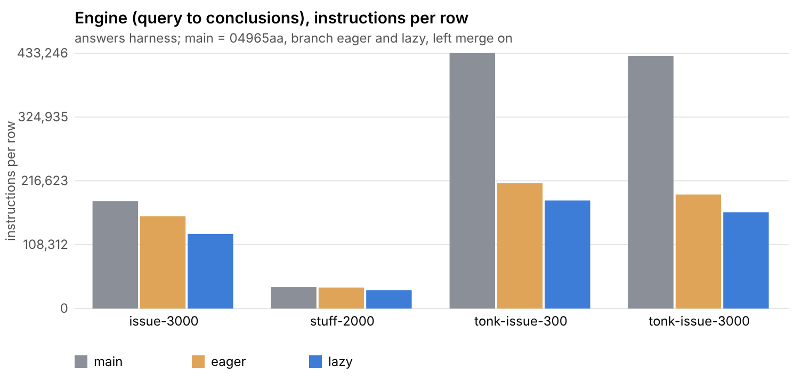
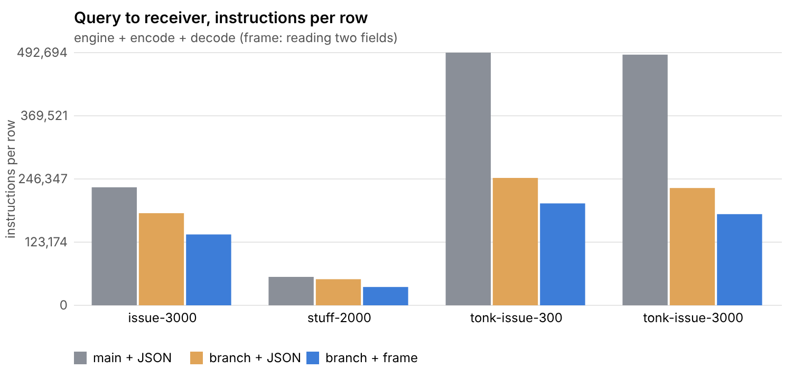
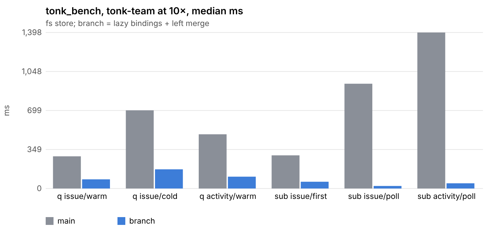

# Zero-copy answers

Status: Evaluating. Its working material is in
[`zero-copy-answers/`](zero-copy-answers/): the
[journal](zero-copy-answers/journal.md) says where the research stands,
the [evaluation](zero-copy-answers/evaluation.md) what decides it, and
the [design](zero-copy-answers/design.md) what the prototype does. See the
[research index](README.md) for what the statuses mean.

## Idea

A leaf stores facts columnar: a node's entities, attributes and values
are front-coded or dictionary-coded once per node. The chronicle goes
further: every token is stored once in the file and a node is a frame
of offsets. The scan keeps part of that. A warm leaf's keys are one
decoded arena (`DecodedKeys`), and a scanned row (`FactView`) is a
handle into it plus the offsets of its components.

The query engine throws that away at the first premise. Every admitted
row is materialized (`FactView::to_owned`): a URI string and an `Arc`
for the entity, a Blake3 hash of the URI to rebuild the entity's key
bytes, a string and an `Arc` for the attribute, and a string for a text
value. Then it is copied again into the claim the row cites, into the
row's bindings, into the conclusion, into tonk's projection
(`Conclusion { this: String, fields: BTreeMap<String, Ipld> }`), and into
JSON. The JSON travels over SSE from the service worker to the page,
where `JSON.parse` builds a JS object graph and `serde_wasm_bindgen`
turns it back into the same Rust structs. Then a template reads a few
fields of each row.

So a value is copied five or six times between the leaf that holds it
once and the DOM that shows it, and most rows are never read by a
premise at all: they are read only so they can be handed on.

Two changes, which compound:

1. **Late materialization in the engine.** A binding the scan makes
   holds the scanned row and which component it is, not an owned value.
   It is materialized only when something asks for the value (a formula,
   a comparison between kinds, a caller reading a `Value`), and the
   answer's encoder reads its bytes straight from the arena.
2. **A binary answer frame, in place of JSON.** Columnar like a leaf:
   per column a lane of token ids, and the distinct tokens once. The
   dictionary belongs to the session, as the chronicle's token log
   belongs to the file: a token sent once (an entity, a status, a
   person's name) is referenced by id in every later frame and delta of
   that subscription. The receiver reads a field in place from the frame
   bytes, so it decodes only what the template reads.

## Question

How much of the cost of answering a query, from the scan to the bytes
the page holds, is materialization and copying, and how much of it do
late materialization and a binary frame take away?

## Hypothesis

Most of it. Per row today: about 16 allocations and 3 KB allocated on
`read-scan`, with about a third of the instructions in the allocator.
The tonk projection and JSON add a comparable cost on top. Late
materialization should remove most of the engine's per-row allocations,
and the frame should cost a fraction of JSON to write and almost nothing
to read.

## Measured against

`main` as it is (`04965aa`), and the branch with each change apart:

- **main:** engine → `Vec<ConceptConclusion>` → tonk's `project` →
  `serde_json` → receiver `serde_json::from_slice` into `Vec<Conclusion>`
  (the path tonk runs, with the browser's `JSON.parse` +
  `serde_wasm_bindgen` stood in for natively);
- **branch, eager bindings, frame:** the engine as main, the frame in
  place of `project` + JSON;
- **branch, lazy bindings, JSON:** late materialization, tonk's path
  after it;
- **branch, lazy bindings, frame:** both.

Lazy bindings are a setting of one build (`DIALOG_LAZY_BINDINGS`), so
every variant runs from the same binary.

## Success

- Engine (query to conclusions), per row: allocations down by half or
  more and instructions down by 25% or more on the scan and the
  eight-field concept, with every existing `dialog-query` test passing.
- The whole path (query to the receiver holding an answer it can read):
  2× or better in instructions and allocations for the eight-field
  concept at 3,000 rows.
- Bytes on the wire: the frame no larger than the JSON; a delta that
  repeats tokens of an earlier frame of the session clearly smaller.

## Failure

- Engine allocations down by less than 25%, or instructions by less than
  10%: late materialization is not worth widening `Match` for.
- The whole path under 1.5×: the copies are not where the cost is, and
  the place to look is the scan or the join.

## The middle

Between those bars, the maintainer weighs the gain against the API it
asks for: a borrowed value type the engine exposes, and a wire format
tonk and its guests must speak.

## Report (2026-11-16)

Built on `worker/beautiful-newton-0d941i`; the
[journal](zero-copy-answers/journal.md) has every run and the
[results](zero-copy-answers/results/2026-11-16/charts.md) every number
behind the charts. Every variant of every dataset answered with the same
bytes (the answer's hash is in each report).

### What was built

1. **Late materialization** (`DIALOG_LAZY_BINDINGS`): a scan binds the
   row it read in place, a shared, once-checked `CheckedRow`, and a value
   is materialized at most once per row, when something reads it as a
   `Value`. `Match::view` and `ConceptConclusion::view` read it without
   materializing.
2. **A join that does not materialize**: the merge join keys rows on the
   scanned entity's bytes (`JoinKey`), and groups of one row combine in
   place.
3. **Left-merged optional fields** (`DIALOG_LEFT_MERGE`): an optional
   field is read once, in entity order, beside the required scans, and
   an entity it lacks binds Absent, where main probed it once per entity.
4. **`dialog-answer`**: a columnar answer frame, its tokens owned by the
   session so a delta carries only what the receiver has not seen, read
   in place in Rust and in JS.

### The answer to the question

The tables below are from the final interleaved sweep, before the
regression work the journal's last entry records (an eager `this`, a
smaller shared row, the scan's kinds decided once); that work moved the
`dialog-perf` scenarios, not these conclusions.

Copying values is not where most of a concept read's time went. On
tonk's own issue concept (thirteen fields, ten optional), main spends
430 K instructions and 446 allocations per row; late materialization
and the byte-keyed join alone (eager, items 1–2 apart from laziness)
take it to 193 K, lazy bindings to 163 K, and the left merge, item 3, is
most of that: a concept with an optional field never merged, so a list
read probed every field of every entity.

| engine, instructions/row | main | eager | lazy |
|---|---|---|---|
| stuff 2,000 | 36,146 | 35,564 | 31,282 |
| issue 3,000 | 182,136 | 156,663 | 126,471 |
| tonk-issue 300 | 433,246 | 212,910 | 183,333 |
| tonk-issue 3,000 | 428,650 | 193,437 | 163,199 |

Allocations per row on tonk-issue 3,000: 446, 184, 71; bytes allocated
per row 391,557, 35,050, 33,165.

From the query to a receiver holding an answer it can read, the
eight- and thirteen-field reads clear the 2× bar; the two-field read
does not (1.5×):

| instructions/row | main + JSON | branch + JSON | branch + frame |
|---|---|---|---|
| stuff 2,000 | 55,365 | 50,990 | 35,728 |
| issue 3,000 | 230,045 | 179,630 | 138,229 |
| tonk-issue 300 | 492,694 | 248,311 | 198,635 |
| tonk-issue 3,000 | 488,721 | 228,736 | 177,727 |

On tonk's workload (`tonk_bench`, tonk-team at 10×, `fs` store):

| ms | main | branch |
|---|---|---|
| query v2/issue, warm | 288 | 82 |
| query v2/issue, cold | 701 | 172 |
| query v2/activity, warm | 486 | 106 |
| subscription v2/issue, first | 297 | 61 |
| subscription v2/issue, poll | 939 | 23 |
| subscription v2/activity, poll | 1,398 | 46 |

### The wire

The frame is 2.1× (two short text fields) to 3.6× (eight fields)
smaller than tonk's JSON, 3.3× on tonk's issue concept, and a delta of 5%
of the rows 7.6× to 13× smaller on the session that sent the snapshot.
Writing it costs 36–40% of `project` + `serde_json`; reading it back
natively costs 3% (two fields) to 10% (every field) of `serde_json`. In a
page (Chromium), reading two fields of a wide row is 10–18× faster than
`JSON.parse`; reading every field is no faster than V8's native parser,
and slower on narrow rows of unique strings (a `TextDecoder` call per
token), before counting the `serde_wasm_bindgen` copy the page makes
today.

### What is open

Closed since the first report (the journal's last two entries): the
`subscribe-repoll`, number-range and `read-scan` regressions, the
commands (noise) and `issue-detail` (a fresh reader reads it cold in the
same time on both). A hydration audit (`trace-hydration`) found where
values were still made for reads that did not need them and removed
them: the list reads, the joins, the scans and the subscription polls
now hydrate nothing from a scanned row, and tonk's JSON can be written
from the rows in place, byte for byte, at a third to a quarter of the
cost of `project` + `serde_json`. Still open:

- **Hydration three designs need**: a lookup's `Selector` takes an owned
  entity and attribute; the recursive fixpoint and the ranked election
  keep owned rows. Removing those is a change to each design.
- **`rule-recursive`** is +0.8% instructions (within the gate): a
  recursive rule's fixpoint keeps owned rows, so its rows bind eagerly
  (the demand travels with the rows). Holding references in the
  fixpoint's rows would take the rest.
- **Bytes**: one shared row per scanned fact and a 16-byte `this` cost
  1–2% more bytes allocated, and 2–7.5% more reallocated growing result
  vectors, in a few scenarios, with up to 54% fewer allocation calls.
  Taken as a trade; the gate's byte checks will flag it.
- A **columnar operator** answered the eight-field read in 40% of the
  engine's time plus encoding. Not built as an operator.
- `unsafe` in `CheckedRow` (an unchecked UTF-8 read of a span validated
  once) is the maintainer's call.

### What to land, and in what order

The left merge is the change to land first: it is most of the gain, it
is small, and it is independent of the rest. The byte-keyed join and the
URI table next. Late materialization pays mostly for a caller that
hands answers on, so it belongs with the frame, after the two gate
regressions are fixed. The frame is worth a design of its own with tonk
(the session lives with the subscription; a JS reader should decode a
frame's text once).
