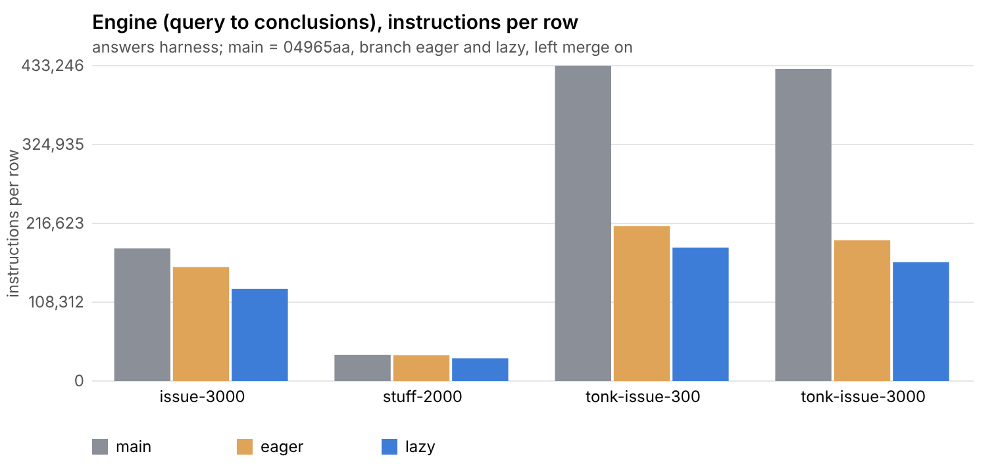
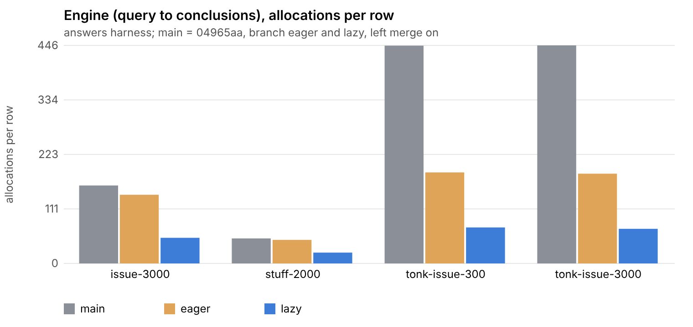
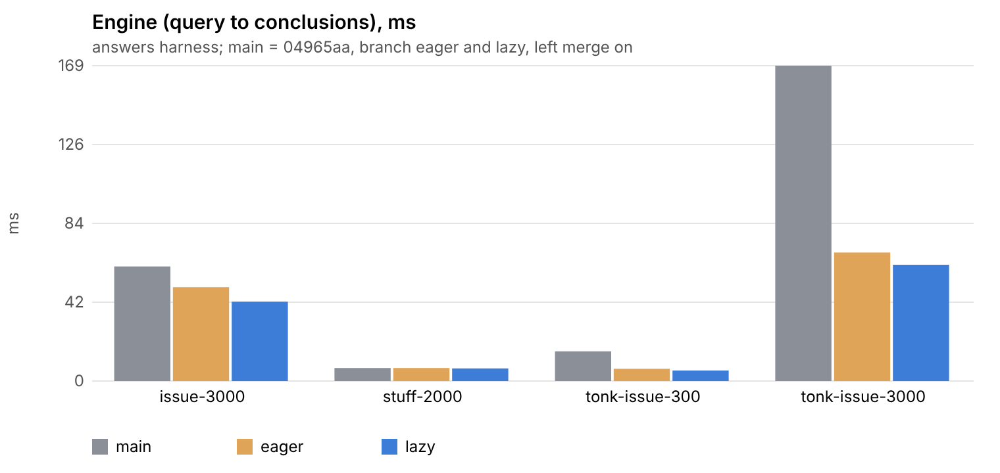
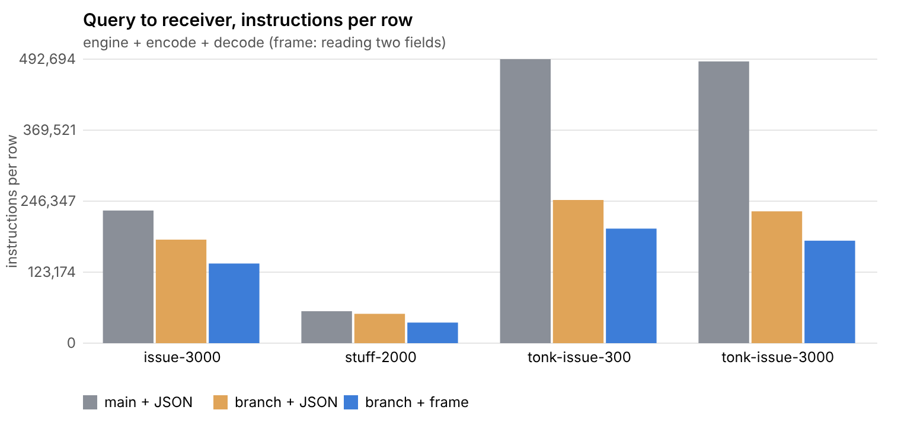
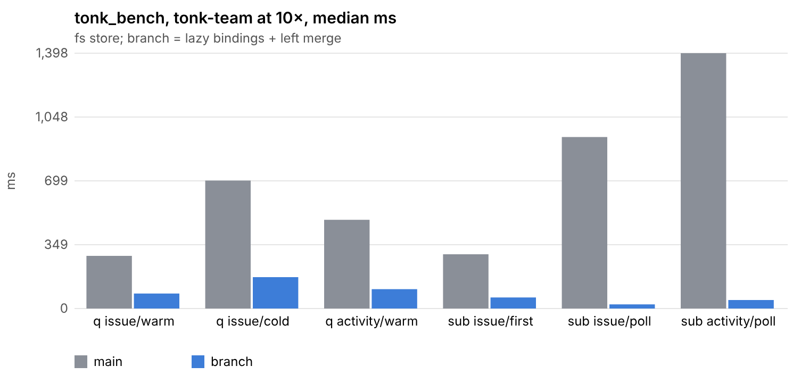

### Engine, instructions per row

| instructions per row | main | eager | lazy |
|---|---|---|---|
| issue-3000 | 182,136.4 | 156,663.0 | 126,471.1 |
| stuff-2000 | 36,146.2 | 35,563.6 | 31,281.7 |
| tonk-issue-300 | 433,246.1 | 212,910.2 | 183,333.1 |
| tonk-issue-3000 | 428,650.4 | 193,436.9 | 163,198.9 |

### Engine, allocations per row

| allocations per row | main | eager | lazy |
|---|---|---|---|
| issue-3000 | 159.3 | 140.3 | 52.3 |
| stuff-2000 | 51.1 | 48.1 | 22.1 |
| tonk-issue-300 | 445.0 | 186.0 | 73.5 |
| tonk-issue-3000 | 445.6 | 183.5 | 70.7 |

### Engine, ms

| ms | main | eager | lazy |
|---|---|---|---|
| issue-3000 | 61.3 | 50.1 | 42.5 |
| stuff-2000 | 7.0 | 7.0 | 6.7 |
| tonk-issue-300 | 15.8 | 6.5 | 5.6 |
| tonk-issue-3000 | 168.6 | 68.8 | 62.2 |

### Query to a receiver holding the answer, instructions per row

| instructions per row | main + JSON | branch + JSON | branch + frame |
|---|---|---|---|
| issue-3000 | 230,044.7 | 179,629.8 | 138,228.9 |
| stuff-2000 | 55,365.4 | 50,990.4 | 35,727.6 |
| tonk-issue-300 | 492,694.3 | 248,311.2 | 198,634.5 |
| tonk-issue-3000 | 488,721.4 | 228,735.8 | 177,727.3 |

### tonk_bench at 10×, ms

| ms | main | branch |
|---|---|---|
| q issue/warm | 288.3 | 82.4 |
| q issue/cold | 700.6 | 171.7 |
| q activity/warm | 485.8 | 106.0 |
| sub issue/first | 297.1 | 60.8 |
| sub issue/poll | 938.7 | 22.8 |
| sub activity/poll | 1,397.6 | 46.4 |
